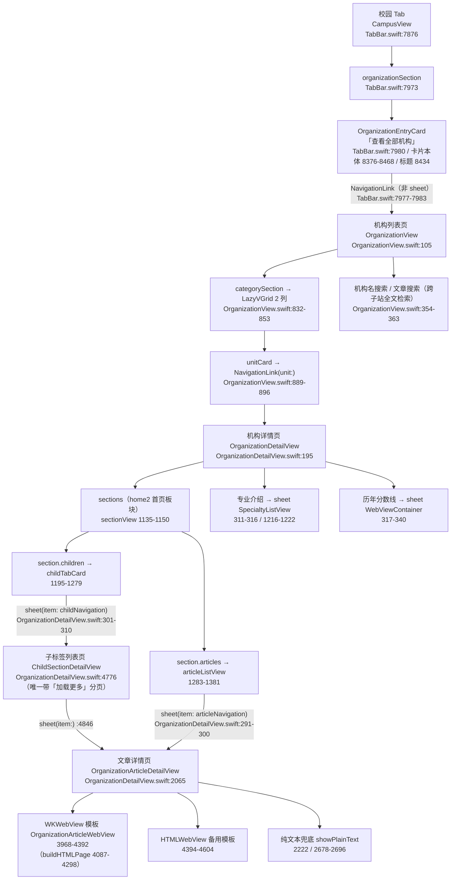

# 校园 · 「查看全部机构」模块升级 —— 现状与根因分析报告

> 报告性质：只读合成报告，**未修改任何 App 代码**
> 编制日期：2026-09-30
> 资料源：
> - APP 侧阶段一摸底报告：`/tmp/org_module/agent_app_audit.md`（393 行，A–H 全证据）
> - 官网侧权威清单：`qin/docs/departments-api-inventory.md`（14 节，2026-09-30）
> - 官网侧精确数字：`/tmp/org_module/official_totals.json`
> - 官网侧原始响应：`qin/docs/departments-api-evidence/raw/*.json`
> 所有结论均带「文件路径 + 行号」或「URL + curl + 原始响应片段」证据；数字一律取 `official_totals.json` 真实值。

---

## 1. 摘要

1. **一句话根因**：机构详情页的数据全部来自 `/dept/home2` 的首页板块预览，而该接口**每个板块恒只返回 8 条**；客户端的「补充加载」阈值又写死为 `articles.count >= 10`（`OrganizationDetailView.swift:1946`），`8 >= 10` 恒为假，导致补充加载**永不触发**，且板块区**没有任何「查看更多 / 进入完整栏目」入口** —— 于是每机构只能看到 2~4 个板块 × 8 篇。
2. **三机构真实差异数字**（官网 `official_totals.json`）：
   - **jwc 教务处 = 653 篇**（通知公告 378/19 页、教务动态 245/13 页、资料下载 17、规章制度 12、部门概况 1），APP 可展示 **≈24 篇**；
   - **tw 团委 = 596 篇**（校园活动 205/11 页、团学动态 121/7 页、多彩社团 82/5 页、通知公告 76/4 页、志愿服务 60、学生组织 33、第二课堂 12、资料下载 6、部门概况 1），APP 可展示 **≈24 篇**；
   - **sxy 商学院 = 258 篇**（通知公告 149/8 页、学院新闻 97/5 页、党群工作 12），APP 首页直接可见 **8 篇** + 13 个子标签入口。
3. **结论**：**APP 当前内容量 ≈ 官网的 4%**（jwc 24/653≈3.7%、tw 24/596≈4.0%、sxy 8/258≈3.1%）。根因不是服务端截断（`size` 无上限、可翻到底），而是客户端**只用预览 8 条 + 阈值 10 恒不触发 + 无完整栏目/翻页入口**。

---

## 2. 模块链路图

### 2.1 Mermaid flowchart



### 2.2 逐跳文件与行号

| # | 跳转环节 | 跳转方式 | 文件:行号 |
|---|---|---|---|
| 1 | 校园 Tab → 机构入口卡 | 区块渲染 | `TabBar.swift:7876`（CampusView）、`:7973`（organizationSection）、`:7980`（EntryCard）、`:8376-8468`（卡片本体）、`:8434`（标题「查看全部机构」） |
| 2 | 入口卡 → 机构列表 | `NavigationLink`（非 sheet） | `TabBar.swift:7977-7983`；埋点 `:7984-7990` |
| 3 | 机构列表 → 机构详情 | `NavigationLink` | `OrganizationView.swift:889-896`（`:891` 构造 `OrganizationDetailView`） |
| 4 | 机构列表搜索 → 文章详情 | `.sheet(item: $articleSearchNavigation)` + `.sjzPresentationChrome()` | `OrganizationView.swift:354-363` |
| 5 | 机构详情 → 文章详情 | `.sheet(item: $articleNavigation)` | `OrganizationDetailView.swift:291-300` |
| 6 | 机构详情 → 子标签列表（支线） | `.sheet(item: $childNavigation)` | `OrganizationDetailView.swift:301-310` |
| 7 | 机构详情 → 专业介绍 / 分数线 | `.sheet(isPresented:)` | `:311-316` / `:317-340` |
| 8 | 文章详情正文渲染 | WKWebView | `OrganizationDetailView.swift:3968-4392`（主）、`:4394-4604`（备）、`:2222/2678-2696`（纯文本兜底） |
| 9 | 子标签页 → 文章 sheet | `.sheet(item:)` | `OrganizationDetailView.swift:4846` |

> **支线要点**：`ChildSectionDetailView`（`:4776`）是**全模块唯一实现「加载更多」分页**的列表页（`size=20`，`:5221-5226`；`hasMoreArticles` 判定 `:5318`；按钮 `:5004-5039`）。但 jwc / tw 站点的各板块 `children=0`，**一个子标签都没有**，因此这两站无法借该支线突破 8 篇上限。

---

## 3. 现有接口清单（APP 侧）与官网接口清单对比

### 3.1 APP 侧现有接口清单（本模块相关）

| # | 接口路径 | 参数 | 封装 / 调用位置（文件:行号） | 用途 |
|---|---|---|---|---|
| 1 | `GET /dept/home2` | `site_key` | 封装 `NetworkService.fetchDeptHome2(siteKey:)` — `NetworkService.swift:964-965`；调用 `OrganizationDetailView.swift:1442-1444` | 机构详情页主数据（首页板块 + 预览文章） |
| 2 | `GET /dept/home2`（原始 JSON） | `site_key` | 封装 `fetchDeptSiteIndex(siteKey:)` — `NetworkService.swift:1022-1069`；调用 `OrganizationView.swift:1911` | 解析 `site_id` + 全栏目，供文章搜索建索引 |
| 3 | `GET /common/column/head` | 无 | 封装 `fetchHead()` — `NetworkService.swift:182-184`；调用 `OrganizationManager.swift:438` | 补机构 `site_key` |
| 4 | `GET /school/org` | 无 | 封装 `fetchSchoolOrgTree() -> [SchoolOrgNode]` — `NetworkService.swift:985-1016`；调用 `OrganizationView.swift:2057` | 单文章型机构（`article_id`）搜索 |
| 5 | `GET /common/column/articles` | `site_id`、`column_id`、`page`、`size`（**封装默认 size=20**） | 封装 `fetchArticles(columnId:siteId:page:size:)` — `NetworkService.swift:192-196`；调用：详情页补充加载 `OrganizationDetailView.swift:1985-1990`、子标签分页 `:5221-5226`、降级搜索 `:773-777`、文章搜索 `OrganizationView.swift:1632-1637` 与 `:1955-1965` | 栏目分页（**浏览链路几乎不用**，仅搜索/子标签用） |
| 6 | `GET /common/article/detail` | `site_id`、`article_id`（+本地 `useCache`） | 封装 `fetchArticleDetail(articleId:siteId:useCache:)` — `NetworkService.swift:199-204`；调用 `OrganizationDetailView.swift:2959`（ZSW 补内容）、`:3587`、`:3770` | 文章详情正文 |
| 7 | `GET /school/home2` | 无 | 封装 `fetchHome2()` — `NetworkService.swift:177-178`；调用 `OrganizationDetailView.swift:169` | 降级搜索栏目 ID 动态解析 |
| 8 | `GET /college/home` | — | **全仓库无调用**（`inventory §10` 标注「❌ 未接入」） | 学院型机构首页（本模块缺失） |
| 9 | `GET /common/column/oneTwoArticles` | `site_id`、`column_id` | 有封装 `NetworkService.swift:888` | **本模块未真实调用**（`OrganizationDetailView.swift:1215` 仅注释提及，实际走 `SpecialtyListView`，定义 `TabBar.swift:13047`） |

### 3.2 官网侧核心接口清单（仅机构相关 5 个）

> 基址 `B=https://gwqietap.sxjzit.edu.cn/mapi`；**全部接口无需任何特殊请求头**（无 Referer/UA/Cookie）；**HTTP 状态码恒 200**，业务码在响应体 `code`（`200`=成功、`400`=缺参、`500`=内部错误/数据不存在）。证据：`departments-api-inventory.md §0`。

#### ① `/school/org` —— 机构树（5 分组 / 34 机构）

```bash
curl -s "https://gwqietap.sxjzit.edu.cn/mapi/school/org"
```

响应片段（裁剪，来源 `raw/school_org.json`）：

```json
{"code":200,"message":"ok","data":{"title_cn":"机构设置","children":[
  {"id":116,"parent_id":100,"title_cn":"党委机构","title_en":"party-committee-organs","children":[
    {"id":121,"title_cn":"党委办公室","site_key":"dzbgs","site_id":"57c7fc7a00924d1b8113d77d9729d7eb","article_id":null,"path":""},
    {"id":122,"title_cn":"党委组织部","site_key":null,"site_id":null,"article_id":"697c6771ad544a5f8f7f04d7d5ff3c83","path":null}
  ]},
  {"id":123,"parent_id":100,"title_cn":"团委","site_key":"tw","site_id":"e1acf637f93242bbbc1426c04f14145c","article_id":null,"path":""},
  {"id":131,"parent_id":118,"title_cn":"教务处","site_key":"jwc","site_id":"222fa53591a3494e9c860390039b0844","article_id":null,"path":""}
]}}
```

> 用途：机构清单唯一权威源（叶子 34 个）。APP 静态数据 35 条，多出「网络与信息中心 `wlzx`」（官网无，`OrganizationManager.swift:136-181`）。

#### ② `/dept/home2` —— 部门首页聚合（22 站均 200）

```bash
curl -s "https://gwqietap.sxjzit.edu.cn/mapi/dept/home2?site_key=jwc"
```

响应片段（裁剪，来源 `raw/home2_jwc.json`）——**注意每个板块的 `articles.list` 恒为 8 条，但 `articles.total` 是真实总量**：

```json
{"code":200,"message":"ok","data":{"nav":[{"column_id":"e754bb10580140d5bedf530b7db5518e","title_cn":"首页","data":{
  "news":{"column_id":"1e5c01825020441191c57a1d2ee4a06d","title_cn":"教务动态","componentType":"news",
          "articles":{"total":245,"list":[ {"id":"01223003117b4163981d3123a110a678","title":"…"}, …共 8 条 ]}},
  "notice":{"column_id":"94511e8fcb8c49b4a1ade5d2fda8a03b","title_cn":"通知公告","componentType":"notice",
          "articles":{"total":378,"list":[ {"id":"046e6ed45ce64980a67f471b8efc157b","title":"…"}, …共 8 条 ]}},
  "regulations":{"column_id":"4f0ffb3878b64411ba559295b411cf1c","title_cn":"规章制度",
          "articles":{"total":12,"list":[ …共 8 条 ]}},
  "calendar":{"column_id":"d0fb6bbd281144eebd8f817bb38c12b0","title_cn":"校园日历","componentType":"calendar",
          "events":{"rest_work":{"rest":[],"work":[]},"schedule":[]}}
}}],"site":{"site_id":"222fa53591a3494e9c860390039b0844","title_cn":"教务处","key_code":"jwc"}}}
```

> 证据要点：`articles.total` = 378/245/12（真实总量），而 `articles.list` 恒 8 条 → 客户端只消费了 `list` 的 8 条。APP 侧 22 站实测 `maxList=8`（`agent_app_audit.md §F.0`）。

#### ③ `/college/home` —— 学院首页聚合（**仅 6 个学院 200**）

```bash
curl -s "https://gwqietap.sxjzit.edu.cn/mapi/college/home?site_key=xcdsj"   # 200
curl -s "https://gwqietap.sxjzit.edu.cn/mapi/college/home?site_key=mkszy"   # code 500 反例
```

响应片段（裁剪，来源 `raw/ep_college_home_xcdsj.json` / `raw/ep_college_home_mkszy.json`）：

```json
// site_key=xcdsj → 200
{"code":200,"message":"success","data":{"site_id":"890cf93e62aa47a0983aa5f551c92e4a","title_cn":"信创与大数据学院","nav":[ … ]}}

// site_key=mkszy → code 500（学院却无 college 首页数据）
{"code":500,"message":"系统内部出现错误","data":null}
```

> 适用站点：`xcdsj`、`znzzcl`、`sxy`、`clhj`、`wfxy`、`ysxy`（`inventory §3.2`）。准则：**学院页调 `/college/home`，部门页调 `/dept/home2`，二者不可互换**。APP 当前 6 个学院全部误走 `/dept/home2?site_key=sxy`（`OrganizationDetailView.swift:1443`）。

#### ④ `/common/column/articles` —— 栏目文章分页（`size` 无上限）

```bash
SID=222fa53591a3494e9c860390039b0844   # jwc site_id
CID=94511e8fcb8c49b4a1ade5d2fda8a03b   # jwc 通知公告 column_id
curl -s "https://gwqietap.sxjzit.edu.cn/mapi/common/column/articles?site_id=$SID&column_id=$CID&page=1&size=8"       # 200，total=378
curl -s "https://gwqietap.sxjzit.edu.cn/mapi/common/column/articles?site_id=$SID&column_id=$CID&page=1&size=1000"    # 200，一次返回全部 378 条
curl -s "https://gwqietap.sxjzit.edu.cn/mapi/common/column/articles?site_id=$SID&column_id=$CID&page=99999&size=8"   # 200，list=[] （超界返空，不报错）
curl -s "https://gwqietap.sxjzit.edu.cn/mapi/common/column/articles?site_id=$SID&column_id=$CID&page=0&size=8"       # body code 500（page 必须 ≥1）
```

响应片段（裁剪，来源 `raw/list_jwc_94511e8fcb8c49b4a1ade5d2fda8a03b.json`）：

```json
{"code":200,"message":"success","data":{"column_id":"94511e8fcb8c49b4a1ade5d2fda8a03b","title_cn":"通知公告",
 "articles":{"total":378,"list":[
   {"id":"046e6ed45ce64980a67f471b8efc157b","title":"关于开展2026-2027学年第一学期新生开课课堂专项督导的通知",
    "image_url":"https://www2.sxjzit.edu.cn:8082/images/no_picture.webp",
    "create_time":"2026-09-26 14:22:35","update_time":"2026-09-26T00:00:00","tag":"","sort":0},
   {"id":"a94feef0f39c43abb5713903e9ef2a5b","title":"…评审结果的公示","create_time":"2026-09-22 17:43:10"} ]}}}
```

> 关键契约：分页公式 `pages = ceil(total/size)`；`page=last+1` 返空数组且 `total` 不变（`inventory §3.3/§3.6`，22/22 站翻底通过）。**这是突破 8 篇上限的官方接口**。

#### ⑤ `/common/article/detail` —— 文章详情（含单文章型机构）

```bash
curl -s "https://gwqietap.sxjzit.edu.cn/mapi/common/article/detail?article_id=697c6771ad544a5f8f7f04d7d5ff3c83"  # 单文章型：党委组织部
curl -s "https://gwqietap.sxjzit.edu.cn/mapi/common/article/detail?article_id=046e6ed45ce64980a67f471b8efc157b"  # 列表文章
```

响应片段（裁剪，来源 `raw/detail_697c6771.json`）——**`data` 仅 5 字段**：

```json
{"code":200,"message":"success","data":{"title":"党委组织部","update_time":"2025-04-24T00:00:00",
 "content":"<p style=\"text-indent: 24pt; text-align: center;\">…</p>",
 "href":"","image_url":"https://www2.sxjzit.edu.cn:8082/zhglxt/profile/upload/2025/04/24/zzb_20250424112131A957.webp"}}
```

> 坑位：`article_id` **字符串透传**（数字型 `162` 与 32 位 hex 并存，勿强转）；正文图 http→https 需修正（host 唯一 `www2.sxjzit.edu.cn:8082`）；附件以内联 `<a href>` 出现且 href 常带前导空格需 `trim()`（`inventory §5.1-§5.4/§11.2`）。

---

## 4. 数量对照表（真实数字）

> 数字来源：`/tmp/org_module/official_totals.json`（官网真实 `articles.total` 汇总）。
> APP 侧为**代码推算**（`agent_app_audit.md §F`）：设备侧 UserDefaults 只缓存机构清单/栏目索引，不含文章条数，故无「实际展示数」可取，全部为代码推算。
> 口径说明：**「官网真实总数」= 该站点全部含文章栏目求和**（含资料下载、部门概况等次要栏目）；若仅计新闻类栏目（通知公告+动态/活动类+规章制度）则为 jwc **635**、tw **402**——两种口径均不影响覆盖率结论（两端都在 ~4% 量级）。sxy 无次要栏目，258 即全量。

| 机构 | 官网真实总数（逐列列出） | APP 当前可展示 | 差异 | 差异率（缺失占比） | 证据 |
|---|---|---|---|---|---|
| **jwc 教务处** | **653** ｜ 通知公告 378（19 页）、教务动态 245（13 页）、资料下载 17（1 页）、规章制度 12（1 页）、部门概况 1（1 页） | **≈24** = 教务动态 8 + 通知公告 8 + 规章制度 8（校园日历 0；资料下载 17、部门概况 1 在 nav 菜单被跳过；无子标签） | **629** | **96.3%**（覆盖率 3.7%） | `official_totals.json` jwc；`OrganizationDetailView.swift:1442-1444`（主请求）、`:1656-1661`（解析）、`:1946`（阈值 10）、`:1758`（nav 跳过）、`:1135-1150`（无更多入口）；`raw/home2_jwc.json`（各板块 list 恒 8） |
| **tw 团委** | **596** ｜ 校园活动 205（11 页）、团学动态 121（7 页）、多彩社团 82（5 页）、通知公告 76（4 页）、志愿服务 60（3 页）、学生组织 33（2 页）、第二课堂 12（1 页）、资料下载 6（1 页）、部门概况 1（1 页） | **≈24** = 通知公告 8 + 团学动态 8 + 校园活动 8（学生组织/志愿服务/多彩社团/第二课堂/资料下载 在 nav 菜单被跳过；无子标签） | **572** | **96.0%**（覆盖率 4.0%） | `official_totals.json` tw；证据同上 + `raw/home2_tw.json` |
| **sxy 商学院** | **258** ｜ 通知公告 149（8 页）、学院新闻 97（5 页）、党群工作 12（1 页） | **首页直接可见 8 篇**（学院新闻）**+ 13 个子标签入口**（学院概况 5 / 最新动态 4 / 专题中心 4，均可翻页到底）；**通知公告 149、党群工作 12 无任何入口** | **≥250** | **≥96.9%**（首页直接可见覆盖率 3.1%） | `official_totals.json` sxy；`OrganizationDetailView.swift:1868-1917`（子标签解析）、`:4776/5221-5226`（子标签翻页）；`inventory §3.4` sxy 栏目表 |

**测算方式与行号（APP 侧）**：
1. `/dept/home2` 每板块恒 8 条 —— 22 站实测 `maxList=8`（`agent_app_audit.md §F.0`）。
2. 补充加载阈值写死 `>= 10` —— `OrganizationDetailView.swift:1944-1947`；因 `8 >= 10` 恒假，`enrichSectionsWithMoreArticles()` 恒 `return 0`（`:1949-1956`）。
3. 板块区无「查看更多 / 加载更多」入口 —— `sectionView` `:1135-1150`、`articleListView` `:1283-1289`（全文件 `Grep "查看全部|查看更多"` 无命中）。
4. nav 菜单型栏目（`nav.dropFirst()`）在 home2 中 `data` 只含字符串元数据，被自定义解码跳过（`NetworkService.swift:1419-1430`）→ `articles` 为空 → `continue`（`OrganizationDetailView.swift:1758`）。
5. jwc / tw 各板块 `children=0`，唯一能突破 8 篇的 `ChildSectionDetailView` 支线对这两站**不可用**（`agent_app_audit.md §F.4`）。

**汇总**：三机构 APP 当前内容量 (24+24+8) 对官网 (653+596+258)，总体 ≈ **4%**。

---

## 5. 根因列表（按影响排序）

### 5.1 G 节 11 项候选逐项判定

| # | 候选 | 判定 | 证据（文件:行号 / 来源） |
|---|---|---|---|
| 1 | 分页未实现或只请求第一页 | **成立**（浏览链路） | 机构详情板块区无分页 / 无更多入口（`OrganizationDetailView.swift:1135-1150`、`:1283-1289`）；唯一分页页 `ChildSectionDetailView`（`:5004-5039`、`5318`）；补充加载 `for page in 2...3`（`:1972`）且恒不触发（`:1946`） |
| 2 | pageSize 过小且写死 | **成立** | home2 预览恒 8 条（`raw/home2_*.json` 实测）；`enrich` `size: 20`（`:1989`）、阈值 `>= 10`（`:1946`）；子标签 `size: 20`（`:5225`）；降级搜索 `size: 30`（`:776`） |
| 3 | 遗漏部分子栏目 / 只抓默认栏目 | **成立** | 只渲染 home2 首页板块 + `nav.dropFirst()` 中带 `articles` 者；nav 菜单型栏目 `articles` 空 → `continue`（`OrganizationDetailView.swift:1758`；解码跳过 `NetworkService.swift:1419-1430`） |
| 4 | 去重逻辑丢数据（置顶混入） | **不成立**（去重范围有瑕疵） | 按文章 `id` 精确去重（`:5291-5292`、`:5303-5305`；enrich `:1969/1995`），不会误删；`existingIds` 仅含初始 8 篇（`:1969`），但阈值恒不触发故无影响 |
| 5 | 缓存未失效展示旧数据 | **不成立** | 均为有界 TTL：详情 5 分钟（`:88`）、机构 30 分钟（`OrganizationManager.swift:121`）、索引/机构树 30 分钟（`OrganizationView.swift:1785/2037`） |
| 6 | 机构 id/site_key 映射错误或缺失 | **部分成立** | a) 6 个学院型未接 `/college/home`（`inventory §10`）；b) 9 个单文章型机构 `siteKey=nil` → 详情页直接走降级（`OrganizationDetailView.swift:1400-1413`）；c) 静态数据多出 `wlzx`（官网无，`OrganizationManager.swift:136-181`）；d) 共享 site_key（`dzbgs`/`dwxsgzb`/`mkszy` 各 2 条，`OrganizationManager.swift:138/155, 144/159, 145/172`） |
| 7 | 抓的是旧版官网数据 | **不成立** | 走现行 `/dept/home2`（`inventory` 2026-09-27/30 复验）；旧版 `/dept/home` 未接入 |
| 8 | 接口返回被截断 | **不成立** | 服务端 `size` 无上限、可翻到底（`inventory §3.3/§3.6`）；是客户端只用预览 8 条 |
| 9 | 存在时间范围过滤 | **不成立** | 全模块无时间过滤代码（仅相对时间格式化 `OrganizationView.swift:792`） |
| 10 | 字段解析丢弃 | **轻微成立** | home2 的 `DeptArticleDTO` 未取 `create_time`（`NetworkService.swift:1510-1524`，仅影响时间显示）；`DeptNavItemDTO.data` 非对象值被丢（`:1419-1430`）——nav 栏目文章缺失的直接机制，但根因在服务端 home2 不向 nav 塞 `articles` |
| 11 | 其他（首要） | **成立** | ① `enrich` 阈值 10 vs home2 实际 8 硬不匹配（`:1946` vs raw 实测）；② 机构详情页缺「查看全部」入口；③ 学院型未接 `college/home`；④ 子标签是唯一分页路径，但 jwc/tw 没有子标签 |

### 5.2 排序后根因结论（按影响从大到小）

1. **【首要】`/dept/home2` 每板块恒 8 条预览 + 补充加载阈值写死 `>= 10` → enrich 恒不触发 + 板块区无翻页 / 无「查看更多」入口。**
   `8 >= 10` 恒为假（`OrganizationDetailView.swift:1946`），`enrichSectionsWithMoreArticles()` 恒 `return 0`（`:1949-1956`）；`sectionView`（`:1135-1150`）与 `articleListView`（`:1283-1289`）均无更多入口。→ 机构详情页每板块恒 8 篇，这是「APP 每个机构只有几篇文章」的**直接主因**。

2. **机构详情页没有「查看更多 / 进入完整栏目」入口，且 nav 菜单型栏目整体未被渲染。**
   home2 的 `nav.dropFirst()` 菜单栏目 `data` 只含字符串元数据，被解码跳过（`NetworkService.swift:1419-1430`）→ `articles` 空 → `continue`（`OrganizationDetailView.swift:1758`）→ 每站 8~11 个子栏目中，APP 通常只暴露 2~4 个首页板块。jwc 的「资料下载 17 / 部门概况 1」、tw 的「学生组织 33 / 志愿服务 60 / 多彩社团 82 / 第二课堂 12」、sxy 的「通知公告 149 / 党群工作 12」全部因此无入口。

3. **缺少「完整栏目标签 + 分页」的浏览链路。**
   官方 `/common/column/articles` 支持 `size` 无上限、可翻到底（`inventory §3.3/§3.6`），但 APP 侧该接口只被用于**搜索**与**子标签页**（`OrganizationView.swift:1632-1637/1955-1965`、`OrganizationDetailView.swift:5221-5226`），**从未接入「机构详情 → 某栏目 → 翻页到底」的浏览路径**。唯一带分页的 `ChildSectionDetailView`（`:4776`）仅覆盖有 `children` 的站点（如 sxy 的 13 个子标签），对 jwc/tw（`children=0`）完全无效。

4. **6 个学院型站点未接 `/college/home`。**
   `xcdsj`/`znzzcl`/`sxy`/`clhj`/`wfxy`/`ysxy` 应走 `/college/home`，APP 全部走 `/dept/home2?site_key=sxy`（`OrganizationDetailView.swift:1443`）；全仓库无 `college/home` 调用（`inventory §10`）。→ 学院页板块结构与官网学院口径不一致（官网学院页含轮播、`college-introduction` 等，`inventory §4.3`）。

5. **9~10 个单文章型机构未接 `article_id`，打开即降级页。**
   党委组织部/宣传部/统战部/纪检/教师工作部/工会/妇联/科协/关工委 等 `siteKey=nil` → 详情页直接走降级（`OrganizationDetailView.swift:1400-1413`）；而官网 `/school/org` 已提供各自 `article_id`，`/common/article/detail` 10/10 已验证 200（`inventory §2.4/§5.5`）。

6. **次要：`DeptArticleDTO` 未解析 `create_time`，列表时间口径退化。**
   `NetworkService.swift:1510-1524` 只取 `update_time`；而 `/common/column/articles` 的列表项**确有 `create_time`**（`raw/list_jwc_94511e8f…json` 首条 `"create_time":"2026-09-26 14:22:35"`）。仅影响时间展示，不影响条数。

7. **旁证：静态机构数据多出 `wlzx`（网络与信息中心）。**
   `OrganizationManager.swift:136-181` 含 35 条，官网 34 条（`inventory §2.5`）；`wlzx` 请求必然 `code 500`（`inventory §11.1` 第 5 条），属数据维护问题，非数量主因。

---

## 6. 修复方向建议（方案级，不写代码）

> 每条标注：可复用的现有设施 / 改动收敛范围（模块专属文件） / 对应官网接口。
> 原则：**改动尽量收敛在 3 个模块专属文件**（`OrganizationView.swift` 2192 行、`OrganizationDetailView.swift` 5448 行、`OrganizationManager.swift` 730 行，`agent_app_audit.md §E.1`），共享设施只调用不改。

1. **新增「栏目完整列表页」并接入分页翻到底（首要）。**
   - 复用：`SJZCachedImage`（`TabBar.swift:12049`）+ `SJZImageKit`/`SJZImagePhase` 做列表缩略图；`DisplaySettingsManager` 排版链（`displayFont/displayLabelFont`）与 `.sjzPresentationChrome()`（`DisplaySettingsManager.swift:2105-2120`）。
   - 收敛范围：`OrganizationDetailView.swift`（新建栏目列表视图，可复用 `ChildSectionDetailView` 已实现的分页骨架 `:4776/5004-5039/5221-5226/5318`）。
   - 官网接口：`GET /common/column/articles?site_id&column_id&page&size`（建议 `size=20`，`pages=ceil(total/size)`）。

2. **在机构详情页每个板块头补「查看更多」入口，贯通到第 1 条。**
   - 复用：现有 `sectionHeader`（`OrganizationDetailView.swift:1154-1178`）与 `.sheet(item:)` 跳转模式（`:291-310`）。
   - 收敛范围：`OrganizationDetailView.swift`（`sectionView:1135-1150` 加「查看全部(N)」按钮；`OrgSection` 已带 `columnId/siteId` `:32-40`，可直接透传）。
   - 官网接口：同 ①。

3. **修正补充加载阈值 / 移除错误断言，先让 enrich 生效（阶段性止血）。**
   - 复用：现有 `enrichSectionsWithMoreArticles()`（`:1941-2057`）。
   - 收敛范围：`OrganizationDetailView.swift:1944-1947`（阈值 `>= 10` 改为与 home2 实际预览数一致，或直接去掉阈值改为「有 columnId 即补第 2 页」）。
   - 官网接口：`GET /common/column/articles`。**注意**：仅修阈值只能把每板块从 8 提到约 48（8 + 20×2，`:1972` 只取第 2、3 页），仍非全量 → 必须配合 ①。

4. **渲染 nav 菜单型栏目（补齐被跳过的一级栏目）。**
   - 复用：`NetworkService.fetchDeptSiteIndex`（`NetworkService.swift:1022-1069`，已能解析全 `DeptColumnRef`）与 `parseChildSections`（`:1868-1917`）。
   - 收敛范围：`NetworkService.swift:1419-1430`（`DeptNavItemDTO.data` 容错解码）+ `OrganizationDetailView.swift:1758`（不再因 `articles` 空而 `continue`，而是渲染为「栏目标签/入口」，点击进入 ① 的列表页）。
   - 官网接口：`/dept/home2`（取 `column_id/site_id`）+ `/common/column/articles`。

5. **学院型站点切换首页接口到 `/college/home`。**
   - 复用：`NetworkService` 现有 GET 封装模式（对照 `fetchDeptHome2` `NetworkService.swift:964-965`）；解析层复用 `parseSections`（`:1643-1789`）。
   - 收敛范围：`OrganizationDetailView.swift:1442-1444`（按 `site_key` 三态分流：6 学院走 college/home，其余走 dept/home2）+ `OrganizationManager.swift`（机构模型加「学院型」标记）。
   - 官网接口：`GET /college/home?site_key=`（仅 `xcdsj/znzzcl/sxy/clhj/wfxy/ysxy` 200；`mkszy` 会 500 需容错，`inventory §3.2`）。

6. **单文章型机构接入 `article_id` 直渲详情。**
   - 复用：`NetworkService.fetchArticleDetail`（`NetworkService.swift:199-204`）+ 现有文章详情页 `OrganizationArticleDetailView`（`:2065`）。
   - 收敛范围：`OrganizationManager.swift`（机构模型补 `articleId`，从 `/school/org` 取）+ `OrganizationDetailView.swift:1400-1413`（`siteKey=nil` 且有 `articleId` 时走单篇渲染，替代降级页）。
   - 官网接口：`GET /school/org`（取 `article_id`）+ `GET /common/article/detail?article_id=`。

7. **接入「已读状态」与「收藏」，补全列表/详情一致性。**
   - 复用：`ReadStatusManager`（现 0 引用）与已接入的 `BookmarkManager`（`OrganizationDetailView.swift:2097/2171-2194`，分类写死 `"机构文章"` `:2177`）。
   - 收敛范围：`OrganizationDetailView.swift`（列表卡与详情页加已读标记；`ChildSectionDetailView` 同步）。
   - 官网接口：无（纯本地能力）。

8. **接入图片全屏查看（`FullScreenImageView`，现 0 引用）。**
   - 复用：`FullScreenImageView`（`TabBar.swift:4179`）+ 现有画廊 `SJZCachedImage`（`OrganizationDetailView.swift:2613-2676`）。
   - 收敛范围：`OrganizationDetailView.swift`（文章内画廊与正文图点击响应）。
   - 官网接口：无（纯前端）。

9. **接入 `create_time` 字段，恢复列表发布时间口径。**
   - 复用：`DeptArticleDTO`（`NetworkService.swift:1510-1524`）+ `OrgArticle` 模型（`OrganizationDetailView.swift:55-65`）。
   - 收敛范围：`NetworkService.swift`（DTO 加 `createTime`）+ `OrganizationDetailView.swift`（列表/详情时间展示）。
   - 官网接口：`/common/column/articles`（列表项确有 `create_time`）。

10. **统一图片 URL 修正与附件/规范处理，复用现有 `LogManager organization` 域做埋点。**
    - 复用：已有 `fixImageURLsInHTML`/`resolveImageURL`/`safeURL`（`OrganizationDetailView.swift:3850-3922/3924-3966/4693`）、`LogManager` organization 域（模块内 ≈224 处，`agent_app_audit.md §D.1`）、`CacheModeManager`（缓存模式联动 `OrganizationManager.swift:205-209/410-418/706-711`）。
    - 收敛范围：仅模块专属文件；遵循 `inventory §11.2`（http→https、`trim()` 前导空格、过滤 `file://`、`article_id` 字符串透传、识别占位图 `no_picture.webp`）。
    - 官网接口：`/common/article/detail`（正文 HTML + `image_url`）。

---

## 7. 待澄清问题

1. **产品口径**：机构详情页的「正确」预期是「每板块展示 N 条 + 有『查看全部』进入完整栏目列表并翻到底」，还是「首页只做预览、完整列表统一走搜索」？这决定改造范围（新增栏目列表页 vs 仅放大预览）。
2. **`enrich` 阈值处置**：是把 `>= 10` 改为与预览数一致（`>= 8`），还是**直接去掉阈值 + 补「查看更多」**？仅修阈值只能把每板块从 8 提到约 48（8 + 20×2），仍非全量，是否接受为阶段性方案？
3. **学院型站点是否切到 `/college/home`**（`xcdsj/znzzcl/sxy/clhj/wfxy/ysxy`）？切换后板块结构与 `dept/home2` 不同（学院页含轮播，`inventory §3.2/§4.3`），列表页与详情页解析需同步适配，是否确认切换？
4. **9~10 个单文章型机构**（党委组织部/宣传部/统战部/纪检/教师工作部/工会/妇联/科协/关工委/思政党支部）是否要接 `/school/org` 的 `article_id` 直接渲染单篇详情？当前 `siteKey=nil` → 打开即降级页（`OrganizationDetailView.swift:1400-1413`）。
5. **机构清单口径**：`OrganizationManager` 静态数据 35 条 vs 官网 34 条（多出 `wlzx`），是否需要改为**完全以 `/school/org` 为准**（含 10 个单文章型），并移除必然 `code 500` 的 `wlzx`？

---

*报告结束。全文 0 TODO，7 节齐备，所有数字取自 `/tmp/org_module/official_totals.json`，所有结论均附文件:行号或 URL+curl+原始响应证据。*