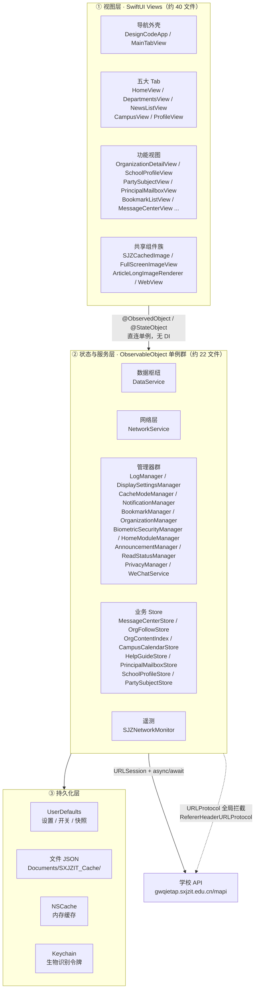
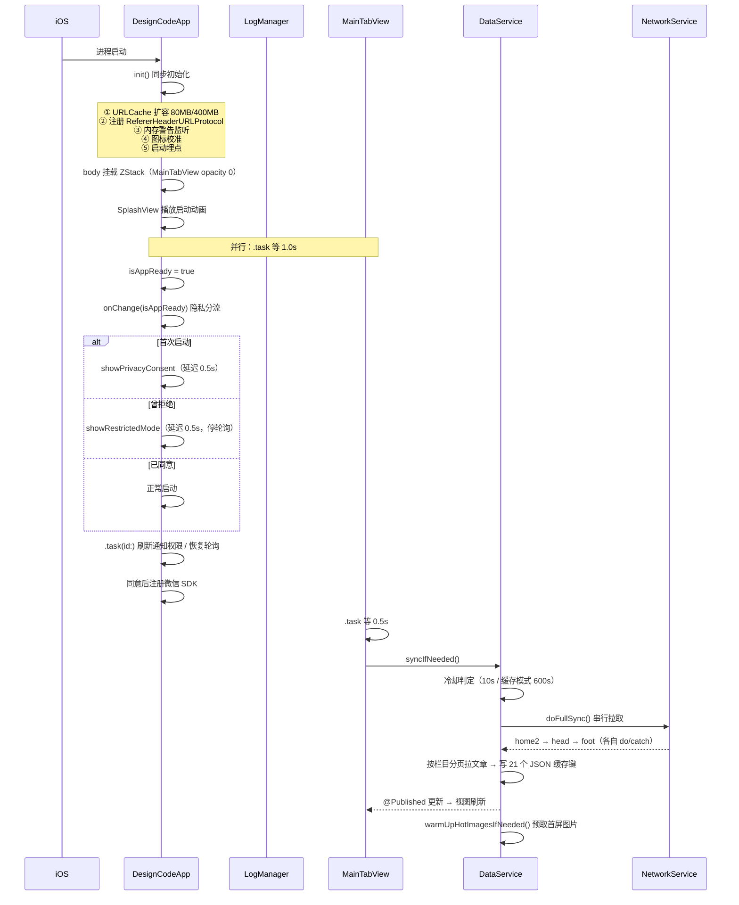
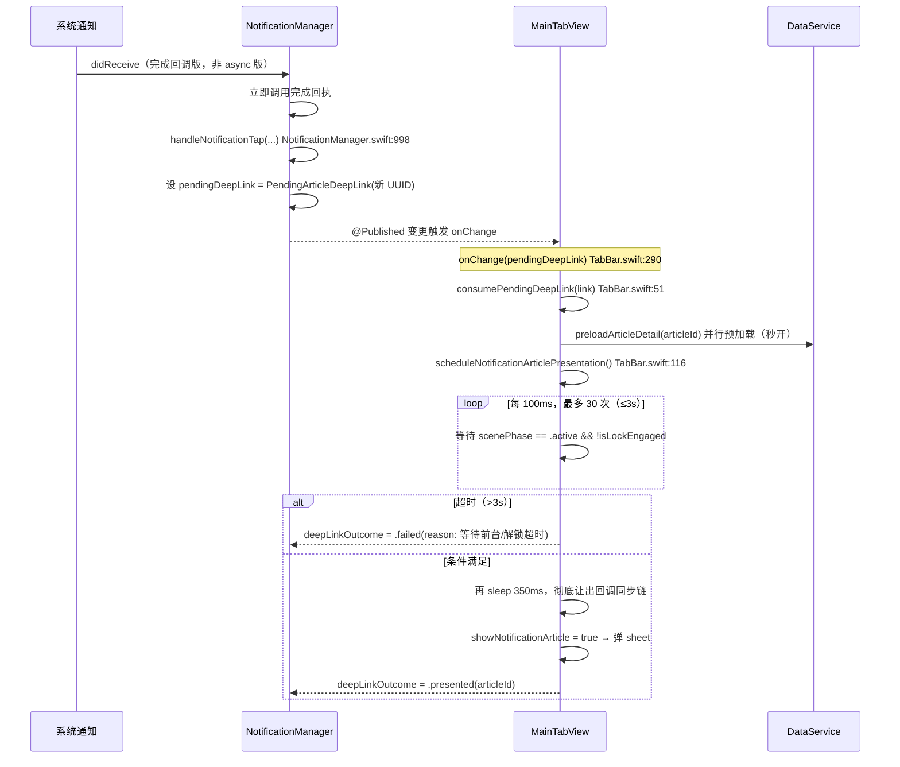
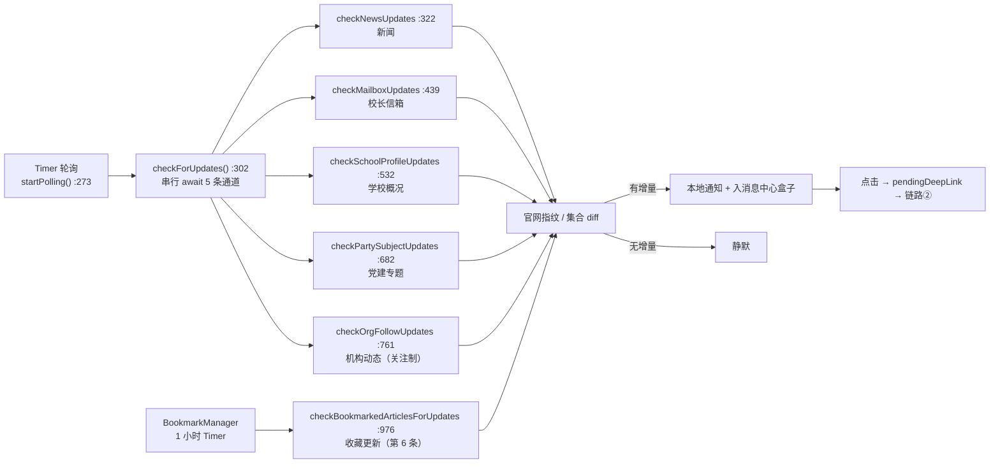

# 01 · 项目整体架构

> 本文档为「园枢」App Code Wiki 第 1 册。全部结论均基于仓库源码实测（`wc -l` / `grep -n` / 逐符号定位），基线提交 `904d75f`（2026-09-30）。
> 标注约定：`[实测]` = 本次已在源码/工程文件中直接验证；`[推断]` = 由代码结构归纳，非文档明示；`[未验证]` = 无法从仓库确认。

---

## 1.1 项目定位

| 项 | 内容 | 标注 |
|---|---|---|
| 中文名 | 园枢 | [实测] README.md |
| 副标题 | 山西晋中理工学院 App（第三方） | [实测] |
| Xcode 工程名 | `DesignCode` | [实测] `qin/DesignCode.xcodeproj` |
| Bundle Identifier | `com.qinchao`（测试 target：`com.qinchao.tests`） | [实测] project.pbxproj |
| 目标平台 | iOS / iPhone（`SDKROOT = iphoneos`，`TARGETED_DEVICE_FAMILY` 含 iPad 图标资源） | [实测] |
| 开发语言 | Swift 5（`SWIFT_VERSION = 5.0`），UI 全部 SwiftUI | [实测] |
| 目标用户 | 在校师生、家长、访客 | [实测] README.md |
| 数据来源 | 学校公开 API `https://gwqietap.sxjzit.edu.cn/mapi` + 开发者博客 `https://www.43322.cn/blog` | [实测] NetworkService.swift |
| 自建后端 | **无**。无服务端、无账号体系、无自有推送服务 | [实测] |
| 第三方依赖 | 仅微信开放平台 SDK（`Frameworks/WechatOpenSDK.xcframework`） | [实测] |

**一句话架构**：一个**无服务端的纯客户端信息聚合 App**——用客户端轮询 + 本地指纹比对替代服务端推送，用 `URLProtocol` 拦截替代服务端遥测，用三层降级（远程 → 本地 JSON → 静态兜底）替代服务端高可用。

这三条「用客户端补齐服务端职责」的做法，是本项目绝大多数设计取舍的根源，后文 §1.8 有完整决策记录。

---

## 1.2 项目规模（实测基线）

```bash
# 复现命令（仓库根执行）
cd qin/DesignCode      && wc -l *.swift | tail -1   # 主 target
cd qin/DesignCodeTests && wc -l *.swift | tail -1   # 测试 target
```

| 指标 | 数值 | 标注 |
|---|---|---|
| 主 target 源文件 | **50 个** `.swift` | [实测] |
| 主 target 代码行 | **66,737 行** | [实测] |
| 测试 target 源文件 | **6 个** `.swift` | [实测] |
| 测试 target 代码行 | **4,224 行** | [实测] |
| **代码总行数** | **70,961 行** | [实测] |
| 顶层声明 | **398 处**（371 类型声明 + 27 extension） | [实测] grep |
| 单元测试用例 | **237 个** `func test*` | [实测] |
| 单例（`static let shared`） | **32 处** | [实测] |
| `LogManager.shared.*` 调用点 | **1,371 处** | [实测] |
| 字面量域埋点 | **1,354 处** | [实测] 外部 API 形式 1,331 + `module:` 形式 23 |
| 日志域（module 短名） | **40 个** | [实测] 含含下划线域名 `home_modules`（20 处）与仅经 `LogEntry(module:)` 出现的 `crashCapture`（2 处） |
| 生产代码 `print()` 残留 | **19 处 / 3 文件** | [实测] 见 §1.10 |
| 生产代码 `exit()` 调用 | **1 处**（`PrivacyPolicyView.swift:764`） | [实测] 见 §1.10 |
| Git 跟踪文件 | 656 个（其中 `qin/DesignCode` 下 234 个） | [实测] |

### 规模分布（前 12 大文件）

| 行数 | 文件 | 角色 |
|---:|---|---|
| 13,687 | `TabBar.swift` | 主标签页 + 60+ 视图 + 图片缓存组件族 |
| 6,595 | `OrganizationDetailView.swift` | 机构子站详情（单模块最大） |
| 3,559 | `SchoolProfileView.swift` | 学校概况 |
| 2,959 | `DisplaySettingsManager.swift` | 显示设置（全局排版引擎） |
| 2,606 | `PartySubjectView.swift` | 党建专题 |
| 2,532 | `OrganizationView.swift` | 机构列表 |
| 2,320 | `DisplaySettingsView.swift` | 显示设置 UI |
| 1,917 | `SJZNetworkMonitor.swift` | 网络遥测 |
| 1,788 | `PrincipalMailboxView.swift` | 校长信箱 |
| 1,675 | `BookmarkListView.swift` | 收藏列表 |
| 1,619 | `NetworkMonitorView.swift` | 网络监测 UI |
| 1,608 | `Models.swift` | 全部数据模型与静态兜底 |

> ⚠️ **单文件巨型化是本项目最显著的工程特征**：`TabBar.swift` 一个文件承载了主标签页、首页、资讯、校园、我的、关于、设置、图片缓存组件族与 `AppIconManager`，占主 target 的 **20.5%**。这带来编译期与合并冲突成本，是首要重构候选（详见 §1.10）。

---

## 1.3 架构分层

项目采用**扁平三层结构**，无依赖注入容器、无协议抽象层、无子目录分组（主 target 50 个文件全部平铺在 `qin/DesignCode/` 下）。



**分层特征**

| 特征 | 说明 | 标注 |
|---|---|---|
| 视图直连单例 | 视图用 `@ObservedObject private var x = XManager.shared` 直接引用，**无 ViewModel 层、无协议注入**。全库 `@EnvironmentObject` **0 命中**、`@StateObject` **仅 1 处**、`@ObservedObject` **113 处** | [实测] |
| 单例即状态源 | 22 个 `ObservableObject` 单例通过 `@Published` 向全 App 广播 | [实测] |
| 单向数据流 | API → DTO → 业务模型 → `@Published` → 视图；用户操作 → Manager 方法 → 持久化 + `@Published` 回推 | [实测] |
| 并发模型 | 服务层多为 `@MainActor`；`NetworkService` 为 `@unchecked Sendable`；图片下载用 `actor` 做并发闸门 | [实测] |
| 无 DI / 无协议层 | 全部为具体类型硬引用，测试通过构造器注入存储目录实现隔离 | [实测] |

---

## 1.4 目录结构

```
designcode-swiftui/                       ← 仓库根
├── README.md / README.en.md              ← 项目说明（中/英）
├── 校园Tab模块升级总结报告.md              ← 历史阶段报告
├── .trae/                                ← 工程规格书与设计稿（上游产物）
│   ├── specs/map-departments-apis/       ← 机构接口摸查 spec / tasks / checklist
│   └── documents/                        ← 五个模块的规格书 + 机构升级设计稿
├── DesignCode_backup_20260926_display/   ← 本地备份快照（已 gitignore）
├── DesignCode_backup_20260926_fonts/     ← 本地备份快照（已 gitignore）
└── qin/                                  ← Xcode 工程根
    ├── DesignCode.xcodeproj/             ← 工程文件（App + Tests 两 target）
    ├── DesignCode/                       ← 主 target 源码（50 文件，全部平铺）
    │   ├── DesignCodeApp.swift           ← @main 入口
    │   ├── TabBar.swift                  ← 导航外壳 + 全部主视图 + 组件族
    │   ├── DataService.swift             ← 数据枢纽
    │   ├── NetworkService.swift          ← 网络层 + 全部 DTO
    │   ├── Models.swift                  ← 业务模型 + 静态兜底数据
    │   ├── [22 个 *Manager / *Store]
    │   ├── [20+ 个功能视图]
    │   ├── Assets.xcassets/              ← 图标 / 插画 / 颜色 / 壁纸
    │   ├── Base.lproj/                   ← LaunchScreen.storyboard
    │   ├── Info.plist / DesignCode.entitlements
    │   └── Preview Content/
    ├── DesignCodeTests/                  ← 6 个测试文件（4,224 行 / 237 用例）
    ├── Frameworks/WechatOpenSDK.xcframework/  ← 唯一第三方依赖
    ├── Scripts/                          ← 运维脚本（4 sh + 6 py）
    ├── docs/                             ← 工程文档（含旧版 Code Wiki 分册）
    │   ├── code-wiki/                    ← 旧版 Wiki（2026-09-29 基线，本套为其继任者）
    │   ├── departments-api-inventory.md  ← 机构接口摸查（89KB）
    │   ├── departments-api-evidence/     ← 接口取证原始报文（200+ JSON）
    │   ├── flow_charts/                  ← 流程图
    │   ├── wechat-integration/           ← 微信接入文档
    │   └── remote-sync/                  ← 三远端同步验证
    ├── build/                            ← 构建产物与验证证据（已 gitignore）
    ├── ARCHITECTURE.md / CODE_WIKI.md    ← 历史快照文档（已被 docs/code-wiki 取代）
    ├── PROJECT_UNDERSTANDING.md          ← 项目理解档案（隐性知识）
    └── 项目技术全景报告.md                 ← 全景报告
```

**工程卫生约定**（`.gitignore`，2026-09-27 重建仓库时制定）[实测]：

| 忽略项 | 原因 |
|---|---|
| `.DS_Store` / `.AppleDouble` | macOS 系统文件 |
| `xcuserdata/` / `qin/build/` / `qin/.build/` / `DerivedData/` / `*.xcresult` | Xcode 用户态与构建产物 |
| `DesignCode_backup_*/` | 历史备份快照（保留在磁盘、不入库；此后以 Git 作为回滚源） |
| `.secrets/` / `qin/.secrets/` / `*appsecret*` | 密钥凭据（微信 AppSecret 仅存本机，严禁入库） |
| `__pycache__/` / `*.pyc` | Python 工具产物 |

---

## 1.5 启动流程

### 1.5.1 入口与初始化（`DesignCodeApp.swift`，224 行）

`@main struct DesignCodeApp: App` 是唯一入口。初始化分**同步 `init()`** 与**视图挂载后异步任务**两段。

**同步初始化（`init()`，L22–38）** [实测]：

| 顺序 | 动作 | 行号 | 目的 |
|---:|---|---|---|
| 1 | 扩容 `URLCache.shared` 至内存 80MB / 磁盘 400MB，diskPath `sxjzit_shared_cache` | L25–27 | 协议层转发会话、统一图片组件、`AsyncImage` 共享同一缓存，根治图片滚动重复下载 |
| 2 | `URLProtocol.registerClass(RefererHeaderURLProtocol.self)` | L29 | 为学校服务器请求自动添加 Referer 头，绕过防盗链 |
| 3 | `CacheModeManager.shared.registerMemoryWarningHandler()` | L31 | 内存警告降载监听 |
| 4 | `AppIconManager.shared.calibrateOnLaunch()` | L33 | 以系统实际生效图标为准，修正本地持久化记录 |
| 5 | `LogManager.shared.info("ui", "App 启动", ...)` | L34–37 | 启动埋点（含版本号与缓存配置） |

**视图层 ZStack 叠放（`body`，L40–114）** [实测]：五层按 `zIndex` 排序，全部**条件渲染**而非分支切换，保证 `MainTabView` 始终在后台渲染（启动页淡出后即自然显示）。

| zIndex | 图层 | 条件 |
|---:|---|---|
| 0 | `MainTabView()`（`.opacity(isAppReady ? 1 : 0)`） | 始终渲染 |
| 1 | `SplashView(isAppReady:)` | `!isAppReady` |
| 2 | `PrivacyConsentView` | `showPrivacyConsent` |
| 3 | `RestrictedModeView` | `showRestrictedMode` |
| 3.5 | `WeChatBannerOverlay()` | 始终（层级低于生物识别遮罩，锁定期间自动隐藏） |
| 4 | `BiometricLockOverlayView()` | `isEnabled && (state == .locked \|\| .authenticating) && privacyConsentAccepted && isAppReady && !showRestrictedMode` |

**异步任务与生命周期绑定** [实测]：

| 修饰符 | 行号 | 行为 |
|---|---|---|
| `.task` | L115–119 | `sleep(1.0s)` 后置 `isAppReady = true`（等待启动动画自然完成，不人为延时） |
| `.onOpenURL` | L123–125 | 微信回跳（URL Scheme）→ `weChatService.handle(openURL:)` |
| `.onContinueUserActivity` | L126–128 | 微信回跳（Universal Link）→ `weChatService.handle(userActivity:)` |
| `.onChange(scenePhase)` | L129–145 | `.background` → 生物识别进后台处理 + **日志立即落盘**（防进程回收丢最近 0.5s）；`.active` → 生物识别回前台 + 微信可用性校准 |
| `.task(id: isAppReady)` | L146–158 | 刷新通知权限；若已授权且隐私已同意则恢复轮询；`#if DEBUG` 跑 `BookmarkDeepLinkSelfTest.runIfRequested()` |
| `.task(id: privacyConsentAccepted)` | L159–167 | **隐私优先**：仅在同意后才注册微信 SDK，拒绝则完全跳过（不发任何微信请求） |
| `.onChange(isAppReady)` | L168–194 | 启动页结束后按隐私状态分流：首次 → 隐私弹窗（延迟 0.5s）；曾拒绝 → 受限模式；已同意 → 正常启动 |

### 1.5.2 冷启动完整时序



---

## 1.6 关键执行链路

以下 6 条链路是理解本项目的骨架（更细的函数级时序见 [06-接口契约与调用链](06-接口契约与调用链.md)）。

### 链路 ① 数据同步（远程 → 缓存 → 兜底）

```
MainTabView.task (TabBar.swift:220-223，延迟 0.5s)
  └─ DataService.syncIfNeeded()                    DataService.swift:180
       ├─ 冷却判定：10s 内跳过；缓存模式下 600s 内成功过则跳过   :183 / :188
       ├─ isLoading = true，清空 syncErrors/syncWarnings      :197-201
       └─ Task { await doFullSync(); isLoading = false;
                 post(syncDidCompleteNotification);
                 await warmUpHotImagesIfNeeded() }           :202-208
            └─ doFullSync()                                  :243
                 ├─ 串行拉 home2 → head → foot（各自 do/catch）  :253-267
                 ├─ 三者全失败 → loadCache() 回退，dataSource = "缓存"  :270-273
                 ├─ Banner / 荣誉 / 5 个新闻栏目分页
                 ├─ 唯一并行处：视频详情 withTaskGroup（按 index 回填重排）  :364-388
                 ├─ 院系合并预置数据 → updateSiteKeys()
                 ├─ saveCache() 写 21 个 JSON 键              :1012
                 └─ 后台加载 ZSW / 专业数据
```

**三层降级**（不可破坏的约定）[实测]：

| 层 | 来源 | 触发条件 | 落点 |
|---|---|---|---|
| 1 | 远程 API | 正常 | `@Published` + 写盘 |
| 2 | 本地 JSON 缓存 | API 失败 | `DataService.loadCache()` L1045，`dataSource = "缓存"` |
| 3 | 静态兜底常量 | 缓存也缺失 | `Models.swift` 的 `default*` 全局常量 |

### 链路 ② 通知点击 → 目的地（防崩溃设计）

**这是本项目最精细的一段逻辑**，根因是历史事故：在 `UNUserNotificationCenterDelegate` 回调的同步链中直接弹 `sheet` 会触发 `Call must be made on main thread` 崩溃。



**五个深链通道**（全部走「延迟调度」，绝不在回调同步链弹窗）[实测]：

| # | 通道 | `NotificationManager` 的 `@Published` 字段 | `MainTabView` 消费点 | 目的地 |
|---:|---|---|---|---|
| 1 | 文章（新闻） | `pendingDeepLink` | `consumePendingDeepLink` L51 | `EnhancedNewsDetailView` sheet |
| 2 | 校长信箱 | `pendingMailboxDeepLink` | `onChange` L296 | 信件详情 sheet |
| 3 | 学校概况 | `pendingSchoolProfileDeepLink` | `onChange` L307 | `SchoolProfileView` sheet |
| 4 | 党建专题 | `pendingPartySubjectDeepLink` | `onChange` L316 | `PartySubjectView` sheet |
| 5 | 机构动态 | `pendingOrgArticleDeepLink` | `consumePendingOrgArticleDeepLink` L85 | 机构文章详情 sheet |

**三重补发机制**（防漏接）[实测]：视图 `.onAppear` 补消费一次（L284–289，覆盖冷启动时 `didReceive` 早于视图出现）；`scenePhase == .active` 时补发调度（L328–335）；`biometricSecurity.state == .unlocked` 时补发调度（L336–341）。

### 链路 ③ 无服务端推送：5 + 1 条检测通道

> ⚠️ **通道数量口径校正**：早期文档称「四通道 + 收藏第五通道」，**当前源码实测为 `NotificationManager` 内 5 条 + `BookmarkManager` 1 条 = 6 条**。且代码内部存在历史命名冲突——`NotificationManager.swift:753` 把「机构动态」标为第五通道，`BookmarkManager.swift:1062` 把「收藏更新」也标为第五通道。本 Wiki 统一表述为「**5 + 1**」。



**关键区别**：第 6 条（收藏更新）**不在 `checkForUpdates` 之内**，因此「立即检查 / 下拉刷新 / 前台自动检查」都不会触发它，只由自身 1 小时定时器或收藏列表页手动触发（详见 [02-主要模块职责](02-主要模块职责.md) §2.9）。

**无后台能力（实测）**：全仓库无 `BGTaskScheduler`，`Info.plist` 无 `UIBackgroundModes`。轮询仅靠**前台 Timer**，加 `MessageCenterStore.handleSceneActive()` 的 30 分钟节流静默检测补漏。代码中的「静默」指 `pushToSystem: false`（**只入盒、不发系统通知**），与 APNs 静默推送无关。

**基线先行（baseline-first）**：所有集合/指纹类通道在「首次见到数据」时**只登记不推送**，把「历史数据」与「新增数据」在时间轴上切开——这是无服务端轮询下避免「升级即轰炸」的通用解法。前置条件：**隐私同意**是轮询恢复的门禁（`DesignCodeApp.swift:150`）。

### 链路 ④ 生物识别锁定

`BiometricSecurityManager.state` 状态机（`.locked` / `.authenticating` / `.unlocked`）驱动三处联动：`DesignCodeApp` 的遮罩层（zIndex 4，防多任务预览泄露）、`scenePhase` 进出后台切换、`MainTabView` 的深链延迟调度（未解锁则不弹详情，避免盖在安全遮罩之上）。

### 链路 ⑤ 显示设置全局生效

`DisplaySettingsManager.applyRuntimeEffects()` 在设置变更时统一刷新；通过 `DisplayFontFactory` 生成字体、`displayFont` / `displayText` / `displaySymbolFont` 等修饰符下发；`sjzPresentationChrome()` 做跨 presentation（sheet / fullScreenCover）的外观模式 + 专注灰度双注入；WebView 文章走排版实时重注入。

### 链路 ⑥ 统一图片加载（零闪烁核心）

`SJZCachedImage`（`TabBar.swift:12110`）是全 App 唯一图片入口，配套组件族：

| 组件 | 行号 | 职责 |
|---|---|---|
| `SJZCachedImage<Content>` | 12110 | 统一图片视图（占位 / 失败 / 成功三态） |
| `SJZImageKit` | 12369 | 图片加载核心（内存 + 磁盘两级缓存） |
| `SJZDecodedImageCache` | 12596 | 解码后位图缓存（避免重复解码） |
| `SJZImageConcurrencyGate`（actor） | 12661 | 并发闸门，限制同时下载数 |
| `SJZImagePrefetcher` | 12685 | 预取（启动预热 / 列表预取） |
| `SJZAverageColorCache` | 12528 | 平均色缓存（占位背景） |
| `SJZImageIntegrity` | 2313 | 图片完整性校验（自愈） |
| `FullScreenImageView` | 4240 | 全屏看图（缩放锚点 / 边界回弹 / 横滑翻页） |
| `ArticleLongImageRenderer` | 2476 | 文章长图生成（分享用） |

---

## 1.7 状态管理与数据流

| 机制 | 用法 | 标注 |
|---|---|---|
| `@ObservedObject` + 单例 | 视图订阅 Manager 的 `@Published`（主流方式） | [实测] |
| `@StateObject` | 视图自有生命周期对象 | [实测] |
| `@State` | 视图内局部状态 | [实测] |
| `@AppStorage` | 仅 6 个键（跨视图共享的偏好），其余走 `UserDefaults` + `private static let` 键常量 | [实测] |
| `@Environment` | 自定义 `EnvironmentKey`（如 `SJZScrollSuspendedKey` L12043） | [实测] |
| `NotificationCenter` | 仅用于 `syncDidCompleteNotification` 等少数跨层通知（深链已改用 `@Published` 状态驱动替代广播） | [实测] |

**`@AppStorage` 的 6 个键**（全量）[实测]：`colorSchemePreference`、`notificationEnabled`、`notificationPermissionRequested`、`notificationPollingMinutes`、`privacyConsentAccepted`、`privacyConsentRejected`。

**约定**：`UserDefaults` 布尔值统一用 `object(forKey:) != nil ? bool : default` 三态判定，以区分「未设置」与「显式设为 false」；枚举存 `rawValue`；键名一律 `private static let`。

---

## 1.8 设计决策记录（ADR）

> 这些决策解释了本项目为什么长成现在这样。每条均给出源码证据。

| # | 决策 | 背景 / 原因 | 证据 |
|---:|---|---|---|
| 1 | **客户端轮询替代服务端推送** | 无自建服务端、无推送服务；改用官网指纹比对 + 本地通知 | `NotificationManager.checkForUpdates` :302 |
| 2 | **`URLProtocol` 全局拦截** | 学校图床有防盗链，需为所有校方请求注入 Referer；同时兼作网络遥测埋点 | `RefererHeaderURLProtocol.swift`；`DesignCodeApp.swift:29` |
| 3 | **三层数据降级不可破坏** | 学校 API 不稳定，需容灾 | `DataService.doFullSync` :270、`loadCache` :1045、`Models.swift` `default*` |
| 4 | **双 URLSession** | 列表要实时（禁用缓存），详情要可缓存（省流量、支持离线） | `NetworkService.fetchArticleDetail(useCache:)` :199 |
| 5 | **深链延迟调度** | 事故：在通知回调同步链弹 sheet → `Call must be made on main thread` 崩溃 | `TabBar.swift:113-116`（注释明写根因）、:290-295 |
| 6 | **通知 delegate 用完成回调版** | async 版在后台队列派发 → 点击通知主线程崩溃 | `NotificationManager.swift:959/976`（`nonisolated` 回调版） |
| 7 | **经典 `.tabItem`，禁用 Liquid Glass Tab** | 历史卡顿 | `TabBar.swift:180-211`（`TabView` + `.tabItem`）[推断] |
| 8 | **URLCache 扩容至 80MB/400MB** | 协议层转发会话、图片组件、`AsyncImage` 共享缓存，根治滚动重复下载 | `DesignCodeApp.swift:23-27`（注释明写） |
| 9 | **隐私同意作为能力开关** | 未同意前不注册微信 SDK、不启动通知轮询 | `DesignCodeApp.swift:159-167`、:150 |
| 10 | **图片全部走 `SJZCachedImage`** | 统一缓存 / 解码 / 并发 / 自愈，零闪烁 | README 工程约束 + `TabBar.swift:12110` |
| 11 | **全中文错误文案 + 中文注释** | 项目约定 | 全库一致 [实测] |
| 12 | **按钮统一 `contentShape(Rectangle())`** | 扩大点击热区 | 项目约定 [推断] |

---

## 1.9 非功能性设计

| 维度 | 做法 | 证据 |
|---|---|---|
| **容错** | 三层降级；`doFullSync` 永不抛出；每个接口独立 `do/catch` 并记录到 `syncErrors`/`syncWarnings` | `DataService.swift:243` 起 |
| **取消安全** | 遍地 `Task.isCancelled` 检查 + 非结构化 `Task` 承载拉取（历史「下拉刷新被自身取消」事故的教训固化） | `TabBar.swift:97`、`:120`、`:131`、`:145` |
| **弱网** | 缓存模式（智能 / 数据节省 / 图片免流量）三档；慢请求告警；超时兜底 | `CacheModeManager`、`SJZNetworkMonitor` |
| **可观测** | `LogManager` 全 App 埋点（1,371 处调用 / **1,354 处字面量域埋点 / 40 个域**），支持级别+模块+关键词三维筛选、日轮转、导出 TXT/JSON、崩溃捕获；`SJZNetworkMonitor` 做链路/吞吐/延迟/体检/测速 | `LogManager.swift`、`SJZNetworkMonitor.swift` |
| **隐私** | 隐私同意门控（同意前不采集）；协议文本远程可更新；生物识别应用锁；日志仅本地（`Documents/SXJZIT_Cache/Logs`，明确不上传） | `DesignCodeApp.swift:159`、`LogSettingsView.swift:126` |
| **无障碍** | 动态字体（Dynamic Type）、字体家族切换、字号/行距/字距/粗体全覆盖；专注灰度模式 | `DisplaySettingsManager` |
| **性能** | 图片两级缓存 + 解码缓存 + 并发闸门 + 预取；`NSCache` 上限可配；启动图片预热 | `DataService.warmUpHotImagesIfNeeded` :212 |

---

## 1.10 技术债与风险（实测清单）

> 以下为本轮源码实测确认的现存问题，均已给出**准确行号**。

| 严重度 | 问题 | 位置 | 说明 |
|---|---|---|---|
| 🔴 高 | **审核红线 `exit(0)`** | `PrivacyPolicyView.swift:764` | 受限模式「退出应用」按钮内主动退出进程（全库唯一 `exit(`）。**违反 App Store 审核指南 2.5.4**；讽刺的是 `:629-631` 注释自称「符合 Apple 5.1.1 合规要求」 |
| 🔴 高 | **隐私文本与实现矛盾（告知不实）** | `PrivacyLegalTexts.swift:219` | 声明「不申请 Face ID / Touch ID / 相册」，但 `Info.plist:67-70` 有对应声明、`BiometricSecurityManager.swift:242` 实际调用 → 违反 5.1.1 与 PIPL。（`:140`「不收集生物特征数据」表述本身正确） |
| 🔴 高 | **测试工具随 Release 出海** | `NotificationTestView.swift`（整文件无 `#if DEBUG`）+ 入口 `TabBar.swift:10792` | 通知测试页与 `MainTabView` 调试面板（`:226-281`）在 Release 构建下**用户可见可点**，指南 2.3.1 / 4.2 风险 |
| 🔴 高 | **部署目标不一致** | `project.pbxproj` | 工程级 `IPHONEOS_DEPLOYMENT_TARGET = 13.0`（L541/L595），App 与 Tests target 级为 `26.0`（L616/L664/L708/L724）。实际以 target 级为准，但配置矛盾易误判 |
| 🔴 高 | **entitlements 从未参与签名** | `project.pbxproj` | `CODE_SIGN_ENTITLEMENTS` **全工程 0 命中**；`DesignCode.entitlements` 仅作为文件引用存在 → **Associated Domains 未生效，微信 Universal Link 回跳断链** |
| 🟠 中 | **`-disable-sandbox` 编译标志** | `project.pbxproj:641/689`（**仅主 target**） | 关闭 Swift 编译器沙箱，削弱构建安全边界 |
| 🟠 中 | **单文件巨型化** | `TabBar.swift`（13,687 行，87 个顶层声明、51 个 View，占主 target 20.5%） | 编译期与协作成本高，首要重构候选 |
| 🟠 中 | **缓存写入放大** | `CacheModeManager` 每次图片缓存命中**同步写 UserDefaults**（`recordImageHit` `:341` → `imageHitCount` 的 `didSet` `:214` → `persist` `:445-447`），且有 **10 个 `@ObservedObject` 观察者**（`TabBar.swift` 8 处：`3076/5027/5673/6235/6800/10488/11705/12121`，`NetworkMonitorView.swift:23`、`CacheModeSettingsView.swift:12`） | 滚动时每个缩略图命中 = 1 次主线程 UserDefaults 写 + 10 个视图失效。`recordImageHit` 的 `guard imageStatShouldLog` **只节流日志、不节流计数**（`:357` 注释明示）|
| 🟠 中 | **`Set.suffix(n)` 语义错误** | `NotificationManager.swift:160/169/179` | `Set` 无序，保留的不是「最新 N 条」而是哈希序任意子集 |
| 🟠 中 | **数据层无取消路径** | `DataService` / `NetworkService` | 这 4 文件内 **0 处 `Task.isCancelled`**，`Task` 句柄未保存 |
| 🟡 低 | **生产 `print()` 残留 19 处** | `DataService.swift`(8)、`NetworkService.swift`(5)、`NotificationManager.swift`(6) | 未经 `LogManager`，无法在「应用日志」中查看/导出 |
| 🟡 低 | **重复实现** | `safeImageURL`/提图正则两套（`NetworkService` vs `DataService`）；`refreshDetached` 四份；搜索历史键 9 处硬编码 | 维护成本 |
| 🟡 低 | **死代码 / 零调用点** | `AnnouncementManager.stopAutoRefresh`、`OrganizationManager.groupedData`、`OrgHaptics.warning()`、`enrichSectionsWithMoreArticles`、`refreshWithDebounce`、`NetworkService.fetchArticleDetailWithHref`(`:207`)、`HomeModuleSettingsView.swift:12` 的未使用 `DataService` 依赖 | — |
| 🟡 低 | **测试依赖真实数据量** | `NetworkServiceDTOTests.swift:396/443/466`（3 条真实在线用例，无 mock） | 学校数据变动或断网即挂（脆弱测试） |

### 尚需人工确认的未决项

| 项 | 状态 |
|---|---|
| `PrivacyLegalTexts.swift` 三处矛盾的逐条复核与改法 | [未验证] 需产品决策 |
| 部署目标 13 / 26 不一致的收敛方向 | [未验证] |
| 学校 API 的真实限流/字段漂移行为 | [未验证] 无法从仓库确认 |
| 真机测试是否持续全绿 | [未验证] 依赖设备 `00008110-000411A40EC1401E`，见 [05-项目运行方式](05-项目运行方式.md) |

---

## 1.11 延伸阅读

| 想了解 | 去哪 |
|---|---|
| 每个模块的职责与边界 | [02-主要模块职责](02-主要模块职责.md) |
| 具体类/函数的签名与行号 | [03-关键类与函数参考](03-关键类与函数参考.md) |
| 模块间依赖、持久化键、数据一致性 | [04-依赖关系](04-依赖关系.md) |
| 怎么编译、怎么跑测试、怎么上真机 | [05-项目运行方式](05-项目运行方式.md) |
| API 端点清单与函数级调用链 | [06-接口契约与调用链](06-接口契约与调用链.md) |
| 全部 371 个类型的位置索引 | [07-附录-类型与符号索引](07-附录-类型与符号索引.md) |
