# 03 · 关键类与函数参考

> **本册定位**：Code Wiki 第 3 册，**LLD 层参考手册**（不是教程）。目标是「拿到一个符号名 → 立刻定位文件、行号、真实签名与行为边界」。
>
> **基线提交**：`6fc702e`（2026-10-04；首版 `904d75f` → `215ea30`，本轮新增 3.7.8 阅读时光小节）。源码根为 `qin/DesignCode/`（56 个 `.swift`）。
>
> **行号口径**：
> - 全部行号为 **1-based**，来自 `grep -n` / `read` 实测（本册撰写时逐条核对，未核对者标 `[未验证]`）。
> - `wc -l` 与 `read` 报告值可能相差 1（部分文件末行无换行符），引用时以 `grep -n` / `read` 为准。
> - 引用格式统一为 `文件.swift:行号`，区间写作 `A-B`。跨文件引用写 `文件.swift:A`。
> - 草稿中标注为「未验证」的结论在本册沿用 `[未验证]` 记号，**不因转抄而升级为已验证**。
>
> **如何检索本册**：
> 1. **知道符号名** → 直接看 [3.11 符号检索速查](#311-符号检索速查)（40+ 条「想找 X → 去哪一行」）。
> 2. **知道模块** → 用下方目录跳到对应小节；每小节的第一个表都是「类型 / 行号 / 职责」三列。
> 3. **只知道行为**（如「重试几次」「缓存几个键」） → 查 [3.10 非平凡算法伪代码集](#310-非平凡算法伪代码集)。
> 4. **需要全量符号清单** → 见同目录 [07-附录-类型与符号索引](07-附录-类型与符号索引.md)（本册只收录「有行为、有契约、有坑」的符号）。
>
> **与既有文档的关系**：本册大量引用 `01-项目整体架构`、`02-主要模块职责` 的结论；若本册与 01/02 口径冲突，以本册的**实测行号**为准，并在对应小节标注差异。

---

## 目录

- [3.1 核心类关系图](#31-核心类关系图)
- [3.2 数据与网络核心](#32-数据与网络核心)
  - [3.2.1 NetworkService](#321-networkservice)
  - [3.2.2 DataService](#322-dataservice)
  - [3.2.3 Models](#323-models)
  - [3.2.4 RefererHeaderURLProtocol](#324-refererheaderurlprotocol)
- [3.3 可观测性](#33-可观测性)
  - [3.3.1 LogManager](#331-logmanager)
  - [3.3.2 SJZNetworkMonitor](#332-sjznetworkmonitor)
  - [3.3.3 日志域总表](#333-日志域总表)
- [3.4 显示与缓存](#34-显示与缓存)
  - [3.4.1 DisplaySettingsManager](#341-displaysettingsmanager)
  - [3.4.2 CacheModeManager](#342-cachemodemanager)
- [3.5 通知与消息](#35-通知与消息)
  - [3.5.1 NotificationManager](#351-notificationmanager)
  - [3.5.2 MessageCenterStore](#352-messagecenterstore)
  - [3.5.3 BookmarkManager](#353-bookmarkmanager)
  - [3.5.4 ReadStatusManager / AnnouncementManager](#354-readstatusmanager--announcementmanager)
- [3.6 机构模块](#36-机构模块)
- [3.7 内容型 Store](#37-内容型-store)
- [3.8 设置类与系统能力](#38-设置类与系统能力)
- [3.9 共享组件族](#39-共享组件族)
- [3.10 非平凡算法伪代码集](#310-非平凡算法伪代码集)
- [3.11 符号检索速查](#311-符号检索速查)
- [3.12 延伸阅读](#312-延伸阅读)

---

## 3.1 核心类关系图

### 3.1.1 三层依赖总览（视图层 → 单例服务层 → 持久化层）

```mermaid
graph TD
    subgraph V["视图层 · View / ViewModifier"]
        App["DesignCodeApp<br/>DesignCodeApp.swift:10"]
        Tab["MainTabView<br/>TabBar.swift:15"]
        Settings["SettingsView<br/>TabBar.swift:10478"]
        Detail["EnhancedNewsDetailView<br/>TabBar.swift:3044"]
        Profile["ProfileView<br/>TabBar.swift:9852"]
        OrgV["OrganizationView<br/>OrganizationView.swift:105"]
        OrgD["OrganizationDetailView<br/>OrganizationDetailView.swift:198"]
        SchoolP["SchoolProfileView<br/>SchoolProfileView.swift:855"]
        Party["PartySubjectView<br/>PartySubjectView.swift:498"]
        Mailbox["PrincipalMailboxView<br/>PrincipalMailboxView.swift:284"]
        Calendar["CampusCalendarView<br/>CampusCalendarView.swift:21"]
        Help["HelpGuideView<br/>HelpGuideView.swift:14"]
        SetViews["LogListView:27 · NetworkMonitorView:21<br/>BookmarkListView:16 · MessageCenterView:15<br/>DisplaySettingsView:16 · CacheModeSettingsView:11<br/>BiometricSettingsView:10 · NotificationTestView:14"]
    end

    subgraph S["单例服务层 · static let shared（@MainActor 为主）"]
        Data["DataService SINGLETON<br/>DataService.swift:9-10"]
        Net["NetworkService SINGLETON<br/>NetworkService.swift:44-45<br/>@unchecked Sendable（非 MainActor）"]
        NSvc["NotificationManager SINGLETON<br/>NotificationManager.swift:105"]
        MC["MessageCenterStore SINGLETON<br/>MessageCenterStore.swift:132"]
        BM["BookmarkManager SINGLETON<br/>BookmarkManager.swift:123"]
        RS["ReadStatusManager SINGLETON<br/>ReadStatusManager.swift:17"]
        AM["AnnouncementManager SINGLETON<br/>AnnouncementManager.swift:26"]
        OrgM["OrganizationManager SINGLETON<br/>OrganizationManager.swift:96"]
        Follow["OrgFollowStore SINGLETON<br/>OrgFollowStore.swift:39"]
        Disp["DisplaySettingsManager SINGLETON<br/>DisplaySettingsManager.swift:569"]
        Cache["CacheModeManager SINGLETON<br/>CacheModeManager.swift:161"]
        Log["LogManager SINGLETON<br/>LogManager.swift:271"]
        Mon["SJZNetworkMonitor SINGLETON<br/>SJZNetworkMonitor.swift:340"]
        Bio["BiometricSecurityManager SINGLETON<br/>BiometricSecurityManager.swift:146"]
        WX["WeChatService SINGLETON<br/>WeChatService.swift:639"]
        Priv["PrivacyManager SINGLETON<br/>PrivacyManager.swift:90"]
        Home["HomeModuleManager SINGLETON<br/>HomeModuleManager.swift:124"]
        ProfS["SchoolProfileStore SINGLETON<br/>SchoolProfileView.swift:175"]
        PartyS["PartySubjectStore SINGLETON<br/>PartySubjectView.swift:59"]
        MailS["PrincipalMailboxStore SINGLETON<br/>PrincipalMailboxView.swift:23"]
        CalS["CampusCalendarStore SINGLETON<br/>CampusCalendarStore.swift:17"]
        HelpS["HelpGuideStore SINGLETON<br/>HelpGuideStore.swift:24"]
        Img["SJZDecodedImageCache/SJZImageKit<br/>TabBar.swift:12596 / 12369"]
        Icon["AppIconManager SINGLETON<br/>TabBar.swift:13403"]
        RR["ReadingReportStore SINGLETON<br/>ReadingReportStore.swift:71"]
        RG["ReadingGoalStore SINGLETON<br/>ReadingGoalStore.swift:24"]
        HE["HapticEngine SINGLETON<br/>HapticEngine.swift:15"]
    end

    subgraph P["持久化层"]
        UD["UserDefaults<br/>（键见各小节表）"]
        FS["Documents/SXJZIT_Cache/*.json<br/>DataService.swift:157,1008"]
        FSMC["Documents/MessageCenter/<br/>messageCenterEvents.json<br/>MessageCenterStore.swift:195"]
        FSB["Documents/SXJZIT_Cache/Bookmarks/<br/>bookmarks.json + BookmarkImages/<br/>BookmarkManager.swift:247-249"]
        LOG["Documents/SXJZIT_Cache/Logs/<br/>log_yyyy-MM-dd.json<br/>LogManager.swift:405,889"]
        KC["Keychain<br/>BiometricKeychain<br/>BiometricSecurityManager.swift:501"]
        URC["URLCache<br/>Shared + article_detail_cache<br/>DesignCodeApp.swift:25 / NetworkService.swift:66"]
    end

    App --> Tab
    Tab --> Settings & Detail & Profile & OrgV & SchoolP & Party & Mailbox & Calendar & Help
    OrgV --> OrgD
    Settings --> SetViews

    Tab -. "@ObservedObject .shared" .-> Data & MC & Bio & NSvc & Home
    Tab -.-> RR
    Profile -.-> RR & RG
    RG -.-> HE
    OrgD -.-> OrgM & Follow & RS
    SetViews -.-> Log & Mon & BM & Disp & Cache & Img
    Help --> HelpS

    Data --> Net
    Data --> Cache
    Data --> OrgM
    NSvc --> Net & MC
    MC --> NSvc
    BM --> Net & MC
    AM --> Net
    OrgM --> Net
    OrgD --> Net
    SchoolP --> Net
    PartyS --> Net
    MailS --> Net
    CalS --> Net

    Net --> RefP["RefererHeaderURLProtocol<br/>RefererHeaderURLProtocol.swift:18"]
    RefP -. nonisolated 读镜像 .-> Cache
    RefP -. tap* 埋点（非隔离） .-> Mon
    Net -. await 主线程日志 .-> Log
    FS -.-> Data
    FSMC -.-> MC
    FSB -.-> BM
    LOG -.-> Log
    KC -.-> Bio
    URC -.-> Img
    Net -.-> URC

    classDef single fill:#fff4d6,stroke:#8F7038,stroke-width:2px
    class Data,Net,NSvc,MC,BM,RS,AM,OrgM,Follow,Disp,Cache,Log,Mon,Bio,WX,Priv,Home,ProfS,PartyS,MailS,CalS,HelpS,Icon,RR,RG,HE single
```



**图例与要点**

| 事实 | 证据 |
|---|---|
| **黄色节点全部是单例**（`static let shared`），全项目 **0 处 `@EnvironmentObject`**、视图侧 **0 处 `@StateObject` 引用管理器**（一律 `@ObservedObject … .shared`；全库仅 2 处 `@StateObject` 且均为视图自有对象：`LogFilterCache`、`WebViewControl`） | `TabBar.swift` 内 `@ObservedObject`×56、`@StateObject`×0；全仓 `@EnvironmentObject`×0 |
| **服务层没有「互相持有」**：全部经 `static let shared` 单向调用解耦；唯一双向关系是 `NotificationManager ↔ MessageCenterStore`（`ingest` 下行 / `silentCheckNow`+`launch` 上行），但不构成循环强引用 | `NotificationManager.swift:408`、`MessageCenterStore.swift:576`、`MessageCenterStore.swift:685` |
| **`NetworkService` 是唯一非 `@MainActor` 的服务**（`@unchecked Sendable`），也是唯一被「全层」依赖的叶子 | `NetworkService.swift:44` |
| **`RefererHeaderURLProtocol` 是唯一「反向注入」点**：它不依赖 `NetworkService`，但被每个自建 `URLSession` 显式注册（`protocolClasses`），并向 `CacheModeManager`（读镜像）与 `SJZNetworkMonitor`（埋点）横向取数 | `NetworkService.swift:59/71`；`RefererHeaderURLProtocol.swift:74-79/85-88` |
| **持久化层有 6 个互不相干的域**（沙盒 JSON / 消息中心 JSON / 收藏目录 / 日志目录 / Keychain / URLCache），**没有统一失效链路**：`DataService.clearCache()` 只管自己的 JSON，**既不删 URLCache 也不清 NSCache** | `DataService.swift:1083-1119` |

### 3.1.2 三条「横切链」（不体现在上图的调用关系）

| 链 | 入口 | 途经 | 终点 |
|---|---|---|---|
| **排版链** | `DisplaySettingsManager.shared` | `.displayTypography()`（`DesignCodeApp.swift:121`）写入 6 个 `EnvironmentKey`；`displayFont` / `displayText` / `displaySymbolFont` / `displayLabelFont` 读取 | 全部视图文本；构建期由 `Scripts/display_coverage_guard.py` 强制 |
| **呈现链** | `DisplaySettingsManager.shared` | `.sjzPresentationChrome()`（定义 `DisplaySettingsManager.swift:2118`）逐 sheet/fullScreenCover 挂载 `.preferredColorScheme` + `.saturation` | 67 处调用点 / 13 个视图文件 |
| **可观测链** | `LogManager.shared`（`@MainActor`） | 每处 `LogManager.shared.info/debugLog/warning/error/fatal` | 42 个生产日志域（[3.3.3](#333-日志域总表)）；`SJZNetworkMonitor` 另有 `tap*` 非隔离埋点旁路 |

---

## 3.2 数据与网络核心

### 3.2.1 NetworkService

**位置**：`NetworkService.swift`（1748 行 `wc -l` / read 报 1749）。**全项目唯一非 `@MainActor` 的服务**。

#### 类型与并发标注

| 类型 | 行号 | 职责 |
|---|---|---|
| `enum NetworkConfig` | 10-15 | 4 个编译期常量（网关地址、超时、重试上限） |
| `enum NetworkError: LocalizedError` | 19-40 | 7 个 case 的统一错误域 |
| `final class NetworkService: @unchecked Sendable` | 44 | 无状态服务；`static let shared`（45）、`private init()`（51-75） |
| `extension NetworkService` | 450-1524 | **52 个解码用类型**（45 个 `*DTO` + `APIResponse<T>` + `AnyCodable` + 6 个私信 DTO + `SchoolMsgDetailDTO`） |
| `static let campusCalendarColumnId` | 441 | 全项目**唯一被正式定义为常量的栏目 ID** |

> `@unchecked Sendable` 的实质：编译器跳过检查，正确性由作者保证。`URLSession` 线程安全；**`JSONDecoder`（97/145）被所有并发请求共用，未承诺线程安全** —— 这是本文件最典型的「未验证并发假设」。[未验证]

#### 配置常量（`NetworkConfig`，10-15）

| 常量 | 值 | 用途 |
|---|---|---|
| `baseURL` | `https://gwqietap.sxjzit.edu.cn/mapi` | 唯一网关前缀（`buildURL` 392 拼接） |
| `requestTimeout` | `15 s` | 同时用于 config（53/63）与每个 `URLRequest.timeoutInterval`（88/136/249/302/1027） |
| `resourceTimeout` | `30 s` | `timeoutIntervalForResource`（54/64） |
| `maxRetries` | `2` | 语义是「**额外**重试次数」→ 总尝试 **3** 次（`for attempt in 0...maxRetries`） |

#### 双 URLSession 对照表（本层最重要的设计决策）

| 维度 | `session`（列表/实时） | `cachedSession`（详情/可缓存） | 行号 |
|---|---|---|---|
| Config 基类 | `URLSessionConfiguration.default` | 同 | 52 / 62 |
| `timeoutIntervalForRequest` | 15 s | 15 s | 53 / 63 |
| `timeoutIntervalForResource` | 30 s | 30 s | 54 / 64 |
| **`requestCachePolicy`** | **`.reloadIgnoringLocalAndRemoteCacheData`** | **`.useProtocolCachePolicy`** | **55 / 65** |
| `urlCache` | 未指定 → 继承 `URLCache.shared` | 专属 `URLCache(memory 10 MB, disk 50 MB, diskPath: "article_detail_cache")` | — / **66-69** |
| `waitsForConnectivity` | `false` | `false` | 56 / 70 |
| `protocolClasses` | `[RefererHeaderURLProtocol.self]` | 同 | **59 / 71** |

**为什么必须两个会话**：
1. **列表必须实时** —— 首页/栏目的 `home2`/`head`/`foot`/`column/articles` 走 `get()` → `session`，「忽略本地与远端缓存」保证下拉刷新一定回源。
2. **详情值钱且更新少** —— 正文体积大、变更频率低，`cachedSession` 用 `.useProtocolCachePolicy` 尊重服务端 `Cache-Control`，独立 URLCache 避免与列表互相污染。
3. **默认值体现取舍** —— `fetchArticleDetail(useCache:)` 默认 `false`（199）：**「实时是默认语义，缓存需显式 opt-in」**。
4. **显式注册协议类，不依赖全局时序**（注释 57-58）—— App.init 属性初始化早于 init 体，`URLProtocol.registerClass` 会漏注册，历史上导致埋点恒为 0。

#### 核心方法签名表

**基础设施**

| 方法 | 行号 | 说明 |
|---|---|---|
| `func get<T: Decodable>(_ path: String, params: [String: String]? = nil, as type: T.Type) async throws -> T` | 79-126 | 主 GET 通道：buildURL → 请求 → `session.data(for:)` → `validate` → 计时 → 成功日志 → `decoder.decode`。`URLError.cancelled` 立即抛出（不重试、不记 ERROR）；兜底 `throw lastError ?? NetworkError.timeout` |
| `func post<T: Decodable>(_ path: String, body: [String: Any]? = nil, as type: T.Type) async throws -> T` | **128-176** | **通用 POST（2026-10-01 新增）**：JSON body（`Content-Type: application/json`）；重试/取消语义与 `get` 完全一致（HTTP 恒 200 时业务码在 body，交由调用方判断） |
| `private func getWithSession<T: Decodable>(_ path: String, params: [String: String]? = nil, as type: T.Type, session: URLSession) async throws -> T` | 178-224 | 与 `get` **逐行同构**，唯一差别是会话可注入；日志文案带「(缓存策略)」后缀。存在意义就是让 `fetchArticleDetail` 能切会话 |
| `private func getRaw(_ path: String) async throws -> Data` | 297-306 | 单次原始 GET（**无重试**、无解码），仍走 `session` + `validate` |
| `private func getRawData(path: String, params: [String: String]?) async throws -> Data` | 350-359 | `getRaw` 的带参通用化（同样无重试） |
| `func fetchJSONDict(path: String) async throws -> [String: Any]` | 336-338 | 转调带参版（params: nil） |
| `func fetchJSONDict(path: String, params: [String: String]?) async throws -> [String: Any]` | 341-347 | `JSONSerialization` 解析顶层字典；失败抛 `.decodeFailed("响应非 JSON 对象")`。**返回未解包的完整响应体** |
| `private func buildURL(path: String, params: [String: String]?) throws -> URL` | 440-457 | URL 构造（见下） |
| `private func validate(_ response: URLResponse, _ data: Data) throws` | 459-466 | 非 `HTTPURLResponse` → `badResponse(0)`；非 200...299 → `badResponse(code)`。**只校验 HTTP 状态，不校验 JSON 的 `code` 字段**；`data` 参数实际未使用 |
| `private func safeImageURL(from string: String) -> String` | 409-436 | 图片 URL 规整（见下） |
| `private func parseImages(from dict: [String: Any]) -> [ImageDTO]` | 362-376 | 优先 `dict["images"]`（`url ?? src`，`alt ?? description`）；否则回退 `content` 的 `extractImagesFromHTML` |
| `private func extractImagesFromHTML(_ html: String) -> [ImageDTO]` | 379-406 | 正则提图（见下） |
| `func resolveShortLinkFinalURL(_ shortURL: URL) async -> URL?` | 311-333 | **HEAD** 请求跟随 302，取 `resp.url`；仅接受 200...399；失败返回 `nil`（不抛）。用于党建/思政子站短链 `#/list/article?id=…` 还原真实文章 id |

**业务端点（19 个 `fetch*` / `query` 方法）**

| 方法 | 行号 | HTTP 路径 |
|---|---|---|
| `fetchHome2() -> Home2DTO` | 228-230 | `GET /school/home2` |
| `fetchHead() -> HeadDTO` | 233-235 | `GET /common/column/head` |
| `fetchFoot() -> FootDTO` | 238-240 | `GET /common/foot` |
| `fetchArticles(columnId:siteId="1":page=1:size=20) -> ColumnDTO` | 243-247 | `GET /common/column/articles` |
| `fetchArticleDetail(articleId:siteId="1":useCache=false) -> ArticleDetailDTO` | 250-255 | `GET /common/article/detail`（**唯一双会话分流点**） |
| `fetchArticleDetailWithHref(_ href:) -> NewsDetailDTO` | 258-292 | 任意 URL 透传（`getRaw(href)`） |
| `fetchZSWHome2() -> ZSWHome2DTO` | 807-809 | `GET /dept/home2`（`site_key=zsw`） |
| `fetchZSWArticlePage(siteId:columnId:page=1:size=20) -> ZSWArticlePageDTO` | **819-823** | **`GET /common/column/articles`**（2026-10-01 由 `/common/article/page` 改走——旧接口对招生栏目固定返回 12 条，是「招生公告远少于官网」根因之二；DTO 兼容嵌套 `data.articles` 与旧扁平结构） |
| `fetchZSWArticleDetail(articleId:siteId="cb3b1fe4…326d") -> ArticleDetailDTO` | 964-968 | `GET /common/article/detail` |
| `fetchSpecialtyData(siteId:columnId:) -> SpecialtyData` | 973-994 | `GET /common/column/oneTwoArticles`（唯一直接返回业务模型的端点） |
| `fetchDeptHome2(siteKey:) -> DeptHome2DTO` | 1047-1049 | `GET /dept/home2` |
| `fetchSchoolOrgTree() -> [SchoolOrgNode]` | 1068-1099 | `GET /school/org`（手写递归，禁硬编码） |
| `fetchDeptSiteIndex(siteKey:) -> (siteId: String, columns: [DeptColumnRef])` | 1105-1152 | `GET /dept/home2`（**刻意跳过 `articles` 子树**） |
| `fetchPartySubjectFingerprint(siteKey:) -> PartySubjectFingerprint` | 1171-1189 | `GET /dept/home2`（指纹：total + 最新 3 篇） |
| `fetchTeacherPage(siteId:page=1:size=40:isLeader=0) -> TeacherPageDTO` | **1644-1654** | **`GET /common/teacher/page`（2026-10-01 新增）**：teacher 型栏目专属（列接口对其返 500）；`is_leader` 必传（0=全部，1=领导），校验顺序先于 `site_id` |
| `queryRecruit(name:encryptedIdCard:) -> RecruitResultDTO?` | **1662-1674** | **`POST /common/recruit/query`（2026-10-01 新增）**：RSA 加密身份证（公钥真机取证后接入）；业务码非 200 → `serverError`；`data:null` → `nil` |
| `fetchSceneryAlbumDetail(articleId:siteId="1") -> SceneryAlbumDetail` | 1247-1261 | 复用 `/common/article/detail` |
| `fetchPrincipalMailbox(page:size:) -> MailboxPageData` | 1333-1367 | `GET /school/msg`（**双层 data 嵌套**） |
| `fetchMessageDetail(msgId: Int) -> MailboxMessageDetail` | 1420-1441 | `GET /common/msg/detail` |

**四个方法行为需要单独记住**：

- **`fetchArticleDetailWithHref`（207-241）**：先 `getRaw(href)`，尝试 `JSONSerialization` → `data` 字典 → 取 title/content/author/source/create_time → `parseImages` → `content.strippingHTMLTags()`；若不是 `{data:{…}}` 结构则**兜底把整段 bytes 当 UTF-8 HTML**（230-240）。⚠️ 全仓 grep **无任何调用点** → 疑似 dead code。[未验证]
- **`fetchSchoolOrgTree`（985-1016）**：`getRaw("/school/org")` + 手写递归 `walk`，收集**叶子节点**（`children` 为空或缺失）且 name 非空且（site_key / article_id / path 至少一个存在）→ 空串归一为 `nil`。设计意图（注释 974-976）：机构三形态（子站型/单文章型/外链型），组织形态会变更故运行时解析。
- **`fetchDeptSiteIndex`（1022-1069）**：同样手写递归，同时收集两类栏目 id：`column_id` 与「仅 `id`+`title_cn` 的子页/tab 节点」（实测其 `id` 可直接当 `column_id` 用，1020-1021、1051-1057）；`seen` 去重。
- **`fetchPartySubjectFingerprint`（1088-1106）**：单次 `/dept/home2` → `collectFingerprint`（1110-1148）深度递归累加所有 `articles.total`、收集所有 list 条目的 `(id, update_time ?? create_time ?? updateTime)` → 按 id 去重保留更晚时间 → 升序 → 取末尾 3 条。`topSignature`（1080-1083）拼 `"id|updateTime"` 逗号串，无文章时为 `"-"`。**零额外请求是明确设计目标**。
- **`fetchPrincipalMailbox`（1250-1284）**：⚠️ 双层 data 嵌套（`data.data.message_list` / `data.data.leave_message_now`），注释 1206-1208 明确记录「**多建模一层会把 message_list 静默解码为 nil（表现为 0 条）**」；文本清洗把 `\r\n`→`\n`、去掉每行前导 `\t`。
- **`fetchMessageDetail`（1337-1358）**：**不使用 `requireData()`**，自己判空并抛 `.dataMissing("该信件详情暂不可用（可能已下架或超出展示期）")` —— 服务端对不存在留言返回 `code=200 + data=null + message="success"`，`requireData` 会抛出令人困惑的「服务器错误：success」（注释 1343-1344）。

#### 错误枚举全 case（`NetworkError`，19-40）

| case | 关联值 | `errorDescription` | 触发位置 |
|---|---|---|---|
| `.badURL` | — | 无效的请求地址 | `buildURL` 395 / 401 |
| `.badResponse(Int)` | HTTP 状态码；**非 HTTP 响应时为 0** | 服务器响应异常（状态码：N） | `validate` 408 / 411 |
| `.decodeFailed(String)` | 解析器原始描述 | 数据解析失败：msg | 291、989、1032、1091 + `decoder.decode` 抛出的 `DecodingError`（**未包装，直接冒泡**） |
| `.timeout` | — | 网络请求超时… | `get` 123 / `getWithSession` 171 的 `lastError ?? .timeout` 兜底 |
| `.noData` | — | 服务器未返回数据… | `APIResponse.requireData()` 426-431 |
| `.dataMissing(String)` | 完整可读文案 | 直接返回 msg | `fetchMessageDetail` 1346 |
| `.serverError(String)` | 服务端 `message` | 服务器错误：msg | `requireData` 428（`data == nil` 且 message 非空） |

> **两层错误语义（易误读）**：HTTP 层由 `validate` 拦截（非 2xx → `badResponse`）；业务层由调用方决定是否 `requireData()`。因此 **`APIResponse.code`（419 声明）从未被读取** —— HTTP 200 + 业务失败完全依赖 `data` 是否为空判定。

#### 重试策略（`get` / `getWithSession` 同构）

```text
startTime = now; lastError = nil
for attempt in 0...2:                       # maxRetries=2 → 最多 3 次
    do:
        url  = buildURL(path, params)
        req  = GET + Accept: application/json + timeout 15s
        (data, resp) = await session.data(for: req)          # 资源超时 30s
        validate(resp, data)                                  # 非 2xx 抛错
        log info(成功, elapsed, attempt+1)
        return decoder.decode(T.self, from: data)             # 解码失败也进 catch
    catch:
        lastError = error
        if error is URLError && code == .cancelled:
            log debug("请求已取消（跳过重试）"); throw error   # 立即冒泡
        if attempt < 2:
            log warning("请求失败，准备重试")
            try? await Task.sleep(500ms * (attempt+1))        # 线性退避 0.5s → 1.0s
        else:
            log error("请求最终失败", attempts=3, elapsed)
throw lastError ?? NetworkError.timeout
```

要点与风险：

- **退避是线性而非指数**（`500_000_000 * UInt64(attempt+1)`，114 / 162），总退避上限 1.5 s；**最坏总耗时 ≈ 3×15 s + 1.5 s ≈ 46.5 s**。
- **`try? await Task.sleep` 吞掉 `CancellationError`**（114 / 162 / DataService 634）：任务被取消时不会中断退避循环，最多再等 1.5 s 才因 `URLSession` 立刻抛 `.cancelled` 而退出。
- **解码失败也会重试**（`decoder.decode` 在 do 块内）→ 把「服务端返回畸形 JSON」当作可重试故障，额外消耗 2 次请求。
- `getRaw` / `getRawData` / `resolveShortLinkFinalURL` **完全无重试**，与 `get` 语义不一致。
- **无并发限流、无请求去重**：同一 path 并发调用会各自发出 3 次尝试。

#### 缓存策略汇总（`URLRequestCachePolicy` 视角）

| 层 | 策略 | 位置 | 语义 |
|---|---|---|---|
| 列表/同步请求 | `.reloadIgnoringLocalAndRemoteCacheData` | 55 | 永远回源 |
| 详情请求（opt-in） | `.useProtocolCachePolicy` | 65 | 遵循服务端 `Cache-Control`/`Expires` |
| 详情 URLCache | memory 10 MB / disk 50 MB / diskPath `article_detail_cache` | 66-69 | 与 `URLCache.shared` 分离 |
| 图片请求（协议层改写） | 缓存模式 `.returnCacheDataElseLoad`；即时模式 `.useProtocolCachePolicy` | Referer 75-79 | 与前台的「缓存模式/即时模式」联动 |
| 图片响应存储 | `cacheStoragePolicy: .allowed`（**即使响应带 `no-store`**） | Referer 113 | 与 `no-store` 语义存在偏差 |
| 应用层 NSCache | 文章详情内存缓存（200/80 MB 或 50/20 MB） | DataService 111-125 | 见 [3.2.2](#322-dataservice) |

#### `buildURL` 与图片 URL 规整

**`buildURL`（387-404）**：

```text
full  = path.hasPrefix("http") ? path : baseURL + ("/" + path)   # ① 绝对 URL 透传 ② 拼网关
comps = URLComponents(string: full) ?? 抛 .badURL                # ③
if params 非空: comps.queryItems = params.map { URLQueryItem(name:value:) }   # ④ 自动 percent-encode
return comps.url ?? 抛 .badURL
```

- 判断用 `hasPrefix("http")` 而非 `hasPrefix("http://")` → `"httpfoo…"` 也会被当绝对地址透传（当前无调用面）。
- **`[String: String]` 字典无序遍历 → query 顺序不确定**，对 `cachedSession` 是轻微缓存击穿风险（同参数不同顺序 = 不同 URL = 不同缓存条目）。[未验证]
- **无鉴权**：不注入任何 `Authorization` / `Cookie` / 业务头，仅 `Accept: application/json`（87/135/248/301/1026）。

**`safeImageURL(from:)`（356-383）五阶段**：

```text
① 协议相对："//host/path"     → "https:" + s                       # 363（强制 https）
② 站点相对："/uploads/x.jpg"  → SchoolInfo.website + s             # 365 = https://www.sxjzit.edu.cn
③ 无 scheme："uploads/x.jpg"   → SchoolInfo.website + "/" + s       # 369
④ URL(string:) 可解析 → 原样返回                                    # 373
⑤ 否则 percent-encode（urlPathAllowed ∪ urlHostAllowed ∪ urlQueryAllowed
   ∪ urlFragmentAllowed ∪ {"%"}，379 显式保留 % 以免二次编码）→ 失败则原样返回  # 380-382
```

> ⚠️ **重要事实**：本层**不存在 `http://` → `https://` 的强制改写**。唯一涉及协议的是「`//` 协议相对补 `https:`」与「相对路径补站点域名」。若服务端正文 HTML 给出 `http://…` 绝对图片地址，代码**原样保留**（能否加载取决于 ATS 例外，见 [05-项目运行方式](05-项目运行方式.md)）。唯一的 http/https 判定在 `warmUpHotImagesIfNeeded`（DataService 218），它**只接受 http/https 前缀的 banner 图**，用于杜绝把 `"video_poster"` 这种键名当 URL 构造。

**提图正则（`extractImagesFromHTML` 326-353 与 `DataService.extractImages` 935-965 完全相同）**：

```regex
]+src=["']([^"']+)["'][^>]*(?:alt=["']([^"']*)["'])?[^>]*>     # 大小写不敏感
```

要点：① `src` 必须带引号；② `alt` 分组可选且必须出现在 `src` **之后**（`alt` 前置抓不到）；③ 过滤 `file://` 前缀（Word/WPS 粘贴残留）；④ 每张图都过 `safeImageURL`；⑤ `enumerateMatches` 保序；⑥ **无去重**；⑦ `DataService` 版本**每张图打印 3 行 `print`**（953/954/981/985/992/1002/963）→ 生产环境控制台噪音与轻微性能损耗。

> **技术债**：该正则与 `safeImageURL` 在 `NetworkService` 与 `DataService` **两处逐字重复**，任何一侧修复都需同步另一侧。

---

### 3.2.2 DataService

**位置**：`DataService.swift`（1332 行 / read 报 1333）。**唯一的业务状态中心**。

#### 类型与并发标注

| 类型 | 行号 | 职责 |
|---|---|---|
| `@MainActor final class DataService: ObservableObject` | 8-9 | 全局业务状态 + 三层降级 + 文章详情 NSCache |
| `static let shared = DataService()` | 10 | 单例 |
| `static let syncDidCompleteNotification = Notification.Name("DataServiceSyncDidComplete")` | 13 | 同步完成广播 |
| `private init()` | 160-172 | 建目录 → `loadCache()` → `loadZSWCache()` → `loadSpecialtyCache()` |
| `nonisolated private func parseArticleDetail(_:articleId:)` | 884 | 允许后台并行 |
| `nonisolated private func extractImages(from:)` | 935 | 同上 |
| `nonisolated private func safeImageURL(_:)` | 968 | 同上 |

> `@MainActor` 的后果：`doFullSync` 内所有 `compactMap` 映射、状态赋值、`formatDate` 都在**主线程**执行；仅三个函数标 `nonisolated` 允许后台。网络等待期间让出主线程，但解析与数组构造仍是主线程工作。[未验证：主线程负载]

#### 35 个 `@Published` 分组表

> 计数口径：`grep -c "@Published" DataService.swift` = **37 行**，其中 2 行为注释/派生说明，实际发布属性 **35 个**。

**分组 A · 同步过程状态（17-22，6 项）**

| 字段 | 类型 / 初值 | 写入点 | 含义 |
|---|---|---|---|
| `isLoading` | `Bool = false` | 197 / 204 | 同步门闸（181 的 guard 依据） |
| `lastError` | `String?` | 198 / 254 / 463 / 465 / 1116 | 首页失败或「部分栏目失败」汇总文案 |
| `syncErrors` | `[String] = []` | 199 / 1117 | 逐栏目失败明细（`safeFetchArticles` 716） |
| `syncWarnings` | `[String] = []` | 200 | 服务端 500/data:null 级降级（714） |
| `dataSource` | `String = "预置数据"` | 166 / 271 / 461 / 1115 | 三层降级指示器：`预置数据`/`缓存`/`服务器` |
| `syncLog` | `[String] = []` | 244（先清空后逐条 append） | 同步过程人类可读流水 |

**分组 B · 首页内容（24-39，15 项）**

| 字段 | 初值 | 远程写入 | 缓存读写 |
|---|---|---|---|
| `banners` | `[]` | 280 | 1050 / 1096 |
| `bottomBanners` | `[]` | **无远程写入点** | 1051 / 1097（仅缓存往返） |
| `stats` | `defaultStats` | **无任何写入点** → 纯静态 | 不参与缓存 |
| `honors` | `defaultHonors` | 288 | 1048 / 1094 |
| `departments` | `defaultDepartments` | 420 | 1049 / 1095 |
| `news` | `defaultNews` | 357（五通道合并） | 1047 / 1093 |
| `newsColumnIds` | `[:]`，`private(set)` | 315 / 676（下标写入） | 不落盘（每次同步重建） |
| `videos` | `[]` | 388 | 1052 / 1098 |
| `studentStories` | `[]` | 391 | 1053 / 1099 |
| `teacherProfiles` | `[]` | 397 | 1054 / 1100 |
| `campusActivities` | `[]` | 407 | 1056 / 1102 |
| `campusSceneries` | `[]` | **无远程写入点**（404 注释：首页校园风光模块 2026-09-24 退役） | 1055 / 1101 |
| `services` | `defaultServices` | 无 | 不参与缓存 |
| `facilities` | `defaultFacilities` | 无 | 不参与缓存 |
| `timeline` | `defaultTimeline` | 无 | 不参与缓存 |

**分组 C · 新闻五通道 + 3 个遗留通道（41-48，8 项）**

| 字段 | 远程写入 | 来源 |
|---|---|---|
| `importantNews` / `updateNews` / `partyNews` / `notices` | 344 / 345 / 346 / 347 | `home2.news.children` 的 `importants` / `updates` / `resports`（实为党建）/ `notices` |
| `admissionNews` | 328（home2 自带 articles，**articleId 置 nil**）或 348 | `informations`（实为招生，**服务端 API 返回 500**） |
| `campusNews` / `researchReports` / `informationNews` | **无远程写入点** | 仅缓存读（1065-1067）与清空（1108-1110）→ **遗留在途通道** |

**分组 D · 站点/底部（50-53，4 项）**：`siteInfo`（431，唯一写入）、`recruitPhones`（438）、`footerLinks`（440）、`socialPlatforms`（446）。

**分组 E · 招生网（57-60，3 项）**：`zswHomeData`（595 / 1129）、`zswIsLoading`（486-487）、`private lastZSWFetchTime`（60，SWR 依据）。

**分组 F · 专业介绍（64-65，2 项）**：`specialtyData`（623 / 1141）、`specialtyIsLoading`（608-609）。

#### 核心方法表

| 方法 | 行号 | 说明 |
|---|---|---|
| `func syncIfNeeded(force: Bool = false)` | 180-209 | 同步总入口（见下） |
| `private func warmUpHotImagesIfNeeded() async` | 212-240 | 启动图片预热：banner 前 6 张 + 缓存模式下五大新闻通道各前 5 条缩略图 → `Set` 去重 → 最多 20 个 URL（233）→ `SJZImagePrefetcher.prefetch(urls:maxConcurrent:4)` |
| `private func doFullSync() async` | 243-480 | **13 步全量同步**（见下），声明「永不抛出」（242） |
| `func loadZSWHomeData() async` | 485-604 | 招生网首页 + 30 min SWR（见下） |
| `func loadSpecialtyData() async` | 607-644 | 专业介绍，**自带重试 2 次 / 间隔 1 s**（615-637） |
| `func articleSearchColumnEntries() -> [(String, String)]` | 650-659 | 固定顺序 `[学校要闻, 新闻资讯, 党建动态, 通知公告]` 的 `(名称, column_id)` 快照，缺 ID 跳过（**招生信息不参与搜索**） |
| `func refreshNewsColumnIdsFromHome2() async -> Bool` | 662-692 | 现场拉 home2 刷新 5 个栏目 ID，供机构页搜索兜底 |
| `private func safeFetchArticles(_ columnId:columnLabel:pageSize:) async -> [ArticleDTO]` | 695-722 | 分页（≤6 页；见 [3.10](#310-非平凡算法伪代码集)） |
| `private func toNewsItem(_ dto:columnId:) -> NewsItem` | 725-731 | `title` 用 `resolvedTitle`（`title ?? title_cn`）；`content = description` |
| `func loadArticleDetail(articleId:) async throws -> String` | 735-738 | 轻量版：`useCache: false` → 返回 `content ?? description ?? ""`（不解析、不缓存） |
| `func loadArticleFullDetail(articleId:) async throws -> ArticleFullDetail` | 742-785 | NSCache 命中即返回；未命中 `useCache: true` → `parseArticleDetail` → 计 cost 写缓存 |
| `func preloadArticleDetail(articleId:) async` | 789-830 | 通知点击预热：`Task.detached`（**非结构化、无句柄**）→ 写 NSCache（**不计 cost、不更新估算计数器**）。无 in-flight 去重 |
| `private func clearArticleDetailCache()` | 833-836 | 清 NSCache（**不重置估算计数器**） |
| `func loadZSWArticleFullDetail(articleId:siteId:) async throws -> ArticleFullDetail` | 839-881 | 三点差异：读缓存前先判 `isCacheEnabled`（843）；只有缓存模式才写缓存（865）；统计键 `"zsw_" + id` |
| `nonisolated private func parseArticleDetail(...)` | 884-906 | 见下 |
| `nonisolated private func extractVideoUrlFromHTML(_:)` | 920-932 | `#"<source\s+src="([^"]+)""#`（**仅双引号、只取第一个匹配**） |
| `nonisolated private func extractImages(from:)` | 935-965 | 与 NetworkService 同正则，产出 `ArticleImage(url:alt:)`，带 3 处 `print` |
| `nonisolated private func safeImageURL(_:)` | 968-1004 | 与 NetworkService 版本逐行等价（**重复实现**） |
| `private func cacheURL(_ key:) -> URL` | 1008-1010 | `Documents/SXJZIT_Cache/"\(key).json"` |
| `private func saveCache()` | 1012-1037 | 写 21 个键 |
| `private func loadCache() -> Bool` | 1044-1074 | 读 21 个键；**仅 news/honors/departments 三者之一非空才返回 true** |
| `private func clearCache()` | 1083-1119 | 删 **22** 个键（**漏 `specialty`**）+ 重置内存状态 |
| `func saveZSWCache()` / `loadZSWCache()` | 1123-1125 / 1127-1131 | 键 `zsw_home` |
| `func saveSpecialtyCache()` / `loadSpecialtyCache()` | 1135-1137 / 1139-1143 | 键 `specialty` |
| `func refreshCacheLimits()` | 127-133 | 重新套用 NSCache 限额并记日志（`CacheModeManager.mode.didSet` 调用） |
| `private func formatDate(_ raw: String?) -> String` | 1173-1193 | 依次尝试 3 种格式 + `ISO8601DateFormatter`，输出 `yyyy.MM.dd`。⚠️ **每次调用新建 4 个 `DateFormatter`（无缓存）** |
| `private func findMatchingDefaultDept(_ name:) -> Department?` | 1196-1207 | 先忽略首尾空格精确匹配，再双向 `contains` 模糊匹配 |
| `private func extractDepartments(from menus:) -> [Department]` | 1209-1222 | 在 `head.menus` 找 `titleCn.contains("教学")` 或 `titleEn == "academics"` 的父节点 |
| `private func extractSiteKey(from path:) -> String?` | 1224-1231 | 截取 `site_key=` 到 `&` 之间（纯字符串切割，不解析 URL） |
| `private func pickIcon(for:) -> String` | 1233-1246 | 11 条关键词 → SF Symbol 规则表，兜底 `building.2.fill` |

#### `syncIfNeeded` 流程（180-209）

```text
guard !isLoading else return                              # 181 并发门闸（唯一的重入保护）
if !force && now - lastSyncTime < 10s: return              # 183 syncCooldown=10s（177）
if !force && CacheModeManager.shared.isCacheEnabled
          && now - lastSyncTime < 600s:                    # 188-195 缓存模式 10 分钟 SWR
    log("缓存模式：10分钟内已同步，跳过远程全量同步"); return
isLoading = true; lastError = nil; syncErrors = []; syncWarnings = []
lastSyncTime = now                                          # 201 先记时（失败也进入冷却）
Task {                                                      # 202 未持有句柄 → 不可取消
    await doFullSync()                                      # 永不抛
    isLoading = false
    NotificationCenter.post(syncDidCompleteNotification)     # 205
    await warmUpHotImagesIfNeeded()                          # 207
}
```

#### `doFullSync` 13 步（243-480）

| 步 | 行号 | 行为 | 失败处理 |
|---|---|---|---|
| 0 | 244-246 | 清空 `syncLog`、写入开始时刻、`LogManager.info("articleSync")` | — |
| 1 | 249-267 | **串行** await `fetchHome2` / `fetchHead` / `fetchFoot`（三个独立 do/catch） | home2 失败 → `lastError`；head/foot 失败 → `syncErrors` |
| 1′ | 270-273 | 三者全 nil → `loadCache()` 后 **return**（不进第 2 步，不写缓存、不置「服务器」） | — |
| 2 | 278-282 | `banners = h2.topBanners.map{…}` | 非空才覆盖 |
| 3 | 285-294 | 荣誉：`safeFetchArticles(achievements.columnId, 50)` → `honors`（icon 固定 `trophy.fill`） | 空则保留原值 |
| 4 | 296-353 | 新闻五通道：312-316 记录真实 `newsColumnIds`；招生信息优先用 home2 自带 articles 且 `articleId = nil`（318-332）；其余逐栏目 `safeFetchArticles(50)` → `toNewsItem` → switch 分派 | 单栏目失败记 `syncWarnings`/`syncErrors`，不阻塞其他栏目 |
| 5 | 356-358 | `anyNewsUpdated` 为真 → `news = 五通道相加` | 保证失败时不把 news 清空 |
| 6 | 361-413 | 视频：`withTaskGroup(of: (Int, String?).self)` **并行**拉各文章详情提取视频 URL；师生/校园活动串行映射 | 单条失败 → url 为空串 |
| 7 | 416-427 | 院系：`extractDepartments(head.menus)` → 与 `defaultDepartments` 按名称模糊匹配合并 | API 为空则不动 |
| 8 | 430-434 | `siteInfo = SiteInfo(…)`（缺省回退 `SchoolInfo.name` / `englishName`） | — |
| 9 | 437-451 | `recruitPhones` / `footerLinks` / `socialPlatforms`（均非空才覆盖） | — |
| 10 | 454-457 | `OrganizationManager.shared.updateSiteKeys(from: menus)`（跨模块副作用） | — |
| 11 | 460-470 | `saveCache()` → `dataSource = "服务器"` → `lastError` 汇总（`部分栏目同步失败（N项）`）→ 追加 warning → 收尾日志 | — |
| 12 | 477 | `Task { await loadZSWHomeData() }`（不阻塞） | 内部 catch |
| 13 | 479 | `Task { await loadSpecialtyData() }`（独立于招生网成功与否） | 内部重试 2 次 |

**两个结构性观察**：
1. 三个基础接口是**串行**的（253-267），最坏情况顺序等待 3 次超时（各含 3 次重试）→ 首屏同步延迟上限很高；真正的并行只出现在视频详情（364，且**并发度无上限**）。
2. `doFullSync` 声明「永不抛出」（242），所有错误被折叠成 `lastError`/`syncErrors`/`syncWarnings` → **调用方无从获知失败原因类型**。

#### 新闻栏目 key ↔ 业务名对照（源码注释 296-302，含两处命名误导）

| API key | `title_cn` | 映射字段 | 备注 |
|---|---|---|---|
| `importants` | 学校要闻 | `importantNews` | — |
| `updates` | 新闻资讯 | `updateNews` | — |
| `resports` | 党建动态 | `partyNews` | **key 名误导**（应为 reports） |
| `notices` | 通知公告 | `notices` | — |
| `informations` | 招生信息 | `admissionNews` | **key 名误导**；服务端 API 返回 500，故优先用 home2 内联 articles |

#### 缓存键清单（23 个 JSON 文件）

**物理位置**：`FileManager.default.urls(for: .documentDirectory, in: .userDomainMask).first! + "/SXJZIT_Cache/"`（157、161-163）；文件名 `"\(key).json"`（1008-1010）；写入 `JSONEncoder().encode` + `Data.write(options: .atomic)`（1039-1042）；读取 `JSONDecoder()`（1076-1081）。

**A. `saveCache()` 的 21 个键（1012-1037）**

| # | 键名 | 落盘类型 | 含义 |
|---|---|---|---|
| 1 | `news` | `[NewsItem]` | 五通道合并后的全部新闻 |
| 2 | `honors` | `[Honor]` | 校园荣誉 |
| 3 | `departments` | `[Department]` | 院系（API 合并预置数据后的结果） |
| 4 | `banners` | `[Banner]` | 首页轮播 |
| 5 | `bottom_banners` | `[Banner]` | 底部轮播（当前无远程写入点） |
| 6 | `videos` | `[CampusVideo]` | 校园视频 |
| 7 | `student_stories` | `[StudentStory]` | 学生故事 |
| 8 | `teacher_profiles` | `[TeacherProfile]` | 教师风采 |
| 9 | `campus_sceneries` | `[CampusScenery]` | 校园风光（首页模块已退役，仅兼容展示） |
| 10 | `campus_activities` | `[CampusActivity]` | 校园活动 |
| 11 | `footer_links` | `[FooterLink]` | 底部友情链接 |
| 12 | `social_platforms` | `[SocialPlatform]` | 社交平台 |
| 13 | `recruit_phones` | `[String]` | 招生咨询电话 |
| 14 | `important_news` | `[NewsItem]` | 学校要闻 |
| 15 | `update_news` | `[NewsItem]` | 新闻资讯 |
| 16 | `party_news` | `[NewsItem]` | 党建动态 |
| 17 | `notices` | `[NewsItem]` | 通知公告 |
| 18 | `admission_news` | `[NewsItem]` | 招生信息 |
| 19 | `campus_news` | `[NewsItem]` | 校园新闻（无远程写入点，遗留） |
| 20 | `research_reports` | `[NewsItem]` | 科研报告（同上） |
| 21 | `information_news` | `[NewsItem]` | 信息公告（同上） |

**B. 另 2 个键（不在 `saveCache()` 内）**

| # | 键名 | 写入 / 读取 | 含义 |
|---|---|---|---|
| 22 | `zsw_home` | `saveZSWCache` 1123-1125 / `loadZSWCache` 1127-1131 | 招生网首页聚合 `ZSWHomeData` |
| 23 | `specialty` | `saveSpecialtyCache` 1135-1137 / `loadSpecialtyCache` 1139-1143 | 专业介绍 `SpecialtyData` |

**C. 三个集合的差异（实测）**

| 操作 | 覆盖键数 | 差异 |
|---|---|---|
| `saveCache()` 1012-1037 | 21 | 不写 `zsw_home` / `specialty` |
| `loadCache()` 1044-1074 | 21（读取）；**仅 3 个影响 `loaded`** | 不读 `zsw_home` / `specialty`（由 init 169/171 单独加载） |
| `clearCache()` 1083-1119 | **22**（21 + `zsw_home`） | ⚠️ **遗漏 `specialty`** → 清缓存后 `specialty.json` 残留，下次启动仍读回旧数据；同时**不清 NSCache、不重置 `cachedArticleCount`/`estimatedCacheMemoryBytes`、不删 URLCache** |

#### 三层降级策略

| 层 | 触发条件 | 实现 | `dataSource` |
|---|---|---|---|
| **L1 远程** | `syncIfNeeded` 未被门闸/冷却拦截 → `doFullSync()` | 逐接口 `do/catch`，各接口独立成功/失败 | 全部走完 → `"服务器"`（461） |
| **L2 本地 JSON** | ① 冷启动 `init` 时 `loadCache()` 返回 true（165-167）；② `doFullSync` 中 home2/head/foot **三者全失败** → `loadCache()`（270-273） | `Documents/SXJZIT_Cache/{key}.json` + `JSONDecoder` | `"缓存"`（166 / 271） |
| **L3 静态兜底** | 属性初值本身（26-39）与 `clearCache()` 的重置（1093-1115） | Models.swift 的 `default*` 常量 | `"预置数据"`（21 初值 / 1115） |

**关键实现细节**：
1. `loadCache()` 只在 `news`/`honors`/`departments` 三者之一非空时才把 `loaded` 置 true（1047-1049、1068）——其余 18 个键即使读到数据也不算「加载成功」，因此 `dataSource` 不会因为「只有 banners 缓存」而从 `预置数据` 变成 `缓存`。
2. 远程赋值普遍带 `!isEmpty` 前置判断（279/287/319/438/439/445），**空响应不会覆盖已有数据** —— 这是「逐栏目降级而非整体失败」的关键。
3. 三层之间**没有版本号/时间戳校验**，缓存永远被信任（无 TTL，除 ZSW 的 30 min SWR）。

#### 文章详情缓存链路

**NSCache 双档限额（111-125）**

| 模式 | `countLimit` | `totalCostLimit` | 依据 |
|---|---|---|---|
| 缓存模式（`CacheModeManager.isCacheEnabled`） | **200** | **80 MB** | 118-120 |
| 即时模式 | **50** | **20 MB** | 121-124 |

- `refreshCacheLimits()`（127-133）：重新套用限额并记日志（含 `ByteCountFormatter` 格式化）。
- 键空间：主站详情用 `articleId`（744），招生网用 `"zsw_\(articleId)"`（841）；`isArticleDetailCached`（135）/ `isZSWArticleCached`（139）分别对应。
- ⚠️ `incrementCacheEstimate`（146-153）与 `cachedArticleCount` / `estimatedCacheMemoryBytes`（143-144）是**只增不减的估算计数器**：NSCache 自行淘汰时不回调、`clearArticleDetailCache()`（833-836）也不重置 → **统计面板数字会随会话单调上升**（数据准确性风险）。

**`loadArticleFullDetail(articleId:)`（742-785）**

```text
start = now; key = articleId as NSString
if let cached = articleDetailCache.object(forKey: key):        # 746 命中
    CacheModeManager.recordHit(articleId, cacheAge)             # 749
    log("文章详情缓存命中，秒开呈现")                             # 750-755
    return cached.detail                                       # 零网络
CacheModeManager.recordMiss(articleId)                          # 759
detail = try await fetchArticleDetail(articleId, useCache: true) # 764 → cachedSession
result = parseArticleDetail(detail, articleId)                  # 766 nonisolated
cost   = plainText.utf8.count + content.utf8.count + images.count * 512   # 769
cache.setObject(entry, forKey: key, cost: cost); incrementCacheEstimate(…) # 770-771
CacheModeManager.recordSavedTraffic(content+plainText 字节数)     # 774
```

**`parseArticleDetail` 要点（884-906）**

```text
rawContent = detail.content ?? detail.description ?? ""        # 885 content 优先
plainText  = rawContent.strippingHTMLTags()                    # 纯正则（禁 NSAttributedString）
images     = extractImages(from: rawContent)                   # 887 注意：只从 rawContent 提图
displayContent   = rawContent.isEmpty ? (detail.description ?? "") : rawContent            # 889-894
plainTextContent = plainText.isEmpty ? (detail.description ?? "").strippingHTMLTags() : plainText  # 899
return ArticleFullDetail(title/author/source/createTime 均 ?? "", images, articleId)
```

⚠️ **图片只从 `rawContent` 提取**：若 `content` 为空而图片信息在 `description`/`imageUrl` 中，则 `images` 为空（封面兜底只在 `fetchSceneryAlbumDetail` 1251-1254 实现）。

#### 招生网 SWR（`loadZSWHomeData`，485-604）

SWR 条件（490-496）：缓存模式 ∧ 已有 `zswHomeData` ∧ 距 `lastZSWFetchTime` < **1800 s** → 直接用缓存跳过远程。否则 `fetchZSWHome2` → 解析 5 个区块：

| 区块 | 来源 | 产出 | 缺省兜底标题 |
|---|---|---|---|
| 首页三栏目 | `nav[0].data.one.children.list` | `[ZSWRecruitItem]`（含 `isOut == 1` 判定） | — |
| 招生计划 | `data.enrollment-plan` | `ZSWSection` | "招生计划" / `enrollment-plan` / componentType "news" |
| 招生公告 | `data.notice` | `ZSWSection` | "招生公告" / `notice` |
| 报考指南 | `data.application-guide.children.list` | `[ZSWGuideChild]`（columnId = id） | — |
| 招生动态 | `data.enrollment-news` | `ZSWSection` | "招生动态" / `enrollment-news` / componentType "notice" |

成功后：`zswHomeData = homeData` → `lastZSWFetchTime = now` → `saveZSWCache` → 追加 syncLog → **再次触发** `Task { await loadSpecialtyData() }`（600，与 `doFullSync` 479 形成**双触发**）。失败只记 syncLog 警告（601-603）——**不写 `lastError`**。

**`loadSpecialtyData`（607-644）**：siteId 取 `zswHomeData?.siteId ?? "cb3b…"`（611）；**columnId 硬编码** `25d7bd39e49a468880356e302b9ccf1d`（612，与文件内「严禁硬编码」注释 30/649/985/1019 自相矛盾）；自带重试 2 次、每次间隔 1 s（615-637）。⚠️ **它自带重试，而 `NetworkService.get` 内部已有 3 次尝试 → 最坏 3×3 = 9 次请求**。

#### 取消处理现状

**实测结论**：本层 **不存在任何 `Task.isCancelled` / `Task.checkCancellation` / `CancellationError` / `withTaskCancellationHandler` 判断**。全仓库的 `Task.isCancelled` 全部位于视图层（TabBar 12 处、NetworkMonitorView、HelpGuideView 等）。

| 形态 | 实现 | 行号 | 局限 |
|---|---|---|---|
| 取消语义下传 | `URLError.cancelled` → 不重试、不记 ERROR、直接 rethrow | NetworkService 102-107 / 150-155 | 这是**对取消的正确响应**，但发起方无法取消 |
| 门闸式互斥 | `guard !isLoading` + 冷却 10 s / 600 s | DataService 181 / 183 / 188 | 只能「拒绝新同步」，不能「中断旧同步」 |
| 非结构化后台任务 | `Task { doFullSync() }`（202）、`Task.detached`（799）、`Task { await loadZSWHomeData() }`（477/479/600） | — | **不保存句柄 → 无取消路径** |

---

### 3.2.3 Models

**位置**：`Models.swift`（1608 行 / read 报 1609）。**29 个业务模型 + `SchoolInfo` 常量枚举**。

#### `enum SchoolInfo`（10-40）——编译期常量集中点

23 个 `static let` 字符串 + 1 个多行 `description`（33-39）。**被代码实际引用的关键项**：`website`（`safeImageURL` 拼相对路径：NetworkService 365、DataService 979/984；`NewsItem.originalArticleURL` 415/419；`BookmarkItem.originalArticleURL` 1510/1513）、`name` / `englishName`（`siteInfo` 缺省回退：DataService 431）。

| 分组 | 常量（值） |
|---|---|
| 标识 | `name` 山西晋中理工学院、`englishName`、`motto` 谨信博学 · 经世致用 |
| 沿革 | `foundedYear` 2002、`convertedYear` 2021、`anniversary` 10月9日、`predecessor` 中北大学信息商务学院、`type` 民办全日制普通本科、`affiliation` 山西省教育厅 |
| 联系 | `address`、`phone` 0351-3624911、`recruitPhones` 3 个号码、`email`、`postalCode` 030600 |
| 规模 | `campusArea` 1000余亩、`buildingArea` 33万平方米、`libraryBooks` 120余万册、`teachingInstruments` 总值9000余万元、`studentCount` 16945、`majorCount` 44、`departmentCount` 10 |
| 网络 | **`website` = `https://www.sxjzit.edu.cn`**（相对路径解析基准） |
| 简介 | `description`（3 段多行文本，33-39） |

#### 全部业务模型（28 struct + 1 enum）

| # | 类型 | 行号 | 关键字段 / 计算属性 | 用途 · 兜底常量 |
|---|---|---|---|---|
| 1 | `SchoolInfo`(enum) | 10-40 | 23 常量 + `description` | 学校静态信息 |
| 2 | `Banner` | 44-49 | `videoSrc`/`posterImgSrc`/`videoTitleImgSrc`；`id = videoSrc` | 首页轮播；`defaultBanners` 51-61（3 条） |
| 3 | `StatItem` | 65-70 | `value`/`label`/`icon`；`id = value+label` | 数据概览；`defaultStats` 72-77（4 条） |
| 4 | `Honor` | 81-95 | `title`/`detail`/`icon`/`imageUrl?`/`tag?`/`date?`/**`var articleId?`**；`id = articleId ?? title` | 校园荣誉；`defaultHonors` 97-110（12 条） |
| 5 | `Department` | 114-129 | `name`/`englishName`/`icon`/`intro`/`siteKey?`/**`var subDepartments`**/**`var majors`**；`id = name` | 院系；`defaultDepartments` 140-373（**11 条**，含内嵌 `Major`，最大兜底常量） |
| 6 | `Major` | 131-138 | `name`/`category`/`duration`/`intro`/`career`；`id = name` | 专业 |
| 7 | `NewsItem` | 377-424 | `title`/`date`/`category`/`summary`/`content`/`imageUrl?`/`columnId?`/**`var articleId?`**/`href?`/`author?`/`source?`；`id = title+date`；**`readKey` = `articleId ?? id`**（399）；`originalArticleURL` 四级构造（415/419） | 全部新闻通道的统一模型；`defaultNews` 426-487（12 条） |
| 8 | `StudentStory` | 491-498 | 同 `Honor` 结构；`id = articleId ?? title` | 学生故事；`defaultStudentStories` 500-521（5 条） |
| 9 | `TeacherProfile` | 525-532 | 同上 | 教师风采；`defaultTeacherProfiles` 534-555（5 条） |
| 10 | `CampusVideo` | 559-565 | `title`/`videoUrl`/`thumbnailUrl?`/`description?`；`id = title+videoUrl` | 校园视频；`defaultVideos` 567-588（5 条） |
| 11 | `CampusActivity` | 592-600 | + `englishTitle?`/**`var articleId?`**；`id = articleId ?? title` | 校园活动；`defaultCampusActivities` 602-627（6 条） |
| 12 | `CampusScenery` | 631-636 | `title`/`imageUrl?`/`description?`；`id = title` | 校园风光（首页模块已退役）；`defaultCampusSceneries` 638-669（10 条） |
| 13 | `CampusService` | 673-678 | `name`/`icon`/`url`；`id = name` | 校园服务入口（含 `sxjzit://` 深链）；`defaultServices` 680-688（7 条） |
| 14 | `FacilityInfoPair` | 693-697 | `label`/`value`；`id = label` | 设施「标签—数值」行 |
| 15 | `FacilitySection` | 700-732 | `title`/`subtitle?`/`desc`/`highlights[]`/`infoPairs?`/`accentHex?`；**自定义 Codable**（723-731） | 设施分区卡片 |
| 16 | `Facility` | 734-758 | `name`/`icon`/`desc`/`details[]`/`sections?`；**自定义 Codable**（749-757） | 校园设施；`defaultFacilities` 760-1351（5 个设施，约 590 行） |
| 17 | `TimelineEvent` | 1355-1359 | `year`/`event`；`id = year+event` | 发展历程；`defaultTimeline` 1361-1368（6 条） |
| 18 | `QuickLink` | 1372-1380 | **`let id = UUID()`**，`CodingKeys` 排除 id（1377-1379） | 快捷链接；`quickLinks` 1382-1389（6 条，被 TabBar 使用） |
| 19 | `FooterLink` | 1393-1397 | `name`/`href`；`id = name` | 友情链接（远程） |
| 20 | `SocialPlatform` | 1401-1405 | `title`/`img`；`id = title` | 社交平台（远程） |
| 21 | `ZSWArticle` | 1410-1425 | `articleId`(CodingKey `"id"`)/`title`/`description`/`imageUrl?`/`updateTime?`/`tag?`；`id = articleId ?? UUID()` | 招生网文章 |
| 22 | `ZSWSection` | 1428-1435 | `id`/`columnId`/`titleCn`/`titleEn`/`componentType`/`articles[]` | 招生网栏目 |
| 23 | `ZSWGuideChild` | 1438-1444 | `id`/`columnId`/`titleCn`/`titleEn`/`articles[]` | 报考指南子栏目 |
| 24 | `ZSWRecruitItem` | 1447-1455 | `id`/`titleCn`/`titleEn`/`href`/`imageUrl?`/`isOut`(→Bool)/`articles[]` | 首页三栏目 |
| 25 | `ZSWHomeData` | 1458-1465 | `siteId`/`recruitItems[]`/`enrollmentPlan?`/`notices?`/`guideChildren[]`/`enrollmentNews?` | 招生网聚合根（缓存键 `zsw_home`） |
| 26 | `BookmarkItem` | 1470-1564 | 见 [3.5.3](#353-bookmarkmanager) | 收藏（含离线正文固化） |
| 27 | `SpecialtyMajor` | 1569-1581 | `articleId`(CodingKey `"id"`)/`title`/`description`/`imageUrl?` | 专业介绍条目 |
| 28 | `SpecialtyCollege` | 1584-1596 | `id`/`titleCn`/`titleEn`/`majors[]` | 学院分组 |
| 29 | `SpecialtyData` | 1599-1609 | `columnId`/`titleCn`/`colleges[]` | 专业介绍根（缓存键 `specialty`） |

#### 13 个 `default*` 常量及其引用状态

| 常量 | 行号 | 项数 | 被引用 | 引用点 |
|---|---|---|---|---|
| `defaultBanners` | 51-61 | 3 | ❌ **0 引用**（`banners` 初值为 `[]`） | — |
| `defaultStats` | 72-77 | 4 | ✅ | DataService 26 |
| `defaultHonors` | 97-110 | 12 | ✅ | DataService 27 / 1094 / 1199 / 1203 |
| `defaultDepartments` | 140-373 | 11 个院系（内嵌 majors） | ✅ | DataService 28 / 1095 / 1199 / 1203 |
| `defaultNews` | 426-487 | 12 | ✅ | DataService 29 / 1093 |
| `defaultStudentStories` | 500-521 | 5 | ❌ **0 引用** | — |
| `defaultTeacherProfiles` | 534-555 | 5 | ❌ **0 引用** | — |
| `defaultVideos` | 567-588 | 5 | ❌ **0 引用** | — |
| `defaultCampusActivities` | 602-627 | 6 | ❌ **0 引用** | — |
| `defaultCampusSceneries` | 638-669 | 10 | ❌ **0 引用** | — |
| `defaultServices` | 680-688 | 7 | ✅ | DataService 37 |
| `defaultFacilities` | 760-1351 | 5 个设施（含 sections） | ✅ | DataService 38 |
| `defaultTimeline` | 1361-1368 | 6 | ✅ | DataService 39 |
| `quickLinks`（非 `default` 前缀） | 1382-1389 | 6 | ✅ | TabBar（跨文件） |

> **结论**：13 个 `default*` 常量中 **仅 7 个被引用，6 个栏目型兜底完全无引用**（另有 `quickLinks`）。这 6 个（banners/videos/studentStories/teacherProfiles/campusActivities/campusSceneries）对应的 `@Published` 初值均为 `[]`，其兜底数据**无路径可达** → 属「**死兜底**」；若设计意图是「断网时也有内容可看」，则 Intent 与实现不一致。

#### id 稳定性风险（SwiftUI diff 语义）

| 模型 | 问题 | 行号 |
|---|---|---|
| `ZSWArticle.id` | `UUID().uuidString` 兜底 → `articleId` 为 nil 时**每次访问都产生新 id**，`ForEach` 认为全部元素变更 | 1411 |
| `QuickLink.id` | `let id = UUID()` 且在 `CodingKeys` 中被排除 → 解码后 id 不稳定 | 1372-1380 |
| `NewsItem.id` | `title + date` → 同标题同日期的不同文章会**撞 id** | 378 |

#### Codable 容错解码三层策略

| 层 | 策略 | 位置 | 评估 |
|---|---|---|---|
| L1 远端 DTO | **字段几乎全 Optional**；28 处 `CodingKeys` 桥接 snake_case；仅 3 处自定义解码 | NetworkService 450-1524 | 缺字段/null 容错好；**类型变化（Int↔String）不容错**，会抛 `DecodingError` 并经 `get` 重试 3 次后冒泡 |
| L2 结构异质 | `try?` 逐键解码跳过非法节点（`DeptNavItemDTO.init(from:)` 1407-1431 + `DynamicCodingKeys` 1449-1454）；`AnyCodable` 618-644 吞任意值 | NetworkService | 针对「data 字典混入字符串元数据」的服务端行为 |
| L3 本地缓存 | 新增字段用 `decodeIfPresent`（`Facility.init(from:)` 749-757 的 `sections`、`FacilitySection.init(from:)` 723-731 的 `subtitle`/`accentHex`/`infoPairs`）；模型内联默认值 `var articleId: String? = nil` | Models.swift | 保证**旧版本缓存文件在新版本可读**；无版本号/迁移机制，字段删除会导致整文件解码失败 → 退回 L3 静态兜底（**静默降级而非崩溃**） |

> **编码方向的非对称**：`AnyCodable.encode` 固定写 `nil`（640-643）→ **不可逆，仅能用于「忽略该字段」**；`DeptNavItemDTO.encode` 只做 `encodeIfPresent`（1434-1445，注释 1433 明示「仅用于缓存」）。即「解码宽容、编码收窄」。

---

### 3.2.4 RefererHeaderURLProtocol

**位置**：`RefererHeaderURLProtocol.swift`（234 行 / read 报 235）。**全项目唯一的全局副作用层**。

#### 类型与共享会话

| 成员 | 行号 | 说明 |
|---|---|---|
| `final class RefererHeaderURLProtocol: URLProtocol` | 18 | — |
| `static let sharedSession` | 28-34 | `timeoutIntervalForResource = 120`、`waitsForConnectivity = false`、`protocolClasses = [self]` |
| `handledKey`（防递归标记） | 约 54 / 65 | 请求上已带该属性 → 不再拦截 |
| `imageExtensions`（10 个） | 37-39 | `jpg, jpeg, png, gif, webp, bmp, heic, jfif, svg, ico` |
| `loggedURLs`（静态 `Set<String>` + `NSLock`） | 42-43 | **每个 URL 只记一次**日志；⚠️ **无上限、无淘汰**（216-219） |

> 共享会话的意图（注释 26-27）：连接复用 + 统一走 `URLCache.shared`，替代历史上「每请求新建会话 + `.notAllowed` 禁止一切缓存」的写法（文件头 7-13 记录了这次修复的动机）。

#### 拦截条件（`canInit(with:)`，47-55）

| 维度 | 规则 | 行号 |
|---|---|---|
| scheme 白名单 | `url.scheme.hasPrefix("http")`（等价 http/https） | 49 |
| host 白名单 | `url.host.contains("sxjzit.edu.cn")`（**子串**匹配，非后缀/等值） | 50 |
| 递归黑名单 | 请求上已带 `handledKey` 属性 → 不拦截 | 54 / 65 |

#### 改写规则（`startLoading()`，61-126）

```text
① 复制可变请求；setProperty(true, handledKey)                        # 62-65
② setValue("https://www.sxjzit.edu.cn/", "Referer")                  # 68 硬编码防盗链 Referer
   setValue(Safari 17 / iPhone UA, "User-Agent")                     # 69-72
③ 若判定为图片请求：
   cachePolicy = 缓存模式 ? .returnCacheDataElseLoad : .useProtocolCachePolicy   # 75-79
④ SJZNetworkMonitor: tapRequestStart(host) → token                    # 84-86
                     tapUploadEstimate(req, token)                    # 88（仅内存 httpBody，流式不计量）
⑤ sharedSession.dataTask(with: original) { … }                        # 90
    error?  cancelled → tapAbandon(幂等)；其他 → tapComplete(success:false) → didFailWithError  # 96-105
    response → tapFirstByte → didReceive(enhancedResponse, cacheStoragePolicy: .allowed)        # 106-115
    data     → tapData(bytes) → didLoad                                                          # 116-119
    完成     → tapComplete(success:true) → urlProtocolDidFinishLoading                            # 120-121
    logImageResponseIfNeeded（每 URL 首见节流）                                                     # 123
stopLoading()                                                         # 128-135
    monitorToken 非空 → tapAbandon；dataTask.cancel()；置 nil
```

#### 图片判定与缓存头注入算法

```text
isLikelyImageRequest(req):                        # 140-153（按 URL 特征"预判"）
    扩展名 ∈ imageExtensions                      → true
    Accept 含 "image/"                            → true
    pathComponents ∩ mediaPathMarkers ≠ ∅         → true      # 14 个标记，156-159
    else false

isImageResponse(resp, req):                       # 162-167（按响应"确认"）
    resp.mimeType.hasPrefix("image/")             → true
    else isLikelyImageRequest(req)                # 回落到请求预判

enhancedResponse(resp, req):                      # 172-201
    guard HTTPURLResponse ∧ 状态码 200...299 ∧ isImageResponse else 原样返回
    existing = allHeaderFields["Cache-Control"] ?? ["cache-control"] ?? ""
    guard !existing.lowercased().contains("no-store") else 原样返回          # 180-182 尊重隐私指令
    fields = allHeaderFields 中 key/value 均为 String 的项（非 String 丢弃）  # 185-190
    fields["Cache-Control"] = "public, max-age=604800"                      # 191（7 天）
    return HTTPURLResponse(同 url/statusCode/httpVersion "HTTP/1.1"/fields) ?? 原响应  # 192-199
```

**媒体路径兜底标记（14 个，156-159）**：`uploads, upload, images, image, img, pics, pic, media, attach, attachments, file, files, photos, picture`。

**设计取舍**（注释 180-181 明示）：除 `no-store` 外，即便是 `no-cache` / `max-age=0` 这类「过弱指令」也会被 7 天覆盖 —— 目的是让滚动往返真正不再复连。

#### 埋点闭环

| 事件 | 方法 | 行号 |
|---|---|---|
| 请求开始 | `tapRequestStart(host:) -> UInt64`（token） | 1135 |
| 上行估算 | `tapUploadEstimate(for:token:)`（仅 `httpBody`） | 1165 |
| 首字节 | `tapFirstByte(token:)` | 1149 |
| 数据 | `tapData(token:bytes:)` | 1139 |
| 完成（成功） | `tapComplete(token:success: true)` | 1157 |
| 完成（失败） | `tapComplete(token:success: false)` | 1157 |
| 放弃（取消） | `tapAbandon(token:)` | 1153 + `stopLoading`（`RefererHeaderURLProtocol.swift:128`）**双保险** |

- TTFB 用 `tapFirstByte`（1149），口径注释 1148「协议层 didReceive 时调用——netmon TTFB 口径入口（2026-09-27）」，慢请求判定不受大文件下载时长拖累。
- 上行估算只计 `httpBody`（`tapUploadEstimate` 1165，仅内存请求体；流式上行不计量，注释见 `RefererHeaderURLProtocol.swift:87`「诚实口径」）。
- 日志跨线程写入：`Task { @MainActor in LogManager.shared.debugLog("urlProtocol", …) }`（225-233），字段含 url 文件名、status、`fromCache`（用 `URLCache.shared.cachedResponse` 反查 211-214）、contentType、cacheMode。

#### 与 NetworkService 的关系

| 关系 | 事实 | 位置 |
|---|---|---|
| 会话注册 | NetworkService 的两个会话都 `protocolClasses = [RefererHeaderURLProtocol.self]` | NetworkService 59 / 71 |
| 全局注册（兜底） | `URLProtocol.registerClass(RefererHeaderURLProtocol.self)` | `DesignCodeApp.swift:29` |
| 其它自建会话 | `TabBar.swift:12400`（`SJZImageKit.imageSession`）、`AnnouncementManager.swift:62`、`OrganizationManager.swift:184`、`SchoolProfileView.swift:2681` 各自注册 | 跨文件 |
| 主动排除 | SJZNetworkMonitor 的探测会话显式 `config.protocolClasses = nil`（4 处） | `SJZNetworkMonitor.swift:972 / 1398 / 1592 / 1747` |
| 模式联动 | 协议层从 `CacheModeManager.isCacheEnabledFromAnyThread` 读缓存开关（非主线程安全入口） | Referer 76 / 224 |
| 依赖方向 | NetworkService → 协议层（注册）；协议层 → CacheModeManager / SJZNetworkMonitor / LogManager（**无反向依赖 NetworkService，无循环**） | — |

#### 风险清单

| ID | 风险 | 证据 | 影响 |
|---|---|---|---|
| R1 | host 用 `contains` 子串匹配 → `https://sxjzit.edu.cn.attacker.com/…` 会被拦截并改写 UA/Referer | 50 | 请求指纹被改成 Safari；不泄露凭据（App 不注入 Authorization），但属明确规则缺陷 |
| R2 | 无条件覆盖 `Referer` / `User-Agent`（`setValue` 覆盖调用方已设值） | 68-72 | 调用方无法自定义 UA |
| R3 | `cacheStoragePolicy` 恒为 `.allowed`，即使响应带 `no-store`（只是不注入缓存头） | 113 / 182 | 与 `no-store` 语义偏差 |
| R4 | 重建 `HTTPURLResponse` 时非 String 头值被丢弃；`httpVersion` 硬编码 `"HTTP/1.1"` | 185-197 | 极端情况头部信息丢失（字段名大小写、多值头） |
| R5 | `loggedURLs` 无界增长 | 42-43 / 216-219 | 长会话内存漂移 |
| R6 | scheme 判定 `hasPrefix("http")` 且未限制端口/重定向 | 49 | 概念上匹配任何 `http*` 前缀 scheme；重定向目标不再复核 |
| R7 | **无法覆盖 `WKWebView`**（其网络栈不走 URLProtocol）；对 `AVPlayer` 的 Range/分段请求无特殊处理 | — | 防盗链对 WebView 内资源无效；视频拖动行为 [未验证] |
| R8 | 拦截层为**所有** https 会话引入额外一跳（协议层转发 + 埋点 + 主线程日志投递） | 90 / 225 | 每请求固定开销；主线程日志洪泛时可能影响滚动 [未验证] |

---

## 3.3 可观测性

### 3.3.1 LogManager

**位置**：`LogManager.swift`（1073 行 `wc -l` / read 报 1074）。全链路本地日志系统，**`@MainActor` 单例**。

#### 四条设计契约（文件头注释 1-10 行原文要点）

1. **完全本地存储，隐私优先，不自动上传任何日志**；
2. **异步后台写入，绝对不阻塞主线程**；
3. **追加合并式落盘** —— 新增条目按日合并进既有文件，杜绝历史「内存裁剪截断磁盘」缺陷；
4. 配套：损坏条目逐条抢救 + 单日文件轮转 + 保留天数自动清理 + 崩溃同步落盘。

另有自我观测契约：**「本模块自身全链路埋点：日志域 `log`」**（第 9 行）。

#### 数据模型

| 类型 | 行号 | 要点 |
|---|---|---|
| `enum LogLevel: String, Codable, CaseIterable` | 18-60 | 5 级：`info` / `debug` / `warning` / `error` / `fatal`；`color`(25)、`icon`(35)、`displayName` 中文名(46)、`isIssue`(57，warning/error/fatal) |
| `struct LogEntry: Identifiable, Codable, Equatable` | 64-211 | `id`/`timestamp`/`level`/`module`/`message`/`context` |
| └ 静态格式化器缓存 | 83-118 | 5 个 `DateFormatter` 静态复用（注释：「列表数千行渲染不再逐行新建 DateFormatter」） |
| └ `dayKeyFormatter` | 114-118 | `yyyy-MM-dd`，**与落盘文件名 `log_<yyyy-MM-dd>.json` 共用同一口径**（113 注释） |
| └ `relativeTime` / `displayTime` | 136 / 149 | 今天 `HH:mm:ss.SSS`，往日 `MM-dd HH:mm:ss` |
| └ `formattedLine` / `detailText` / `jsonObject` / `jsonText` | 160 / 170 / 187 / 203 | 导出与复制三态（行文本 / 详情文本 / 结构化 JSON） |
| `struct LogStorageSnapshot` | 215-230 | 磁盘维度：文件数、占用、日键列表（最新在前）、KB/MB 自适应文案 |
| `struct LogStats` | 234-243 | 内存维度：总数 / 今日 / 今日异常 / 各级计数 / 最早最新 |
| `enum LogExportFormat: String, CaseIterable, Identifiable` | 247-266 | `text` / `json` 两格式，含标题与扩展名 |

`LogEntry.jsonObject`（187-200）字段：`id / timestamp(可读全文) / timestampUnix / level / module / message / context?` —— `timestampUnix` 供脚本分析，`timestamp` 面向人读。

#### 单例与测试宿主隔离（本文件最「反直觉」的设计）

```swift
static let shared = LogManager(persistsToDisk: !LogManager.isRunningTests)   // 276
nonisolated static let isRunningTests: Bool = {                              // 279-282
    ProcessInfo.processInfo.environment["XCTestConfigurationFilePath"] != nil
        || NSClassFromString("XCTestCase") != nil
}()
```

- **为什么**（272-275 注释原文）：测试宿主中自动切换为「仅驻内存」—— 不读/不写真实日志文件，杜绝单元用例故意构造的错误路径（损坏存储 / 超限 / 空 id 等）污染用户在「应用日志」里看到的真实日志内容。
- 契约由单测锚定：`DesignCodeTests/LogManagerTests.swift:494 testSharedInstanceRunsEphemeralUnderXCTest`。
- **可注入构造**（395-400）：`defaults` / `storageDirectory` / `defaultRetentionDays(7)` / `defaultMaxEntries(3000)` / `maxEntriesPerFile(1000)` / `persistsToDisk`。存储目录默认 **`Documents/SXJZIT_Cache/Logs`**（405）。

#### 持久化设置项（4 项，`@Published` + `didSet` 即持久化即留痕）

| 设置 | 键（`SettingsKeys`，293-298） | 默认 | 声明行 | 副作用 |
|---|---|---|---|---|
| `debugEnabled` | `logDebugEnabled` | `true` | 306-312 | 关闭后 `log(level:.debug)` 直接 return（443） |
| `crashCaptureEnabled` | `logCrashCaptureEnabled` | `true` | 315-322 | 同步写 `crashCaptureEnabledSnapshot`（即时生效，无需重启） |
| `maxEntries` | `logMaxEntries` | `3000` | 325-332 | `applyMaxEntriesLimit()` 立即裁剪 |
| `retentionDays` | `logRetentionDays` | `7` | 335-342 | `applyRetention(reason:"设置变更")` 立即清理 |

> **为什么要「刻意不在声明处给默认值」**（302-303 注释原文）：Swift 中「声明处有初值的属性在 init 再赋值」会触发 `didSet`，导致每次启动误写设置并留下「设置变更」伪日志；因此统一在 `init` 末尾集中赋值（赋值不触发观察器）。这是避免日志自噪声的关键细节。

#### 写入管线（输入 → 处理 → 输出）

```text
调用方 LogManager.shared.info/debugLog/warning/error/fatal(module, message, context)   # 553-567 便捷方法
        │
        ▼  log(level:module:message:context:)                     # 441
   ① DEBUG 门控：level == .debug && !debugEnabled → return         # 443
   ② 构造 LogEntry（UUID + Date 打点）                              # 445
   ③ 风暴防线：shouldFold(entry) == true → return                  # 448
   ④ appendDirect(entry)                                          # 454
        ├─ entries.insert(entry, at: 0)            // 最新在前      # 456
        ├─ FIFO 淘汰：entries.count > maxEntries → prefix(maxEntries) # 459-461
        ├─ pendingBox.items.append(entry)（NSLock 保护）           # 464-466
        └─ scheduleFlush()                                        # 467
                └─ ioQueue.asyncAfter(0.5s, execute: work)         # 870（防抖合并）
                        └─ flush(box:dir:maxPerFile:)              # 874：抽干缓冲
                                └─ mergeWrite(batch:dir:maxPerFile:) # 885
```

- `scheduleFlush`（853-871）：`saveWorkItem?.cancel()` 后重建 → **0.5 s 防抖**，同一窗口内多次写入只落一次盘；落盘失败会在主线程补一条 `WARNING 日志落盘部分失败`（861-867）。
- `flushPendingNow()`（572-584）：走 `ioQueue.sync` **同步**执行。注释：「与删除/清理任务严格串行，杜绝『先删后写』竞态导致已清日志复活」。调用点在 App 退后台：`DesignCodeApp.swift:131 → :134`。
- **`pendingBox` 是 `@unchecked Sendable` 的锁盒**（355-359）：主线程写、ioQueue 抽干。

#### 追加合并落盘 `mergeWrite`（883-909）—— 本文件核心算法

```text
输入：batch（待写条目）、dir、maxPerFile
grouped = Dictionary(grouping: batch, by: \.dayKey)         # 887 按本地日键分组
for (dayKey, newEntries) in grouped:
    fileURL = dir/"log_<dayKey>.json"                       # 889
    logFileLock.lock() … defer unlock                       # 890-891（跨线程读-改-写互斥）
    existing = decodeEntries(读既有文件).entries ?? []       # 893-895
    merged   = newEntries.filter { 其 id 不在 existing 中 }  # 897（按 id 去重）
    merged.append(contentsOf: existing)                     # 898
    merged.sort { $0.timestamp > $1.timestamp }             # 899 倒序
    capped   = merged.prefix(maxPerFile)                    # 900 单文件上限
    JSONEncoder().encode(capped).write(.atomic)             # 902-903 原子写
输出：失败文件数（>0 时由调用方补 WARNING 日志）
```

**设计要点**（884 注释原文）：「内存 FIFO 不影响磁盘既有条目（修复历史『重写截断』缺陷）；仅写有新条目的日文件（消除全量重写放大）」。即**内存上限只裁剪内存，磁盘条目靠「单文件上限 + 保留天数」治理**。

回归测试锚点：`LogManagerTests.swift:234 testAppendMergePreservesExistingDiskEntries`、`:252 testMemoryTrimDoesNotTruncateDisk`、`:275 testSingleFileCapKeepsNewest`。

#### 三把锁（职责分明）

| 锁 | 行号 | 保护对象 | 说明 |
|---|---|---|---|
| `logFileLock`（`nonisolated static NSLock`） | 363 | 日文件的读-改-写 | 统一保护「合并落盘 / 删除剔除 / 崩溃同步写入」三类操作，避免崩溃写入与防抖落盘并发交错导致条目丢失 |
| `PendingBox.lock`（`NSLock`） | 356 | 待落盘缓冲 `items` | 主线程 append / ioQueue 抽干 / 删除剔除（722-727） |
| `crashFlagLock`（`nonisolated static NSLock`） | 378 | `crashFlag` 快照 | 供信号/异常回调线程读取崩溃捕获开关（382-391） |

`ioQueue` 本体是串行队列：`DispatchQueue(label: "com.sxjzit.log.io", qos: .utility)`（351）。

#### 日志风暴抑制双防线（`shouldFold`，487-529）★

**根因**（447 注释原文）：「自反馈防线：同 module+message 1 秒内高频重复 → 折叠（**防止「展示日志 → 写日志 → 再展示」递归风暴拖死主线程**）」。真机卡死现场被记录在测试注释中（`LogManagerTests.swift:431`）。

| 防线 | 常量 | 阈值 | 行号 | 触发行为 |
|---|---|---|---|---|
| ① **全局速率防线**（跨键） | `globalStormLimit` | **300 条 / 秒** | 475 | 超出即丢；窗口内首次超限补一条 `WARNING 日志全局限流：日志产生速率异常已限速折叠`（501-506） |
| ② **同键防线** | `stormFoldLimit` | **50 条 / 秒**（同 `module+message`） | 473 | 超出即丢；第 51 条补一条 `WARNING 日志风暴抑制：短时间内大量重复日志已折叠`（522-526） |
| 窗口 | `stormWindow` | **1.0 s** | 476 | 两条防线共用 |

**为什么需要①**（475 注释原文）：「跨键防线：防『多键交替』型自反馈绕过同键折叠」。即自反馈若每轮换 message/context（例如带 index、时间戳），防线②永远命中不了，必须靠全局速率兜底。

**结算留痕**（窗口切换时输出折叠统计，避免「静默丢日志」不可审计）：
- `settleStormIfNeeded()`（532-540）→ `INFO 日志风暴抑制结束：重复日志已折叠`（context: key, folded）
- `settleGlobalIfNeeded()`（543-550）→ `INFO 日志全局限流结束：超速日志已折叠`（context: folded, limitPerSecond）

**自留痕机制**：两条防线的留痕都走 `appendDirect`（不做折叠判定）而非 `log`（注释 453-454：「供折叠器自身留痕，避免递归」）。

契约测试：`LogManagerTests.swift:433 testStormFoldSuppressesRepeatedIdenticalLogs`、`:453 testGlobalStormFoldCapsTotalRate`（用常量断言，不写死数字）。

#### 日轮转与保留策略

| 机制 | 实现 | 行号 |
|---|---|---|
| 单日文件 | 文件名 `log_<yyyy-MM-dd>.json`；单文件条数上限 `maxEntriesPerFile`（默认 **1000**） | 889 / 399,406 / 900 |
| 保留天数清理 | `applyRetention(reason:)`：`cutoff = startOfDay(今天) - (retentionDays - 1) 天`，逐文件解析日键 `date < cutoff` 即删 | 821-849（cutoff 828-829） |
| 触发时机 | 启动（427 `reason:"启动"`）、保留天数变更（340 `reason:"设置变更"`） | — |
| 执行线程 | `ioQueue.async` 后台扫描；完成后回主线程留痕 `INFO 过期日志已清理` | 825 / 842-847 |
| 目录扫描快照 | `storageSnapshot()`：`Task.detached(priority:.utility)` 统计，`dayKeys.sort(by: >)` | 660-679 |
| 内存上限裁剪 | `applyMaxEntriesLimit()`：`entries = prefix(maxEntries)` + `WARNING 日志超上限已裁剪` | 811-818 |

#### 删除路径与「复活」竞态修复

| 方法 | 行号 | 关键点 |
|---|---|---|
| `removeEntry(id:)` | 685-696 | 内存删除 → `discardPending` → `purgeFromDisk` → 留痕 `INFO 删除单条日志`（记录被删条目的级别/模块/内容前 60 字） |
| `removeEntries(level:module:query:dayKey:)` | 700-718 | 组合条件删除（「清空当前筛选」「清空今日」），先 `filtered(...)` 再按 `dayKey` 二筛；返回删除数 |
| `discardPending(ids:)` | 722-727 | **从待落盘缓冲剔除**：注释原文「防止『删除后 0.5s 防抖落盘又把该条写回磁盘』的复活竞态」 |
| `purgeFromDisk(_:)` | 912-938 | ioQueue 后台按日文件重写；`remaining.isEmpty` 则直接删文件 |
| `clearAll()` | 730-746 | 清内存 + 清缓冲 + 后台删全部 `log_*.json` + 自留痕 `INFO 清空全部日志` |

测试锚点：`LogManagerTests.swift:473 testDeletePendingEntryDoesNotResurrect`。

#### 崩溃捕获（同步落盘 · 本地日键 · 开关即时生效）

| 步骤 | 实现 | 行号 |
|---|---|---|
| nonisolated 崩溃上下文 | `struct CrashContext { dir, maxPerFile }` + `nonisolated(unsafe) static var crashContext` | 371-376 |
| 开关快照（线程安全） | `crashCaptureEnabledSnapshot` get/set 走 `crashFlagLock` | 382-391 |
| 安装（初始化时**始终**安装） | `setupCrashCapture()`：`NSSetUncaughtExceptionHandler`（1021-1031）+ 6 个信号 `SIGABRT/SIGILL/SIGSEGV/SIGFPE/SIGBUS/SIGTRAP`（1034-1039） | 1019-1040 |
| **为什么始终安装** | 423 注释：「写入门由线程安全快照控制 → 开关运行中即时生效」 | — |
| 信号入口 | `handleCrashSignal(_:)`：先查快照，再 `crashWrite(LogEntry(level:.fatal, module:"crashCapture", …))` | 1043-1051 |
| 同步写入 | `crashWrite(_:)`：**不依赖主线程、不依赖异步队列**；`logFileLock` + 读既有 → 去重 → 倒序 → `prefix(maxPerFile)` → 原子写 | 1054-1073 |
| 日键一致性 | 文件名同样为 `log_\(entry.dayKey).json`（1056）→ 崩溃日志可被常规 `loadFromDisk` 直接加载 | — |

测试锚点：`LogManagerTests.swift:319 testCrashWriteUsesLocalDayKeyAndPersists`、`:330 testCrashCaptureToggleSnapshotTakesEffect`。

#### 损坏条目逐条抢救 `decodeEntries`（996-1015）

```text
输入：Data
① 整段解码 [LogEntry] 成功 → (entries, rescued = 0)                    # 998
② 否则 JSONSerialization 取 [Any]；失败 → (nil, 0) 表示整体不可解析       # 1001-1003
③ 逐元素 JSONSerialization.data → JSONDecoder.decode
     成功 → append；失败 → rescued += 1 并跳过                         # 1006-1013
输出：(entries?, rescued)
```

调用点：`loadFromDisk`（961-964，累加 rescued/corruptedFiles 并在有损坏时发 `WARNING 日志加载完成（含损坏条目抢救）`）、`mergeWrite`（894）、`purgeFromDisk`（923）、`crashWrite`（1063）。
测试锚点：`LogManagerTests.swift:290 testCorruptedFileRescuesValidEntries`、`:304 testFullyCorruptedFileDoesNotBlockStartup`。

#### 查询 / 筛选 / 实时统计记忆化

| 方法 | 行号 | 说明 |
|---|---|---|
| `search(query:in:)` | 589-604 | 空格分隔多关键词 **AND**；命中面 = message + module + 级别英文名 + 级别中文名 + 两种时间格式 + 上下文字段 |
| `filtered(level:module:query:)` | 607-616 | 级别 × 模块 × 关键词组合；注释：「视图与导出共用，纯函数」 |
| `moduleFacets()` | 620-631 | 模块聚合（按次数降序，次数相同按名字升序）；**记忆化键 = 首条 id + 总数**（`facetsCache`，366-367） |
| `stats()` | 635-657 | 总数/今日/今日异常/各级计数/最早最新；同样记忆化（`statsCache`） |

**为什么这样记忆化**（619、634 注释原文）：视图一帧内多次取用不重复分组/不逐条做日历判定 ——**「日志洪峰期保持丝滑」**。键用「首条 id + 总数」而非内容哈希，是因为列表最新在前，首条 id 变化即代表有新写入，成本 O(1)。
测试锚点：`LogManagerTests.swift:149 testModuleFacetsSortedByCount`、`:161 testStatsCountsTodayAndIssues`。

#### 导出（TXT / JSON）

| 方法 | 行号 | 要点 |
|---|---|---|
| `exportAsText()` | 751-753 | 兼容旧入口，导出全部 |
| `exportText(entries:title:)` | 756-768 | 头部元信息：App 名、范围标题、导出时间、日志总数、最早、最新；正文逐条 `formattedLine` |
| `exportJSON(entries:title:)` | 771-785 | payload: `app / scope / exportedAt(ISO8601) / count / entries[]`；`prettyPrinted + sortedKeys + withoutEscapingSlashes`；失败返回 `"{}"` |
| `export(entries:title:format:)` | 788-793 | 按 `LogExportFormat` 分派 |
| `exportFileName(tag:format:)` | 796-806 | 标签净化（空格→`_`，剔除字母数字与 `_-` 之外字符）+ `yyyyMMdd_HHmmss`；空标签回退 `all`；命名 `sxjzit_logs_<tag>_<stamp>.<ext>` |

#### 「跟随最新」不打断翻阅 —— 机制在视图层

`LogManager` 只负责「最新在前 + `entries` 首元素驱动」；UI 侧用 `isAtTop` 判定把「自动跟随」降级为「只累计提示」，两者职责分离。相关行号：

| 机制 | 行号 |
|---|---|
| `followLatest` / `pendingNewCount` / `lastSeenTopID` 状态 | `LogListView.swift:45-47` |
| `isAtTop`（滚动几何判定） | `LogListView.swift:50`（注释 48-49） |
| 滚顶节流（每 0.25 s 最多一次） | `LogListView.swift:52` |
| 新日志到达时的计数器维护 | `LogListView.swift:252-272` |
| 开关 UI 与留痕 | `LogListView.swift:318-341` |
| 自动滚顶条件（`contentOffset.y <= 60`） | `LogListView.swift:567-580` |

#### LogManager 关键方法行号速查

| 方法 / 属性 | 行号 |
|---|---|
| `shared` / `isRunningTests` / `persistsToDisk` | 276 / 279 / 285 |
| `SettingsKeys` 四键 | 293-298 |
| `entries`（`@Published`） | 347 |
| `ioQueue` / `saveWorkItem` / `PendingBox` | 351 / 352 / 355-359 |
| `logFileLock` / `statsCache` / `facetsCache` | 363 / 366-367 |
| `init(...)` | 395-436 |
| `log(level:module:message:context:)` / `appendDirect` | 441-451 / 454-468 |
| `stormFoldLimit` / `globalStormLimit` / `stormWindow` | 473 / 475 / 476 |
| `shouldFold` / `settleStormIfNeeded` / `settleGlobalIfNeeded` | 487-529 / 532 / 543 |
| 便捷方法 `info`/`debugLog`/`warning`/`error`/`fatal` | 553 / 556 / 559 / 562 / 565 |
| `flushPendingNow` | 572-584 |
| `search` / `filtered` / `moduleFacets` / `stats` | 589 / 607 / 620 / 635 |
| `storageSnapshot` | 660-679 |
| `removeEntry` / `removeEntries` / `discardPending` / `clearAll` | 685 / 700 / 722 / 730 |
| `exportAsText` / `exportText` / `exportJSON` / `export` / `exportFileName` | 751 / 756 / 771 / 788 / 796 |
| `applyMaxEntriesLimit` / `applyRetention` | 811 / 821 |
| `scheduleFlush` / `flush` / `mergeWrite` / `purgeFromDisk` | 853 / 874 / 885 / 912 |
| `loadFromDisk` / `decodeEntries` | 942 / 996 |
| `setupCrashCapture` / `handleCrashSignal` / `crashWrite` | 1019 / 1043 / 1054 |

> **注意**：`cleanEmptyFiles` **在当前 `LogManager.swift` 中不存在**（全文 0 命中）。它只存在于历史备份 `qin/DesignCode_backup_20260922/LogManager.swift:236`（调用）与 `:266`（定义）。当前版已由「追加合并 + 单文件上限 + 保留天数」替代，属对历史缺陷的正面替代，**不是遗漏**。

---

### 3.3.2 SJZNetworkMonitor

**位置**：`SJZNetworkMonitor.swift`（1917 行 `wc -l` / read 报 1918）。网络可观测性中枢。

#### 文件自述的 8 项能力（5-14 行注释）

1. 链路感知（`NWPathMonitor`）+ iOS 26 `linkQuality` / `isUltraConstrained` / IPv4/IPv6/DNS；
2. 链路事件时间线（断网/恢复/异常，持久化最近 **30** 条）；
3. 全 App 实时流量统计（URLProtocol 埋点，含上行 `httpBody` 估算）；
4. 主动心跳实时采样（页面可见 5 s 起步，三档智能省电 5s/10s/30s，后台暂停）；
5. EMA 瞬时吞吐 / 并发 / 峰值 / 慢主机 TOP3 / 分钟级小时历史 / 今日流量（跨启动）；
6. 双目标网络诊断（网关 API + 官网门户，**5 轮冷连接**）+ 诊断历史（内存 3 + 持久 1）；
7. 校园网健康分（0-100）+ 优化建议生成器 + 诊断报告文本；
8. 一键带宽测速（HEAD 挑源 + 循环下载真实资源）。

#### 类型与并发标注（本文件的架构核心）

| 组件 | 隔离/并发标注 | 行号 | 职责 |
|---|---|---|---|
| `SJZNetworkMonitor` | `@MainActor final class : ObservableObject` | 339-340 | 全部 `@Published` 状态与 UI 派生指标 |
| `NetworkMonitorLedger` | `private final class : @unchecked Sendable` + `NSLock` | 35-36 | 任意线程调用的记账槽（在飞请求、字节桶、延迟桶、静默开关） |
| `ProbeMetricsCollector` | `private final class : NSObject, URLSessionTaskDelegate, @unchecked Sendable` + `NSLock` | 313 | 收集 `URLSessionTaskMetrics` 与 `remoteAddress` |
| `tap*` 接口 | `nonisolated static func` | 1135-1168 | 任意线程安全的埋点入口（内部只碰 Ledger） |
| 纯函数 | `nonisolated static func` | 461-490、1457-1519 | `isMediaHost` / `isObservationalSlowRequest` / `classifySlowStreak` / `healthScore` / `gradeText` / `advice` / `resolvableSchoolURL` / `currentIPv4Address` |
| 常量 | `nonisolated static let` | 449, 451, 468, 511 | 跨隔离域常量 |

**跨域回主线程的模式**：`tapComplete`（1157-1162）→ `DispatchQueue.main.async { SJZNetworkMonitor.shared.absorbCompletion(...) }`；`PathMonitor` 回调（557-560）→ `Task { @MainActor in self?.apply(path:) }`；`Timer` tick（741-745）同样投主线程。`NetworkMonitorLedger` 溢出保护（63-72）：在飞 > **256** 条即 `removeAll` 并回主线程 `WARNING(netmon) 请求台账溢出，已重置`。

#### `@Published` 分组表（46 个，全部 `private(set)`）

> 计数口径：`grep -c "@Published" SJZNetworkMonitor.swift` = **47 行**，其中 1 行是文档注释内的提及（514），实发属性 **46 个**。

| 分组 | 字段（行号） | 个数 |
|---|---|---|
| 链路状态 | `pathStatus`346、`unsatisfiedReason`347、`interfaceName`348、`isExpensive`349、`isConstrained`350、`linkQualityText`352、`isUltraConstrained`354、`supportsIPv4`355、`supportsIPv6`356、`supportsDNS`357、`interfaceCount`358、`gatewayAddress`359、`ipv4Address`360、`isCampusLAN`361 | **14** |
| 时间线 | `linkTimeline`365 | 1 |
| 流量指标 | `samples`369、`totalRequests`370、`successRequests`371、`failedRequests`372、`totalBytes`373、`totalUpBytes`375、`lastLatencyMs`376、`latencySumMs`377、`latencyHistogram`378、`instantaneousKBps`380、`peakKBps`382、`inFlightCount`384、`trendDirection`386、`coveragePercent`388、`minuteSummaries`390 | **15** |
| 心跳 | `samplingTier`394、`heartbeatEnabled`395、`liveSamplingActive`396、`heartbeatSucceeded`397、`heartbeatFailed`398、`heartbeatLastRTTMs`399、`anomalyKind`401 | 7 |
| 探针/测速/健康 | `probeState`405、`probeHistory`406、`lastPersistedProbe`407、`speedTestState`408、`healthScore`410 | 5 |
| 今日流量 | `todayDownBytes`414、`todayUpBytes`415 | 2 |
| 会话 | `sessionStartAt`419 | 1 |
| 图表窗口 | `chartWindow`515 | 1 |
| **合计** | | **46** |

**派生只读属性**：`successRate`1276、`averageLatencyMs`1280、`currentThroughputKBps`1284、`slowHostsTop3`1287、`domainDistribution`1297、`heartbeatConsecutiveFailuresPublic`1721、`diagnosticReportText`1884。

#### 持久化键（`enum NetmonKey`，25-31）

| 键 | 用途 | 备注 |
|---|---|---|
| `netmonLiveSamplingEnabled` | 心跳采样总开关 | `UserDefaults.object(forKey:) as? Bool ?? true`（530、540-543）；`NetworkMonitorView.swift:41` 用 `@AppStorage(NetmonKey.samplingEnabled)` |
| `netmonChartWindowSeconds` | 图表窗口 | `@AppStorage` + `@Published chartWindow`（513-515），`setChartWindow`（518-524）clamp 1…120 |
| `netmonTimelineJSON` | 链路事件时间线 | JSON + ISO8601 编解码器（504-509） |
| `netmonLastProbeJSON` | 最近一次诊断摘要（持久 1 条） | 1803-1814 |
| `netmonTraffic_<yyyyMMdd>` | 今日流量 `[down, up] as [Double]` | 动态日键（30），保留最近 3 天（1858-1880） |

#### `tap*` 埋点入口（`nonisolated static func`，1135-1168）

| 事件 | 方法 | Ledger 行为 | 行号 |
|---|---|---|---|
| 请求开始 | `tapRequestStart(host:) -> UInt64`（token） | 记 `(start, bytes=0, host, firstByte=nil)`；静默期不记账 | 54-74 |
| 上行估算 | `tapUploadEstimate(for:token:)` | 仅 `request.httpBody` 非空时计（**流式上行不计量**，1164） | 1165-1168 |
| 响应数据 | `tapData(token:bytes:)` | 累加下行字节 + 桶字节 | 77-84 |
| 首字节 | `tapFirstByte(token:)` | 记 `firstByte`（**幂等**：已有则不覆盖） | 95-100 |
| 完成 | `tapComplete(token:success:)` | 出队算 `latency` / `ttfb` / bytes / host，延迟桶统一记 **TTFB**（无响应头则回退总时长）；回主线程 `absorbCompletion` | 102-112、1157-1162 |
| 放弃 | `tapAbandon(token:)` | 出队丢弃（取消类终止不计失败） | 114-117 |
| 静默 | `setSuspended(_:)` | 诊断/测速期间挂起业务采集，清空在飞与桶 | 119-129 |

**主线程归并 `absorbCompletion`（1170-1254）**

```text
totalRequests += 1；success/failedRequests                                    # 1171-1172
effectiveLatency = ttfb ?? latency                                            # 1174（避免大图下载时长被误判为「链路慢」）
lastLatencyMs / latencySumMs / totalBytes / todayDownBytes 累加               # 1175-1178
延迟直方图 4 档：<100 / <300 / <1000 / ≥1000 ms                                # 1179-1184
宿主归因 perHostStats[host] = (bytes, latSum, count, failures)                 # 1186-1194
registerBusinessLatency(...)  ← 慢请求告警主入口                               # 1196
失败 → 10s 节流 WARNING「请求失败（协议层观测）」                               # 1198-1211
慢（≥1s）→ 分级（见下）                                                        # 1213-1238
正常成功 → 批量统计：每 50 条一条 DEBUG「成功请求批量统计」                     # 1240-1253
```

#### 指标口径与告警规则

**慢请求告警：宿主归因 + 时间窗 + 冷却**（三级判定纯函数为契约测试锚点）

| 函数 | 行号 | 语义 |
|---|---|---|
| `isMediaHost(_:)` | 461-465 | `www2.` 前缀 或含 `img`/`pic`/`image`/`cdn` —— 注释：「图片镜像 / CDN 类宿主的大图 TTFB 天然偏高（实测 www2 3.99 MB 图 ≈2.55 s），单宿主慢属正常观测，不得升级为『链路异常』横幅」 |
| `bulkBytesThreshold` | 468 | **1 MB** —— 注释：「镜像站大图/附件类传输的 TTFB 天然偏高（现场样本 www2 9.8 MB ≈ 2.08 s）」 |
| `isObservationalSlowRequest(host:bytes:)` | 473-477 | 大负载 或 媒体宿主 → 观测（INFO）；**无宿主按异常处理（fail-closed）** |
| `classifySlowStreak(hosts:)` | 482-490 | ① ≥2 个不同宿主 → `.linkWide`；② 非媒体宿主累计 ≥3 条 → `.hostService`；③ 仅单一媒体宿主 → `.mediaObservation`（≥3 才输出，否则 `.none`） |

| 时间窗与冷却机制 | 值 | 行号 | 依据 |
|---|---|---|---|
| `slowWindow` | **60 s** | 449 | 「仅窗口内的慢请求参与判定——跨小时累积会把正常的外部慢误判为持续异常」 |
| 窗口清理 | — | 1073 | `slowRecords.removeAll { now - $0.date > slowWindow }` |
| 慢阈值 | `latency >= 1000 ms` | 1074 | — |
| `bannerCooldown` | **300 s** | 451 | 「同一异常不重复打扰」 |
| 冷却命中 | — | 1093-1098 | `INFO 高延迟横幅冷却中（不重复打扰）` |
| 横幅出现 | — | 1099-1110 | `anomalyKind = .highLatency` + `appendLinkEvent(.anomaly)` + `WARNING 异常横幅出现：延迟持续偏高` |
| 恢复解除 | — | 1112-1121 | 成功且 `< 500 ms` → `INFO 延迟恢复，异常解除` + 清窗口 + `clearAnomalyIfResolved()` |
| 心跳连败横幅 | — | 1046-1053 | 连败 ≥3 → `.unstableLink` + `WARNING 异常横幅出现：心跳连续失败` |
| 横幅消失 | — | 1124-1131 | 心跳连败为 0 且慢窗口为 0 → 清 nil + `INFO 异常横幅消失` |

**流量统计与采样聚合**

| 机制 | 实现 | 行号 |
|---|---|---|
| 1 s 聚合定时器 | `Timer.scheduledTimer(1.0s, repeats)` + `tolerance 0.2`（省电）+ 主线程 tick | 740-747 |
| tick 主流程 | 抽干桶 → 下行/上行 KBps → 平均延迟 → 上行总量累计 → EMA → 峰值 → 采样点 → 趋势 → 分钟摘要 → 心跳调度 → 档位迁移 → 今日流量批写 → 午夜滚动 → 三类周期日志 | 749-844 |
| **EMA 吞吐** | `0.35*current + 0.65*ema`；无流量时 `*= 0.8` 指数衰减（注释：「杜绝『停表冻结』误导」） | 762-769 |
| 环形采样 | `samples` 上限 **120**（`removeFirst(count-120)`），`withAnimation(.easeOut(0.3))` | 786-791 |
| 覆盖度 | `coveragePercent = samples.count / 120`（⚠️ 773 与 794 **计算两次**，第二次为重复赋值 —— 疑似冗余） | 773、794 |
| 趋势 | 最近 10 个有效延迟采样的**最小二乘斜率**；`\|slope\| > 0.8` 判升/降，需 ≥4 个有效点 | 846-869 |
| 分钟摘要 | 60 槽环形；分钟切换时结算上一槽（avg/peak） | 871-898 |
| 智能省电档位 | 零流量 ≥**120 s** → `.saving`（10 s）；≥**300 s** → `.deepSaving`（30 s）；有流量 → `.live`（5 s） | 900-920（枚举 181-193） |
| 今日流量 | `todayDownBytes/todayUpBytes`；**总额快照覆盖（非增量叠加，防重复累加）**（1830）；日切先以旧键落盘再归零 | 1831-1880 |

**聚合日志节奏（均为节流，防刷屏）**

| 聚合日志 | 周期 | 行号 |
|---|---|---|
| 吞吐周期聚合（current/EMA/avg30s/peak30s/up/concurrent/coverage） | 30 s | 823-837 |
| 主机归因汇总（慢主机 TOP3 + 流量域 TOP5） | 30 s | 840-843、1256-1272 |
| 心跳聚合统计（ok/fail/lastRtt/tier/sceneActive） | 30 s | 1057-1065 |
| 今日流量批写 | 10 s | 815-818、1831-1834 |
| 失败请求告警 | 10 s | 1201 |
| 慢请求 WARNING（小负载非媒体宿主） | 10 s | 1228 |
| 慢请求 INFO 观测（媒体宿主/大负载） | 60 s | 1218 |

**心跳引擎**

| 项 | 值 / 行号 |
|---|---|
| 引用计数门控 `beginLiveSampling` / `endLiveSampling` | 924-944（token 计数 + 启停日志） |
| 场景门控 `setSceneActive(_:)` | 947-960：退后台暂停发射（注释：防 iOS 挂起误判离线）+ 落盘；回前台清零连败 |
| 干净会话 | `URLSessionConfiguration.ephemeral`、超时 5 s、`waitsForConnectivity = false`、**`protocolClasses = nil`**（不经过 RefererHeaderURLProtocol，避免自埋点递归） | 968-975 |
| 心跳请求 | GET 网关 API + `Accept: application/json` + 统一 UA；成功判定 `2xx \|\| 403 \|\| 404` | 983-1010（999） |
| 成败都落采样点 | 失败 `throughput = 0`（「断网曲线归零而非冻结」）；成功点吞吐 = 字节/耗时 | 1024-1043 |
| 一次性心跳（手动刷新） | `performOneOffHeartbeat` 建临时会话，不落采样点、只累计成败 | 1743-1777 |

**一键网络诊断（双目标 + 5 轮冷连接）**

| 步骤 | 行号 | 说明 |
|---|---|---|
| 单飞锁 | 1307（`guard !probeIsRunning, !speedTestIsRunning`）、1524（反向） | 诊断与测速互斥 |
| 静默采集 | 1318-1319 | `NetworkMonitorLedger.setSuspended(true)` … `defer false`（避免自身流量污染统计） |
| 主目标 | 1321-1326 | 网关 API 全部超时 → `.failed("无法连接学校服务器，请检查网络")` + `WARNING` |
| 副目标 | 1328 | 官网门户（**失败不阻断**） |
| 单轮实现 | 1374-1452 | 每轮**全新 ephemeral 会话**（`protocolClasses = nil`，超时 10 s）+ 独立 `ProbeMetricsCollector`；从 `transactionMetrics` 提取 DNS/TCP/TLS/TTFB 四阶段耗时与 `networkProtocolName`、`remoteAddress`（IPv6 判定）；最终 `median` 聚合 |
| 健康分/建议 | 1330-1343 | 见下 |
| 历史 | 1346-1352 | 内存 `probeHistoryStorage` 容量 **3** + 持久 1 条 `lastProbe` |

**健康分（`healthScore`，1457-1481）**：满分 100 = **链路质量 35 + P90 30 + 丢包 20 + 吞吐 15**

| 维度 | 分档 | 行号 |
|---|---|---|
| 链路质量 | 优秀 35 / 良好 22 / 一般 10 / 未知 15（中性分） | 1458-1465 |
| P90 | <100 → 30 / <250 → 22 / <500 → 12 / <1000 → 5 / 其余 0 | 1466-1473 |
| 丢包 | 0 → 20 / ≤0.2 → 14 / ≤0.5 → 6 / 其余 0 | 1474-1478 |
| 吞吐 | `min(KBps/300, 1) * 15` | 1479 |

`gradeText`（1483-1490）：≥85 优秀 / ≥70 良好 / ≥50 一般 / 其余 较差。
`advice(for:healthScore:)`（1493-1519）规则映射：丢包 >20%（靠近路由器/切网）、P90 >500 且 DNS <50 ms（校园网出口拥塞 → 错峰/5G）、TLS >150 ms（网关防护正常开销，可忽略）；无规则命中时按分数给正向或泛化建议。

**一键带宽测速（`runSpeedTest`，1523-1693）**

| 阶段 | 行号 | 说明 |
|---|---|---|
| 单飞 + 静默 | 1524-1533 | 同诊断 |
| 候选池 | 1536-1559 | 学校域真实图片：banner 封面 → 新闻图，**host 必须含 `sxjzit.edu.cn`**；上限 6 个；无候选 → `.failed("当前无可测资源（尚未加载学校数据）")` |
| HEAD 挑源 | 1562-1583 | 取 `expectedContentLength` 最大者；<500 KB 提示「资源样本较小，结果仅供参考」 |
| 循环下载 | 1585-1657 | 干净 ephemeral 会话 + `reloadIgnoringLocalAndRemoteCacheData`；目标 **8 MB** 或 **10 s** 先到即止；内存丢弃不落盘；0.5 s 滑动窗口计峰值；进度每 10% 一条 DEBUG；失败轮换候选 + 300 ms 退避；**连续失败 3 次提前止损** |
| 快网兜底 | 1659-1663 | 首窗口未触发即下完 → 用总字节/总耗时兜底 |
| 结果分级 | 1674-1684 | ≥4 Mbps 优秀 / ≥1.5 良好 / ≥0.5 可用 / 其余 较差 |

> **重要修正**：**测速只测下载，不包含上传测速**。上传仅以「请求体字节估算」参与流量统计（`tapUpload`，1144-1146；`totalUpBytes` 374-375）。全仓 grep `上传|upload|测速` 的命中均为上行字节/曲线，**无 upload 测速流程**。
> `resolvableSchoolURL`（1696-1705）：相对 URL → 绝对；`http://` 强制升级 `https://`（注释：干净会话受 ATS 约束，明文必失败）；仅放行学校域。

**历史序列保留策略汇总**

| 序列 | 容量 | 位置/行号 |
|---|---|---|
| 采样点 `samples` | 120（1 s 粒度 ≈ 2 分钟） | 788-790 |
| 分钟摘要 `minuteSummaries` | 60（≈1 小时） | 884-886 |
| 链路事件 `linkTimeline` | 30 条（持久化） | 1783-1785 |
| 诊断历史 `probeHistoryStorage` | 3 条（内存） | 1347-1349 |
| 最近诊断 `lastPersistedProbe` | 1 条（持久化） | 1803-1807 |
| 今日流量日键 | 保留最近 3 天 | 1867、1872 |
| 在飞台账 `inFlight` | 256（溢出整体重置 + 告警） | 63-72 |
| 延迟直方图 `latencyHistogram` | 4 桶（会话累计，不淘汰） | 378、1179-1184 |

**诊断报告与手动刷新**

| 成员 | 行号 | 说明 |
|---|---|---|
| `setSamplingEnabledForSession(_:)` | 1710-1718 | 会话内开关（View 层 `@AppStorage` 联动）；关闭即拆会话 |
| `refreshNetworkIdentityPublic()` | 1724-1726 | 页面打开即刷新身份快照 |
| `refreshNow()` | 1729-1741 | 采样中 → 立即一次心跳；否则 → 一次性心跳；均刷新身份 + `INFO 手动刷新触发` |
| `diagnosticReportText` | 1884-1911 | 10 行中文报告：生成时间/链路/健康分/成功率+平均延迟/会话流量↓↑/今日流量↓↑/最近诊断/最近链路事件/尾注 |
| 尾注口径 | 1909 | 「—— 由『园枢』App 网络监测生成（**统计口径：App 数据层 HTTP**）」；`NetworkMonitorView` 脚注进一步说明「网页与视频由系统组件加载，不在此统计。健康分为估算值，仅供参考」 |

#### 与 CacheModeManager 的关系

**无直接代码依赖**（grep 确认 netmon 不引用 `CacheModeManager`）。二者是**消费同一网络事实的两条并行链**：netmon 提供 `isExpensive`/`isConstrained`/`pathStatus` 事实用于 UI 提示（如 `NetworkMonitorView.swift:1470` 断网缓存联动卡），**缓存策略本身不自动随链路变化** —— 即「省流」决策仍由用户手动切换。

---

### 3.3.3 日志域总表

#### 统计口径（可复现）

```bash
# 口径 A：仅 LogManager.shared.<level>("域") 字面量（生产）
grep -rhoE 'LogManager\.shared\.(info|debugLog|warning|error|fatal)\("[a-zA-Z_]+"' --include='*.swift' qin/DesignCode \
  | sed 's/.*("//' | sort | uniq -c | sort -rn
# → 41 个域 / 1382 处

# 口径 B：module: "域" 形式（log(level:module:message:) 调用式）
grep -rhoE 'module: "[a-zA-Z_]+"' --include='*.swift' qin/DesignCode | sort | uniq -c
# → log(20) + crashCapture(2) + wechat(1) = 23 处

# 合计：41 + 1(crashCapture) = 42 个生产域；1382 + 23 = 1405 处
```

**与任务描述的差异（重要）**：任务书写「38 个域」，**2026-10-04 实测为 42 个生产域**（口径 A 41 + 仅以 `module:` 形式出现的 `crashCapture`）。差异来自口径 A 会漏掉 `crashCapture`（2 处）以及期间新增的域（`readingReport`，20 处，2026-10-04 分享改造后计）。**本册以 42 为准**。

#### 生产日志域（42 个，按埋点数降序）

| # | 日志域 | 处数 | 主要来源文件（冒号后为该文件内处数） |
|---|---|---|---|
| 1 | `organization` | 260 | OrganizationDetailView.swift:185, OrganizationManager.swift:35, OrganizationView.swift:32 (+OrgFollowStore 4 / OrgContentIndex 2 / TabBar 2) |
| 2 | `favorite` | 91 | BookmarkManager.swift:56, BookmarkListView.swift:34, TabBar.swift:1 |
| 3 | `ui` | 70 | TabBar.swift:69, DesignCodeApp.swift:1 |
| 4 | `party` | 69 | PartySubjectView.swift:67, TabBar.swift:2 |
| 5 | `profile` | 68 | SchoolProfileView.swift:66, TabBar.swift:2 |
| 6 | `wechat` | 68 | WeChatService.swift:58, WeChatIntegrationViews.swift:6, ReadingReportView.swift:2, DesignCodeApp.swift:1, PartySubjectView.swift:1（+1 `module:` 形式 → 有效 69） |
| 7 | `campusCalendar` | 61 | CampusCalendarStore.swift:33, CampusCalendarView.swift:27, TabBar.swift:1 |
| 8 | `messageCenter` | 59 | MessageCenterStore.swift:34, MessageCenterView.swift:22 (+TabBar 2 / NotificationManager 1) |
| 9 | `longimage` | 54 | TabBar.swift:41, OrganizationDetailView.swift:13 |
| 10 | `display` | 53 | DisplaySettingsManager.swift:37, DisplaySettingsView.swift:16 |
| 11 | `netmon` | 50 | SJZNetworkMonitor.swift:42, NetworkMonitorView.swift:7, TabBar.swift:1 |
| 12 | `mailbox` | 43 | PrincipalMailboxView.swift:41, TabBar.swift:2 |
| 13 | `log` | 41 | LogListView.swift:21, TabBar.swift:12, LogSettingsView.swift:7, DesignCodeApp.swift:1（+20 `module:` 形式） |
| 14 | `notification` | 36 | NotificationManager.swift:36 |
| 15 | `biometric` | 30 | BiometricSecurityManager.swift:28, BiometricSettingsView.swift:2 |
| 16 | `collaboration` | 28 | SchoolProfileView.swift:28 |
| 17 | `helpGuide` | 28 | HelpGuideView.swift:18, HelpGuideStore.swift:6, TabBar.swift:4 |
| 18 | `notificationTest` | 27 | NotificationManager.swift:16, NotificationTestView.swift:11 |
| 19 | `privacy` | 26 | PrivacyPolicyView.swift:18, DesignCodeApp.swift:8 |
| 20 | `imageViewer` | 23 | TabBar.swift:23 |
| 21 | `cache` | 22 | CacheModeManager.swift:12, TabBar.swift:4, CacheModeSettingsView.swift:3, DataService.swift:3 |
| 22 | `imageCache` | 21 | TabBar.swift:21 |
| 23 | `home_modules` | 20 | HomeModuleManager.swift:14, HomeModuleSettingsView.swift:6 |
| 24 | `readingReport` | 20 | ReadingReportStore.swift:6, ReadingReportView.swift:13, TabBar.swift:1（**2026-10-03 新增**，真实停留口径；2026-10-04 分享改造后计） |
| 25 | `data` | 19 | DataService.swift:19 |
| 26 | `network` | 14 | NetworkService.swift:14 |
| 27 | `reading` | 12 | DisplaySettingsManager.swift:12（**估算口径**阅读统计，与 `readingReport` 无关） |
| 28 | `announcement` | 12 | AnnouncementManager.swift:12 |
| 29 | `facility` | 10 | TabBar.swift:10 |
| 30 | `schoolInfo` | 8 | TabBar.swift:8 |
| 31 | `appicon` | 8 | TabBar.swift:8 |
| 32 | `webview` | 6 | TabBar.swift:6 |
| 33 | `articleSync` | 5 | DataService.swift:5 |
| 34 | `campusService` | 4 | TabBar.swift:4 |
| 35 | `socialFollow` | 4 | TabBar.swift:4 |
| 36 | `about` | 4 | TabBar.swift:4 |
| 37 | `departments` | 3 | TabBar.swift:3 |
| 38 | `campusLinks` | 2 | TabBar.swift:2 |
| 39 | `crashCapture` | 2 | LogManager.swift:2（崩溃写入固定域，`module:` 形式） |
| 40 | `startup` | 1 | DataService.swift:1 |
| 41 | `urlProtocol` | 1 | RefererHeaderURLProtocol.swift:1 |
| 42 | `settings` | 1 | TabBar.swift:1 |

**观察**：
- 埋点最密集的是**内容/机构模块**（`organization` 260 + `longimage` 54 + `collaboration` 28 + `schoolInfo` 8 + `departments` 3 = 353 处），反映机构子站抓取/渲染链路的排查成本最高。
- `ui` 域（70 处）集中在 `TabBar`，说明 Tab 切换/深链/长图等外壳行为也是观测重点。
- 基础设施四文件的自观测分布：`log` 41（+module 20）、`display` 53（自身 37）、`netmon` 50（自身 42）、`cache` 22（自身 12）、`reading` 12（DisplaySettingsManager 自身）—— **四个文件都遵守「自身全链路埋点」契约**。
- **本组 4 文件内部埋点总量 = 125**：LogManager 22（`module: "log"` 20 + `crashCapture` 2）、DisplaySettingsManager 49（`display` 37 + `reading` 12）、CacheModeManager 12（`cache`）、SJZNetworkMonitor 42（`netmon`）。

#### 测试专用域（13 个，共 52 处，全部在 `DesignCodeTests/LogManagerTests.swift`）

| 域 | 处数 | 用途 |
|---|---|---|
| `test` | 22 | 通用断言（列表/开关/FIFO/搜索/筛选/统计/删除/清空/导出） |
| `netmon` | 9 | 慢请求告警日志上下文回归（`LogManagerTests.swift:119`） |
| `log` | 8 | 日志自身链路测试（保留/落盘/裁剪/导出） |
| `wechat` | 4 | 导出用例上下文 |
| `alpha` / `beta` | 2 / 1 | 多 manager 隔离（`first`/`second` 实例） |
| `trim` | 2 | `maxEntriesPerFile` 裁剪契约 |
| `storm` | 2 | 同键风暴折叠 + 结算留痕 |
| `floodGlobal` | 2 | 跨键交替型自反馈 → 全局速率防线 |
| `flood` | 1 | 高频写入（FIFO 裁剪） |
| `sync` / `cap` / `ghost` / `rescue` / `old` / `recent` | 各 1 | 落盘同步 / 单文件上限 / 删除不复活 / 损坏抢救 / 保留期边界 |

#### 动态域修正（引用时须加注）

生产代码存在 **35 处**以变量传域的调用（`grep -E "LogManager\.shared\.(info|debugLog|warning|error|fatal)\([a-zA-Z_]+,"`）：

| 变量 | 处数 | 定义/取值 | 归属域 | 修正后有效处数 |
|---|---|---|---|---|
| `moduleName` | 17 | `PrivacyManager.swift:100` → `"privacy"` | `privacy` | 26 + 17 = **43** |
| `logTag` | 11 | `SchoolProfileView.swift:2709 static func saveToPhotos(urlString:logTag:)` 的入参 | 由调用方传入 `"profile"`/`"collaboration"`/`"party"`/`"socialFollow"` | 分摊到 4 个域 |
| `logDomain` | 7 | `TabBar.swift:2192 static let logDomain = "longimage"` | `longimage` | 54 + 7 = **61** |

其余节流/调试动态度：`SchoolProfileView.swift:73 static func reassert(logTag: String = "display")`（默认域 `display`，与 `:78` 的 `debugLog(logTag, …)` 配合）。
**因此上表某些域（尤其 `longimage`、`privacy`）的「有效埋点数」高于字面量计数**；本表口径为**字符串字面量**计数。

---

## 3.4 显示与缓存

### 3.4.1 DisplaySettingsManager

**位置**：`DisplaySettingsManager.swift`（2963 行 `wc -l` / read 报 2964）。**全局显示/排版/阅读统计的单一状态源**。

#### 三套出口（架构总览）

```text
DisplaySettingsManager.shared  (@MainActor, ObservableObject)          // 569-571
   ├─ 出口① 环境值注入（SwiftUI 主链路）
   │     DesignCodeApp.swift:121  .displayTypography(displaySettings)
   │        └─ 写入 6 个自定义 EnvironmentKey + sizeCategory + buttonStyle + saturation
   │     DesignCodeApp.swift:120  .tint(displaySettings.themeStyle.color)
   │     TabBar.swift:283         .preferredColorScheme(resolvedColorScheme)   ← 呈现修饰器
   ├─ 出口② UIKit 系统渲染面接管（导航栏 / 标签栏）
   │     applySystemChromeAppearance(reason:) → UINavigationBar/UITabBar appearance 代理 + 既有实例就地刷新
   └─ 出口③ 非隔离快照（后台线程/长图渲染器/WebView）
         typographySnapshot() / articleBodyLightHexSnapshot()  ← 直读 UserDefaults（线程安全）
```

#### 23 个存储键全表 ★

> 计数口径：`grep -cE "static let .*Key" DisplaySettingsManager.swift` = **26 行**，减去 3 个非设置键（见文末 `ReadingStatsCache` 三键）与 2 处非键声明，实际 **21 个设置项键 + 2 个历史键 = 23**。其中 **8 个标 `nonisolated`**（579-584、591-592）供非主线程直读。

| # | 设置项 | 存储键 | 键声明行 | 默认值 | 默认值行 | `@Published` 声明行 |
|---|---|---|---|---|---|---|
| 1 | 外观模式 `appearanceMode` | `colorSchemePreference`（复用既有键） | 576 | `.system` 跟随系统 | 857 | 605-607 |
| 2 | 主题色 `themeStyle` | `displayAccentStyle` | 577 | `.blue` 品牌蓝 | 858 | 610-612 |
| 3 | 字体大小档 `fontSizeTier` | `displayFontSizeTier` | 579 | `.medium` 中 | 859 | 615-621 |
| 4 | 粗体文本 `boldTextEnabled` | `displayBoldText` | 580 | `false` | 860 | 624-633 |
| 5 | 使用系统字体 `useSystemFont` | `displayUseSystemFont` | 581 | `true` | 861 | 636-642 |
| 6 | 字体家族 `fontFamily` | `displayFontFamily` | 582 | `.system` 苹方黑体（含历史值迁移） | 862-869 | 645-651 |
| 7 | 行距系数 `lineSpacingFactor` | `displayLineSpacing` | 583 | `1.0` | 870 | 654-656 |
| 8 | 字间距 `letterSpacingValue` | `displayLetterSpacing` | 584 | `0` | 871 | 659-661 |
| 9 | 按钮形状 `buttonShapesEnabled` | `displayButtonShapes` | 585 | `false` | 872 | 664-666 |
| 10 | 屏幕亮度 `brightnessValue` | `displayBrightness` | 586 | `-1`（= 未接管，系统自动亮度） | 874-875 | 669-676 |
| 11 | 自动亮度 `autoBrightnessEnabled` | `displayAutoBrightness` | 587 | `true` | 876 | 679-696 |
| 12 | 自动锁定 `autoLockOption` | `displayAutoLock` | 588 | `.m1` 1 分钟 | 877 | 699-709 |
| 13 | 屏幕常亮 `keepAwakeEnabled` | `displayKeepAwake` | 589 | `false` | 878 | 714-727 |
| 14 | 正文文字色预设 `articleTextColorPreset` | `displayArticleTextColorPreset` | 591 | `.system` 跟随系统 | 879 | 738-749 |
| 15 | 自定义正文色 `articleTextCustomHex` | `displayArticleTextCustomHex` | 592 | `"1A1A1A"` 墨黑 | 880 | 752-757 |
| 16 | 阅读统计总开关 `readingStatsEnabled` | `displayReadingStatsEnabled` | 593 | `true` | 881 | 774-776 |
| 17 | 正文字数开关 `readingCharCountEnabled` | `displayReadingCharCountEnabled` | 594 | `true` | 882 | 779-781 |
| 18 | 阅读时长开关 `readingTimeEnabled` | `displayReadingTimeEnabled` | 595 | `true` | 883 | 784-786 |
| 19 | 列表徽标开关 `readingListBadgeEnabled` | `displayReadingListBadgeEnabled` | 596 | `true` | 884 | 789-791 |
| 20 | 阅读速度档 `readingSpeedTier` | `displayReadingSpeedTier` | 597 | `.standard` 标准 | 885 | 794-796 |
| 21 | 专注灰度 `grayScaleEnabled` | `displayGrayScaleMode` | 598 | `false` | 886 | 799-808 |
| 22 | 自定义色历史 `customColorHistory` | `displayCustomColorHistory` | 599 | `[]`（JSON 解码） | 887-890 | 827 |
| 23 | 变更时间轴 `changeHistory` | `displayChangeHistory` | 600 | `[]`（JSON 解码） | 891-894 | 829 |

**只读监听（不持久化）**：`systemReduceMotion` / `systemReduceTransparency` / `systemDarkerColors` / `systemVoiceOverRunning`（818-822），由 `refreshSystemAccessibilityState()`（962-967）+ 5 个系统通知监听（970-984，含 `didBecomeActive` 校准）+ 低电量模式通知（982-983、987-993）刷新。

**三个派生量**：
- `nonDefaultChangeCount`（1146-1168）= 与默认值不同的项计数，**19 项**（不含 `brightnessValue`/`articleTextCustomHex`/两个历史），供 Hero 徽章与设置入口摘要徽标；
- `isDefault`（1171-1191）= 同 19 条件的与运算，注释明确「清单与 `isDefault` 严格一致」；
- `resetAll()`（1194-1221）= 22 项回落 + 清空两个历史 + `applyIdleTimer()` + 留痕 `INFO 恢复默认显示设置`。

#### 枚举体系（设置项取值域）

| 枚举 | 行号 | 取值数 | 备注 |
|---|---|---|---|
| `DisplayAppearanceMode` | 33-55 | 3（system/light/dark） | `resolvedColorScheme` 返回 `ColorScheme?`（48） |
| `DisplayThemeStyle` | 60-85 | 5 | 每色给「浅/深」双 hex（76-84） |
| `ArticleTextColorPreset` | 91-151 | 9（system + 7 预设 + custom） | 浅色/深色双 hex 表（125/139）；「跟随系统」= 不覆盖（90 注释） |
| `ReadingSpeedTier` | 156-194 | 3 | 中文 200/300/450 字/分（178）、英文 150/220/300 词/分（187） |
| `DisplaySchemePreset` | 199-286 | 3（阅读舒适/紧凑高效/护眼大字） | 一键套用 **6 项**排版值：字号档(239)/行距(247)/字距(255)/粗体(263)/系统字体(271)/家族(279) |
| `DisplayFontSizeTier` | 368-407 | 6（tiny…max） | `scale` 0.85/0.94/1.0/1.12/1.26/1.40（385）；`contentSizeCategory` 中档返回 nil（397，不覆盖系统 Dynamic Type） |
| `DisplayFontFamily` | 414-525 | 7（system/songti/kaiti/yuanti/xingkai/libian/weibei） | 见下 |
| `DisplayFontAvailability` | 532-542 | 3 态 | `.ready` / `.downloading(percent: Double?)`（nil = 不确定态）/ `.unavailable`；`isReady`（538） |
| `DisplayAutoLockOption` | 547-563 | 7（30s/1m/2m/5m/10m/15m/永不） | 「永不」经 `isIdleTimerDisabled` 真实生效 |
| `DisplayHistoryOperator` | 303-316 | — | 纯算子：`pushColor`（规范化→置顶去重→截断 6）、`appendChange`（新在前→截断 20） |
| `DisplayContrastChecker` | 322-363 | — | WCAG 2.x：sRGB 线性化亮度(340)、对比度 `(L亮+.05)/(L暗+.05)`(349)、分级 ≥4.5 合规 / ≥2.5 建议 / 否则不合格(358) |

#### 字体工厂（关键契约）

| 工厂 | 行号 | 策略 |
|---|---|---|
| `enum DisplayFontFactory` → `font(size:weight:scale:family:bold:)` | 1745-1765 | `resolvedSize = size * scale`；`system` → `.system(size:weight:)`；自定义家族：**若开启粗体且真实粗体字面已就绪 → 直接用粗体字面**（1744 注释：「中式字形合成加粗观感差」），否则 `.custom(fontName, size:).weight(...)` 回退 |
| `enum DisplayUIFontFactory` → `uiFont(size:weight:scale:family:bold:)` | 1772-1799 | 同源策略但产出 `UIFont`，供 **UIKit 绘制的系统渲染面**（导航栏标题 / Tab 标签）；字面不可用时回退 `systemFont`（1788-1791）；`weight >= semibold` 也按粗体处理（1792-1794） |

注释（1769-1771）：SwiftUI 的 `display*` 修饰器**物理上无法触及** UIKit 绘制的栏；系统弹窗遵循 HIG 不接管。

**`DisplayFontFamily` 契约（7 家族）**

| 维度 | 行号 | 内容要点 |
|---|---|---|
| 可选中文字体集 | 411-415 | 全部为 iOS 内置**中文全字形**家族 —— 注释原文：「西文字体不含中文字形会导致中文全部回退苹方、切换毫无变化——历史教训」 |
| `fontName`（PostScript 字面名） | 446-461 | `PingFang SC` / `STSongti-SC-Regular` / `STKaitiSC-Regular` / `STYuanti-SC-Regular` / `STXingkaiSC-Light` / `STLibianSC-Regular` / `WeibeiSC-Bold`。**关键契约**（447-450）：系统按需下载的匹配引擎**只认 PostScript 字面名**，传家族名（如 `"Songti SC"`）会「`didBegin → didFinish` 静默完成且不下载任何资产」，表现为界面永远停在「下载中」直到看门狗复位 |
| `boldFontName` | 464-474 | 真实粗体字面表；`libian`/`weibei`/`system` 为 nil → 回退主字面合成加粗 |
| `cssFamilyName` / `cssLocalizedFamilyName` | 478-501 | CSS 按**家族名**匹配（476-477 注释：WebView 正文此前永远默认，根因即只给字面名） |
| `downloadFaceNames(includeBold:)` | 504-511 | 主字面 +（需粗体时）粗体字面，去重；`system` 返回 `[]` |
| `normalized(rawValue:)` | 514-524 | 历史值迁移：`serif/georgia→宋体`、`rounded→圆体`、`palatino→楷体`、`avenir→系统`，未知回退系统 |

#### 字体按需下载 + 60 s 无进展看门狗 ★

```text
ensureFontFamily(_:reason:)                                       // 1253
  ├─ refreshFontAvailability()                                    // 1255
  ├─ wanted  = family.downloadFaceNames(includeBold: boldTextEnabled)   // 1256
  ├─ missing = wanted.filter { UIFont(name: $0, size: 17) == nil }      // 1257（实查，不信系统回调）
  ├─ 无缺失 → DEBUG「字体家族已就绪」并返回                        // 1258-1265
  ├─ 在途防重入（inFlightFontDownloads）→ DEBUG「已在途，忽略重复触发」 // 1266-1272
  ├─ 令牌：fontDownloadTokens[family] = UUID()                     // 1273-1274
  ├─ fontDownloadLastProgress[family] = now；清进度分档            // 1276-1277
  ├─ 状态置 .downloading(percent: nil)                             // 1278
  ├─ INFO「字体按需下载开始」(family/faces/includeBold/reason)      // 1279-1285
  ├─ CTFontDescriptorMatchFontDescriptorsWithProgressHandler       // 1287-1297（一次调用合并多字面）
  └─ 看门狗 Task（每 5s 轮询）                                      // 1299-1308
```

| 看门狗参数 | 值 | 行号 |
|---|---|---|
| `fontDownloadStallSeconds` | **60 s** | 1247 |
| `fontDownloadWatchdogTickSeconds` | **5 s** | 1249 |
| 判定基准 | **「最近一次系统进度回调时间」而非起跑时间** | 1244-1246 注释 |
| 为什么 | 「系统仍在报进度就不判超时（**行楷-简实测资产 54.7 MB，慢网耗时远超 60 s**）；连续无进展才复位为『未下载·可重试』」 | 1244-1246 |
| 令牌校验 | `fontDownloadTokens[family] == attemptToken` 才生效 —— 「超时与迟到回调只作用于同一次尝试，杜绝误伤重试中的新下载」 | 843、1302 |

**进度回调状态机 `handleFontMatchingCallback`（1332-1392）**

| 系统状态 | 处理 | 行号 |
|---|---|---|
| `.didBegin` | DEBUG「字体匹配开始」 | 1343-1347 |
| `.willBeginQuerying` | **break（不记日志）**——注释：「瞬时态，无用户可感信息，避免日志噪声」 | 1348-1349 |
| `.willBeginDownloading` | INFO「字体资产开始下载」+ 本地化家族名/资产数/总字节 | 1350-1356 |
| `.downloading` / `.stalled` | 取 `CTFontDescriptorMatchingPercentage`；**进度变化 <1% 不刷新 UI**（1361-1363）；日志**每 25% 一档**（1365-1376）。注释：`.stalled` 是系统分块间隙的正常回传，**不视为异常**（1358） | 1357-1376 |
| `.didFinishDownloading` | INFO「字体资产传输完成，等待系统安装生效」 | 1377-1381 |
| `.didMatch` | INFO「字体字面匹配成功」 | 1382-1383 |
| `.didFailWithError` | `finalize(..., outcome: .failed)` | 1384-1385 |
| `.didFinish` | `finalize(..., outcome: .finished)` —— 注释：**「`didFinish` 在『匹配成功』与『无匹配静默完成（历史家族名缺陷形态）』两种情形都会回传 —— 必须以实查判定成败」** | 1386-1388 |

**终态收尾 `finalizeFontDownload`（1402-1472）**：三种 outcome 共用一条「实查自愈」路径。

```text
清令牌 / 在途 / 进度基准 / 进度分档                                  // 1408-1412
primaryReady = UIFont(name: family.fontName, size: 17) != nil        // 1415（覆盖"下载完成与终态回调之间的空窗"）
boldReady    = boldFace.map { UIFont(name: $0, size: 17) != nil }    // 1416-1417
.stalled : primaryReady → .ready + typographyRevision += 1 + INFO「停滞但实查已就绪（自愈）」
           否则 → .unavailable + INFO「字体下载停滞超时，已转为可重试状态」
                  （注释 1430-1431：状态流转而非待处理异常；警告栏只留真异常，用户入口由橙色徽章呈现）
.failed  : primaryReady ? (.ready + revision+1) : .unavailable，WARNING「字体按需下载失败（可点击重试）」
.finished: primaryReady → .ready + revision+1 + INFO「字体按需下载完成并已全局生效」
           否则 → .unavailable + WARNING「字体匹配结束但未取得字面（可点击重试）」
```

其他成员：`fontMatchingDiagnostic`（1475-1485，取 `CTFontDescriptorMatchingError`/`...Result`，`NSError` 格式化为 `[domain code] desc`，截断 300 字符）；`ensureAllFontFamilies(reason:)`（1312-1329，批量入口，调用点 `DisplaySettingsView.swift:696`）。
**全局生效链**：`typographyRevision`（838-840，`didSet` 触发 `applySystemChromeAppearance`）→ 写入环境值（2076）→ 所有 `display*` 修饰器读取建立依赖（1993、2045）→ 全文重算字体。

#### EnvironmentKey 清单（6 个自定义键）

| 环境键 | 定义行 | 默认值 | 写入点 |
|---|---|---|---|
| `displayFontScale` | 1684-1686 / 1709 | 1.0 | 2071 |
| `displayBold` | 1688-1690 / 1714 | false | 2072 |
| `displayFontFamily` | 1692-1694 / 1719 | `.system` | 2073 |
| `displayLetterSpacing` | 1696-1698 / 1724 | 0 | 2074 |
| `displayLineSpacing` | 1700-1702 / 1729 | 1.0 | 2075 |
| `displayTypographyRevision` | 1704-1706 / 1734 | 0 | 2076 |

`DisplayTypographyModifier.body`（2065-2083）一次注入：

```swift
.environment(\.displayFontScale,   manager.fontSizeTier.scale)
.environment(\.displayBold,        manager.boldTextEnabled)
.environment(\.displayFontFamily,  manager.useSystemFont ? .system : manager.fontFamily)
.environment(\.displayLetterSpacing, manager.letterSpacingValue)
.environment(\.displayLineSpacing, manager.lineSpacingFactor)
.environment(\.displayTypographyRevision, manager.typographyRevision)
.environment(\.sizeCategory, manager.fontSizeTier.contentSizeCategory ?? systemSizeCategory)   // 2077
.shapedButtonStyle(enabled: manager.buttonShapesEnabled)                                        // 2078
.saturation(manager.grayScaleEnabled ? 0 : 1)                                                   // 2080
.animation(.easeInOut(duration: 0.4), value: manager.grayScaleEnabled)                          // 2081
```

挂载点**唯一**：`DesignCodeApp.swift:121`。`shapedButtonStyle`（2087-2096）用 `@ViewBuilder` 分支而非 `AnyButtonStyle` 类型擦除（2085 注释说明原因）。

#### 文本处理修饰器族（5 个）

| 修饰器 | 定义行 | 对外 API | 作用 |
|---|---|---|---|
| `DisplayTextModifier` | 1979-1999 | `View.displayText(size:weight:baseLineSpacing:)`（2003-2005） | 字号 × 档位缩放 + 粗体 + 家族 + `.tracking` + **动态行距**：`lineSpacing(baseLineSpacing + (lineSpacing - 1.0) * size * scale)`（1997） |
| `DisplayScaledFontModifier` | 2029-2062 | `displayFont`（2013，三态 text）、`displaySymbolFont`（2018，symbol）、`displayLabelFont`（2023，label） | **三种应用策略分离**：文本→家族+粗体；SF Symbol→仅缩放（「不应用家族，保证图标正常渲染」，2017）；Label→缩放+粗体但不用自定义家族（「保护 `systemImage` 图标」，2022） |
| `DisplayTypographyModifier` | 2065-2083 | `displayTypography(manager)`（2008） | 全局环境注入（上表） |
| `SJZPresentationChromeModifier` | 2105-2114 | `sjzPresentationChrome()`（2118） | 跨 presentation 双注入（见下） |
| `DisplayShapedButtonStyle` | 2125-2141 | 由 `shapedButtonStyle` 条件挂载 | 胶囊边框 + `.ultraThinMaterial` + 按压 0.6 / 禁用 0.45 透明度 |

修订号依赖：两个修饰器都在 `body` 内 `_ = revision`（1993、2045）—— 注释：「读取修订号建立依赖：字体按需下载完成后 revision 变化 → 重算字体即时全局生效」。

**使用规模（grep 实测，含定义行各 1 处）**：`displayFont(` **1281** 处、`displaySymbolFont(` **554**、`displayLabelFont(` **226**、`displayText(` **20**、`displayTypography(` **2**。
`displayText` 调用文件分布：DisplaySettingsView 9、WeChatIntegrationViews 6、TabBar 1、PrivacyPolicyView 1、AnnouncementDetailView 1。

#### `sjzPresentationChrome()` —— 跨 presentation 注入 ★

**为什么必须二次注入**（2100-2104 注释原文）：`.preferredColorScheme` 与 `.saturation` 属「**呈现/渲染修饰器**」而非环境值；根视图（`MainTabView`）上的注入链**不会作用于 presentation 内容**。其余设置均为环境值（`.tint`、6 个自定义键、`.buttonStyle`）会自动传播进弹出层，无需重复挂载。系统分享面板属系统 UI，不在承诺范围。

| 注入点 | 位置 | 注入内容 |
|---|---|---|
| 根（主链路） | `TabBar.swift:283` | `.preferredColorScheme(resolvedColorScheme)` |
| 根（灰度 + 排版） | `DesignCodeApp.swift:121` → 2080 | `.saturation(grayScaleEnabled ? 0 : 1)` |
| 每个 sheet / fullScreenCover 内容根 | `sjzPresentationChrome()`，**67 处调用点 / 13 个视图文件**（定义在 2118） | `.preferredColorScheme(...)` + `.saturation(...)` + 同一 0.4 s 动画 |

**调用点分布（`grep -rc` 行数，含定义 1）**：TabBar 32、OrganizationDetailView 8、SchoolProfileView 7、PrivacyPolicyView 3、PartySubjectView 3、MessageCenterView 3、LogListView 3、WeChatIntegrationViews 2、BookmarkListView 2、OrganizationView 1、LogSettingsView 1、HelpGuideView 1、CampusCalendarView 1（+ 定义文件 DisplaySettingsManager 1）。

注释标注为「**每个内容级 sheet / fullScreenCover 内容根都必须挂载本修饰器**（2026-09-27 全链审计固化）」—— 即这是一个**强制项**，且已由构建期护栏规则二强制（见 [05-项目运行方式](05-项目运行方式.md)）。

> ⚠️ **外观模式双源风险**：根注入（`TabBar.swift:22/283`）读 `@AppStorage("colorSchemePreference")`，presentation 注入读 `DisplaySettingsManager.appearanceMode`（2110）；而 `appearanceMode` 的存储键**就是** `colorSchemePreference`（576）—— 两者同源，风险实际不存在。[未验证：是否存在其他写入路径绕过 `DisplaySettingsManager`]

#### 文章正文色解析与 WebView CSS 注入

| 成员 | 行号 | 说明 |
|---|---|---|
| `articleCustomHexNormalized` | 1013-1017 | 去杂字符、校验 6 位 hex，非法回退 `1A1A1A` |
| `articleBodyColor: Color?` | 1021-1030 | `nil` = 跟随系统（各渲染点保持原有语义色）；预设色自动适配明暗；自定义色单色直用 |
| `articleCSSTextLightHex` / `…DarkHex` | 1033-1048 | WebView CSS 用；注释 1032：长图为白底渲染，同样使用浅色值 |
| `articleCSSFontFamily` | 1060-1066 | **家族名优先 + 字面名 + 本地化名 + 系统栈兜底**的 CSS 字体栈 |
| `articleCSSCurrentFamilyName` | 1069-1071 | `document.fonts.check` 探针用 |
| `articleCSSFontSize` | 1074 | `16 × fontSizeTier.scale`（与 SwiftUI `.displayText(size: 16)` 同口径） |
| `articleCSSLineHeight` | 1077 | `0.85 + lineSpacingFactor`（系数 1.0 → 1.85） |
| `articleCSSLetterSpacing` / `articleCSSFontWeight` | 1080 / 1083 | 与 `.tracking` 同值同单位 / 粗体 700 否则 400 |
| `articleCSSTypographyDeclaration` | 1087-1096 | 一行式 5 属性，**每项 `!important`** |
| `articleCSSTypographyRuleBlock` | 1100-1102 | `body, body * { … }` —— 官网原文把字体写在元素内联 style / `<font>` 上，**继承不敌直接声明**，必须后代全选 + `!important` |
| `articleCSSLiveInjectionPayload` | 1106-1108 | 追加 `/* r<typographyRevision> */` 注释：revision 变化 → 载荷变化 → `updateUIView` 重注入并强制重绘 |
| `articleCSSTypographyLogContext` | 1111-1121 | 两处注入模板共用的完整埋点字典 |

WebView 侧注入实现与埋点（**跨文件**）：`OrganizationDetailView.swift:5013`（首注，logTag `机构文章`）、`:5029`（`injectTypography`）、`:5433`（实时重注）、`:5561`（logTag `原文浏览`）、`:5718`（实时重注）。

#### 变更时间轴与自定义色历史

| 机制 | 行号 | 说明 |
|---|---|---|
| `recordChange(field:fieldTitle:value:)` | 1504-1508 | 新记录插头部 → `DisplayHistoryOperator.appendChange` 截断 **20** |
| `scheduleHistorySave()` | 1511-1518 | `DispatchWorkItem` **0.5 s 防抖**（避免滑块等高频输入刷盘） |
| `persistHistories()` | 1520-1527 | 两个 history 各 `JSONEncoder` → UserDefaults |
| `log(_:_:)`（私有统一入口） | 1674-1679 | 先 `DEBUG「显示设置变更」`，再按 `changeDescription` 映射决定是否入时间轴 |
| `changeDescription(field:rawValue:)` | 1631-1672 | **15 个字段键 → 中文(标题, 文案)**：appearance/theme_style/font_size_tier/bold_text/use_system_font/font_family/button_shapes/auto_lock/reading_stats/reading_char_count/reading_time/reading_list_badge/reading_speed/auto_brightness/gray_scale（未知键返回 nil 不入轴） |
| 自定义色历史 | `pushColor` 1572-1581 / `clearCustomColorHistory` 1583-1589 / `clearChangeHistory` 1591-1597 | 最近 6 色 / 清空留痕 |
| 摘要分享 `shareSummaryText()` | 1600-1622 | 14 行中文配置摘要（含亮度、常亮、灰度） |
| 滑块留痕 `logSliderSettled(_:_:)` | 1487-1499 | `DEBUG「滑块调整完成」` + 按字段（line_spacing / letter_spacing / brightness）入时间轴 |
| 自定义色节流 | 760-769 | 拖动色盘 **0.5 s 节流**（`lastCustomColorLogAt`） |

一键套用 `applyScheme(_:)`（1533-1569）：记录 6 项 before/after 全量 context（1548-1563）→ 若引入的新家族未就绪则 `ensureFontFamily(reason:"scheme_apply")` → 返回 Toast 文案。

#### 系统渲染面接管（导航栏 / 标签栏）

| 成员 | 行号 | 说明 |
|---|---|---|
| `lastChromeSignature` | 1838 | 签名门控：家族/档位/粗体三要素未变化时跳过重刷（防启动期重复调用刷屏） |
| `applySystemChromeAppearance(reason:)` | 1844-1891 | ① 先**解析字体**再生成签名（1849-1852：字体资产按需下载期间工厂回退系统字体，旧签名对「就绪态变化」不敏感）；② `applyChromeToProxies`（1894-1914，覆盖之后**新建**的栏）；③ `applyChromeToExistingBars`（1918-1973，场景内**既有**实例：复制现外观后仅重写字体属性，「不动背景/材质，规避视觉回归」）；④ **延迟补刷** 0.35 s + 0.85 s 各一次（1879-1890，SwiftUI 会在屏幕更新周期重设栏外观） |
| 遍历方式 | 1960-1971 | 递归 `walk(rootViewController)`：`UINavigationController` / `UITabBarController` + `children` + `presentedViewController` |
| 接管规模（注释口径） | 1840 | 「导航栏标题 **62 处** + Tab 标签 **5 枚**，一处生效」 |
| 字体规格 | 1853-1855 | 标题 17 semibold / 大标题 34 bold / Tab 项 10 medium（均乘档位系数） |

#### 运行时效果 `applyRuntimeEffects`（948-959）

```swift
func applyRuntimeEffects() {                                       // 948
    if !autoBrightnessEnabled && brightnessValue >= 0 {
        activeScreen?.brightness = CGFloat(brightnessValue)        // 950 亮度接管
    }
    applyIdleTimer()                                               // 952 防息屏
    LogManager.shared.debugLog("display", "运行时效果应用（亮度/inidle timer）", context: [...])
}
private func applyIdleTimer() {                                     // 730-732
    UIApplication.shared.isIdleTimerDisabled = keepAwakeEnabled || autoLockOption == .never
}
```

- `activeScreen`（940-945）：替代已弃用的 `UIScreen.main` —— 优先 `foregroundActive` 场景 → 任意非 `unattached` 场景 → 首个场景。
- **调用点唯一**：`init` 第 900 行（已 grep 确认全仓无第二个调用点）。变更时**不**走 `applyRuntimeEffects`，而是各 `didSet` 直接生效：`brightnessValue.didSet`（672-674 直接写 `activeScreen?.brightness`）、`autoBrightnessEnabled.didSet`（682-693：开启 = 交还系统并记 `-1`，关闭 = 以当前系统亮度为起点；找不到屏幕时 `WARNING 手动接管亮度时未找到可用场景屏幕`）、`autoLockOption`/`keepAwakeEnabled` 各自调用 `applyIdleTimer()`。
- ⚠️ 因此回前台/场景切换**不会**重新应用亮度与防息屏；若用户在其他 App 改过亮度，本 App 回前台不会重写。[未验证：是否为预期]

#### 非隔离快照（后台线程读取）

- 8 个键标 `nonisolated private static let`（579-584、591-592），注释（578、590）：「非隔离排版快照函数直读（UserDefaults 线程安全）」。
- `typographySnapshot()`（1814-1831）：返回 `TypographySnapshot{family, scale, bold, lineSpacingFactor, letterSpacing}`，供**长图等后台渲染上下文**使用（1804-1805 注释：避免跨 actor 访问 `@MainActor` 单例）。
- `articleBodyLightHexSnapshot()`（1126-1141）：返回 `(presetRaw, hex)`，非法/未知值回退 `1a1a1a`。

#### 阅读统计算法（口径 + 缓存 + 服务）

**字数口径 A（全程一致，2146-2150 注释）**：展示「全文共 X 字」= **中文字符数 + 英文单词数之和**。

- 中文按「字」计（`isCJK` 2211-2222：CJK 统一表意 `0x4E00-0x9FFF`、扩展 A `0x3400-0x4DBF`、假名 `0x3040-0x30FF`、韩文 `0xAC00-0xD7A3`、兼容表意 `0xF900-0xFAFF`），**已剔除全部中英文标点与空白**；
- 英文按「词」计：CJK 字符替换为空格后切分，保证「你会说English吗」= 4 字 + 1 词**不粘连**；
- 词内标点 `'`、`-`、`_` 仅延续已有词，孤立出现不构词（2230-2234）；
- 单趟 `unicodeScalars` 扫描（2187-2208）；
- **公示自洽**：展示字数 ÷ 对应速度 ≈ 展示分钟（高估取向，保守取值）。

**时长口径（2152-2156 注释）**：`分钟 = 中文字数/速度 + 英文词数/速度 + 图片耗时 + 代码块耗时`

| 参数 | 值 | 行号 |
|---|---|---|
| 中文默认速度 | 300 字/分（「成人默读 300–500，取保守值，宁可高估」） | 2173 |
| 英文默认速度 | 220 词/分（Medium 265 / Substack 200 之间取偏保守） | 2175 |
| 首张图片 | +12 s | 2177 |
| 图片递减步长 | −1 s/张，最低 **3 s** | 2179 / 2181 |
| 每个代码块 | +30 s（「代码阅读速度约为正文一半」） | 2183 |
| 取整 | `max(1, Int(ceil(raw)))`；**正文非空时至少 1 分钟** | 2283 |
| 空文本 | 返回 `nil`（不展示），**优先级高于「不低于 1 分钟」兜底** | 2246-2250 |
| ≥70 分钟 | 转「约 X/Y 小时」（0.5 步进，「避免过度精确」） | 2297-2307 |
| 列表角标 | ≥60 分钟转「X 小时」（0.5 步进） | 2310-2316 |

**预处理**：
- `stripMarkdown`（2321-2362）：① 围栏代码块 ````` ```[\s\S]*?``` ````` 计数并替换 ② 图片 `!\[…\]\(…\)` 计数并替换 ③ 链接 `[text](url)` → `text` ④ 行首引用/列表符 ⑤ `# * _ \`` 直接替换为空格。
- `stripHTML`（2367-2383）：`` 时回退独立 `<code`）正则计数 + `html.strippingHTMLTagsFast()` 剥离。**诚实口径注释**（2365-2366）：「富文本附件在 SwiftUI 的 `AttributedString` 中难以可靠枚举，采用源码正则统计；若原始 HTML 不可得，调用方应传 nil / 纯文本并接受图片数、代码块数为 0」。
- 输入类型 `ArticleReadingTextSource`（2682-2686）：`.plain(text, imageCount, codeBlockCount)` / `.markdown(text)` / `.html(html, knownImageCount:)`。

**持久化缓存 `ReadingStatsCache`（2392-2551）**

| 项 | 值 | 行号 |
|---|---|---|
| 持久化键 | `readingStatsCache`（分量表）/ `readingStatsLastResolved`（最近快照）/ `readingStatsDiag`（诊断计数） | 2427 / 2428 / 2429 |
| 容量 | **500** 条 | 2430 |
| 条目结构 | `Entry{chineseChars, englishWords, imageCount, codeBlockCount}` + `totalCount` | 2395-2401 |
| **关键设计** | 缓存按**原始分量**存储（字数/图片/代码块），速度档位变化时**按分量重算分钟** → 「档位切换不会导致旧缓存失真」（2390-2391） | — |
| 淘汰 | **真 FIFO**：`insertionOrder` 队列（修复原实现依赖 Dictionary 无序键集的缺陷） | 2433、2523-2530 |
| 惰性加载 | `loadIfNeeded()`（2444-2463），首次访问才解码，`isLoaded` 门控 | — |
| 最近快照 | `LastResolved{id,totalCount,minutes,at}`（2404-2409）；`lastResolvedDescription`（2466-2471）供设置页状态胶囊 | — |
| 诊断计数 | `Diagnostics{mounted, resolveAttempts, lastMountedAt, lastResolveAt, badgeMounted, lastBadgeMountedAt, badgeComputed, lastBadgeComputedAt}`（2412-2423），4 个 `record*` 方法（2474/2481/2489/2497）**即时持久化**（跨启动/覆盖安装保留，仅卸载重装清零） | — |
| 快照分钟近似 | `guessMinutes`（2543-2550）按**标准速度**近似（「仅供状态展示，精确值由展示组件重算」） | — |

**业务入口 `ReadingStatsService.resolve`（2565-2678）**

```text
recordResolveAttempt() + DEBUG「统计计算请求开始」(id/startedAt/attempt)   // 2570-2576
guard settings.readingStatsEnabled else { return nil }                     // 2578（总开关，先于一切计算）
① 缓存命中（cachedID 非空且 entry 存在）：用缓存分量 + 当前档位速度重算分钟 → DEBUG「阅读统计缓存命中」→ return   // 2583-2606
② 预处理：plain / markdown / html（html 时 knownImageCount 优先，否则  50_000 字符）→ Task.detached(priority: .utility) 计算 + DEBUG「超长正文转入后台统计」；否则同步  // 2629-2650
④ 写缓存（仅当有 id）+ INFO「阅读统计计算完成」(chars/words/images/codeBlocks/minutes/startedAt/finishedAt/elapsedMs)
```

`backgroundThreshold = 50_000`（2559），注释：「10 万字符级正文不阻塞 UI」。毫秒级埋点由 `ReadingStatsClock`（19-28）提供（`HH:mm:ss.SSS`）；另有一条 **`os.Logger` 系统控制台直出**（15 行 `Logger(subsystem: "com.qinchao.designcode", category: "ReadingStats")`，在 2768 调用 —— 可在 Xcode Console 按 category 过滤实时观测）。

**展示组件（两个「恒存锚点容器」教训）**

| 组件 | 行号 | 要点 |
|---|---|---|
| `ArticleReadingStatsText` | 2694-2810 | 详情页 meta 行；`ZStack` + `Color.clear.frame(0,0)` **恒存锚点**（2713-2716 注释：生命周期修饰符若挂在条件 `Group` 上，条件为假时修饰符永不触发 → `result` 恒 nil → 「永不显示」死锁）。渲染条件：总开关 && result && （字数 \|\| 时长）（2720-2722）；`.task(id: cachedID)`（2746）+ `.onChange(readingSpeedTier)` 重算（2749）；VoiceOver 合并为单标签（2742-2743、`accessibilityText` 2799-2809） |
| `ReadingDurationTier` | 2815-2852 | 4 档：quick ≤4 / standard 5-9 / longRead 10-19 / deepRead ≥20 分钟；配色 绿/蓝/橙/紫（`sjzGreen`/`sjzAccent`/`sjzOrange`/`sjzPurple`） |
| `ReadingTimeBadgeView` | 2860-2960 | 缩略图角标「⏱ 9分钟」；**两级数据源**：① 全文缓存优先 ② 无缓存时用列表摘要**同步估算**（微秒级，不写缓存不落盘）③ 皆无则不显示 —— 「列表滚动零异步任务、零卡顿」（2855-2857）；同样恒存锚点（2872-2876）；挂载采样日志每 20 次一条（2901）；刷新日志按 `source:minutes` 变化去重（2944-2959） |

---

### 3.4.2 CacheModeManager

**位置**：`CacheModeManager.swift`（455 行 `wc -l` / read 报 456）。缓存策略单一状态源。

#### 模式模型（**与「三种缓存模式」的任务前提不符**）

任务描述为「三种缓存模式（智能缓存/数据节省/图片免流量）」。源码实际结构是 **2 个互斥枚举 + 1 个正交布尔开关**：

```swift
enum CacheMode: String, CaseIterable, Identifiable { case instant = "instant"; case cached = "cached" }  // 51-52
@Published var mode: CacheMode                                     // 179
@Published var imageFreeModeEnabled: Bool                          // 192  ← 独立开关，非枚举成员
```

`CacheModeSettingsView.swift:148` 明确其优先级：「**无图模式优先于缓存模式生效：图片请求完全不起网络**」。
→ **正确表述**：「即时刷新 / 缓存模式」二选一 × 「无图模式」可叠加 = **4 种组合 / 3 种典型用户态**。

| 模式 | rawValue | 标题/图标 | 语义（源码文案） | 行号 |
|---|---|---|---|---|
| 即时刷新 | `instant` | 即时刷新 / `bolt.fill` | 「每次浏览实时加载最新内容，确保数据始终是最新的。适合网络畅通时使用。」/「实时加载 · 始终最新」 | 57-85 |
| 缓存模式 | `cached` | 缓存模式 / `archivebox.fill` | 「已浏览的内容将自动缓存到本地，再次访问时无需网络加载，秒开呈现。节省流量，提速明显。」/「智能缓存 · 省流量 · 秒开」 | 57-85 |
| 无图模式（独立） | — | `leaf.fill`/`photo.fill` | 「开启后全局跳过静态图片加载（正文/列表/画廊统一渲染优雅占位），**视频播放与正文文字不受影响**」 | 190-191 |

#### 存储键（`CacheModeManager` 内部常量，165-175）

| 键 | 常量名 | 用途 | 加载行 | 持久化行 |
|---|---|---|---|---|
| `cacheMode` | `modeKey` | 模式（默认 `instant`） | 226 | 181 |
| `cacheImageFreeMode` | `imgFreeModeKey` | 无图模式（默认 `false`） | 227 | 194 |
| `cacheImageFreeSkippedCount` | `imgFreeSkipKey` | 累计跳过图片数 | 228 | 204 |
| `cacheHitCount` | `hitCountKey` | 文章命中数 | 229 | 208 |
| `cacheMissCount` | `missCountKey` | 文章未命中数 | 230 | 211 |
| `cacheImageHitCount` | `imgHitCountKey` | 图片命中数 | 231 | 214 |
| `cacheImageMissCount` | `imgMissCountKey` | 图片未命中数 | 232 | 217 |
| `cacheSessionStart` | `sessionStartKey` | 会话起点（Date） | 238-243 | 242/382 |
| `cacheSavedTrafficBytes` | `savedTrafficKey` | 累计节省流量（Int64，按 Int 存） | 233 | 370/383 |

#### 线程安全镜像 `CacheModeMirror`（12-47）★

**问题**：`CacheModeManager` 是 `@MainActor`，而 `RefererHeaderURLProtocol` 的回调在后台线程，不能直接访问。
**解法**：`final class CacheModeMirror: @unchecked Sendable` 单例 + `NSLock`，持有 `_cacheEnabled` / `_imageFreeEnabled` 两个 Bool 镜像；`mode.didSet` → `Self.syncMirror(mode)`（184、279-281），`imageFreeModeEnabled.didSet` → 直接写镜像（195）。

**读取入口**：
- `CacheModeManager.isCacheEnabledFromAnyThread`（264-266）
- `CacheModeManager.isImageFreeModeFromAnyThread`（269-271），并包装为 `SJZImageKit.isImageFreeModeFromAnyThread`（`TabBar.swift:12376-12377`）

注释（14-16、234）明确：「由 mode 变化时同步写入本镜像，读取走 NSLock」「镜像同步须在所有存储属性初始化完成后执行」。

#### 联动点（本模块最重要的对外契约）

| 联动对象 | 触发点 | 效果 | 行号 |
|---|---|---|---|
| `DataService.shared.refreshCacheLimits()` | `mode.didSet` | 文章详情 NSCache 限额随模式切换 | `CacheModeManager.swift:183` |
| └ `configureNSCacheLimits` | — | 缓存模式 `countLimit 200 / 80 MB`；即时刷新 `50 / 20 MB` | `DataService.swift:117-125` |
| └ `refreshCacheLimits()` | — | 重配 + `INFO(data) 缓存限制已刷新` | `DataService.swift:127-133` |
| `SJZDecodedImageCache.shared.refreshLimits(cacheEnabled:)` | `mode.didSet` | 解码图内存缓存：缓存模式 **600 张 / 96 MB**；否则 **200 / 40 MB** | `CacheModeManager.swift:186`；实现 `TabBar.swift:12626-12637` |
| `DataService` 文章详情读写 | 命中/未命中/写缓存 | `recordHit(articleId:cacheAge:)`（`DataService.swift:749/847`）、`recordMiss`（759/857）、`recordSavedTraffic`（774/871） | — |
| ZSW 路径 | 仅缓存模式下读写缓存 | `DataService.swift:844` 判 `isCacheEnabled` 才命中；`:868` 才写入 | — |
| `RefererHeaderURLProtocol` 图片请求策略 | `startLoading` | 图片请求 `cachePolicy = isCacheEnabledFromAnyThread ? .returnCacheDataElseLoad : .useProtocolCachePolicy`；日志 context 含 `cacheMode` | `RefererHeaderURLProtocol.swift:74-78`、`:224` |
| 图片命中/未命中/省流量统计 | 图片加载路径 | `recordImageHit`（`TabBar.swift:4796`）、`recordSavedTraffic`（4797、12339）、`recordImageMiss`（4845）、`recordImageSkipped`（12195、12203） | — |
| 无图模式跳过渲染 | 图片组件 | `if SJZImageKit.isImageFreeModeFromAnyThread`（`TabBar.swift:12137`、12166 task id、12189）→ 占位 + 计数 + 节流日志 | — |
| **与 `SJZNetworkMonitor` 的关系** | — | **无直接代码依赖**（grep 确认）。二者消费同一网络事实但互不联动 | 见 [3.3.2](#332-sjznetworkmonitor) |

#### 统计与重置

| 成员 | 行号 | 说明 |
|---|---|---|
| `struct CacheStatsSnapshot` | 104-156 | 命中/未命中/图片命中/缓存文章数/内存估算 + `hitRate`、`hitRatePercent`、`imageHitRatePercent`、`formattedMemory`(B/KB/MB)、`efficiencyRating`（≥0.8 极佳 / ≥0.6 良好 / ≥0.4 一般 / 无数据 / 偏低）、`efficiencyColor` |
| `snapshot` | 300-311 | 组合 `DataService.cachedArticleCount` / `estimatedCacheMemoryBytes` |
| `sessionDuration` | 313-318 | 秒 / 分钟 / 小时三段文案 |
| `recordHit` / `recordMiss` | 326-338 | 计数 + `DEBUG(cache)` 日志（命中带 `cacheAge`） |
| `recordImageHit` / `recordImageMiss` | 340-355 | 计数 + **按 URL 首次记录节流**（357-366：`imageStatLoggedURLs` Set + **600** 上限 `removeFirst`）—— 注释：「同一 URL 仅首次记录（计数始终累加，滚动不刷日志）」 |
| `recordSavedTraffic(bytes:)` | 368-371 | 累加 + 立即持久化 |
| `resetStats()` / `resetAll()` | 375-393 | 清 4 个计数 + 省流量 + 会话起点重置；`resetAll` 额外 `mode = .instant` |
| 图片缓存占用/清理 | 398-420 | `URLCache.shared.currentDiskUsage/diskCapacity`；`clearImageCache()` = URLCache + `SJZDecodedImageCache.removeAll()` + `DataService.clearArticleDetailCache()` + 归零图片计数 + `INFO 图片缓存已清理` |
| 内存警告降载 | 425-441 | `didReceiveMemoryWarningNotification` → 主线程三处清理 + `WARNING 收到内存警告，已降载图片缓存`（注释 430：「闭包位于非隔离上下文，投递主线程后调用 MainActor 单例」） |

**App 启动调用点**：`DesignCodeApp.swift:31 CacheModeManager.shared.registerMemoryWarningHandler()`。

---

## 3.5 通知与消息

### 3.5.1 NotificationManager

**位置**：`NotificationManager.swift`（1282 行 `wc -l` / read 报 1283）。

#### 体系定位：无服务端 / 无 APNs / 无第三方 SDK 的自建推送

把学校官网当数据源，用「抓取 → 本地指纹/集合比对 → `UNUserNotificationCenter` 本地通知」模拟服务端推送。全链路只依赖 `URLSession` + `UserNotifications` + `CryptoKit`。

**通道数量的实测校正（重要）**：任务前提描述的「四通道 + 收藏第五通道」是**早期口径**。当前代码为 **`NotificationManager` 内 5 条通道 + `BookmarkManager` 1 条 = 6 条**：

- `checkForUpdates` 串行调用 5 条：新闻、信箱、概况、党建、**机构动态**（`313-318`，注释自称「五条独立检测通道」）。
- 收藏更新是**第 6 条**，实现在 `BookmarkManager`（`BookmarkManager.swift:976-1083`），**不在** `checkForUpdates` 里。
- ⚠️ **代码内部存在命名冲突**：`NotificationManager.swift:753` 把机构动态标为「第五通道」，而 `BookmarkManager.swift:1062` 把收藏更新也标为「第五通道」。**写文档时应统一为「5 + 1」并显式说明这处历史命名重叠。**

#### 通道 × 指纹对照表 ★

| 通道 | 实现行号 | 指纹 / 比对方式 | 基线或去重键 | 首次基线策略 |
|---|---|---|---|---|
| 新闻 | 322-435 | 文章 id 集合 diff（各栏目第一页 10 条） | `notifiedArticleIds`（上限 2000） | 用户开启开关时调 `markExistingArticlesAsNotified()` |
| 信箱 | 439-526 | 信件 id 集合 diff（第一页 20 条） | `notifiedMailboxIds`（上限 2000） | `notifiedMailboxIds.isEmpty` → 只登记不推送（452-461） |
| 概况 | 532-675 | 三整数指纹字符串 `领导数\|风光数\|合作交流数` | `schoolProfileBaseline` | 基线不存在 → 只建立不推送（586-593） |
| 党建 | 682-751 | 双子站四元组 `总数\|top3签名\|总数\|top3签名` | `partySubjectBaseline` | 同上；旧结构不符则静默重建（705-712） |
| 机构动态 | 761-899 | 关注机构 `/dept/home2` nav 嵌套区块文章 id 集合 | `notifiedOrgArticleIds`（上限 3000）+ `orgFollowBaselineEstablished` 布尔 | 冷启动首轮只登记；新关注由 `seedOrgFollowBaseline` 播种 |
| **收藏更新**（第 6 条，在 BookmarkManager） | `BookmarkManager.swift:976-1083` | **正文文本本身**作为指纹（`isMeaningfulUpdate`） | 无独立集合；靠 `updateDetectedAt` 徽标状态 | 无缓存正文 → 跳过（`skipped`） |

设计要点：**每条通道都独立 try/catch，任一失败不影响其余**（`313` 注释 + 各通道末尾 `catch` 只记 `debugLog`）。这是「一份不稳定的校园官网 API」下的必要韧性设计。

#### `checkForUpdates` 流程（302-319）

1. `guard !isChecking else { return }`（303）—— **重入守卫**，同时防住「定时轮询」与「消息中心静默检测」撞车（`MessageCenterStore.swift:576` 注释明确依赖这一点）。
2. `pushToSystem == true` 时再要求 `isEnabled && isAuthorized`（304-306）；**`false` 时不受系统通知开关限制** —— 这正是站内信独立于通知权限的关键。
3. `defer { isChecking = false; lastCheckTime = Date() }`（311）—— 无论成功失败都刷新检查时间；`lastCheckTime` 的 `didSet`（126-134）顺带持久化到 `notificationLastCheckTime`。
4. 依次 `await` 五条通道（314-318）—— **串行**，不并发。

#### 通道一：新闻（322-435）逐步

1. `fetchHome2()` 取 `news.children` 的 4 个 `columnId`：学校要闻 / 新闻资讯 / 党建动态 / 通知公告（334-339）。
2. `withTaskGroup` **并行**拉 4 个栏目第一页（`size: 10`，342-362），单栏目失败仅打印并返回空数组（353-356）。
3. `allArticles.filter { !notifiedArticleIds.contains($0.id) }` 求新增（365），空则返回。
4. `prefix(maxNotificationsPerCheck)` = **每次最多 5 条**（369，常量在 190）。
5. 逐条构造 `UNMutableNotificationContent`（373-382）：标题 `【分类】`、正文文章标题、`userInfo` 携带 `articleId/articleCategory/articleTitle`；`content.badge = nil`（377）—— **刻意不设角标**，角标统一由消息中心未读数驱动。
6. 触发器错峰：`UNTimeIntervalNotificationTrigger(timeInterval: 1 + index)`（385-386），标识符 `news-{articleId}`（387）。
7. `pushToSystem` 为真才 `center.add`；否则 `delivered = true` 跳过发送但仍入盒（392-404）。
8. `delivered` 为真才 `MessageCenterStore.ingest(kind: .news, id: "news-{id}", ...)`（407-417）—— **「系统通知成功」与「入盒」是同一判定**。
9. 最后统一写入 `notifiedArticleIds`（421-423），`newArticlesFound = toNotify.count`（425）—— ⚠️ **只有新闻通道会更新这个 `@Published` 计数**。

#### 通道二：信箱（439-526）

- 取第一页 20 条（441）。
- **历史保护**：`notifiedMailboxIds.isEmpty` 时把当前 20 条全部登记为已通知并 `return`，不推送（452-461），注释说明是为避免「把历史 12 封全部轰炸给用户」（438）。
- 增量 `filter` 后 `prefix(3)`（463-466）—— 上限比新闻更保守（3）。
- `userInfo` 键为 `mailboxId`/`mailboxTitle`/`deepLink: "principalMailbox"`（473-477）；标识符 `mailbox-{id}`。
- 发送失败记 `warning`（491-494），入盒判定同新闻。
- 整通道 catch 仅 `debugLog`（521-525）。

#### 通道三：学校概况（532-675）—— 三段指纹与静默升级

- 基线键 `schoolProfileBaseline`（533）。
- 三个子指标：`current-leader.data.list.count`（领导数，538-545）、`campus-life.articles.total`（风光数，547-554）、**合作交流数**（556-581）。
- 合作交流数是本文件最「考古」的一段（见 [3.10 算法③](#310-非平凡算法伪代码集)）：
  - 内联列表计数需**跳过 `title_en == "cooperation"` 的校企合作组**（566），因其内嵌列表只有前 8 条；
  - 校企合作的权威计数改走栏目文章接口 `cc7376c390cb4aa4bc519c4858009630` 的 `total`（572-575）；
  - 任一子请求失败 → `cooperateTotal = -1` → **本轮跳过比对、不写坏基线**（578-581）—— 「宁可不报，不可误报」范式。
- 首次运行建立三段基线不推送（586-593）。
- **旧版两段基线静默升级**（595-634）：`prevParts.count < 3` 时，若前两段未变则直接把基线升级为三段并 return（不误报）；若前两段确有变化则**按旧语义推送**（607-633）。
- 三段基线逐段对比产出**精确变化文案**（637-640）：如「校领导、合作交流内容已更新，点击查看」（646）。
- 通知标识符固定 `school-profile-update`（618/653）—— 复用同一标识符意味着**后续通知替换前一条**，天然防堆积。
- ⚠️ 入盒 id 用毫秒时间戳 `schoolProfile-{ms}`（626/661）—— 与固定通知标识符**不一致**，因此同一次「概况更新」若连续触发会**累积多条消息中心条目**。

#### 通道四：党建专题（682-751）—— 双子站轻量指纹

- 基线键 `partySubjectBaseline`（683）。
- 遍历两个子站 `("djgz", "党建工作")`、`("mkszy", "思政专题")`，各调一次 `fetchPartySubjectFingerprint(siteKey:)`（687-691，实现在 `NetworkService.swift:1088`）。
- 指纹四元组 `总数|top3签名|总数|top3签名`（692）。
- 结构校验 `prevParts.count == 4` 不满足则**静默重建基线不误报**（705-712）。
- 变化归因到具体子站（717-718）；通知标识符固定 `party-subject-update`；入盒 id `partySubject-{ms}`。

#### 通道五：机构动态（761-899）—— 唯一与用户行为挂钩的通道

- **零请求短路**：`OrgFollowStore.shared.followed` 为空直接 return（762-763）。
- **单轮巡检上限 10 个机构**（766），`maxNotificationsPerCheck` 跨机构共用（774），超出预算的新文章**登记为已通知避免下轮重复轰炸**（843-845）。
- **冷启动基线**（780-785）：`orgFollowBaselineEstablished` 为假时只登记不推送。
- **关注动作播种**：`seedOrgFollowBaseline(for:)`（875-899）由机构详情页关注成功回调触发（`OrganizationDetailView.swift:1077`），把该机构当前文章全部登记，并把全局基线标记置真（885-887）。注释解释了为何必须同时置真：否则关注后第一轮仍按冷启动「只登记不推送」，会**吞掉这一窗口内的真新增**（883-884）—— 典型的「基线状态机」陷阱。
- **并集写回**（854-856）：写回时用 `notifiedOrgArticleIds.union(known)` 而非直接覆盖，避免轮询期间 `seedOrgFollowBaseline` 刚播种的基线被整集覆盖。
- `userInfo` 携带机构归因四元组 `orgArticleId/orgName/orgCategory/orgSiteId` + `articleTitle`（796-804），标识符 `org-{articleId}`。
- 单机构失败只跳过该机构（846-851）。

#### 轮询间隔、定时器与「后台策略」

| 项 | 值 / 位置 | 说明 |
|---|---|---|
| 间隔配置 | `@AppStorage("notificationPollingMinutes")` 默认 **30 分钟**（117），`didSet` 触发 `restartPollingIfNeeded()` | UI 选项 15/30/60/120 分钟（`TabBar.swift:10808-10813`） |
| 开关 | `@AppStorage("notificationEnabled")` 默认 **false**（111），`didSet` 直接启停轮询（112-114） | — |
| `startPolling()` | 273-285 | 先 `stopPolling()` 清旧定时器 → `guard isEnabled, isAuthorized` → `Timer.scheduledTimer(repeats: true)`，回调内 `Task { @MainActor [weak self] in await self?.checkForUpdates() }` → 末尾**立即执行一次首次检查**（284） |
| `stopPolling()` | 287-290 | `invalidate()` + 置 nil |
| `restartPollingIfNeeded()` | 292-295 | — |

**后台策略 = 没有后台策略**（实测结论）：
- 全仓库无 `BGTaskScheduler` / `BGAppRefresh`（grep 为空）；
- `DesignCode/Info.plist` **无 `UIBackgroundModes` 键**；
- `stopPolling()` 的调用点只有 `isEnabled` 的 `didSet`（113）与 `startPolling()` 自身（274）—— **App 进后台不停止轮询，回前台也无补偿逻辑**；
- 实际效果：iOS 挂起进程后 `Timer` 不再触发，回前台后因 fire date 已过而补触发一次。补漏主要靠 `MessageCenterStore.handleSceneActive()` 的 30 分钟节流静默检测。
- ⚠️ **潜在阻塞**：五通道在一个定时器回调里串行 await，若官网接口慢，单轮耗时可能接近分钟级；`isChecking` 重入守卫会把此时到达的静默检测**直接丢弃**（303）—— 「静默检测被无声跳过」。[未验证：实际发生频率]
- ⚠️ `Timer.scheduledTimer`（278）**未加入 `.common` RunLoop mode** —— 用户长按/滚动跟踪期间定时器不触发。[未验证：影响面]

#### `handleNotificationTap` 优先级（998-1107）★

**核心思路**（996-997 注释）：**绝不在系统回调同步链中直接弹窗**，只设置 `@Published` 状态，由主界面 `onChange` 在安全时机消费。

| 优先级 | 判定键 | 行号(NM) | 写入槽 | 已读回标 | MainTabView 消费 | 目的地视图 |
|---|---|---|---|---|---|---|
| 1 | `schoolProfileDeepLink == true` | 1006-1015 | `pendingSchoolProfileDeepLink = true` | `markRead(kind: .schoolProfile)`（1012） | `onChange` 307-315（sleep 400 ms） | `SchoolProfileView`（`TabBar.swift:362`） |
| 2 | `partySubjectDeepLink == true` | 1018-1027 | `pendingPartySubjectDeepLink = true` | `markRead(kind: .partySubject)`（1024） | `onChange` 316-324（sleep 400 ms） | `PartySubjectView`（`TabBar.swift:380`） |
| 3 | `orgArticleId: String` 非空 | 1030-1053 | `pendingOrgArticleDeepLink = PendingOrgArticleDeepLink(...)` | `markRead(id: "org-{id}")`（1044） | `consumePendingOrgArticleDeepLink`（85-111，100 ms×30 轮询 + 300 ms settle） | `OrganizationArticleDetailView`（`TabBar.swift:397`） |
| 4 | `mailboxId: String` 非空 | 1056-1070 | `pendingMailboxDeepLink = Int(mailboxId)` | `markRead(id: "mailbox-{id}")`（1067） | `onChange` 296-306（sleep 400 ms） | `MailboxSheetRoot(messageID:)`（`TabBar.swift:353`） |
| 5（兜底） | `articleId: String` | 1072-1107 | `pendingDeepLink = PendingArticleDeepLink(articleId:category:title:source:)` | `isBookmarkUpdate ? markRead(kind: .bookmarkUpdate, articleId:) : markRead(id: "news-{id}")`（1095-1099） | `consumePendingDeepLink`（51-80）+ 调度（116-176） | `EnhancedNewsDetailView`（`TabBar.swift:342`） |

**顺序即优先级，务必按序理解**。配套细节：
- 无 `articleId` 的纯送达通知**只记 warning 不跳转**（1088-1093）；
- 成败回执 `DeepLinkOutcome`（78-100）由 `MainTabView` 在 `.presented`（66/169）与 `.failed`（161）处回写，供通知测试页展示；**生产路径未设置**；
- `PendingArticleDeepLink` / `PendingOrgArticleDeepLink`（36-75）**都含 `let id = UUID()`** —— 注释说明「每次点击通知都生成新实例，id 保证 `onChange` 每次都触发」（35）。

**防闪退三原则**（贯穿 51-176 与 296-324）：① 从不在系统回调同步链弹窗；② 一律等待 `scenePhase == .active` 且 `!isLockEngaged`；③ 弹窗前额外 sleep 300-400 ms 让出 runloop。

#### delegate 设计（为何用「完成回调版」而非 async 版，950-992）

代码注释（951-956）给出的完整历史原因：

1. async 版 `userNotificationCenter(_:didReceive:) async` **由系统在任意后台协作队列上派发**；
2. UIKit 的通知响应处理机制（快照 / 状态恢复 `CATransaction` 提交）会**随回调在同一后台队列**执行；
3. 触发 `"Call must be made on main thread"` 断言崩溃 —— 注释明确指认为**「点击通知闪退根因」**；
4. 完成回调版**由系统保证在主线程派发**，配合内部 `Task { @MainActor ... }` 形成双保险。

实现细节（976-992）：
- 方法标注 `nonisolated`（976），因为类本身是 `@MainActor`；
- `completionHandler()` **在处理任何业务逻辑之前立即回执**（984，注释「系统只要求调用回执，不要求等待处理完成」）；
- 随后 `Task { @MainActor in NotificationManager.shared.handleNotificationTap(...) }`（985-991）；
- `willPresent`（959-973）同理：先 `completionHandler([.banner, .sound, .list])`（966），日志埋点放异步主线程（「绝不阻塞系统回调」，965）。

> ⚠️ 上述崩溃因果是**代码注释的声明**，未经真机复现独立验证。[未验证]

#### `UNUserNotificationCenter` 使用方式

| 用途 | 位置 | 说明 |
|---|---|---|
| delegate 注册 | `196` | `init` 中 `UNUserNotificationCenter.current().delegate = self` |
| 权限申请 | `216` | `requestAuthorization(options: [.alert, .sound, .badge])` |
| 权限查询 | `231-234` | `notificationSettings()`，`authorized \|\| provisional` 均算已授权；同时取 `badgeSetting` |
| 发通知 | `394`/`488`/`622`/`657`/`733`/`813`/`926`/`1212` | 全部走 `UNNotificationRequest` + `UNTimeIntervalNotificationTrigger` |
| 角标 | `1270` | `setBadgeCount(count)`（仅测试面板调用） |
| 前台展示 | `959-973` | `willPresent` → 回执 `[.banner, .sound, .list]` |
| 点击响应 | `976-992` | `didReceive`（完成回调版） |

- **全部为本地通知**，无 `UNNotificationServiceExtension`、无远程推送注册（无 `registerForRemoteNotifications`）。
- `content.badge` 在新闻（377）、信箱（472）、机构（795）、信箱模拟（913）里显式置 `nil`；**概况与党建通道完全没设 badge**。角标唯一来源是消息中心未读数。
- 通知标识符策略：新闻/信箱/机构用**实体 id**（幂等，同文重推自动替换）；概况/党建/信箱模拟用**固定串**（单条覆盖）；测试用**随机 UUID 前缀**（1199）。

#### `@Published` 表（121-152）

| 字段 | 行 | 用途 |
|---|---|---|
| `isAuthorized: Bool` | 123 | 授权态（`authorized \|\| provisional`） |
| `authorizationDetailText: String` | 125 | 授权明细文案 |
| `lastCheckTime: Date?` | 126-134 | 带持久化 `didSet`（键 `notificationLastCheckTime`） |
| `isChecking: Bool` | 135 | 检测中（消息中心「立即检查」按钮观察它做撞车反馈） |
| `lastCheckError: String?` | 136 | 错误（**仅新闻通道会写**，327/429/432） |
| `newArticlesFound: Int` | 137 | 本轮新增数（**仅新闻通道写**，425） |
| `pendingDeepLink: PendingArticleDeepLink?` | 140 | 文章深链 |
| `pendingMailboxDeepLink: Int?` | 142 | 信箱深链（信件 id） |
| `pendingSchoolProfileDeepLink: Bool` | 144 | 概况深链 |
| `pendingPartySubjectDeepLink: Bool` | 146 | 党建深链 |
| `pendingOrgArticleDeepLink: PendingOrgArticleDeepLink?` | 148 | 机构深链 |
| `deepLinkOutcome: DeepLinkOutcome?` | 150 | 测试闭环回显 |
| `badgeSettingText: String` | 152 | 系统「标记」许可文案 |

另有 2 个 `@AppStorage`：`isEnabled`（111）、`pollingIntervalMinutes`（117）。

#### 权限申请时机与维护入口

- `requestPermission()`（213-227）**唯一调用点**是设置页的「开启通知」按钮（`TabBar.swift:10760`），由用户主动点击触发，非启动自动弹窗。成功且 `isEnabled` 时顺带 `startPolling()`（219）。
- App 级自动恢复轮询的**门禁是隐私同意**：`DesignCodeApp.swift:146-152` 先 `refreshAuthorizationStatus()`，仅当 `privacyConsentAccepted && isAuthorized && isEnabled` 才 `startPolling()`（150-151）。
- 隐私同意由 `@AppStorage("privacyConsentAccepted")` / `privacyConsentRejected` 控制（`DesignCodeApp.swift:17-18`），拒绝后进入**受限模式** → 「设置页 → 开启通知」这条路径在受限模式下不可达。**隐私同意是事实上的前置条件，而非 `requestPermission` 内的显式 guard**（该函数不检查隐私状态）。
- 文案映射：`authorizationStatusDescription`（243-252，含 `.provisional` → 「临时授权（静默试推送）」）与 `badgeSettingDescription`（255-262）。代码**从不请求 `.provisional`**（216 只要三个基础项），文案里的 provisional 分支属防御性写法。
- `openSystemSettings()`（265-269）用 `UIApplication.openNotificationSettingsURLString` 直达通知设置页。

**测试与维护入口**：

| 方法 | 行号 | 说明 |
|---|---|---|
| `sendMailboxSimulationNotification(message:)` | 904-937 | 模拟信箱通知，固定标识符 `mailbox-simulation`（922）；`isAuthorized` 为假直接拦截（905-908）。调用点 `PrincipalMailboxView.swift:277` |
| `markExistingArticlesAsNotified()` | 941-948 | 开关首次启用时把现有文章全部登记（`TabBar.swift:10785` 调用）。⚠️ 每次 `.insert()` 都触发「读 stringArray → 拷贝 → 写回」→ O(N) 次 UserDefaults 读写 |
| `ensureRealTestArticle()` | 1124-1158 | 本地无文章时现场拉要闻第一篇兜底 |
| `sendTestNotification(delaySeconds:useRealArticle:source:)` | 1162-1223 | `delay = max(delaySeconds, 1)`，返回 `NotificationTestResult` |
| `simulateNotificationTap()` | 1228-1255 | 与真实点击**共用** `handleNotificationTap`（1245-1252），`source: "test_simulate"` |
| `setBadgeCount(_:)` | 1259-1282 | 先查 `badgeSetting`，`.disabled` 时返回中文引导文案；仅 `NotificationTestView.swift:483` 调用 |

#### 共享存储键（NotificationManager 侧）

| 键 | 类型 | 定义行 | 语义 / 上限实现 |
|---|---|---|---|
| `notificationEnabled` | Bool | 111 | 设置页 Toggle |
| `notificationPollingMinutes` | Int | 117 | `TabBar.swift:10808` |
| `notificationLastCheckTime` | TimeInterval | 129/131/202 | — |
| `notifiedArticleIds` | Set\<String\> ≤2000 | 157/161 | `get` 返回 `Set<String>`，`set` 做 `Array(newValue.suffix(2000))` |
| `notifiedMailboxIds` | Set\<String\> ≤2000 | 167/170 | 同上 |
| `notifiedOrgArticleIds` | Set\<String\> ≤3000 | 176/180 | 同上 |
| `orgFollowBaselineEstablished` | Bool | 185 | 机构通道全局基线标记 |
| `schoolProfileBaseline` | String `a\|b\|c` | 533 | 概况三段指纹 |
| `partySubjectBaseline` | String `a\|b\|c\|d` | 683 | 党建四元组指纹 |

> ⚠️ **`Set.suffix(n)` 语义错误**：`Set` 无序，`suffix(2000)` 保留的**不是「最新 2000 条」而是一个哈希序上的任意子集**（三处写法相同：160/169/179）。代码意图（「防止无限增长」）能达到，但「保留最近」的隐含语义**无法保证**。**同一个仓库里已有正确范式** —— 参考 `ReadStatusManager` 的 `_order` 有序数组 + 尾部截断（`ReadStatusManager.swift:27-28` / `99-105`）。[未验证：对推送准确性的实际影响程度]

---

### 3.5.2 MessageCenterStore

**位置**：`MessageCenterStore.swift`（874 行 / read 报 875）。App 内消息中心（站内信）事件库。

#### 三个数据模型

| 类型 | 行号 | 要点 |
|---|---|---|
| `enum MessageKind: String, Codable, CaseIterable` | 20-27 | **6 个枚举值**：`news` / `mailbox` / `schoolProfile` / `partySubject` / `bookmarkUpdate` / `orgUpdate`。注释「新增通道只需在此加一项 + 视觉映射」（19） |
| `struct DeepLinkPayload: Codable, Equatable` | 32-80 | 统一可编码深链结构（见下） |
| `struct MessageItem: Codable, Identifiable, Equatable` | 84-94 | `id`/`kind`/`title`/`subtitle`/`timestamp`/`isRead`/`deepLink`/`isTest`/**`schemaVersion`**（供版本迁移） |
| `enum MessageLaunchState: Equatable` | 118-127 | `idle` / `launching` / `failed(String)` |

**`DeepLinkPayload` 关键设计**：
- `asUserInfo`（49-71）把它转回 `handleNotificationTap` 能识别的 `userInfo` 字典 —— **消息中心与系统通知共用同一条深链分发链路**；
- `isBookmarkUpdate`（41）注释点明是「payload 自描述 + launch 侧按 kind 兜底双保险」（2026-09-29 加入）；
- `orgArticleId/orgName/orgCategory/orgSiteId`（43-46）承载机构归因四元组，`articleTitle` 复用于机构文章标题；
- `isEmpty`（73-79）⚠️ **不包含 `isBookmarkUpdate` 判断** —— 但因收藏更新 payload 必带 `articleId`，实际不会误判为空。

**容错解码 `MessageItem.init(from:)`（98-113）**：`id` 严格必需，其余全部 `try?` 降级（未知 `kind` → `.news`，缺失时间 → `Date()`，缺失 `schemaVersion` → 1）。注释：「旧版本数据与损坏字段不拖垮整库」（100）。

#### 持久化：路径、格式、原子写、两级自愈

| 项 | 值 | 行号 |
|---|---|---|
| 路径 | `Documents/MessageCenter/messageCenterEvents.json` | **195-197** |
| 目录创建 | `init` 内 `createDirectory` | 198 |
| 格式 | `[MessageItem]` 的 JSON 数组，`dateEncodingStrategy = .iso8601` / `dateDecodingStrategy = .iso8601` | 285 / 268 |
| **强原子写** `writeAtomically` | 先写同目录 `messageCenterEvents.json.tmp`，再 `replaceItemAt`；目标不存在则 `moveItem` | **307-316** |
| **写后自校验** | 写完立即读回并尝试解码，失败则重写一次并落 `warning` | **288-296** |
| 损坏备份 | `messageCenterEvents.corrupt-{yyyyMMdd-HHmmss}.json`（234-236），`trimCorruptBackups()` 只保留**最近 5 份**（326-336） | — |
| `finishLoad` | 记录来源与耗时 | 272-278 |

> 注释解释为何不用 `write(.atomic)`：「比 `write(.atomic)` 的隐式 rename 在容器边界场景更可控」（305-306）。写后自校验指向「强杀/覆盖安装边界下极端竞态造成的半截落盘（2026-09-24 真机物证）」。

**二级加载自愈 `load()`（218-264）**：

1. 一级：整体标准解码成功 → 按 `timestamp` 倒序 → 完成（226-231）；
2. 二级：把原文件**复制为 `messageCenterEvents.corrupt-{ts}.json`**（234-236），再用 `JSONSerialization` 逐条抢救，单条失败 `dropped += 1` 并记 warning（245-257），最后 `save()` 重建；
3. 注释说明保留 5 份的目的是「避免固定备份名被后续损坏事件覆盖、丢失首次现场」（232-233）。

#### `ingest` 规则（341-404）

入参：`kind` / `id` / `title` / `subtitle` / `deepLink?` / `isTest`。规则：

1. `isTest == true` 一律**不入盒**（343-348）；
2. 空 `id` 拒绝并 warning（349-354）；
3. **同 id 幂等去重**（356-389）：
   - 已存在时**不新增、不加未读**，仅当 `title`/`subtitle` 变化才更新；
   - **深链升级两种情形**：原来 `nil` 现在有值（363-370）、或深链内容变化（371-380），二者都重建 `MessageItem` 并标记 `deepLinkUpgraded`；
   - 仅在 `changed || deepLinkUpgraded` 时落盘（383）。
4. 新条目：`timestamp = Date()`、`isRead = false`、`schemaVersion = 1`，`items.sort` 后 `unreadCount += 1`、`latestItem = items.first`，再 `applyMaxCountLimit()` + `save()`（391-400）。

**上限（FIFO）**：`applyMaxCountLimit()`（408-418）取 `items.prefix(maxCount)` 截断（数组已按时间倒序，故丢的是最旧的）；`maxCount` 默认 **200**（147-156，键 `messageCenterMaxCount`），`set` 时自动触发截断。

#### 未读数计算

- **增量维护 + 兜底重算**：正常路径在 `ingest`/`markRead`/`markUnread`/`delete` 里 `unreadCount ± 1`（均带 `max(0, ...)` 或幂等 guard）；`recomputeUnread()`（520-523）在加载、截断、清空时全量重算（`items.filter { !$0.isRead }.count`）。
- `unreadCount` 的 `didSet`（173-178）在**值真正变化**时调用 `syncBadge()` —— 角标联动的唯一触发点。
- 分类未读：`unreadCount(of kind:)`（540-542）。

#### 已读 / 未读 / 删除 / 清空

| 操作 | 行 | 匹配策略 |
|---|---|---|
| `markRead(id:)` | 423-430 | 精确 id，幂等（已读直接 return） |
| `markRead(kind:articleId:)` | 434-450 | `kind + deepLink.articleId + 未读`，**匹配失败保持现状（no-op）**；注释强调「绝不降级标记同类型其他消息，避免跨消息误标已读」（432-433） |
| `markRead(kind:)` | 453-461 | 按 kind 标最近一条未读（概况/党建类无单条 id） |
| `markUnread(id:)` | 464-471 | 幂等 |
| `markAllRead()` | 474-485 | 单次批量写盘，记录条数与耗时 |
| `delete(id:)` | 488-496 | 删除并校正未读、刷新 `latestItem` |
| `clearHistory(scope:)` | 499-516 | `ClearScope.all` / `.readOnly`，随后 `recomputeUnread` |
| `filter(keyword:kind:unreadOnly:)` | 527-538 | 关键词对 `title`/`subtitle` 做 `lowercased().contains`，空白关键词视为无关键词 |

#### 与 NotificationManager 的「通知-入盒配对」

| 通道 | 系统通知 identifier | 消息中心 id | 配对点 | 是否一致 |
|---|---|---|---|---|
| 新闻 | `news-{articleId}` | 同左 | `NotificationManager.swift:387/409` | ✅ |
| 信箱 | `mailbox-{messageId}` | 同左 | `488/504` | ✅ |
| 概况 | `school-profile-update` | `schoolProfile-{ms}` | `618/626`、`653/661` | ❌ **不一致** |
| 党建 | `party-subject-update` | `partySubject-{ms}` | `729/737` | ❌ **不一致** |
| 机构 | `org-{articleId}` | 同左 | `790/831` | ✅ |
| 收藏 | `bookmark-update-{readKey}` | 同左 | `BookmarkManager.swift:1057/1065` | ✅ |

**关键契约**：只有 `delivered`（系统通知发送成功或静默模式）才入盒（407-417、500-510、826-831、`BookmarkManager.swift:1060-1072`）。机构通道注释明确写了「发送失败：保留未通知态，下轮重推（对齐新闻通道契约）」（825-826）。

**反向配对（点击回写已读）**：`handleNotificationTap` 按 6 种方式回标 —— `markRead(kind: .schoolProfile)`（1012）、`markRead(kind: .partySubject)`（1024）、`markRead(id: "org-{id}")`（1044）、`markRead(id: "mailbox-{id}")`（1067）、`markRead(kind: .bookmarkUpdate, articleId:)`（1096）、`markRead(id: "news-{id}")`（1098）。

**收藏通道的归因兜底 `deliveryUserInfo(for:)`（655-661）**：若 `item.kind == .bookmarkUpdate` 就强行补 `info["isBookmarkUpdate"] = true`。注释解释：收藏 payload 只带 `articleId`，若不补，`handleNotificationTap` 会按 `news-{articleId}` 走新闻通道标已读，**收藏条目永远命中不了**；这个兜底同时修复了历史已落盘消息（652-654）。

#### 「串行同步」的准确表述

源码中**没有** `DispatchQueue`、`actor` 或串行队列实现（全文实测）。所谓串行来自两处结构性保证：

1. `MessageCenterStore` 是 `@MainActor final class`（131-132），所有 `@Published`/写盘点都在主 actor 上执行，天然原子；
2. 上游 `NotificationManager.checkForUpdates` 用 `await` **串行**跑五条通道（`NotificationManager.swift:313-318`），因此 `ingest` 调用也是串行的，不存在并发写同一 JSON 文件的竞态。

> 若要写「串行同步」，应表述为「**主 actor 串行化 + 上游通道串行 await**」，而非队列/actor 级的显式串行化设计。

#### 静默检测与前台节流

| 方法 | 行号 | 行为 |
|---|---|---|
| `silentCheckNow()` | 571-574 | 调 `NotificationManager.shared.checkForUpdates(pushToSystem: false)` —— **只入盒不推系统通知**；注释「五通道检测」（570）。调用点：`MessageCenterView.swift:214`（立即检查按钮）、`:406`（刷新方法 `refreshBody`） |
| `handleSceneActive()` | 577-596 | `autoCheckEnabled`（默认 true，158-162，键 `messageCenterAutoCheck`）为真时，用 `messageCenterLastAutoCheckTime` 做 **30 分钟节流**，通过后异步触发 `silentCheckNow()`。调用点 `TabBar.swift:333` |
| `setAutoCheck(_:)` / `isAutoCheckEnabled` | 599-604 / 606 | — |

> ⚠️ **收藏更新通道不在此列**（`checkForUpdates` 不含 `BookmarkManager` 通道），所以「立即检查 / 下拉刷新 / 前台自动检查」**都不会触发收藏更新检测**；收藏通道只由自身 1 小时定时器或列表页手动触发。
> ⚠️ **撞车即丢弃**：`checkForUpdates` 的 `guard !isChecking else { return }`（`NotificationManager.swift:303`）会让与定时轮询撞车的静默检测**无声跳过**，而 `handleSceneActive` 在触发前就已写入时间戳（589）→ **撞车一次就白等 30 分钟**。[未验证：实际发生频率]

#### 角标同步（627-648）

1. `syncBadge()` 先 `badgeSyncTask?.cancel()`（628）—— **防抖**；
2. `Task.sleep(300ms)`（630）后检查取消与开关；
3. `badgeEnabled` 为假跳过（632-635）；
4. 每次**实时查询** `settings.badgeSetting == .enabled`，不可用则静默跳过（636-642）；
5. `setBadgeCount(unreadCount)`（643）。

`setBadgeEnabled(_:)`（609-621）：关闭时**主动清零桌面角标**（616-619）。开关默认 true（164-168，键 `messageCenterBadgeEnabled`）。
⚠️ 这里**不复用** `NotificationManager.setBadgeCount`（那个带 UI 文案返回，仅供测试面板）。

#### 深链投递 `launch(item:)`（664-691）

1. `launchTask?.cancel()`（665）、`launchState = .launching`；
2. `deepLink` 为空 / `isEmpty` → `launchState = .failed("无法定位内容")` 并 warning（667-673）；
3. 经 `deliveryUserInfo(for:)` 生成 `userInfo`（674）；
4. `dismissRequest = UUID()`（681）—— 请求关闭消息中心 sheet（`TabBar.swift:9986-9989` 消费并置 nil），**让出 sheet 动画**；
5. `Task.sleep(450ms)` 后调 `NotificationManager.shared.handleNotificationTap(userInfo:source: "message_center")`（682-688），然后 `launchState = .idle`。

`deepLinkTargetDescription`（693-700）按 `orgArticle > article > mailbox > schoolProfile > partySubject > unknown` 优先级生成日志目标串。

#### 诊断面板与修复

| 成员 | 行号 | 说明 |
|---|---|---|
| `debugSnapshot` | 705-716 | 输出**存储路径 / 条目总数 / 未读 / 上限 / schema 版本集合 / 自动检查 / 角标联动**。入口：消息中心页长按标题 5 次（702 注释）。⚠️ **无次数上限**（对照：`BookmarkListView.swift:1352-1356` 同样用 `repairPressCount`，也无上限） |
| `repairRewrite()` | 719-732 | 当前内存态原子重写 + 立即回读校验，失败返回 false |

#### 系统通知历史导入（737-839）

首次启动一次（`importDoneKey = "messageCenterImportedSystemOnce"`，144/207-212）：

- `getDeliveredNotifications` 用 `withCheckedContinuation` 包装成 async（739-743）—— **注意这里没有用 async 版系统 API，也回避了 delegate 的线程问题**；
- 跳过 `isTestNotification`（748）、按 `id` 去重（753）；
- `kind(from:)`（768-778）**判定顺序有讲究**：`mailboxId`/`deepLink=="principalMailbox"` → `schoolProfileDeepLink` → `partySubjectDeepLink` → `isBookmarkUpdate` → **`orgArticleId` 先于 `articleId`**（注释：机构通道同样携带 `articleTitle`，必须靠 `orgArticleId` 区分，774）→ `articleId`；
- `convert(info:kind:notification:)`（782-839）：**导入语义 = 24 小时内记为未读，更早的按已读归档**（785 + 注释 780-781），避免升级当天历史轰炸。

#### `@Published` 清单（5 个）

| 字段 | 行 | 备注 |
|---|---|---|
| `items: [MessageItem]` | 172 | `private(set)`，按 timestamp 倒序 |
| `unreadCount: Int` | 173-178 | `private(set)`，`didSet` 触发 `syncBadge()` |
| `latestItem: MessageItem?` | 179 | `private(set)` |
| `launchState: MessageLaunchState` | 180 | `private(set)` |
| `dismissRequest: UUID?` | 182 | **可写**，供 `TabBar` 关闭 sheet |

#### 视觉映射与时间工具

- `style(for:)`（546-555）：6 通道 → (SF Symbol, 颜色) 元组，如 `.orgUpdate → ("building.2.fill", .sjzTeal)`。
- `kindName(_:)`（557-566）：中文名，如 `.bookmarkUpdate → "收藏更新"`。
- `enum MessageTimeText`（845-871）：`relative(_:now:)` 相对时间（⚠️ `seconds < 60` 统一返回「刚刚」，注释说明是为容纳时钟偏差导致的负值，848）；`DayGroup`（今天/昨天/更早）分组。

---

### 3.5.3 BookmarkManager

**位置**：`BookmarkManager.swift`（1354 行 / read 报 1355）。

#### 存储格式与路径

| 内容 | 路径 / 键 | 行 |
|---|---|---|
| 收藏数据（当前格式） | `Documents/SXJZIT_Cache/Bookmarks/bookmarks.json` | **247-248** |
| 旧版收藏（一次性迁移源） | `UserDefaults` 键 `bookmarkedArticles` | 129 |
| 固化图片目录 | `Documents/SXJZIT_Cache/BookmarkImages/{sha256}.img` | 249、769、793 |
| 设置：上限 | `bookmarkMaxCount`（默认 **500**，257-258） | 131 |
| 设置：自动缓存 | `bookmarkAutoCacheContent`（默认 true） | 132 |
| 设置：更新推送 | `bookmarkPushOnUpdate`（默认 **false**） | 133 |

- 目录可注入（`storageDirectory` / `cacheDirectory`，240-251），`DocumentDirectory` 取不到时回退 `NSTemporaryDirectory()`（245-246）—— 测试隔离友好。
- **写盘** `save()`（1087-1096）：`JSONEncoder().encode(bookmarks)` + `data.write(to:options:.atomic)`。**比 MessageCenterStore 的 tmp + replaceItemAt 方案简单**（两者强度不同）。
- **加载** `loadBookmarks()`（1098-1142）三级：
  1. 文件存在 → `decodeBookmarks` → 成功即用；`skipped > 0` 记 warning 并回写；`reconcileContentFlags()` 有修正也回写（1100-1117）；
  2. 文件解析整体失败 → 回退读**旧版 UserDefaults** `bookmarkedArticles`，迁移成功后 `removeObject` 清源（1123-1139）；
  3. 都失败 → 空数组（1141）。
- `decodeBookmarks`（1168-1187）：整段优先，失败则 `JSONSerialization` 逐条抢救，返回 `(items, skipped)`。
- ⚠️ **无 `schemaVersion` 字段**（对比 `MessageItem` 有），版本演进靠 `Codable` 默认值 + 容错解码。

#### `BookmarkItem` 模型（定义在 `Models.swift:1470-1564`，非本文件）

| 成员 | 行号 | 说明 |
|---|---|---|
| 字段 | 1483-1488 | `title`/`date`/`category`/`summary`/`imageUrl`/`articleId`/`href`/`author`/`source`/`columnId` + `bookmarkDate` + **可变状态四件套** `cachedContent`、`contentCached`、`lastViewedAt`、`updateDetectedAt` |
| `id` | 1471 | `= readKey` |
| `readKey` | **1500** | **`articleId ?? title + date`** |
| `hasPendingUpdate` | 1491 | `updateDetectedAt != nil` |
| `hasCachedContent` | **1495-1497** | **以 `cachedContent` 实际内容判定，不信任 `contentCached` 标志位** —— 「单一事实源」设计的基石；标志位与内容不一致时由管理器 `reconcileContentFlags()`（1148-1164）在加载时自愈并回写 |
| `originalArticleURL` | 1502-1516 | href 绝对 → 相对拼域名 → `articleId` 造 `#/list/article?id=` → 首页兜底 |

**三处 `readKey` 口径并列（易混）**：

| 模型 | 口径 | 行号 |
|---|---|---|
| `NewsItem.readKey` | `articleId ?? id` | `Models.swift:399` |
| `BookmarkItem.readKey` | `articleId ?? title + date` | `Models.swift:1500` |
| 机构文章 `readKey` | `articleId.isEmpty ? title + updateTime : articleId` | `OrganizationDetailView.swift:67` |

#### 增删改查

| 操作 | 行 | 要点 |
|---|---|---|
| `isBookmarked(_ key:)` / `(_ item:)` | 308-315 | 以 `readKey` 比对 |
| `addBookmark(_ item:)` | 318-358 | 重复静默忽略；**上限检查在插入前**，超限置 `showLimitAlert`/`limitAlertMessage` 并 return（326-333）；`insert(at: 0)` 保持倒序；随后 fire-and-forget 自动缓存正文（345-350，受 `autoCacheContent` 门控）与固化缩略图（353-357） |
| `removeBookmark(_ key:)` | 362-377 | 同时 `removeCachedImage` 清理固化图片（373-375）；`@discardableResult` 返回是否实际移除 |
| `removeBookmark(_ item:)` | 380-382 | 转发 |
| `toggleBookmark(_ item:)` | 385-391 | 分流 |
| `toggleBookmark(articleId:title:date:...)` | 395-426 | 面向机构文章等非 `NewsItem` 来源；**key = `articleId.isEmpty ? title + date : articleId`**（396） |
| `markViewed(_ key:)` | 429-443 | 刷新 `lastViewedAt` 并**清除 `updateDetectedAt` 徽标**；分别埋点「最近阅读时间已更新」（debug）与「内容更新徽标已清除」（info，仅在原先有徽标时） |
| `removeBookmarks(_ keys: Set)` | 449-465 | 批量，返回实际移除数，逐个清图 |
| `clearAll()` | 469-482 | 清空全部并清图 |
| `applyMaxCountLimit()` | 282-291 | `prefix(maxCount)` + 回写；⚠️ **触发点在视图层**（`TabBar.swift:11205-11207` 的 `.onChange(of: bookmarkManager.maxCount)`） |

> ⚠️ **与 `NotificationManager` 的不一致（实测）**：`NotificationManager` 的设置联动写在**模型内部的 `didSet`**（112-114 启停轮询、118 重启定时器）；`BookmarkManager` 则把联动外包给**设置页视图的 `onChange`**（`maxCount → applyMaxCountLimit`，`TabBar.swift:11205`；`pushOnUpdate → applyPushOnUpdateSetting`，`TabBar.swift:11208-11210`）。后果：**任何非设置页路径修改 `maxCount`/`pushOnUpdate` 都不会生效截断或启停定时器**。当前唯一入口就是设置页，故暂无实际 bug，但属易碎耦合。

#### 检索 / 筛选 / 排序 / 分组（`nonisolated static` 纯函数）

`filter(_:query:scope:sort:readKeys:)`（492-529）：

1. **范围** `BookmarkFilterScope`（46-60）：`.all` / `.unread`（依赖传入的 `readKeys` 已读快照）/ `.offlineReady`（`hasCachedContent`）/ `.category(name)`（505-507）；
2. **关键词**：对 `title`/`summary`/`category` 做 `localizedCaseInsensitiveContains`，空白视为无关键词（509-516）；
3. **排序** `BookmarkSortOrder`（17-42）4 种：`recentlyBookmarked`（`bookmarkDate` 降序）/ `recentlyPublished`（`date` **字符串**降序）/ `recentlyViewed`（`lastViewedAt ?? .distantPast` 降序）/ `titleAscending`（`localizedCompare`）（518-527）。

`groupSections(_:now:calendar:)`（532-543）：按 `BookmarkTimeGroup`（今天/近 7 天/更早，64-75）分桶，**空组自动剔除**且保持时间倒序。

**派生统计（207-236，注释「判定源加固」）**：`contentCachedCount`（以 `hasCachedContent` 为准）、`precacheCandidates`、`precacheAvailability`（三元组，菜单三态判定的唯一数据源）、`categoryFacets`（分类计数降序，供筛选芯片动态生成）、`unreadCount(readKeys:)`。

#### 更新检测（正文指纹）

| 项 | 行号 | 说明 |
|---|---|---|
| 定时器 | 204-205 | `updateCheckTimer`，间隔 **3600 s**（1 小时） |
| `startUpdateCheck()` | 958-965 | `Timer.scheduledTimer` + `Task { @MainActor }`；启动条件为 `pushOnUpdate` 为真 —— `init` 里恢复（267-269），设置变更由 `applyPushOnUpdateSetting()`（294-303）启停（调用点在视图层） |
| **指纹 = 正文文本本身** | `isMeaningfulUpdate(old:new:)` 546-551 | 旧缓存非空且与去首尾空白后的新内容不同即视为「有更新」。**没有额外的 hash/version 字段**，缓存正文同时充当离线内容与比对基线 |
| `checkBookmarkedArticlesForUpdates(manual:)` | 976-1030 | ① `bookmarks` 空 → 空报告（982）；非手动且 `pushOnUpdate == false` → 空报告（983）；② 目标 = 有 `articleId` 的前 **12（手动）/ 10（自动）** 条（985）；③ 逐条：无缓存正文 → `skipped`（996-999），否则调 `cacheArticleContent(..., isRefreshCheck: true)`，按 `BookmarkContentOutcome`（79-86：`cached/updated/unchanged/skipped/failed/cancelled`）计数（1000-1015）；④ `updatedItems` 非空**且** `pushOnUpdate` 才发通知（1018-1020）；⑤ 返回 `BookmarkUpdateCheckReport`（90-96：checked/updated/failed/skipped/elapsedMs），并埋点（1025-1028） |
| `sendUpdateNotifications` | 1032-1083 | 先查 `authorizationStatus`，未授权直接返回（1034-1040）；**最多 3 条**（1042）；标识符 `bookmark-update-{readKey}`；`userInfo` 带 `isBookmarkUpdate: true`（1047-1052）；发送成功才 `ingest(kind: .bookmarkUpdate, ...)`（1060-1072）并记 info |
| 失败重试语义 | 601-613 | `cacheArticleContent` 的 catch 里用 `SJZImageKit.isCancellation(error)` 区分「取消」与「真失败」—— 取消静默（debug），真失败 warning。注释称「取消语义红线」（602） |

#### `cacheArticleContent`（558-614）—— `await` 后下标复用隐患核实

**结论：已修复。**

| 行 | 代码 | 安全性 |
|---|---|---|
| 559 | `guard let index = bookmarks.firstIndex(...)` | 取下标 |
| 561 | `if !isRefreshCheck && bookmarks[index].hasCachedContent { return .skipped }` | **await 之前**读，安全 |
| 563 | `let oldContent = bookmarks[index].cachedContent` | **await 之前**读，安全 |
| 565 | `let detail = try await NetworkService.shared.fetchArticleDetail(...)` | ⚠️ **挂起点**：期间 `bookmarks` 可能被增删改 |
| **573** | **`guard let currentIndex = bookmarks.firstIndex(where: { $0.readKey == key }) else { return .skipped }`** | ✅ **重新解析下标** —— 这正是修复点 |
| 575-579 | `bookmarks[currentIndex].cachedContent = content` / `.contentCached = true` / `.updateDetectedAt = Date()` | 用 `currentIndex` 写入，安全 |
| 586-587 | 日志读 `bookmarks[currentIndex].title` | 安全 |

> 附带观察：第 562-563 行在 `await` **前**读 `oldContent` 是**必要**的 —— 若在 `await` 后读，会读到被并发刷新覆盖的新值，`isMeaningfulUpdate` 将恒为 false。当前位置正确。

#### 固化缓存（离线预热）

**正文侧（689-742）**

| 成员 | 行号 | 说明 |
|---|---|---|
| `offlineContentStats` | 692-697 | 篇数 / 字符数 / **UTF-8 字节**；注释强调口径与 `hasCachedContent` 严格一致（691） |
| `clearAllContent()` | 701-703 | 清全部 |
| `clearAllContent(keepingLatest:)` | 707-711 | 按 `bookmarkDate` 倒序保留前 N 篇 |
| `performContentClear(shouldKeep:)` | 714-742 | **先把进行中的批量缓存取消**（715-717，注释「避免与清理写入交叉」），再逐条清 `cachedContent = nil` + `contentCached = false`，返回清理数与释放字节 |

**图片侧（744-883）两级缓存**：① 内存 `NSCache<NSString, UIImage>`：`countLimit = 200`、`totalCostLimit = 50 MB`（253-254）；② 磁盘：`{sha256}.img` 文件。

| 方法 | 行号 | 流程 |
|---|---|---|
| `loadCachedImage(for:)` | 764-776 | 内存 → `Task.detached(.utility)` 读盘 → `SJZImageKit.decode(maxPixel: 360)` **降采样解码** → 回填内存（`cost: data.count`） |
| `cacheImage(from:)` | 782-853 | ① URL 归一化 + 构造，失败返回 false（783-784）；② **内存命中即完成**（788-791）；**磁盘命中即完成**（793-801），只记节流命中日志（`logPersistHit`，856-861，用 `SJZImageKit.shouldLogHit` 按 URL 节流）；③ **优先复用共享 `URLCache`**：`SJZImageKit.usableCachedResponse(...)` 命中则直接用其 `data`，避免二次下载（806-808）；未命中才 `SJZImageKit.imageSession.data(from:)`（811）；④ 单张上限 `maxPersistedImageBytes = 8 MB`（200/823-828），超限跳过并记 info；⑤ `Task.detached(.utility)` 原子写盘（830-843）；⑥ 解码 360 px 回填内存（844-846） |
| `removeCachedImage(for:)` | 864-871 | 内存 + 后台磁盘删除，取消收藏/批量移除/清空时调用（374、458、473） |
| `clearImageCache()` | 875-883 | 清内存 + 后台清目录，返回 `(files, bytes)` |

**`imageCacheKey(for:)`（750-756）**

```swift
nonisolated static func imageCacheKey(for url: String) -> String
```

- 输入先 `trimmingCharacters(in: .whitespacesAndNewlines)` 归一化（751）；
- `CryptoKit` 的 `SHA256.hash(data:)` 输出 64 字符纯十六进制（755）；
- 注释列出三条理由（746-749）：① 不同 URL 无冲突；② 无 `/`、`+`、`=` 等路径不安全字符；③ 定长 64 无需截断。
- 依赖：`import CryptoKit`（14）—— **本模块唯一的外部框架依赖，且是系统框架**。

#### 批量缓存与进度反馈（627-687）

`precacheAllContent()`：
1. 已有任务在跑 → 记 info 后忽略（628-631）—— **单飞保护**；
2. 先记「批量缓存可用性评估」日志（635-640，字段与 `precacheAvailability` 同源，便于对账）；
3. 无候选 → 记 info 返回（641-646）；
4. `precacheProgress = PrecacheProgress(done: 0, total:)`（648）—— `@Published`，驱动列表页进度条；
5. `precacheTask = Task { ... }`（649）内**顺序 for 循环**，每次 `Task.isCancelled` 检查（655）；
6. `cacheContent(for: item.readKey)`（656）—— 走公开入口，内部重新取 `articleId`（618-624），**不缓存旧的 item 下标**；
7. 逐条更新 `precacheProgress`（658）；
8. **进度采样日志**：首条 / 每 5 条 / 末条（659-666）—— 「防刷屏且状态可对账」；
9. 结束后一次性汇总日志（670-674，含 `cancelled` 与 `cancelledItems`），`precacheProgress = nil`、`precacheTask = nil`（675-676）。

`cancelPrecache()`（681-687）：`cancel()` + 清 `precacheTask`/`precacheProgress`。

#### 深链归因（payload 自描述 + launch 兜底）★

这是收藏通道最容易踩坑的地方，代码用了**双保险**：

1. **系统通知路径（自描述）**：`sendUpdateNotifications` 在 `userInfo` 里手工塞 `isBookmarkUpdate: true`（1047-1052）。这样 `handleNotificationTap` 的第 6 步（`NotificationManager.swift:1095-1099`）能把已读回标到 `.bookmarkUpdate` 而不是 `news-{id}`。
2. **消息中心路径（payload 自描述）**：`DeepLinkPayload.isBookmarkUpdate = true`（1068-1072），`asUserInfo` 会转出同键（`MessageCenterStore.swift:62`）。
3. **`launch` 侧兜底（按 kind 补齐）**：`MessageCenterStore.deliveryUserInfo(for:)`（655-661）在 `kind == .bookmarkUpdate` 时**无论如何都补上** `isBookmarkUpdate = true` —— 注释明确此举「同时修复历史已落盘消息」（654）。

**回归验证设施**：`enum BookmarkDeepLinkSelfTest`（**1222-1354**，`#if DEBUG`）用启动参数 `-uiTestBookmarkDeepLink`（1224）跑完整闭环：重建自测收藏 → `debugInjectStaleBaseline` 注入哨兵旧基线（1195-1207）→ 打开 `pushOnUpdate` → 真实更新检测 → 定位入盒消息 → **分别走 `system_tap`（1309）与 `message_center`（1320）两条深链路径** → 还原开关 → 回执落盘 `Documents/bookmark_deeplink_selftest_done.json`（1344-1348）→ `LogManager.flushPendingNow()` 确保宿主能取到日志（1352）。宿主脚本 `Scripts/bookmark_deeplink_selftest.py`（注释 1219）。**这是本仓库「可验证性」做得最好的一处。**

#### 诊断面板

| 成员 | 行号 | 说明 |
|---|---|---|
| `struct BookmarkStorageSnapshot` | 100-118 | `total` / `contentCached` / `contentChars` / `imageFiles` / `imageBytes` / `storageFileBytes`，`summaryText`（109-117）输出人类可读摘要（含 MB/KB 换算） |
| `storageSnapshot()` | 888-911 | **目录扫描与文件大小全在 `Task.detached(.utility)`**，避免主线程 IO；随后状态用内存态拼装 |
| `rebuildStorage()` | 915-927 | 重写 + 回读校验 + **条数一致性比对**（`decoded.count == bookmarks.count`） |
| `scanDirectory` / `removeDirectoryContents` | 930-943 / 946-954 | 只统计 `.typeRegular` 文件 |

#### 状态流转埋点（统一前缀「状态流转：」，域 `favorite`，共 5 处）

| 埋点 | 行 |
|---|---|
| 最近阅读时间已更新（debug，含 `hadUpdateBadge`） | 437-439 |
| 内容更新徽标已清除（info，仅原先有徽标时） | 441 |
| 内容更新徽标点亮（info，含新旧字符数） | 585-588 |
| 收藏图片已固化（debug，含来源 `urlcache`/`network`） | 847-851 |
| 图片固化命中（debug，节流） | 858-860 |

另在 `storageSnapshot` 里有一条「存储快照」debug（905-909，注释「诊断面板对账依据」）。`markViewed`（429-443）是「更新徽标」的**唯一清除入口**，与 `cacheArticleContent`（578）的点亮入口成对。

---

### 3.5.4 ReadStatusManager / AnnouncementManager

#### `ReadStatusManager`（109 行）

| 项 | 值 / 行号 |
|---|---|
| 类型 | `@MainActor final class` + `static let shared`（16-18） |
| **存储键** | **`readArticleIds`**，值为 `[String]` 数组（20 / 108）—— 存的是**有序插入序列**而非 `Set`，目的为「超限精确淘汰最早」（注释 27） |
| 双结构 | `_readIds: Set<String>`（O(1) 查询）+ `_order: [String]`（持久化顺序）（26-28） |
| `init(defaults:maxStoredIds:)` | 30-38：**可注入 `UserDefaults`**（测试隔离），`maxStoredIds` 默认 **5000**；加载时用 `seen.insert($0).inserted` **去重保序**（34-37）—— 注释「历史数据可能存在重复项」 |
| 查询 | `isRead(_ key:)` 42-44；`snapshot: Set<String>` 47（供收藏页「未读」筛选等只读场景）；`unreadCount(in items: [NewsItem])` 50-52（按 `readKey` 过滤） |
| 标记 | `markAsRead(_ key:)` 56-63（幂等 guard + `trimIfNeeded` + `persist` + `objectWillChange.send()`）；`markAsRead(_ item: NewsItem)` 66-68（转发 `item.readKey`）；**`markAsUnread(_ key:)` 71-77**（回退标记未读，用于收藏页「标记为未读」）；`markAllAsRead()` 82-94（来源 `DataService.shared.allNews`，83） |
| **超限裁剪** `trimIfNeeded()` | 99-105：`overflow = _order.count - maxStoredIds`，淘汰 `_order.prefix(overflow)` 并从 `_readIds` 同步移除 —— 注释「保证最新已读状态永不丢失」 |
| 变更通知 | `objectWillChange.send()` 手动触发（62/76/93）—— 因为 `_readIds`/`_order` 是普通私有属性。**没有 `@Published` 字段** |

> ⚠️ `markAsUnread` **只移除键、不重新追加顺序**（74），因此「已读 → 标记未读 → 再次已读」会让该键排到队尾。顺序语义实际是「**最近一次从未读转为已读的时间**」。

**联动点**：`TabBar.swift:3442`（`markAsRead(news)`）、`OrganizationDetailView.swift:3085`（`markAsRead(readKey)`）、`BookmarkListView.swift:18`（观察 `snapshot` 做「未读」筛选）、`TabBar.swift:11233`（`markAllAsRead()`）、`TabBar.swift:10876-10890`（设置页展示 `unreadCount(in: data.allNews)`）、`TabBar.swift:9880`（`bookmarkManager.unreadCount(readKeys: bookmarkReadManager.snapshot)`）。

> **无键冲突（实测）**：`HelpGuideStore` 用的是 `helpGuideReadIds`（`HelpGuideStore.swift:30`），与本模块的 `readArticleIds` 不同名；`CampusCalendarStore` 用的是 `campusCalendarReadArticleIds`（`CampusCalendarStore.swift:28`）。

#### `AnnouncementManager`（339 行）

| 项 | 值 / 行号 |
|---|---|
| 类型 | `final class AnnouncementManager: ObservableObject`（26）+ `struct AnnouncementCache: Codable`（16-21：`title`/`content`/`isActive`/`fetchTime`） |
| 抓取源（固定） | `https://www.43322.cn/blog/gonggao`（**46**） |
| **开关判定 = 标题字符串包含** | 138-139：`let active = title.contains("公告开启")`；`let closed = title.contains("公告关闭")` |
| 刷新间隔 | `refreshInterval = 1800`（30 分钟，48） |
| 缓存键 | **`announcementCache`**（47），值是 **JSON `Data` 存进 `UserDefaults`**（301 写 / 314 读） |
| `@Published`（6 个） | `isActive`(32)、`title`(34)、`content`(36)、`lastFetchTime`(38)、`isLoading`(40)、`errorMessage`(42) |

**「零后端远控」的本质**：改公告 = **改博客文章标题**，无需发版、无需后端接口。

**`fetchAnnouncement()`（84-188）**：
1. `isLoading = true`（85）；
2. **`defer { isLoading = false }`（86）** —— 注释明确记录这是 **2026-09-27 的修复**：「非 200/编码异常等路径曾致转圈永久」。下面连续 5 个 `guard … return`（89/104/110/116/126）是当初漏掉复位的分支，`defer` 一次性覆盖全部提前返回路径；
3. 请求配置：`timeoutInterval = 15`、`cachePolicy = .reloadIgnoringLocalCacheData`（99-100）；会话在 `init` 里配 15 s / 30 s，并**显式注册 `RefererHeaderURLProtocol`**（58-63）；
4. 逐级守卫：非 `HTTPURLResponse` → 「服务器无响应」（104-108）；非 200 → 「服务器返回 {code}」（110-114）；UTF-8 解码失败 → 「页面编码异常」（116-120）；无标题 → 「未找到文章标题」（126-130）；
5. 三分支判定（141-165）：`active` → 写 title/content 并保存；`closed` → 清空并保存；**else（两者都不含）→ 与 closed 完全相同的清空逻辑（157-165，代码重复）**；
6. 错误分支（167-187）：`URLError` 按 `.timedOut` / `.notConnectedToInternet` / `.networkConnectionLost` / default 分别给中文文案，统一走 `applyFallback`。

**解析实现**：
- `extractTitle`（194-211）：`<h1 itemprop="headline">` 到 `</h1>` 之间取文本，手工替换 5 种 HTML 实体（`&amp; &lt; &gt; &quot; &#39;`，205-209）+ trim。
- `extractContent`（215-231）：定位 `id="__blog-post-container"` → 找该标签的 `>` → `extractDivContent`。
- `extractDivContent`（234-263）：**手写深度计数器**处理嵌套 `<div>`，`depth == 0` 遇到 `</div>` 终止（241-249），`<div` 后跟 `>` 或空格才计深度（251-258）—— 避免把 `<divx>` 误判。
- `htmlToPlainText`（269-271）：**只做纯正则 `strippingHTMLTags()`**（实现在 `NetworkService.swift:1536`）。注释（265-268）给出重要历史原因：**绝不用 `NSAttributedString(.html)`** —— 后者走 `NSHTMLReader` → WebKit 内部加载，主线程调用时表现为 `-[NSHTMLReader _loadUsingWebKit]` 递归等待主队列 → UI 卡死（HangTracer hang）。[未验证：属注释声明]

**降级 `applyFallback(_:)`（275-289）**：有缓存 → 沿用缓存的 `isActive/title/content`，**只把错误写进 `errorMessage`**（不清空当前状态）；无缓存 → `isActive = false` + 空标题正文 + 错误文案。

**定时刷新**：`startAutoRefresh()`（323-333）：`refreshTimer?.invalidate()` 后 `Timer.scheduledTimer(withTimeInterval: refreshInterval, repeats: true)`，回调 `Task { @MainActor [weak self] }`；`init` 中先 `loadCache()` 再 `startAutoRefresh()` 再**立即首拉**（66-72）。
⚠️ `stopAutoRefresh()`（336-339）注释写「App 进入后台时可调用」—— **实测全仓库无任何调用点**（grep 仅命中定义处）。属**预留但未接线的接口**。
⚠️ `Timer.scheduledTimer`（325）同样**未加入 `.common` RunLoop mode**。

**外部实测验证**：`https://www.43322.cn/blog/gonggao` 当前 HTTP 200，原始 HTML 同时存在 `<h1 itemprop="headline">公告开启` 与 `id="__blog-post-container"` —— `extractTitle`（195）与 `extractContent`（216）的两个解析锚点均与线上页面匹配，当前会判定为「开启」并解析出正文。（草稿执行时实测，本册未复跑）

**消费侧**：`AnnouncementDetailView.swift:16`（`AnnouncementBanner`）与 `:101`（`AnnouncementDetailView`）两个视图各自 `@ObservedObject private var manager = AnnouncementManager.shared`。

---

## 3.6 机构模块

**范围**：7 个文件共 **12,147 行**（`wc -l` 实测，2026-10-04；较 `215ea30` +1 为 `.readingReportTrack` 挂载行）。

| 文件 | 行数 | 角色 |
|---|---|---|
| `OrganizationManager.swift` | 753 | 机构清单真值源（静态 + head API 菜单）、`site_key` 四层匹配 + **缓存条目名称兜底纠正**、UserDefaults 缓存、30 min 定时刷新 |
| `OrganizationView.swift` | 2544 | 列表页（Hero / Bento 焦点区 / 玻璃吸顶 chips / 五分类网格）、双模式搜索（机构本地 + 文章跨站，**total 驱动全量覆盖**） |
| `OrganizationDetailView.swift` | **7668**（全项目第 2 大文件） | 机构详情页（栏目九形态分页链路）+ 文章详情页 + 子标签页 + WebView 封装 |
| `OrgContentIndex.swift` | 596 | 纯逻辑层：栏目九形态分派 / 索引构建 / 并发闸 / 看图载荷 / 媒体探针 / 分页状态机 |
| `OrgFollowStore.swift` | 166 | 关注清单持久化 + 机构动态扫描纯函数 |
| `OrgTheme.swift` | 361 | 「青金书院 v2.2」设计令牌 + 空态插画 + 机构徽章 + 按压样式 + 骨架块 |
| `OrgHaptics.swift` | 59 | 六级（+2 结果级）振动词表 |

> **规模数据口径差（重要）**：摸查文档口径为「34 个机构 / 178 个栏目 / 20 个端点」，**源码实测**为「`staticData` **34 条**（2026-10-02 删除官网无来源的 `wlzx`；思政部改名并 siteKey 置 nil）/ 栏目数运行时由 `nav` 枚举（源码内无 178 常量）/ 模块自用 **8 条 API**」。UI 实际渲染文案是 `"\(manager.totalCount) 个机构 · \(OrganizationCategory.allCases.count) 大类 · \(manager.detailPageCount) 个官网子站"`（`OrganizationView.swift:925`）→ 运行时为「**34 个机构 · 5 大类 · 24 个官网子站**」。设计稿的「178 个栏目」在 UI 上**不存在**。[未验证：178 需联网复算]

### 3.6.1 OrganizationManager（753 行）

#### 关键类型表

| 类型 | 行号 | 职责 |
|---|---|---|
| `enum OrganizationCategory: String, CaseIterable, Identifiable, Codable` | 19 | 5 分类：党委 / 群团 / 行政 / 教学 / 教辅；`icon`(28) / `color`(38 → `OrgTheme.categoryColor`) / `sortOrder`(42) |
| `struct OrganizationUnit: Identifiable, Codable, Equatable` | 55 | `id = "\(category.rawValue)_\(name)"`（72）；`hasDetailPage = siteKey != nil`（63）；`detailURL` 拼 `#/departments/page?site_key=`（66-69） |
| `struct OrganizationCache: Codable` | 87 | `departments` + `fetchTime` + `dataSource`（87-91 / 624-639） |
| `@MainActor final class OrganizationManager: ObservableObject` | 96 | 单例 `shared`（**97**）；`@Published departments/isLoading/lastFetchTime/dataSource/errorMessage`（102-110） |

#### 关键方法签名表

| 方法 | 行号 | 说明 |
|---|---|---|
| `func refresh() async` | 229-240 | `syncTask?.cancel()` → sleep 50 ms → `syncFromAPI(force: true)` |
| `func refreshWithDebounce(source:)` | 244-246 | ⚠️ **死代码**：注释称「冷却期内不重复请求」，函数体**只有 `await refresh()`**，且全仓库**零调用点** |
| `func updateSiteKeys(from menus:)` | 251-384 | `site_key` 四层匹配（见下）；末尾无条件 `dataSource = "服务器"` + `saveCache()`（369-370） |
| `private func normalizeDeptName(_:)` | 387-394 | `智造→制造`、`製造→制造`、去空格、`lowercased` |
| `func syncFromAPI(force: Bool) async` | 398-512 | 主同步链路（见下） |
| `private func validateFromPageHTML() async` | 515-568 | 抓官网首页 HTML 做「名称差集」校验（**仅日志**） |
| `private func extractDepartmentNames(from html:)` | 571-608 | 3 条正则提名称 → `newNames`/`removedNames` 只打 INFO/WARNING |
| `private func extractSiteKey(from path:)` | 613-620 | 找 `site_key=` 子串并截到 `&` |
| `private func saveCache()` | 624-639 | 写 `organizationCache` |
| `private func loadCache()` | 642-682 | 读缓存 + **反向合并静态数据** |
| `func clearCache()` | 685-694 | 删 UserDefaults + 回静态数据 + `lastFetchTime = nil`；调用点 `TabBar.swift:11226` |
| `private func startAutoRefresh()` | 698-717 | `Timer.scheduledTimer(withTimeInterval: 1800, repeats: true)` |
| `func stopAutoRefresh()` | 720-724 | ⚠️ **仅定义，机构模块内无调用**（App 进后台未停 Timer） |

#### 静态数据合并（「静态为基、API 叠加」）

- 静态数据 `staticData: [OrganizationUnit]`（**130-175，35 条**）是**永远存在的基线**。
- `loadCache()`（642-682）读取缓存后**反向合并静态数据**：缓存里 `siteKey == nil` 而静态有值 → 用静态值（660-663）；`icon` 不一致 → 一律以静态为准（665-667）。日志 `"缓存合并静态 siteKey"`（675）。
- `updateSiteKeys(from:)`（251-384）在 API 侧再合一次静态：先按 `id` 把静态 `siteKey`/`icon` 补进 `departments`（285-294），再做菜单匹配。

#### `updateSiteKeys` —— `site_key` 四层匹配算法

| 层级 | 算法 | 行号 | 日志标签 |
|---|---|---|---|
| 0 | 静态基线注入（id 相同 → 补 `siteKey` / 覆盖 `icon`） | 285-294 | — |
| 1 | **精确匹配**：`siteKeyMap[name]` | 298-308 | `site_key 精确匹配` |
| 2 | **模糊匹配**：`name.contains(menuName) \|\| menuName.contains(name)`（字典序首个命中，`break`） | 310-325 | `site_key 模糊匹配` |
| 3 | **近似匹配**：`normalizeDeptName` 后全等 | 327-341 / 387-394 | `site_key 近似匹配` |
| 4 | **关键词匹配**：按 `" -（）()"` 切词、长度 ≥2、交集 ≥1（仅当 `siteKey == nil` 时尝试） | 343-364 | `site_key 关键词匹配` |

菜单 → 映射表构建：递归 `MenuDTO`，从 `menu.path` 里 `extractSiteKey`，键为 `titleCn.trimmed`（260-275）。

**已知风险（源码可读出，非推测）**：
1. 第 2 层 `for (menuName, key) in siteKeyMap` 依赖**字典遍历顺序**，命中即 `break`（312-323）；当菜单名与机构名互为子串的候选项 >1 时结果不稳定（如「党委学生工作部（武装部）」与「学生工作处」共用 `dwxsgzb`）。第 4 层同样依赖字典序（345-363）。
2. `matched` 标志只覆盖第 2 层：`matched = true` 仅在「模糊命中且 key 与原值不同」时置位（314-317），而 `break` 在「名字命中」时无条件执行（322）→ 若模糊命中的 key 与原值相同，`matched` 仍为 false，**第 3 层会继续执行**。第 3 层自身**不置 `matched`**（327-341），故第 4 层的 `!matched` 判断的仍是第 2 层结果；但第 4 层额外要求 `updated[i].siteKey == nil`（344），**因此不会覆盖第 3 层已写入的非 nil 值**。
3. 层级优先级不对称：**第 1/2/3 层可覆盖**已存在的（含静态基线）`siteKey`，**只有第 4 层要求原值为 nil**（344）—— 「关键词匹配」是唯一的弱优先级层。

#### 缓存、降级与数据来源链路

```text
OrganizationManager.init (179)
 ├─ URLSession 配置 15s/30s + 显式注册 RefererHeaderURLProtocol      :180-185
 ├─ loadCache()  读 UserDefaults["organizationCache"]               :188 → 642-682
 │    └─ 无缓存 → departments = staticData（35 条），dataSource="预置数据" :646-651
 │    └─ 有缓存 → 合并静态 siteKey/icon（防旧缓存覆盖新静态）           :654-681
 ├─ startAutoRefresh()  30 分钟 Timer                                 :196 → 698-717
 │    └─ CacheModeManager.isCacheEnabled == true → **暂停定时远程刷新**  :702-705
 ├─ modeObserver = CacheModeManager.shared.$mode.sink → startAutoRefresh :199-203
 └─ syncTask = Task { syncFromAPI() }                                 :206-209

syncFromAPI(force:)                                                   :398-512
 ├─ 防并发：非 force 且 isLoading → 直接返回                            :400-403
 ├─ 缓存模式 + 本地缓存新鲜（<600s）→ 跳过远程                           :405-412
 ├─ NetworkService.fetchHead() → GET /common/column/head               :432
 │    └─ head.menus 非空 → updateSiteKeys(from: menus)                 :435-441
 │    └─ menus 为空 → dataSource="服务器（空菜单）"，仍标 syncSucceeded   :442-454
 ├─ validateFromPageHTML()  抓官网首页 HTML 做「名称差集」校验（**仅日志**）:457 → 515-568
 │    └─ 直连 https://www.sxjzit.edu.cn/（15s、reloadIgnoringLocalCacheData）:516-526
 └─ 成功且未取消 → lastFetchTime = Date()（单一赋值点）                  :505-510
```

**降级阶梯（4 级）**：内存 `departments` → UserDefaults 缓存 → `staticData`（35 条）→ UI 层 `enhancedFallbackView` 主站搜索降级（详情页内）。

**网络错误文案**（459-486）：`.timedOut → "请求超时，已使用缓存数据"` / `.notConnectedToInternet` `.networkConnectionLost → "网络未连接…"` / 其余 `→ "网络异常…"`。**仅当 `departments` 为空才写 `errorMessage`**，有缓存时静默 WARNING（470-478）。

#### `columnId` 硬编码现状（**部分修复，未清零**）

| 位置 | 内容 | 状态 |
|---|---|---|
| 全量栏目浏览链路 | 栏目 = `home2.nav` 运行时枚举（`OrgColumnIndexBuilder.build`，`OrgContentIndex.swift:93`） | ✅ **已修** |
| 文章搜索栏目 ID | `DataService.shared.articleSearchColumnEntries()` → 空则 `refreshNewsColumnIdsFromHome2()`（`OrganizationView.swift:1940-1950`） | ✅ 运行时解析 |
| 降级搜索栏目 ID | `resolveMainSiteSearchColumns()`（`OrganizationDetailView.swift:171-194`） | ✅ 动态 + ⚠️ 硬编码回退 |
| — 回退常量 | 4 个 2026-09-27 实测值（`OrganizationDetailView.swift:189-192`：要闻 `41cb4c84…`、资讯 `90ede729…`、党建 `10a8da2f…`、通知 `747dcb1e…`） | ⚠️ **残留硬编码** |
| 子站栏目索引 | `NetworkService.fetchDeptSiteIndex(siteKey:)`（1022）运行时解析 nav | ✅ |
| 历年分数线入口 | `scoreLineURL`（`OrganizationDetailView.swift:166`）内嵌 `site_id=cb3b1fe4…&column_id=6ea796a0…` | ⚠️ **残留硬编码**（工具入口，非主链路） |
| 「专业介绍」路由判定 | `child.columnId == "25d7bd39e49a468880356e302b9ccf1d"`（`OrganizationDetailView.swift:1979`） | ⚠️ **残留硬编码** |
| ZSW siteId | `private let zswSiteId = "cb3b1fe4fcdf40999b0c162015c3326d"`（`OrganizationDetailView.swift:163`） | ⚠️ 硬编码 site_id（**不是 column_id**） |

**结论**：浏览/搜索主链路已修复；仍有 **3 处硬编码 `column_id` + 1 处硬编码 `site_id`**。

### 3.6.2 OrganizationView（2532 行）

#### 关键类型表（8 个顶层声明）

| 类型 | 行号 | 职责 |
|---|---|---|
| `enum OrganizationSortOrder` | 15 | 默认 / 名称 A-Z / 名称 Z-A / 按分类；`icon` 映射（23-30） |
| `enum OrganizationSearchMode` | 35 | `.organization` / `.article`，含 `placeholder`（48-53） |
| `struct ArticleSearchResult: Identifiable` | 58 | 10 字段：`articleId/title/description/tag/updateTime/imageUrl/siteId/columnName/orgName/relevanceScore` |
| `enum ArticleSearchScope` | 76 | 全部 / 要闻 / 资讯 / 党建 / 通知（与 `columnName` 短名对齐） |
| `enum ArticleSearchSortOrder` | 88 | 相关度 / 时间降序 / 时间升序 |
| `struct OrganizationView: View` | 105 | 主体（105-1326） |
| `extension OrganizationView` | 1330 | 文章搜索逻辑（1330-2507） |
| `struct OrganizationCardButtonStyle: ButtonStyle` | 2511 | scale 0.97 + `easeInOut 0.15`（**被详情页 8 处复用**：`OrganizationDetailView.swift:812,1343,1538,1571,1601,1652,2040,6278`） |

嵌套类型：`OrganizationView.ArticleSearchNavigation`（164-168）；extension 内私有嵌套 `OrgIndexEntry`（2117-2122）、`OrgTreeBox`（2371-2374）。

#### 列表页结构（可验证的 7 区块口径）

> ⚠️ 「七分区」在源码与设计稿中**均无此命名**（`grep "分区"` 仅命中设计稿 §5.1 的 5 层层级图）。下表为按 `contentView`（**427-507**）代码顺序读出的**实测可数区块**，建议 Wiki 采用此可验证口径；如需沿用「七分区」措辞，应标注为本模块自定义口径。

`contentView`（427-507）= `ScrollView` + `LazyVStack(spacing:16, pinnedViews:[.sectionHeaders])`：

| # | 区块 | 行号 | 关键实现 |
|---|---|---|---|
| ① | 搜索模式切换器 | 431 → 1332-1368 | 机构/文章分段；切模式清空搜索态（331-341） |
| ② | Hero 概述 | 442 → 920-937 | 「N 个机构 · 5 大类 · M 个官网子站」+ 铜金饰线（`OrgTheme.brass` 44×2，928-932） |
| ③ | Bento 焦点区 | 444 → 941-1073 | 1 大 2 小；`portalSiteKeys` 固定 `["jwc","tw","sxy"]`（`OrgContentIndex.swift:428`）；数据来自 `portalStats`（`@State`，155） |
| ④ | 搜索/筛选状态栏 | 450-452 → 519-578 | 关键词 + 分类点 + 结果计数胶囊 + 清除 |
| ⑤ | 数据来源指示器 | 455 → 859-916 | 绿点=服务器 / 橙点=预置；`relative` 时间；错误行内提示（885-894） |
| ⑥ | 名称排序提示 | 458-460 → 701-715 | 仅名称排序时出现 |
| ⑦ | 玻璃吸顶 chips + 分类区块 | 475-478（header）→ 582-627 / 468-473 → 1077-1108 | header 为 `categoryFilterChips`；每分类一个 `categorySection`，`SJZRevealOnce(key:"org.group.<分类>", delay: sortOrder*0.06)` 错峰入场（470-472） |

- **三区仅在「默认视图」显示**：`!isSearching && !isFiltering && sortOrder == .defaultOrder` 才渲染 ②③（441-446）。
- 加载态：`loadingView`（408-423）用 `OrgSkeletonBlock` 拼 5 块骨架。
- 空态两分支：`emptySearchResult`（719-745）/ `emptyFilterResult`（748-772）。

#### 玻璃吸顶（`GlassEffectContainer` + 8pt 阈值）

| 项 | 行号 | 说明 |
|---|---|---|
| `categoryFilterChips` | 582-627 | `GlassEffectContainer(spacing: 8)` 包横向 chips；背景 `isScrolledPastThreshold ? .ultraThinMaterial : OrgTheme.bg.opacity(0)`（616-620）；底部分割线高度 0/1 随阈值切换（622-626） |
| 阈值来源 | 488-500 | `onScrollGeometryChange` 读 `contentOffset.y > 8`，`withAnimation(.easeOut(0.25))` 切换 |
| **首次吸顶触觉** | 496-499 | `if past && !glassBarHapticFired { glassBarHapticFired = true; OrgHaptics.soft() }` —— 会话内一次 |
| `filterChip` | 638-675 | `.glassEffect(.regular.tint(OrgTheme.glassTint(color, active: isSelected)).interactive(), in: .capsule)`（667-670）；分类色 12%/18% 衬底由 `OrgTheme.categoryTintOpacity` 提供；badge 显示该分类机构数（598-603） |
| 分类切换触觉 | 630-635 | `selectCategory` → `OrgHaptics.selection()` + `spring(0.4, 0.85)` |

#### Bento 焦点区

| 元素 | 行号 | 实现要点 |
|---|---|---|
| `focusBenchSection` | 941-973 | 标题「门户机构」+ `sparkles` + `brassStrong`；`heroKey = portalSiteKeys.first`，`smallKeys` = 其余 2 个 |
| `focusHeroCard` | 976-1034 | 40×40 图标瓦片 + 机构名 16pt bold + 分类 11pt + `chevron`；有 `stats` 时加「N 个栏目 · 最新一篇标题」；圆角 `Radius.hero`(22) + 分类色描边 + 阴影；`OrgPressStyle()` + `OrgHaptics.light()` |
| `focusSmallCard` | 1037-1073 | 34×34 瓦片 + 名称 14pt + 「N 个栏目」；圆角 `Radius.card`(18) |
| 预取 | 501-515 → `OrgHomeCache.prefetchPortals()` | `.task` 触发；**串行 3 站点**（`OrgContentIndex.swift:463-475`），缓存命中零请求；`guard portalStats.isEmpty` 保证只跑一次 |
| 统计行 `cachedStatText` | 1264-1271 | **仅缓存命中显示**「N 个栏目」（list 类栏目数）；未命中返回 nil 不留占位 |

> ⚠️ **实现与设计稿的偏差（实测）**：设计稿 §5.1 声称「其余机构统计只在进入其详情页时获取并**回填** `OrganizationManager` 缓存」「预取与详情**共用同一缓存键**，二次进入零请求」。实测 `OrganizationDetailView.loadData` **直接调 `NetworkService.shared.fetchDeptHome2`（2225），全程不读写 `OrgHomeCache`**（`grep OrgHomeCache` 仅命中 `OrganizationView.swift:512,942,1266` 与 `OrgContentIndex.swift`）。
> → ① 详情页**不回填**统计；② 列表页「N 个栏目」**只可能出现在 jwc/tw/sxy 三个门户机构**上；③ 进入详情页会**再发一次** `/dept/home2`（预取数据被浪费）。

#### 分类区块与机构卡

| 元素 | 行号 | 说明 |
|---|---|---|
| `categorySection` | 1077-1108 | 默认排序且 `units.count > 1` 时，**每组首卡升格为宽卡**（`usesWideLeadCard`，1078-1080），其余进双列 `LazyVGrid` |
| `wideUnitCard` | 1155-1195 | 96×72 图标瓦片（`linearIcon` 26pt light）+ 名称 15pt bold + `cachedStatText ?? "官网子站"` + `followBadge` + `chevron` |
| `unitCard` / `cardContent` | 1144-1152 / 1209-1261 | 34×34 图标瓦片 + `followBadge` + 名称（搜索时走高亮）+ 缓存统计行 |
| 搜索高亮 | 1276-1304 | `buildHighlightedAttributedString` **直写 `AttributedString.font`**，并读 `DisplaySettingsManager.typographySnapshot()` 让高亮片段跟随字号/字族（注释标明「普通护栏不可见」，1292-1296）；铜金底 `OrgTheme.brass.opacity(dark ? 0.30 : 0.22)`（1320） |
| `followBadge` | 1199-1207 | `bell.fill` 9pt `brassStrong`，仅 `siteKey` 非空且 `followStore.isFollowing` 时渲染 |

#### 搜索：模式 / 防抖 / 双通道 / 深度检索

**机构搜索（本地，零网络）**：`filteredDepartments`（194-229）= 分类过滤 + `name`/`category.rawValue` 小写包含 + 4 种排序（`.nameAsc/.nameDesc` 用 `localizedCompare`）。

**文章搜索**（`extension OrganizationView`，1330-2507）：

| 环节 | 行号 | 细节 |
|---|---|---|
| 防抖 | 313-328 | `onChange(searchText)` → 取消旧 `articleSearchTask` → `Task.sleep(500ms)` → `performArticleSearch` |
| 主体 | 1908-2111 | ① E13 query 缓存命中秒回 ② 栏目 ID 解析（1940-1957，双通道：`DataService` 缓存 → `refreshNewsColumnIdsFromHome2`）③ 主站 4 栏目并行 `withThrowingTaskGroup`（1963-2002） |
| 分页（主站） | 1969-1983 | `let maxPages = deep ? 8 : 4`；`size: 50`；提前终止三条件：`list.isEmpty \|\| all.count >= total \|\| (page == 1 && all.count < 50)` |
| 相关性打分 | 2017-2046 | 标题命中 **+3**、完全相等再 +2、前缀再 +1；描述 **+1**；多词命中额外 `matchedTermCount * 0.5` |
| 栏目短名 | 1885-1893 | 学校要闻→要闻 / 新闻资讯→资讯 / 党建动态→党建 / 通知公告→通知（未知保留原名）；配色 `searchColumnColor`（1896-1904） |
| 机构子站频道 | 2161-2240 | 站点清单来自 `OrganizationManager.shared.departments` 按 `siteKey` 去重（2168-2174）；**分批 8 站**（2186）；进度文案 `orgSearchProgress`（2194）；逐批**流式合入** `articleSearchResults`（2221-2223） |
| 单子站全栏目拉取 | 2246-2325 | 索引 30 min 缓存（`cachedOrgIndex`，2129-2136）→ 落空 `fetchDeptSiteIndex`（2251）；栏目按语义优先级排序（`["新闻","通知","公告","动态","要闻","工作","风采","资讯"]`，2274-2280）；**栏组分批 6**（2287）；逐栏 `total` 驱动分页（`while page <= maxPages, all.count < total, !list.isEmpty`，2302-2310） |
| 单文章型机构频道 | 2394-2468 | 机构树 30 min 缓存（`cachedOrgTree`，2379-2384）→ 并行 `fetchZSWArticleDetail(articleId:siteId:"1")`（2422）；标题 **+4** / 正文 **+1**；`tag="机构介绍"`，`columnName="机构介绍"` |
| 深度检索入口 | 1557-1576 / 1667-1685 / 1692-1703 | 文案「还有更早的文章？深度检索全部栏目（每栏至多 400 条）」；触发时先清空结果再 `deep: true` |
| E13 query 缓存 | 1864-1882 / 1924-1937 | `NSLock` 保护的静态字典，键=关键词，**容量 20**（FIFO 淘汰 `keys.first`），TTL **600 s**，**仅 `CacheModeManager.isCacheEnabled` 且非 deep 时命中** |
| 搜索历史 | 148 / 2083-2089 | UserDefaults **`"orgArticleSearchHistory"`**，去重 + 最多 10 条 |

> 「翻到底」在列表页的真实语义：**没有**触底自动加载；分页边界由「每栏 `maxPages`（4/8 页 = 200/400 条）+ `total` 提前终止」决定 —— 属**有界检索**而非无限翻页。真正的「滚到底自动加载 + 翻到底锐级触觉」在机构详情页。

#### 刷新

| 入口 | 行号 | 行为 |
|---|---|---|
| 下拉刷新 | 504-506 → `performRefresh(source: "下拉刷新")` | `.refreshable` |
| 工具栏按钮 | 776-792（`refreshButton`，`isLoading` 时转圈并 `disabled`） | `source: "按钮刷新"` |
| `performRefresh` | 796-855 | 下拉 → `OrgHaptics.soft()`（798-800）；`await manager.refresh()`；比较 `detailPageCount` 前后差；3 类 Toast 文案；结果级 `success()` 或 `error()`（840-844）；2.5 s 自动隐藏（847-854） |

滚动与图片挂起：`.scrollBounceBehavior(.always)`（484）+ `SJZIdleTimerRepairOnScrollStop()`（485）+ `.sjzScrollSuspendTrack($isScrolling)`（486）+ `.environment(\.sjzImageLoadingSuspended, isScrolling)`（487）。

### 3.6.3 OrganizationDetailView（6595 行）

#### 关键类型表（21 个顶层声明 = 19 类型 + 2 extension，2026-10-02 九形态后）

| # | 行号 | 类型 | 角色 |
|---|---|---|---|
| 1 | 20 | `enum DeptSectionType: String` | news / notice / regulations / tabs / content / calendar / link / unknown |
| 2 | 32 | `struct OrgSection: Identifiable` | `id/title/type/articles/children/columnId/siteId` |
| 3 | 43 | `struct OrgChildSection: Identifiable` | 子标签，+ `href`（路由线索） |
| 4 | 55 | `struct OrgArticle: Identifiable, Hashable` | 文章行模型；**`readKey`（= `articleId.isEmpty ? title + updateTime : articleId`）；2026-10-01 新增 `createTime`（行显示优先 create_time，空回退 update_time）** |
| 5 | 75 | `struct CachedArticleDetail` | title/content/plainText/author/source/publishTime/images/timestamp |
| 6 | 89 | `final class ArticleDetailCache: @unchecked Sendable` | 单例（90）；`NSCache` 键 `"\(siteId)_\(articleId)"`；`maxAge 300s`、`countLimit 100` |
| 7 | 125 | `private final class CachedArticleDetailWrapper` | NSCache 需 class 的包装 |
| 8 | 133 | `struct ArticleNavigation: Identifiable, Hashable` | 文章跳转包装（`id = articleId`） |
| 9 | 148 | `struct ChildSectionNavigation: Identifiable` | 子标签跳转包装 |
| 10 | 165 | `private struct TeacherPageCache` | **师资分页会话缓存（2026-10-01）**：items/total/pages |
| 11 | 172 | `private enum OrgFormLoadState: Equatable` | **壳形态加载态（2026-10-01）**：idle/loading/loaded/empty/failed |
| 12 | 177 | `private enum OrgColumnToolModal: String, Identifiable` | **日历/信箱联动弹层（2026-10-01）**：calendar/opinion |
| 13 | **220** | **`struct OrganizationDetailView: View`** | **机构详情页主体（220-3916，九形态渲染分发）** |
| 14 | 3917 | `struct OrganizationArticleDetailView: View` | 文章详情页（3917-5792） |
| 15 | 5793 | `struct TimeoutError: Error, LocalizedError` | `"操作超时（N秒）"` |
| 16 | 5800 | `struct OrgBriefArticleError: Error, LocalizedError` | 简报型（各级均成功但正文空）—— 让调用方按 INFO 记日志 |
| 17 | 5960 | `struct OrganizationArticleWebView: UIViewRepresentable` | WKWebView 主力渲染（5960-6582；2026-10-02 深色修复：排版 props 追加 `color`、链接 `body a` 提权） |
| 18 | 6583 | `extension Notification.Name` | `.organizationArticleWebViewProgress` / `.…Blank` / `.…Loaded` |
| 19 | 6594 | `struct HTMLWebView: UIViewRepresentable` | 兼容旧版（6594-6804） |
| 20 | 6805 | `extension String` | `strippingHTMLTagsFast` / `strippingHTMLTagsOptimized` 等 |
| 21 | 6979 | `struct ChildSectionDetailView: View` | 子标签详情页（6979 起，自带分页） |

**嵌套类型（3 个）**：`OrganizationArticleDetailView.ContentLinkPreview`、`OrganizationArticleWebView.Coordinator`（`WKNavigationDelegate + WKScriptMessageHandler + WKUIDelegate`）、`HTMLWebView.HTMLWebViewCoordinator`。

> ⚠️ **行号已随 2026-10-01~02 九形态改造大幅平移**（下述「功能段起始行速查」等为**首版基线 `904d75f`** 口径，见各节内更新标注；可复现定位请以 [07-附录-类型与符号索引](07-附录-类型与符号索引.md) 为准）。
**文件级私有函数**：`resolveMainSiteSearchColumns()`（171）、`withTimeout`（4746）、`fixImageURLsInHTML`（4779）、`resolveImageURL`（4853）、`safeURL`（5824）、`extractImagesOptimized`（5844）、`safeImageURL`（5882）；常量 `zswSiteId`（163）、`scoreLineURL`（166）。

#### 功能段起始行速查

| 行号 | 段 |
|---|---|
| 160-194 | 常量：`zswSiteId`(163)、`scoreLineURL`(166)、`resolveMainSiteSearchColumns()`(171-194) |
| 196-277 | 属性区：环境(201-206)、状态(208-237)、`screenHeight/screenWidth`(240/246)、阶段一链路状态(251-266)、阶段二动效状态(268-277) |
| 279-395 | `body`：ZStack 三分支(282-291) + Toast(295-317) + toolbar(321-325) + `navigationDestination`(**zoom 转场** 326-334) + 4 个 sheet(335-374) + `.task`(381-387) + `.onAppear`(388-394) |
| 397-419 | `loadingView`（6 块 `OrgSkeletonBlock`） |
| 421-444 | `errorView(_:)` |
| 446-816 | `enhancedFallbackView` 降级页 |
| 817-900 | `loadFallbackArticles()`（降级搜索） |
| 903-930 | `extractKeywords(from:)`（括号切分 + 9 种后缀 + 去后缀核心词，`Set` 去重） |
| 933-979 | `departmentDescription`（**硬编码 30+ 部门简介文案**，`switch unit.name`） |
| 1029-1079 | 阶段三 C · **关注**（`followPill` 1033 / `toggleFollow` 1058） |
| 1082-1166 | `performDetailRefresh(source:)`（刷新 + 5 类 Toast 判定） |
| 1168-1220 | `contentView`（详情页主结构 + 滚动阈值 + `.refreshable`） |
| 1222-1309 | 部门头部（`departmentHeader` 1224 / `headerStatText` 1277 / `headerBanner` 1289，视差 `offset(y: scrollOffsetY * 0.35)`） |
| 1310-1370 | 阶段一 · 工具入口行（`toolEntriesRow` 1312 / `toolEntryCard` 1323 / `routeToolEntry` 1348） |
| 1371-1430 | 阶段一 · 栏目标签（`columnChipsSection` 1373 / `columnChip` 1399） |
| 1432-1613 | 阶段一 · 栏目文章全量列表（`columnArticlesSection` 1435 / `columnProgressRow` 1462 / `columnListSkeleton` 1477 / `columnEmptyRow` 1501 / `columnErrorRow` 1517 / `columnWebFallbackRow` 1544 / `columnLoadMoreFooter` 1578） |
| 1615-1654 | 单文章型机构入口卡（`singleArticleCard` 1617） |
| 1656-1895 | 栏目链路数据方法（`applyColumnIndex` 1660 / `selectedColumn` 1680 / `selectColumn` 1686 / `loadPage` 1730 / `loadMoreIfNeeded` 1836 / `resolveSingleArticle` 1852 / `openSingleArticle` 1879） |
| 1897-2172 | 旧区块渲染兜底（`sectionView` 1900 / `sectionHeader` 1917 / `childTabsView` 1958 / `articleListView` 2046 / `articleCard` 2054 / `placeholderIcon` 2162） |
| 2175-2426 | **`loadData()`**（重试/超时/降级总控） |
| 2428-2722 | 区块解析（`parseSections` 2430 / `sectionTitleFromKey` 2579 / `classifySectionType` 2602 / `parseArticles` 2630 / `parseChildSections` 2655 / `formatDate` 2706） |
| 2724-2846 | `enrichSectionsWithMoreArticles()` —— **已废弃未调用**（注释 2726-2729：「阶段一已废弃，按只增不改原则暂留」；grep 确认零调用点） |
| 2854-3143 | `OrganizationArticleDetailView`：状态区(2859-2913) + `body`(2920-3143) |
| 3146-3231 | 阶段三 A · 看图与链接（`openWebImageGallery` 3149 / `openStripGallery` 3168 / `handleContentLink` 3184 / `handleGalleryPhase` 3204） |
| 3233-3726 | 加载/错误/空内容/内容视图（`contentView` 3457） |
| 3727-4223 | `loadArticleDetail(forcePlainText:)`（缓存校验 → 网络 → 短内容 ZSW 补取 → 摘要兜底） |
| 4224-4464 | 长图生成与分享（`startLongImageGeneration` 4277 / `generateLongImage` 4292 / `presentLongImageShare` 4356） |
| 4465-4628 | **`fetchArticleDetailWithFallback()`**（多 siteId 并行） |
| 4632-4724 | `searchMainSiteForArticle(title:)`（主站同标题搜索补全） |
| 4727-4769 | `TimeoutError` / `OrgBriefArticleError` / **`withTimeout`** |
| 4771-4891 | 图片 URL 预处理（`fixImageURLsInHTML` / `resolveImageURL`） |
| 4892-5513 | **`OrganizationArticleWebView`**（`buildHTMLPage` 5083 / `Coordinator` 5356 / 消息桥 5380 / 链接拦截 5397 / `didFinish` 5418） |
| 5514-5730 | `Notification.Name` + 旧版 `HTMLWebView` |
| 5731-5906 | `String` 扩展 + 图片提取工具 |
| 5907-6567 | `ChildSectionDetailView`（分页 5919 / 列表 6074 / 更多按钮 6137 / 卡片 6174 / 加载逻辑 6293） |
| 6568-6595 | `#Preview` |

#### `loadData()` —— 重试与 5xx 短路（2175-2426）

| 阶段 | 行号 | 行为 |
|---|---|---|
| 无 `siteKey` | 2179-2195 | `isLoading=false`；**重置全部降级态**（2182-2186）；`await resolveSingleArticle()`（2188）→ 渲染 `enhancedFallbackView` + 单文章卡 |
| 有 `siteKey` | 2197-2204 | 每次加载前清空 `sections` 与降级态（注释「避免旧数据残留」） |
| 重试循环 | 2213 `retryLoop: for attempt in 0...2` | 最多 3 次尝试；每轮开头查 `Task.isCancelled`（2215-2221） |
| 超时保护 | 2224-2226 | `withTimeout(seconds: 12) { fetchDeptHome2(siteKey:) }` |
| ZSW siteId 强制 | 2229-2242 | `nav.first.siteId`；若为 `"1"` 且 `siteKey == "zsw"` → 强替 `zswSiteId`；无 nav 时同样兜底（2252-2260） |
| 解析 | 2267 / 2282 | `sections = parseSections(from: data)`；`applyColumnIndex(from: data)` |
| 首屏栏目 | 2299-2302 | `OrgColumnIndexBuilder.defaultColumn` → `await selectColumn(firstColumn, reset: true)`（注释「不阻塞页面呈现：`pager.isLoading` 自带骨架态」） |
| 重试分支 | 2304-2325 | `TimeoutError` / `URLError` → `attempt < 2` 时 `Task.sleep(500ms)` 后重试 |
| **跳重试（关键）** | **2326-2356** | `NetworkError.badResponse(code >= 500)` → `break retryLoop`（2331-2335）；`serverError` → `break`（2336-2340）；`noData` → `break`（2341-2345）；其余 `default` 才重试（2346-2356）—— 注释「服务器端错误，重试无意义」 |
| 统一降级 | 2369-2425 | `errorMessage = nil`（注释「不清除错误会导致 body 跳过降级页」2371）；按 `lastError` 类型给文案（2373-2412；**5xx/业务错误/noData 只写 WARNING 不给 `errorMessage`**，直接降级）；`await loadFallbackArticles()`（2418） |

#### 栏目标签与首屏列表（阶段一核心）

| 方法 | 行号 | 说明 |
|---|---|---|
| `applyColumnIndex(from:)` | 1660-1677 | `OrgColumnIndexBuilder.build(nav:defaultSiteId:)` → 写 `columnSpecs/columnSeedTotals/toolChildren`；**清空 `pagerCache` + `selectedColumnId` + 重置 `pager`**（1665-1667） |
| `selectColumn(_:reset:)` | 1686-1726 | 非 list 类 → 只改选中 ID 并发请求（1687-1696）；**会话缓存命中直接复用 `pagerCache[column.id]`**（1702-1711，切回秒开）；否则 `seedTotal` 种子（1714-1716）→ `loadPage(page:1, reset:true)` |
| `columnChip` | 1399-1430 | 篇数取 `pagerCache[column.id]?.total ?? columnSeedTotals[column.columnId]`（1401）—— **真值优先、种子兜底** |
| `columnArticlesSection` | 1435-1460 | **五态**：非 list → `columnWebFallbackRow`；加载中且空 → 骨架；错误且空 → 错误行；空 → 空态；否则列表 + `columnLoadMoreFooter` |
| `headerStatText` | 1277-1288 | **只有当所有 list 栏目 total 都已确证**（`knownTotals.count == listColumns.count`）才追加「共 M 篇」，否则只显示「N 个栏目」 |

#### 分页（40/页 + 触底自动加载 + 翻到底触觉）

| 环节 | 行号 | 细节 |
|---|---|---|
| 页大小 | `OrgContentIndex.swift:304` | `static let pageSize = 40` |
| 单页加载 | 1730-1833 | 经 `OrgRequestGate.shared.withPermit`（1735，≤3 并发）+ `withTimeout(12s)`（1736）+ `fetchArticles(columnId:siteId:page:size:40)` |
| 防串栏 | 1762-1773 | 响应落地前比对 `selectedColumnId == column.id`；不等则整页写入 `pagerCache[column.id]`（切回秒开），**不污染当前列表** |
| 写缓存 | 1776 | `pagerCache[column.id] = pager` |
| 触觉 | 1780 / 1799 / 1824 | 加载更多到达 → `light()`（仅 `page > 1`）；翻到底 → `rigid()`（一次性，`reachedEndNotified`）；失败 → `error()` |
| 触底自动加载 | 1836-1848 | 行 `.onAppear`（1452）→ `loadMoreIfNeeded`：仅当是最后一行且 `pager.hasMore` 且非加载中 → `loadPage(nextPage)` |
| 兜底按钮 | `columnLoadMoreFooter` 1578-1613 | 手动「加载更多」 |
| 进度文案 | `columnProgressRow` 1462-1475 | `pager.progressText` = 「已显示 40 / 653」/「已显示 40」 |
| 停机判定 | `OrgPagerState`（`OrgContentIndex.swift:321-332`） | `hasMore`：total 已知按真值，未知按「上页是否满页」；`isExhausted`：total 已知且 `articles.count >= total` |
| 去重 | `OrgPagerState.apply`（`OrgContentIndex.swift:358-372`） | 按 `articleId` 集合去重后追加，返回新增数 |

#### 看图桥链路（阶段三 A）★

```text
OrganizationArticleWebView 注入 JS
      → 用户点正文图 → postMessage
      → Coordinator.userContentController（5380-5393）→ 取 index/urls/alts
      → onImageTap?(index, urls, alts)（5392）
      → openWebImageGallery（3149-3165）
      → OrgGalleryPayloadBuilder.make（OrgContentIndex.swift:265-282，纯函数）
      → OrgHaptics.light() + webGalleryPayload = payload（3164）
      → .fullScreenCover(item:)（3053-3057）
      → FullScreenImageView（TabBar.swift:4240，共享组件）
```

| 子项 | 实现 | 行号 |
|---|---|---|
| 载荷模型 | `SJZImageGalleryPayload{urls, alts, startIndex, source}` + `clampedStartIndex` 越界防护 | `TabBar.swift:4117-4151` |
| 载荷构造（本模块） | 跳过空串/非 http(s)，**落点索引重映射**（点第 N 张必开第 N 张）；alts 缺位补空串 | `OrgContentIndex.swift:265-282` |
| 1x 横滑翻页 | `pageDragOffset`（`TabBar.swift:4253`）+ `pageTurnDecision`（4535）+ `turnPage`；`payload.count > 1` 才启用；**不是 TabView 分页** | `TabBar.swift:4248-4255 / 4533-4536` |
| 双指缩放锚点 | `SJZImageViewerGeometry.anchoredOffset`（`offset' = a − (a − offset)·k`） | `TabBar.swift:4196-4200 / 4705-4706` |
| 边界回弹 | `maxOffset`（未溢出轴为 0）→ 拖动中 `rubberBanded`（damping 0.35）→ 松手 `clamped` 落定 | `TabBar.swift:4170-4194 / 4486 / 4512` |
| 倍率 | min 1x / max 5x / 双击 2.5x | `TabBar.swift:4312-4314` |
| 缩略图条入口 | `openStripGallery`（3168-3180）：`galleryLoadedIndices.contains(index)` 才可点（失败图保留「轻点重试」）；载荷 source `organization_detail_strip` | — |
| 加载计数联动 | `handleGalleryPhase`（3204-3231）：success 收集索引 + 顶部进度条 1 s 后渐隐；empty 保持显示；skipped（无图模式）不推进 | — |
| 链接拦截 | `decidePolicyFor`：`.linkActivated` → `.cancel` + `onLinkTap`（5397-5409）；`handleContentLink`（3184-3201）：http(s) → App 内 `WebViewContainer`，mailto/tel/sms → 系统，其余仅 WARNING | — |
| 就绪探针 | `imageBridgeProbeJS`，`didFinish` 后**延迟 1.2 s** 采样（注释：立即采样会把「有图但未就绪」误报为「无可查看图」） | 5458-5472 |
| 自测钩子 | 启动参数 `-uiTestOrgImageBridge` → `imageBridgeSelfTestJS` 自动派发一次真实点击（仅 DEBUG） | 5473-5488 / 5092-5097 |

#### 已读接入（阶段三 B）

| 场景 | 行号 | 行为 |
|---|---|---|
| 已读键口径 | `OrgArticle.readKey`（67） | `articleId` 优先，空则 `title + updateTime` |
| 列表行（旧区块渲染） | 727-793 | 未读光点 6pt `OrgTheme.tint`，已读时 `scaleEffect(0.01)+opacity(0)` 收敛（**占位恒定防抖动**）；`accessibilityValue(isRead ? "已读" : "未读")` |
| 栏目分页列表 | 2072-2141 | 同上口径 |
| 子标签详情 | 6192-6259 | 同上 |
| 进入详情标记 | 3084-3090 | `.task` 内 `if !readManager.isRead(readKey) { markAsRead(readKey) }` + INFO 日志 |
| 搜索结果显示 | `OrganizationView.swift:727` | 搜索结果卡同样显示已读态（与全局已读库同源） |

#### 关注制推送触发点（第 6 通道数据源）

| 环节 | 行号 | 说明 |
|---|---|---|
| 关注 pill | 1033-1055 | `bell`/`bell.fill`；有色 `brassStrong`（已关注）/`tint`（未关注）；`OrgPressStyle(scale: 0.95)`；**未配置 `siteKey` 的机构不显示 pill**（1031 注释） |
| `toggleFollow` | 1058-1079 | 构造 `FollowedOrg(siteKey, name, categoryRaw, siteId: deptSiteId.isEmpty ? "1" : deptSiteId)` → `followStore.toggle` → `OrgHaptics.medium()`（1064）→ Toast（1066-1075）→ **关注成功即 `NotificationManager.shared.seedOrgFollowBaseline(for: org)`**（1076-1078，fire-and-forget） |

#### WebView 渲染层

| 项 | 行号 | 说明 |
|---|---|---|
| `buildHTMLPage` | 5083-5355 | 正文 HTML 包装（排版 CSS 注入、图片宽度约束、`viewport` 等） |
| 排版兜底 | 5431-5435 | `didFinish` 后再注入 `latestTypographyCSS`（DOM 级 inline `!important`） |
| 空白检测 | 5439 | `document.body.innerText.trim().length > 0 \|\| document.querySelector('body img') !== null` —— **纯图片文章不误判**；空白则 post `.organizationArticleWebViewBlank`（5445-5448） |
| 视频探针 | `OrgMediaProbe.videoSourceCount(in:)`（`OrgContentIndex.swift:289-296`），调用点 5097 | **仅日志取证不参与渲染决策**（注释 288） |
| 旧版 `HTMLWebView` | 5525-5730 | 保留向后兼容 |
| `extension String.strippingHTMLTagsFast` | 5737 | 纯正则，被全模块用于内容有效性判定 |

### 3.6.4 OrgContentIndex（596 行，阶段一新建、2026-10-01 九形态化）

#### 关键类型表（11 个）

| 类型 | 行号 | 职责 |
|---|---|---|
| `enum OrgColumnKind: String` | 21 | **九形态**：`.list / .content / .video / .teacher / .recruit / .calendar / .opinion / .link / .webFallback` |
| `struct OrgColumnSpec: Identifiable, Equatable` | 93 | `id/columnId/siteId/title/componentType/href` + **`kind` 构建期一次性判定**（`init` 内 `classify`，不再每帧重算） |
| `enum OrgColumnIndexBuilder` | 119 | 纯函数索引构建（`build` **143**-292 / `defaultColumn`） |
| `actor OrgRequestGate` | 295 | 模块内网络并发闸（**≤3**，FIFO） |
| `enum OrgGalleryPayloadBuilder` | 345 | 正文图 → 看图载荷（落点重映射） |
| `enum OrgMediaProbe` | 374 | 视频源计数（仅日志） |
| `struct OrgPagerState` | 389 | 分页状态机（纯值类型） |
| `struct SingleArticleEntry: Equatable` | 476 | 单文章型机构条目 |
| `enum OrgSingleArticleResolver` | 482 | 机构名 → `article_id` |
| `struct PortalStats: Equatable` | 502 | 门户机构摘要 |
| `@MainActor final class OrgHomeCache` | 511 | 首页数据内存缓存（TTL **1800 s**） |

#### 栏目类型分派（`OrgColumnKind.classify`，30-92，2026-10-02 三路判定）

1. **componentType 直判**（34-55）：`content → .content`；`videos → .video`；`teacher`、`recruit`、`calendar`、`opinion`、`link` 一对一；`news/notice/notice-small/news-important/download/electronic-book/thematic-center/tabs/tabs-sub → .list`；
2. **标题/path 二次启发**（70-91，componentType 为空时）：标题含「简介」且内嵌 total≥1 → `.content`；标题含「师资」或 path 含 `teacher` → `.teacher`；标题含「联系/意见/反馈」或 path 含 `contact/opinion` → `.opinion`；titleEn 同名也计入；
3. **内嵌 total 兜底**（`embeddedTotal` 参数）：total>1 → `.list`；total==1 → `.content`（信创/文法 2026-10-02 实证）；其余 → `.webFallback`。

> ⚠️ 旧口径（首版基线）「`content/teacher/videos/recruit` 归 list；`link/opinion` 归 webFallback」**已废弃**——2026-10-01 阶段三将十类专业形态独立化（列接口实测：`content` 列 total=1、`videos` 列 total=0、`teacher` 列接口返 500、`recruit` 走 POST）。
>
> 注释记录了最新 **178 栏目 `componentType` 分布**（22-30：news 25 / notice 26 / notice-small 16 / tabs 26 / tabs-sub 4 / content 11 / download 7 / news-important 7 / opinion 10 / link 4 / teacher 2 / electronic-book 2 / calendar 1 / thematic-center 1 / videos 1 / recruit 1 / `"0"` 7 / 空 27）。[未验证]

#### 索引构建（`build`，143-292）——「nav 数组 = 栏目唯一真值源」

| 步骤 | 行号 | 规则 |
|---|---|---|
| 聚合项处理 | 176-205 | 标题 ∈ `aggregateTitles`（= `["首页"]`）→ **不下发为栏目**；遍历其 `data` 区块：取 `section.articles.total > 0` 作 `seedTotals[columnId]`（取 max）；`children.list` 递归为栏目（`articles`/`data` 双键兼容 `childEmbeddedTotal`） |
| 普通 nav 项 | 208-241 | **每项 = 一个栏目**（`column_id` 为空则丢弃）；**例外**：nav 项 `data` 内含 `children` 键（tabs-sub 容器，马院「学院概况」实证）→ 自身空壳栏目不下发，仅下发其子栏目 |
| 子导航（深层菜单） | 242-268 | `isToolTitle` → 收进 `toolChildren`；其余并入栏目，标题为空则继承父标题 |
| `nav.data.children`（菜单型栏目） | 270-292 | 同上分流 |
| 去重 | 144/148 | 栏目按 `columnId` 去重；工具入口按标题去重 |
| 默认选中 | 143 起 | 优先「有 total 种子且 list 类」→ 首个 list 类 → 首个栏目 |

#### 请求并发闸 `OrgRequestGate`（295-344）

- `actor`，单例 `maxConcurrent: 3`（296）。
- `withPermit(_:)`：`await acquire()` → `defer release()` → 执行。
- `acquire`：无等待者且未满 → 直接 `active += 1`；否则 `withCheckedContinuation` 入队（FIFO）。
- `release`：**有名额交接** —— 有等待者时 `resume` 下一个（`active` 不变），否则 `active -= 1`。
- **实测使用点随九形态扩至 5+ 处**：列表/单篇 `loadPage`、师资首屏/翻页（`loadTeacherFirstPage`/`loadMoreTeachersIfNeeded`）、视频板块（`loadVideoColumn`）、单篇正文预览（`loadContentDetailIfNeeded`）、`resolveSingleArticle`。→ **列表页的文章搜索链路仍不过闸**（自行用「批 8 站 / 批 6 栏」控制并发）。

#### 分页状态机 `OrgPagerState`（302-384）

`pageSize = 40`（304）；状态：`articles/total/loadedPages/lastPageCount/isLoading/isLoadingMore/errorText/reachedEndNotified`；方法：`beginLoad(reset:)` **346** / `apply(page:list:total:)` **358**（去重追加，返回新增数）/ `fail(_:)` **374** / `seedTotal(_:)` **381**；派生：`displayedCount` 318 / `hasMore` 321 / `isExhausted` 329 / `progressText` 335 / `nextPage` 343。

#### 看图载荷 / 媒体探针 / 单文章解析 / 首页缓存

| 成员 | 行号 | 说明 |
|---|---|---|
| `OrgGalleryPayloadBuilder.make` | 265-282 | 见 [3.6.3 看图桥](#363-organizationdetailview6595-行) |
| `OrgMediaProbe.videoSourceCount` | 289-296 | 正则 `<(?:video\|source)\b[^>]*\bsrc\s*=\s*["'][^"']+["']`（忽略大小写） |
| `OrgSingleArticleResolver.articleId(forOrgName:)` | 397-409 | `fetchSchoolOrgTree()` → 去空格后**精确匹配（要求 `articleId != nil`）→ 包含匹配**（双向 `contains`）→ 返回 `articleId`。注释标明适用「党委组织部 / 工会 / 妇联 等 11 个」（388）[未验证：精确名单] |
| `OrgHomeCache.portalSiteKeys` | **428** | 固定 `["jwc","tw","sxy"]` |
| `OrgHomeCache.Entry` / `ttl` | 436 | `{data, fetchedAt}` + `ttl 1800` |
| `OrgHomeCache.cached(siteKey:)` | 438-442 | 读内存缓存 |
| `OrgHomeCache.home(siteKey:force:)` | 449-458 | 经 `OrgRequestGate` 拉取并写入 |
| `OrgHomeCache.prefetchPortals()` | 461-483 | **串行**遍历 3 站点、失败只 WARNING |
| `OrgHomeCache.stats(from:siteKey:)` | 486-509 | = list 栏目数 + 首页嵌套区块 `update_time` 最大者的标题/时间 |

#### 消费方矩阵（grep 实测）

| 类型 | 消费点 |
|---|---|
| `OrgColumnIndexBuilder` | `OrganizationDetailView.applyColumnIndex:1661`、`loadData:2300`；`OrganizationView.cachedStatText:1267`；`OrgHomeCache.stats:489` |
| `OrgPagerState` | `OrganizationDetailView:262/264/1667/1689/1713/1741/1763/1788` |
| `OrgRequestGate` | `OrganizationDetailView:1735/1862`；`OrgHomeCache.home:453` |
| `OrgSingleArticleResolver` | `OrganizationDetailView.resolveSingleArticle:1853` |
| `OrgGalleryPayloadBuilder` | `OrganizationArticleDetailView.openWebImageGallery:3150` |
| `OrgMediaProbe` | `OrganizationArticleWebView.buildHTMLPage:5097` |
| `OrgHomeCache` | `OrganizationView.prefetchPortals:512`、`portalSiteKeys:942`、`cachedStatText:1266` |
| `OrgColumnSpec` / `OrgColumnKind` | `OrganizationDetailView` 状态与 chips/列表渲染 |
| `PortalStats` | `OrganizationView.portalStats:155`、焦点卡入参 |

### 3.6.5 OrgFollowStore（166 行）

| 类型 | 行号 | 说明 |
|---|---|---|
| `struct FollowedOrg: Codable, Equatable, Identifiable` | 20 | `siteKey`（主键）/ `name` / `categoryRaw` / `siteId`（缺省 `"1"`）；`id = siteKey`；`category` 派生（未知回落 `.administrative`） |
| `@MainActor final class OrgFollowStore: ObservableObject` | 39 | 单例（40）；`@Published private(set) followed`（**46**）；`defaultsKey = "orgFollowedOrgs"`（42） |
| `enum OrgFollowArticleScanner` | 125 | 纯函数扫描器（嵌套 `Candidate` 127） |

| 方法 | 行号 | 行为 |
|---|---|---|
| `isFollowing(siteKey:)` / `count` / `siteKeys` | 55-61 | 查询 |
| `toggle(_:)` | 67-87 | 已关注 → 移除 + persist + INFO「取消关注机构」；未关注 → append + persist + INFO「关注机构」（含 category/total） |
| `removeAll()` | 90-96 | 清空；注释：「设置面板『全部取消关注』入口；**当前无 UI 调用**，保留为运维与单测入口」（89）→ **实测无调用点** |
| `encode` / `decode`（`nonisolated static`） | 100-109 | JSON 字符串 ⇄ `[FollowedOrg]`；**容错解码：损坏数据一律回落 `[]`**（105-109） |
| `persist()` | 111-119 | 编码失败只 WARNING「本轮不落盘」 |

**扫描器规则（`OrgFollowArticleScanner.candidates(from:limit:)`，137-156）**：遍历 `data.nav` → 每项 `data` 字典的每个 section：`section.articles.list` + `section.children.list[].articles.list`（141-144）+ `item.articles.list` + `item.children[].articles.list`（146-149）→ 按 `articleId` 去重（152-153）→ **按 `updateTime` 字符串降序**（154）→ `prefix(limit)`（默认 **20**，137）。

### 3.6.6 OrgTheme / OrgHaptics

#### `OrgTheme`（361 行，2026-10-01 扩充至 v2.2）设计令牌

| 组 | 令牌 | 行号 |
|---|---|---|
| 面 | `bg`(F7F5F0 / 0F141B) / `bgTop` / `surface` / `surfaceMuted` / `separator` | 22-30 |
| 文字三级 | `textPrimary` / `textSecondary` / `textTertiary`（注释给对比度） | 34-36 |
| 主色/交互/点睛 | `primary`(墨蓝 1E3A66) / `tint`(交互蓝 2C5CA8) / `brass`(铜金 8F7038) / `brassStrong`(7A5F2E) / **`brassRule`**(9A7B42，v2.2 §3.5② 饰线) | 41-49 |
| 语义 | `success` / `warning` / `danger` | 54-56 |
| 背景 | `backgroundGradient`（`bgTop → bg` 2 级） | 60-62 |
| 分类五色 | `categoryColor(_:)`：绛红/赭橙/藏青/青莲/松青（注释带 WCAG 实算值） | 66-74 |
| 衬底 | `categoryTintOpacity(scheme)` = 深 **0.18** / 浅 **0.12** | 77-79 |
| 几何 | `Radius`：tile 10 / row 14 / card 18 / **shell 18** / hero 22 / capsule 999；`Spacing`：4/8/12/16/20/24/28（+16 pt 外距 / **screen 24**） | 83-98 |
| 阴影 | `floatShadowColor/R/SY`（墨蓝 10% / 黑 35%）、`chipShadowColor/R/SY` | 101-114 |
| 动效 | `Motion`：`chipsIn`(spring 0.5/0.8) / `stagger`(0.03) / `imageFadeIn`(0.2) / `glassIn`(0.25 easeOut) / `columnInOffset`(6) | 117-129 |
| 图标 | `linearIcon(_:)` 去 `.fill` 后缀；**`symbol(_:fallback:)` 单点探测**（SF Symbol 存在才用，v2.2 §1.5）；**`kindSymbol(_:fallback:)` 九形态语义图标** | 133-150 |
| 玻璃 | `glassTint(color, active:)` = `active ? 0.28 : clear` | 154-156 |
| 按压 | `OrgPressStyle`（171-184）：scale 0.97 + brightness −3% + `spring(0.3, 0.85)` | 171-184 |
| 骨架 | `OrgSkeletonBlock`（185-199）：`surfaceMuted` + 复用 `ShimmerView` 微光 | 185-199 |
| 空态插画 | `OrgArtKind`（207）：`shelfEmpty` / `wifiBroken` / `paperTorn`；`OrgEmptyArt`（215-333）：**Canvas 矢量轻描线**（2pt 圆头、墨蓝主描边 + 次级淡描边、三场景绘制函数）——非二进制资源、深浅自适应、零 Assets 维护 | 207-333 |
| 徽章 | `OrgBadge`（336-361）：分类色 12%/18% 衬底 + 24px 线性符号 + `isPulsing`（`symbolEffect(.pulse)`） | 336-361 |

**使用点（实测计数）**：`OrgPressStyle`/`OrgSkeletonBlock` 在 `OrganizationView.swift` 计 **10 处**、`OrganizationDetailView.swift` 计 **9 处**；`OrgBadge` / `OrgEmptyArt` / `kindSymbol` 由九形态壳全面引入。`OrganizationCategory.color` 转发到 `OrgTheme.categoryColor`（`OrganizationManager.swift:38-40`）。

#### `OrgHaptics`（59 行）振动分级

| 级别 | 实现 | 设计稿语义（8-9 行注释） | 实测调用点 |
|---|---|---|---|
| `selection()` | `UISelectionFeedbackGenerator` | 选择｜平级切换（分类/栏目 chips、排序） | `OrganizationView:631`；`OrganizationDetailView:1405` |
| `light()` | `impact(.light)` + `prepare()` | 轻｜完成·进入（进详情/加载更多到达/打开图片） | `OrganizationView:1033,1072,1151,1194`；`OrganizationDetailView:1780,2057,3158,3173` |
| `soft()` | `impact(.soft)` + `prepare()` | 柔｜开始·触发（下拉刷新触发/吸顶首次/toast） | `OrganizationView:498,799`；`OrganizationDetailView:1212` |
| `medium()` | `impact(.medium)` | 中｜状态改变（收藏/关注/长按菜单/字号） | `OrganizationDetailView:1064`（关注） |
| `rigid()` | `impact(.rigid)` | 锐｜边界·干脆（翻到底/回弹到顶底/空态无变化） | `OrganizationDetailView:1799`（翻到底） |
| `success()` | `notificationOccurred(.success)` | 结果·成功 | `OrganizationView:841`；`OrganizationDetailView:1215` |
| `warning()` | `notificationOccurred(.warning)` | 结果·注意（弱网降级提示） | ⚠️ **0 处**（实测无调用点，未使用） |
| `error()` | `notificationOccurred(.error)` | 结果·失败 | `OrganizationView:843`；`OrganizationDetailView:1217,1824` |

**合计 20 处调用**（列表页 9 + 详情页 11）。约束（注释 9）：模块内新增交互必须映射到词表之一，**禁止裸用生成器**。

#### 机构模块实际调用的端点（7 条 API + 1 个 HTML 页）

| # | 端点 | NetworkService 封装 | 调用点（文件:行） |
|---|---|---|---|
| 1 | `GET /common/column/head` | `fetchHead()`（`NetworkService.swift:182`） | `OrganizationManager.swift:432` |
| 2 | `GET /dept/home2` | `fetchDeptHome2(siteKey:)`（964） | `OrgContentIndex.swift:454`；`OrganizationDetailView.swift:2225`；`NotificationManager.swift:776/877` |
| 3 | `GET /dept/home2`（原始 JSON 解析版） | `fetchDeptSiteIndex(siteKey:)`（1022） | `OrganizationView.swift:2251` |
| 4 | `GET /common/column/articles` | `fetchArticles(columnId:siteId:page:size:)`（192） | 7 处：`OrganizationDetailView:1737`（40/页）、`:2774`（**已废弃** enrich，20/页）、`:837`（降级搜索 30/页）、`:4650`（主站同标题补全 30/页）、`:6368`（子标签分页 20/页）；`OrganizationView:1972`（主站搜索 50/页 4~8 页）、`:2295/:2303`（子站搜索 50/页） |
| 5 | `GET /common/article/detail` | `fetchArticleDetail(articleId:siteId:useCache:)`（199） | 4 处：`OrganizationDetailView:1863`（单文章型，`useCache:true`）、`:3863`（短内容 ZSW 补取）、`:4505`（多 siteId 并行）、`:4690`（主站补全） |
| 5b | 同上（ZSW 变体） | `fetchZSWArticleDetail(articleId:siteId:)`（881） | `OrganizationView.swift:2422` |
| 6 | `GET /school/home2` | `fetchHome2()`（177） | `OrganizationDetailView.swift:172` |
| 7 | `GET /school/org` | `fetchSchoolOrgTree()`（985） | `OrgContentIndex.swift:398`、`OrganizationView.swift:2397` |
| 8 | `GET https://www.sxjzit.edu.cn/`（HTML，非 API） | 无封装（`urlSession.data`） | `OrganizationManager.swift:515-568`（**仅日志校验**） |

**缓存层级总览（新→旧）**

```text
内存 @State（sections / pager / pagerCache / portalStats）          ← 会话级，切页丢失
  └─ OrgHomeCache（内存 dictionary，1800s，siteKey 键）              ← 仅门户预取写入
      └─ ArticleDetailCache（NSCache，300s，siteId_articleId 键）    ← 文章详情
          └─ searchQueryCache（静态字典 + NSLock，600s，≤20）
              └─ UserDefaults: orgSearchIndexCache / schoolOrgTreeCache（1800s）
                  └─ UserDefaults: organizationCache（机构清单，定时 1800s 刷新）
                      └─ staticData（35 条编译期常量，最终兜底）
```

| UI 区块（文件:行） | 端点 | 缓存键 / 存储 | TTL / 容量 |
|---|---|---|---|
| 列表 · 数据来源指示器（`OrganizationView.swift:859`） | — | `OrganizationManager.departments`（内存） | 会话 |
| 列表 · 机构清单刷新（`:504`、`OrganizationManager.swift:398`） | `/common/column/head` | `UserDefaults["organizationCache"]` | 定时 1800 s；缓存模式新鲜度 600 s |
| 列表 · Bento 焦点区（`:941`） | `/dept/home2` ×3 | `OrgHomeCache.entries[siteKey]`（内存） | 1800 s，无容量上限 |
| 列表 · 卡片统计（`:1264`） | （读缓存，不发起） | `OrgHomeCache.cached(siteKey:)` | 同上 |
| 详情 · 身份头/区块（`OrganizationDetailView.swift:2225`） | `/dept/home2` | `homeData`（`@State`） | 会话；**未接入 `OrgHomeCache`** |
| 详情 · 栏目 chips 篇数种子（`:1661`） | （home2 响应 `nav.data.*.articles.total`） | `columnSeedTotals`（`@State`） | 会话 |
| 详情 · 栏目文章分页（`:1730`） | `/common/column/articles`（size 40） | `pagerCache[columnId]`（`@State`） | 会话 |
| 文章详情 · 正文（`:3731`） | `/common/article/detail`（多 siteId） | `ArticleDetailCache`（NSCache，`"\(siteId)_\(articleId)"`） | 300 s，`countLimit 100` |
| 文章详情 · 主站同标题补全（`:4632`） | `/common/column/articles` ×4 + detail | **不缓存** | — |
| 搜索 · 主站频道（`OrganizationView.swift:1908`） | `/common/column/articles` ×栏目（size 50，≤4/8 页） | `searchQueryCache`（静态字典 + `NSLock`） | 600 s / 20 条；仅缓存模式生效 |
| 搜索 · 子站栏目索引（`:2246`） | `/dept/home2`（`fetchDeptSiteIndex`） | `UserDefaults["orgSearchIndexCache"]` = `[siteKey: OrgIndexEntry]`，**`version = 3`** | 1800 s / 最多 60 站（按 `fetchedAt` 淘汰最旧） |
| 搜索 · 单文章机构（`:2394`） | `/school/org` + `/common/article/detail` | `UserDefaults["schoolOrgTreeCache"]` = `OrgTreeBox` | 1800 s |
| 搜索 · 历史（`:2083`） | — | `UserDefaults["orgArticleSearchHistory"]` | 最多 10 条 |
| 关注 pill / 关注角标（`:1033` / `OrganizationView.swift:1199`） | —（关注动作额外发 `/dept/home2` 播种基线） | `UserDefaults["orgFollowedOrgs"]`（JSON 字符串） | 无 TTL |
| 第 6 推送通道（`NotificationManager.swift:761`） | `/dept/home2` ×关注机构（≤10） | `notifiedOrgArticleIds` + `UserDefaults["orgFollowBaselineEstablished"]` | 无 TTL |

---

## 3.7 内容型 Store

**范围**：`SchoolProfileView.swift`（3559）、`PartySubjectView.swift`（2606）、`PrincipalMailboxView.swift`（1788）、`CampusCalendarView.swift`（1494）+ `CampusCalendarStore.swift`（478）、`HelpGuideView.swift`（1552）+ `HelpGuideStore.swift`（239）+ `HelpContent.swift`（593）、`HomeModuleManager.swift`（356）、**`ReadingReportStore.swift`（619）+ `ReadingReportView.swift`（1282）+ `ReadingGoalStore/View`（72/181）+ `MechanicalPicker/HapticEngine`（108/71）**。

### 3.7.1 形态对比总表

| 模块 | 隔离标注 | 单例 | `init` | `@Published` 数 | 磁盘缓存 | 详情缓存 | 已读 | 搜索历史 | 刷新状态机 |
|---|---|---|---|---|---|---|---|---|---|
| `SchoolProfileStore` | `@MainActor` | ✅ L176 | 默认 | **18** | ❌ | ✅ 内存（代际清理） | ❌ | ✅ View 层硬编码 | ✅ `success(total,elapsedMs,at)` |
| `PartySubjectStore` | `@MainActor` | ✅ L60 | 默认 | **8** | ❌ | ✅ 独立 Cache 类（5 min TTL） | ❌ | ✅ View 层硬编码 | ✅ `success(newCount,elapsedMs,at)` |
| `PrincipalMailboxStore` | `@MainActor` | ✅ L24 | **`private init() {}`** L52 | **11** | ❌ | ❌ | ✅ 新增基线 | ✅ View 层硬编码 | ✅ `success(newCount,elapsedMs,at)` |
| `CampusCalendarStore` | `@MainActor` | ✅ L19 | `private init()` L68 | **15** | **✅ 列表 JSON** | ✅ 内存（无 TTL） | ✅ 落盘 | ✅ Store 内常量 | ✅ `success(elapsedMs,total,at)` |
| `HelpGuideStore` | `@MainActor` | ✅ L26 | `private init()` L47 | **3** | ❌（无需） | ❌（静态） | ✅ 落盘 + 目录对账 | ✅ Store 内常量 | ❌（无异步） |
| `HomeModuleManager` | `@MainActor` | ✅ L125 | `private init()` L140 | **2** | ✅ 顺序 + 隐藏 | — | — | — | ❌ |

**五条共性**：
1. 全部 `@MainActor` + `static let shared` 单例 + `ObservableObject`（6/6）。视图侧统一 `@ObservedObject private var store = X.shared`（非 `@StateObject`）—— **生命周期归 App 而不归视图**。
2. `RefreshStatus` **四态状态机**在 4 个网络模块中结构同源（`SchoolProfile` L178 / `PartySubject` L75 / `Mailbox` L78 / `Calendar` L52），差异仅在 `success` 关联值。**`URLError.cancelled` 一律归 `.idle` 不展示失败横幅（4/4 一致）**。
3. **`refreshDetached(source:)` 独立 Task 模式在 4 个网络模块中逐字重复**（SchoolProfile L282、PartySubject L206、Mailbox L105、Calendar L171），`source` 参数仅供日志 → 明显可抽象为协议扩展（如 `RefreshableStore`）。
4. `loadIfNeeded(force:)` + `loadTask` 防重入 + `hasLoaded` 短路（4/4），且都以 `LogManager.shared.debugLog(…, "拉取跳过", ["reason": "已有进行中任务"])` 记录 —— **文案完全一致**。
5. **持久化键规范不统一**：`CampusCalendarStore` / `HelpGuideStore` 用 `private static let` 常量；`SchoolProfileView` / `PartySubjectView` / `PrincipalMailboxView` 在 View 层硬编码字符串（各 3 处）。**推荐以 `HelpGuideStore.swift:30-32` 为范式。**

### 3.7.2 SchoolProfileStore（`SchoolProfileView.swift`）

#### 关键类型表（16 个顶层声明 + 3 嵌套）

| 类型 | 行号 | 职责 |
|---|---|---|
| `struct SJZScrollOffsetKey: PreferenceKey` | 23 | 滚动偏移，`defaultValue = 0`（24） |
| `struct SJZScrollActivityTracker: ViewModifier` | 31 | 滚动方向追踪，`handleOffsetChange`（53）；**党建专题共用**（`PartySubjectView.swift:54` 注释明示） |
| `enum SJZIdleTimerRepair` | 72 | iOS 27 Beta 手势会话结束后空闲计时器卡死修复，`reassert(logTag:)`（73） |
| `struct SJZIdleTimerRepairOnScrollStop: ViewModifier` | 85 | 滚动停止时机接入修复（88） |
| `enum SchoolProfileAssets` | 101 | 官网静态素材 URL 表（**内容哈希硬编码**，101-139；`rowHash` 122 / `columnHash` 131） |
| `struct ProfileSearchEntry: Identifiable` | 144 | 六类内容统一搜索模型（`id`/`kind`/`kindIcon`/`title`/`detail`/`imageURL`） |
| `struct CooperateEntry: Identifiable` | 154 | 合作交流条目，`id = "分组\|文章ID"`；`dateText`（167） |
| **`final class SchoolProfileStore: ObservableObject`** | **175** | 数据中枢（`@MainActor`，174）；`static let shared`（176） |
| `struct SchoolProfileView: View` | 855 | 主页面 |
| `struct ProfileInlineVideo: View` | 2443 | 轻量 AVKit 播放器（出现即播、离开即停，2441 注释） |
| `struct RollingNumberView: View` | 2467 | 学校简介统计数字滚动，`formatted`（2502） |
| `struct ProfileTextDetailView: View` | 2511 | 领导/文字详情（图文），保存/分享 2631/2640 |
| `struct ProfileFullScreenImage: Identifiable` | 2662 | 全屏图片载体 |
| `enum ProfileImageSaveShare` | 2674 | 系统级保存/分享基础设施（相册写权限 + `UIActivityViewController`） |
| `struct ProfileAlbumView: View` | 2808 | 校园风光图集画廊（轮播 + 网格 + 全屏） |
| `struct ProfileCooperateDetailView: View` | 3176 | 合作交流图文详情 |

嵌套：`SchoolProfileStore.RefreshStatus`（178）、`SchoolProfileStore.AlbumsPreheat`（204）、`SchoolProfileView.Tab`（858）。

#### `@Published`（18 项）

| 行号 | 字段 | 语义 |
|---|---|---|
| 186 | `statItems: [(text: String, number: Int)]` | 简介统计数字（⚠️ 元组数组，**不满足 `Equatable`**） |
| 188 | `textSections: [ProfileSearchEntry]` | 简介/学科竞赛/办学特色文字区块 |
| 190 | `leaders` | 现任领导 |
| 192 | `sceneryArticles: [OrgArticle]` | 校园风光列表（**复用 `OrgArticle` 以复用图片缓存组件**，191 注释） |
| 194 | `sceneryAlbums: [String: SceneryAlbumDetail]` | 风光图集详情缓存（`articleId` → 完整图集） |
| 196 | `albumsPreheat: AlbumsPreheat` | 风光预热状态 |
| 198 | `cooperateEntries` | 合作交流合并条目 |
| 200 | `cooperateDetails: [String: SceneryAlbumDetail]` | 校企合作详情缓存 |
| 202 | `cooperatePreheat` | 合作详情预热状态 |
| 210 / 211 | `promoVideoURL` / `songVideoURL` | 宣传片 / 校歌（运行时解析，静态素材兜底） |
| 212 / 213 | `markLogoURL` / `introBannerURL` | 默认值直接取 `SchoolProfileAssets` 静态常量 |
| 215-219 | `isLoading` / `hasLoaded` / `lastError` / `refreshStatus` / `lastRefreshDate` | 通用加载态 |

**非发布内部状态**：`loadTask`（221）、`refreshInFlight`（222）、`cacheGeneration`（224）。

**常量**：`sceneryColumnId = "214e6c2b44984c87831d4e96eba11793"`（226）、`scenerySiteId = "1"`（227）、`cooperationColumnId = "cc7376c390cb4aa4bc519c4858009630"`（229）、`cooperationSiteId = "1"`（230）。

#### 持久化键

| 键 / 路径 | 位置 | 类型 |
|---|---|---|
| **`"profileSearchHistory"`** | L900（读）、L1292（清空）、L2431（写） | `[String]`，**硬编码字符串 ×3** |

> ⚠️ **本模块没有任何列表/详情磁盘缓存**。冷启动完全依赖网络；离线时 `silentLoad` 只落 `lastError`（391），首屏渲染错误卡（`errorCard`，2198）。与 `CampusCalendarStore` 的离线策略不一致。

#### 关键方法签名表

| 行号 | 签名 | 行为 |
|---|---|---|
| 273 | `func loadIfNeeded(force: Bool = false)` | 懒加载；`hasLoaded && !force` 直接返回；`loadTask != nil` 记 debug 日志跳过（276） |
| 282 | `func refreshDetached(source: String) async` | 下拉刷新专用句柄：本体放独立 `Task`，规避 `.refreshable` 手势收回取消导致的 `URLError.cancelled` 误报 |
| 287 | `func refresh(source: String) async` | 手动刷新 = 与官网完全同步：`refreshInFlight` 防重入 → 取消在途 `loadTask` → **`cacheGeneration += 1` + `sceneryAlbums.removeAll()` + `cooperateDetails.removeAll()`**（306-308）→ `performFullFetch`；`URLError.cancelled` 归为 `.idle` 不展示失败横幅（318-320） |
| 331 | `func dismissRefreshBanner()` | 非 `.refreshing` 时置 `.idle` |
| 339 | `func localSearch(keyword: String) -> [ProfileSearchEntry]` | 见下 |
| 402 | `private func performFullFetch() async throws` | 六段串行（见下） |
| 525 | `func loadSceneryAlbum(articleId: String, title: String) async -> SceneryAlbumDetail?` | 内存缓存优先；未命中 `fetchSceneryAlbumDetail(articleId:siteId:)` 后回填；失败仅 warning 并返回 `nil`（**不抛错**） |
| 555 | `func preheatSceneryAlbums() async` | 预热全部风光图集：`.preheating` 防重入；`pending` 过滤已缓存；**`stride(by: 4)` + `withTaskGroup` 分批（并发 ≤4**，571 注释：避免一次性 10+ 请求压学校服务器**）**；每次写回前校验 `generation == cacheGeneration`（593）；末尾再校验一次，不一致则整体作废（604-607） |
| 623 | `private func fetchCooperations() async` | 三段式（见下） |
| 724 | `func preheatCooperationDetails(pending: [CooperateEntry]?) async` | 同风光预热结构（并发 ≤4 + 代际校验） |
| 785 | `func loadCooperateDetail(articleId: String, title: String) async -> SceneryAlbumDetail?` | 内存缓存优先；未命中 `fetchSceneryAlbumDetail`；失败 warning 返回 nil |
| 817 | `private static func parseSection(_ block:key:kind:icon:) -> ProfileSearchEntry?` | `title` + `article.text`（优先 `article.title` 覆盖），`imgSrc` 经 `introAssetURL` |
| 842 | `private static func introAssetURL(for key: String) -> String?` | 4 个图片键 → `SchoolProfileAssets`；未知键返回 nil |

**`performFullFetch()`（402）六段串行**：

1. **404** `NetworkService.shared.fetchJSONDict(path: "/school/intro")`，`root["data"]` 缺失抛 `NetworkError.decodeFailed("学校概况响应结构异常")`（406）；
2. **412-447 学校简介**：`school-introduction.statistics.dynamicDigit.list[]` → `statItems`（`endNumber` 兼容 `String` 与 `NSNumber` 两种类型，419-422）；`compete` 单块（430）+ `features` 多子块字典（435）→ `textSections`（`parseSection`，817）。⚠️ `if !sections.isEmpty { textSections = sections }`（443）—— **空结果保留旧值**；
3. **449-471 现任领导**：`current-leader.data.list[]`，`title = "\(name) · \(position)"`，id 优先 `NSNumber` 行 id 否则用姓名（459-460）；
4. **473-485 视频**：`campus-promotion-video.data.videoSrc.href` → `promoVideoURL`；`school-song` 同构 → `songVideoURL`；
5. **487-511 校园风光**：`fetchArticles(columnId: sceneryColumnId, page: 1…4, size: 50)`，`list.count < 50 || scenery.count >= total` 提前 break（上限 4 页）；
6. **514-519**：风光非空则 `Task { await preheatSceneryAlbums() }` 异步预热；随后 `await fetchCooperations()`。

**`fetchCooperations()`（623）三段式**：① `fetchJSONDict(path: "/school/cooperate")` 取分组骨架；`title_en == "cooperation"` 的组**跳过内嵌列表**（仅 8/19 条，642-643）；国际交流/继续教育 `content` 内联全文（`strippingHTMLTags()`）标 `needsDetailFetch = false`；② 校企合作走 `fetchArticles(cooperationColumnId, page 1…6, size 8)` 全量（服务端 total=19）；③ `Task { await preheatCooperationDetails(pending:) }`。**整体失败仅 warning 并 `return`，保留上次数据**（705-712）。

**`localSearch(keyword:)`（339）算法**：
- 分词：`split(whereSeparator: { $0 == " " || $0 == "　" })`（**显式兼容全角空格**，340），逐词 `lowercased()`；
- **AND 语义**：`guard matched == terms.count, score > 0`（359）；
- 权重：标题 **+5**、`detail` **+2**、`kind` **+1**（354-356）；同分按 `title` 升序（363）；
- 语料 = `allEntries`（233）= `textSections + leaders + sceneryEntries + cooperateSearchEntries`；
- **搜索结果全文由预热增强**：`sceneryEntries`（237）把 `sceneryAlbums[id]?.plainText` 并入 `detail`；`cooperateSearchEntries`（253）并入 `cooperateDetails[id]?.plainText` —— 即「**预热完成度决定搜索召回率**」。

#### View 层（7 个分区）

```text
ScrollView
└─ VStack(spacing: 14)
   ├─ heroCard              L1111 ① 主题头卡（蓝金学术风）
   ├─ tabBar                L1180 ② 板块切换（7 个 Tab）
   ├─ searchSection         L1221 ③ 搜索区（含 searchHistoryChips L1266）
   └─ isSearching ?
        ├─ searchStatusBar  L2044 + searchContent L2064 ④-search
        └─ tabContent       L1306 ④-content
```

| Tab | 内容区行号 | 结构要点 |
|---|---|---|
| 学校简介 `introduction` | L1326 | `RollingNumberView` 数字滚动（L2467）+ `sectionCard`（L1354）渲染 `textSections` |
| 现任领导 `leaders` | L1401 | 2 列 `LazyVGrid`，圆形头像 `74×74` + 金边；`title` 以 `·` 拆名/职（L1434/L1438）→ 点击 `selectedLeader` sheet → `ProfileTextDetailView` |
| 识别系统 `identification` | L1458 | 校徽大图 + `contextMenu` 保存/分享（L1479）+ 校名横/竖排各 4 图（L1529）+ **标志释义文案硬编码在 View**（L1512-1519） |
| 学校宣传片 `promo` / 校歌 `song` | L1577 `videoTab(url:poster:title:logLabel:)` | `ProfileInlineVideo`（出现即播、离开即停） |
| 校园风光 `scenery` | L1631 | 2 列网格；**图集张数角标实时显数**（L1687），未预热时退化为 `photo.stack.fill` 图标（L1694）→ `ProfileAlbumView` |
| 合作交流 `cooperate` | L1727 | `cooperateGrouped`（L1717）按 `groupTitle` 分组；固定顺序 `cooperateGroupOrder = ["国际交流", "继续教育", "校企合作"]`（L1715）；预热进度 `cooperatePreheatDoneCount`（L1722） |

**导航与呈现点**：`.sheet(item: $selectedLeader)`（965）、`.sheet(item: $selectedSceneryAlbum)`（971）、`.sheet(item: $selectedCooperate)`（977）、`.fullScreenCover(item: $fullScreenImage)`（983，`FullScreenImageView` 定义在 TabBar.swift）、`.sheet(isPresented: $showShareSheet)`（987）。
`.coordinateSpace(name: "profileScroll")`（935）+ `SJZScrollActivityTracker`（936）；`.modifier(SJZIdleTimerRepairOnScrollStop())`（945）；`.refreshable { await store.refreshDetached(source: "下拉刷新") }`（962）；`.task { store.loadIfNeeded() }`（1003）。

**搜索历史三处硬编码**：`"profileSearchHistory"` 在 L900 / L1292 / L2431。

**图片加载**：全模块 **0 处 `AsyncImage`**；统一走 `SJZCachedImage`（用于识别系统网格 L1535、领导头像 L1415、风光封面 L1661）。

#### 消费的端点

| 端点 | 调用行号 | 返回模型 |
|---|---|---|
| `fetchJSONDict(path: "/school/intro")` | 404 | `[String: Any]`（**动态结构直解析，规避动态 DTO**，L403 注释） |
| `fetchJSONDict(path: "/school/cooperate")` | 629 | `[String: Any]` |
| `fetchArticles(columnId:siteId:page:size:)` | 491（风光，size 50）、668（校企合作，size 8） | `ColumnDTO` |
| `fetchSceneryAlbumDetail(articleId:siteId:)` | 535、580、748、797 | `NetworkService.SceneryAlbumDetail`（`NetworkService.swift:1237`） |

#### 技术债与风险（本模块专属）

1. **静态素材 URL 硬编码内容哈希**（`SchoolProfileAssets` 101-139）：官网每次重新部署（Vite 构建产物哈希变化）全部 url 失效，L99 注释自认「官网重新部署后需同步核对」→ **无运行时兜底，无远端下发机制**。
2. **零离线缓存**：断网冷启动 = 错误卡 + 空白。
3. `statItems` 为元组数组（186）：无法 `Equatable`，影响 SwiftUI diff 效率与测试可断言性。
4. **合作交流分组语义半硬编码**：`groupTitle == "校企合作"` 与 `groupKey == "cooperation"` 在 L643 / L677 / L715 与展示顺序 L1715 之间靠字符串耦合。
5. **预热并发固定 4 且串行分批**（L572 / L740）：19 条校企合作详情需 5 批串行；代际校验（L593/L604、L761/L772）**只覆盖手动刷新**，无法感知官网单篇更新。
6. **无 TODO/FIXME 标记**：`grep -nE 'TODO|FIXME|⚠️|XXX|HACK'` 在本文件命中 0。
7. `fetchCooperations` 中 `title_en == "cooperation"` 的组跳过内嵌列表，但**内联计数与权威计数来自两个不同数据源**（566 vs 572-575）。

### 3.7.3 PartySubjectStore（`PartySubjectView.swift`）

#### 关键类型表（11 个顶层声明）

| 类型 | 行号 | 说明 |
|---|---|---|
| `struct PartyColumnInfo: Identifiable, Hashable` | 22 | 栏目（`id`/`title`/`total`） |
| `struct PartySiteState: Identifiable` | 29 | 站点状态（`key`/`name`/`siteId`/`columns`/`totalArticles`/`articlesByColumn`） |
| `struct PartyArticleRef: Identifiable` | 41 | 文章条目 + 来源信息（`siteKey`/`siteName`/`columnName`/`siteId`），`dateText`（49） |
| **`final class PartySubjectStore: ObservableObject`** | **59** | 数据中枢（`@MainActor`，58）；`static let shared`（60） |
| `struct PartySubjectView: View` | 498 | 主页面 |
| `enum PartyRichBlock: Identifiable` | 1640 | 图文混排块（`.paragraph(Int, String)` / `.image(Int, URL, alt:)`） |
| `struct PartyParseOutcome` | 1653 | 解析输出（`blocks` + `deadImageCount`） |
| `enum PartyContentParser` | 1660 | 纯正则 HTML → 混排块 |
| `final class PartyArticleDetailCache: @unchecked Sendable` | 1765 | 两段式详情内存缓存（**5 分钟 TTL**） |
| `struct PartyArticleDetailView: View` | 1810 | 文章详情 |
| `struct PartyFullScreenPayload: Identifiable` | 2603 | 全屏图片载体 |

嵌套：`PartySubjectStore.RefreshStatus`（75）、`PartyArticleDetailCache.Entry`（1768，`fileprivate`）、`PartyArticleDetailView.LoadPhase`（1817）。

#### Store 配置与状态

| 项 | 行号 | 说明 |
|---|---|---|
| 站点配置 | 63-66 | `[("djgz", "党建工作"), ("mkszy", "思政专题")]` —— 注释明示「服务端栏目结构与 ID 会变更，**运行时解析**」 |
| 覆盖上限 | 69 / 71 / 72 | `regularLimit = 200`（4 页 × 50）、`deepLimit = 400`（8 页 × 50）、`pageSize = 50` |
| `@Published`（8 项） | 82-98 | `sites`(82)、`isLoading`(83)、`hasLoaded`(84)、`lastError`(85)、`syncProgressText`(87)、`refreshStatus`(88)、`lastRefreshDate`(89)、`skippedColumnsCount`(98) |
| 非发布内部状态 | 91 / 92 / 96 | `loadTask`、`refreshInFlight`、**`unavailableColumnIds: Set<String>`** —— 会话级不可用栏目记忆（94-95 注释：官网「首页」容器栏稳定返回业务 500 `code=500, data=null`，记录后刷新跳过，避免重复无效请求） |
| 持久化 | — | Store **无任何 `UserDefaults`**；唯一落盘键 **`"partySearchHistory"`** 在 View 层（515 读 / 957 清 / 1627 写）。**无磁盘缓存** → 冷启动必然全量网络 |

#### 关键方法签名

| 行号 | 签名 | 行为 |
|---|---|---|
| 107 | `func site(_ key: String) -> PartySiteState?` | 按 key 取站点 |
| 112 | `func aggregatedArticles(siteKey: String) -> [PartyArticleRef]` | 跨栏目聚合后按 `updateTime` 倒序 |
| 135 | `func localSearch(keyword: String) -> [PartyArticleRef]` | 多词 AND；权重 标题 **5** / 描述 **2** / 标签 **1**（154-156）；`guard matchedTerms == terms.count`（160）；排序 分数↓ → `updateTime`↓（173-176） |
| 181 | `func searchHitDistribution(keyword: String) -> [(siteName: String, count: Int)]` | 两站命中分布，按 `siteConfigs` 顺序过滤 0 值（188-190） |
| 196 | `func loadIfNeeded(force: Bool = false)` | 懒加载，`loadTask` 防重入 |
| 206 | `func refreshDetached(source: String) async` | 独立 Task（205 注释） |
| 212 | `func refresh(source: String) async` | 必定真实全量拉取（`regularLimit`）；`URLError.cancelled` 不计失败 |
| 253 | `func deepSearchSupplement(keyword: String, onComplete: @escaping ([PartyArticleRef]) -> Void) async` | **深度搜索**：以 `deepLimit = 400` 重跑 `performFullFetch`，成功后回调 `localSearch(keyword:)`；失败也回调（降级为已缓存语料，267） |
| 272 | `func dismissRefreshBanner()` | 同上 |
| 280 | `private func silentLoad() async` | 首载 + `syncProgressText = "正在同步党建专题数据…"` |
| 319 | `private func performFullFetch(limit: Int, progress: @escaping (String) -> Void) async throws` | 两站串行：`fetchDeptSiteIndex` → `fetchSiteArticles`；`progress` 文案「正在同步「X」文章（done/count 栏目）…」 |
| 372 | `private func fetchSiteArticles(...) async -> (infos:articlesByColumn:grandTotal:skipped:)` | **6 路分块并发**（`stride(by: 6)`，386）；`group.addTask` 内先 `await MainActor.run { unavailableColumnIds.contains }` 跳过已知坏栏（395-400）；单栏失败仅 warning + 记入 `unavailableColumnIds`，`grandTotal` 不计（409-417） |
| 439 | `private func fetchColumnArticlesTolerant(columnId:siteId:limit:) async -> (total:articles:error:)` | 栏目内分页（`pageSize 50`），`collected.count >= limit` 或 `list.count < pageSize` 或 `collected >= total` 停止；**任何错误就地捕获返回 error，绝不向上抛**（438 注释、481） |

#### `PartyContentParser`（纯正则，工程红线）

| 行号 | 方法 | 行为 |
|---|---|---|
| 1663 | `private static func isPlaceholder(_:)` | `no_picture` 或 `data:` 前缀 |
| 1670 | `private static func isDeadImageSource(_:)` | Word/WPS 残留：`file:` / `data:` 前缀、`^[A-Za-z]:[\\/]` 盘符、含 `\`、**不含 `/` 的裸文件名** |
| 1680 | `static func resolvedImageURL(_:)` | `//` → 补 `https:`；`/` 开头 → 拼 `https://www.sxjzit.edu.cn`；否则 nil；末端走 `ProfileImageSaveShare.safeURL` |
| 1695 | `static func parse(html:) -> PartyParseOutcome` | 正则 `]*src=…>` 分段；图片与段落**严格保持官网顺序**；死图/占位图剔除并 `deadImageCount += 1`；`alt` 二次正则提取（1720）；首尾空段清理（1738） |
| 1745 | `private static func appendTextBlocks(from:into:nextIndex:)` | `</p>` / `<br>` / `<br/>` / `<br />` → `\n` 后 `strippingHTMLTags()` 拆段 |

L1658 注释明确：**「纯正则，全项目禁止 NSAttributedString HTML 解析」**。

#### `PartyArticleDetailView` 详情四级策略

**关键修复**（1805-1809 注释）：**党建工作子站列表接口的 article id 与真正承载全文的 id 不一致**，用列表 id 请求详情返回空壳（`content` 仅 `<p><br></p>`）；真正全文 id 藏在详情响应 `href`（`#/list/article?id=…`）。思政专题站列表 id 即全文 id，自动一段直达。

`loadDetail()`（2425）四级：

| 级 | 行号 | 策略 |
|---|---|---|
| 0 | 2430 | `PartyArticleDetailCache.shared.cached(key: cacheKey)` 命中直出（二开毫秒级） |
| 1 | 2450 | 一段：`fetchArticleDetail(articleId: ref.article.articleId, siteId:)`；`firstStripped.isEmpty && !firstHTML.hasImageContent` 判为空壳（2454） |
| 2 | 2479 | 二段：`Self.realArticleID(from: href)` 提取真实 id 后重取；二次判空否则抛 `NetworkError.decodeFailed("官网全文仍为空")` |
| 3 | 2501 | 短链形态 `/s/xxx`：`resolveShortLinkFinalURL` 经 302 目标提取真实 id 再取全文 |
| 4 | 2531 | 摘要兜底：`phase = .summary`（warning 日志 `summary_fallback`） |
| — | 2539 | catch → `phase = .failed("全文获取失败，请检查网络后重试")` |

- **缓存键**：`private var cacheKey: String { "\(ref.article.articleId)|\(ref.siteId)" }`（**1847**）。
- `realArticleID(from:)`（**2553**）：优先 `URLComponents.queryItems["id"]`，其次 **hash 路由内嵌 query**（`#/list/article?id=xxx`，用 `URLComponents(string: "fake://x?" + fragment…)` 技巧解析，2566-2569），最后退化为正则 `[?&#]id=([0-9a-fA-F]{16,})`（2555）。
- `PartyArticleDetailCache`（1765-1808）：`@unchecked Sendable` + `NSLock`（1779），`store: [String: Entry]`（1780）；TTL **300 秒**（1785-1788）；缓存内容含 `resolvedArticleId` / `canonicalHref`（1763-1764 注释：二开零网络毫秒直出、避免重复二段请求）。

#### 消费的端点与模型

| 端点 | 行号 | 模型 |
|---|---|---|
| `fetchDeptSiteIndex(siteKey:)` | 326 | `(siteId: String, columns: [NetworkService.DeptColumnRef])`（`DeptColumnRef` = id/title，`NetworkService.swift:969`） |
| `fetchArticles(columnId:siteId:page:size:)` | 446 | `ColumnDTO` → `OrgArticle` |
| `fetchArticleDetail(articleId:siteId:)` | 2450 / 2480 / 2508 | `ArticleDetailDTO` |
| `resolveShortLinkFinalURL(_:)` | 2505 | `URL?`（302 目标） |

#### 技术债与风险

1. **运行时栏目发现 + 全量串行抓取**：两站 × 每栏最多 200 篇，全量走 `sites` 内存常驻 → **常驻内存随栏目数线性增长**，且每次 `refresh` 重新全量拉取（**无增量、无 If-Modified-Since**）。
2. **官网容器栏稳定 500 依赖「会话级记忆」容错**（96 / 394-400）：`unavailableColumnIds` **进程重启即忘**，每次冷启动都会重踩一次；且只在失败后记忆，**首次必付代价**。
3. **`grandTotal` 语义分离**：跳过栏目的文章数不计入 `totalArticles` → 首页徽章数字与官网 article 总数不等（**有意的诚实降级**），但无 UI 说明（仅 `skippedColumnsCount` 一行 tertiary 文案）。
4. **`deepSearchSupplement` 全量重拉**（256）：一次深度搜索 = 400 篇/栏的网络成本；**无并发限制保护**（可与其他刷新竞态，`refreshInFlight` 不覆盖 deepSearch）。
5. **两段式全文链路的强耦合假设**：`realArticleID` 依赖官网 href 的 `id` 参数形态（正则要求 16+ 位十六进制），官网改路由形式即**静默退化**为摘要兜底。
6. **零离线缓存**：冷启动断网 = 空列表 + 错误卡。
7. `PartySubjectView.swift:394` 是本文件唯一「踩坑」类注释。

### 3.7.4 PrincipalMailboxStore（`PrincipalMailboxView.swift`）

#### 关键类型表（6 项，含 2 个 typealias）

| 行号 | 声明 | 说明 |
|---|---|---|
| 16 | `typealias MailboxMessage = NetworkService.MailboxMessage` | 嵌套类型简写 |
| 18 | `typealias MailboxMessageDetail = NetworkService.MailboxMessageDetail` | 同上 |
| **23** | **`final class PrincipalMailboxStore: ObservableObject`** | 数据中枢（`@MainActor` 22），**唯一 `private init() {}`（52）** |
| 284 | `struct PrincipalMailboxView: View` | 列表页 |
| 1255 | `struct MailboxMessageDetailView: View` | 信件详情（来信 + 校方回复） |
| 1710 | `struct MailboxSheetRoot: View` | 通知深链 sheet 根 |
| 1770 | `private struct MailboxMessageMissingView: View` | 深链目标缺失防御占位 |

嵌套：`PrincipalMailboxStore.RefreshStatus`（78）。

#### 数据结构（留言与回复）

模型定义在 `NetworkService.swift`（本文件只做 typealias）：

- **`MailboxMessage`（`NetworkService.swift:1183`）** 列表项，3 个业务字段：`id: Int`、`title: String`（**原始来信**）、`showTitle: String`（**校方公开回复标题**）、`messageTime: String`（原始串，`dateText` 1193 截 `T` 前段）。
- **`MailboxMessageDetail`（`NetworkService.swift:1287`）** 详情项，7 字段：`showTitle`、`content`（**来信内容**；`is_show_content = 0` 时为服务端隐私占位文案）、`isShowContent: Bool`（1292 注释）、`messageTime`/`replyTime`（`messageDateText` 1304 / `replyDateText` 1308）、`isReplied: Int`（1 = 已回复，`replied` 计算属性 1312）、`replyContent`。
- **`MailboxPageData`（`NetworkService.swift:1199`）**：`total` / `messages` / `noticeText`。

> ⚠️ **服务端 DTO 层级事故注释**（`NetworkService.swift:1206-1208`）：`data(标题层).data.message_list / leave_message_now` —— **仅两层 `data` 嵌套，多建模一层会把 `message_list` 静默解码为 nil（成功返回 0 条，逻辑上"暂无数据"）**。这是明确的历史事故预防注释。

#### 只读 vs 提交 —— **只读**

| 证据 | 行号 | 结论 |
|---|---|---|
| 全仓 `httpMethod` 仅出现 `GET`（`NetworkService.swift:86/134/247/300/1025`）与一处 `HEAD`（260） | NetworkService.swift | **无任何 POST/PUT** |
| 「前往官网留言」按钮 `UIApplication.shared.open(Self.opinionURL)` | 1536-1558；`opinionURL = "https://www.sxjzit.edu.cn/#/opinion"`（1266） | 留言能力**外链给官网** |
| 「联系校长信箱」= `callPhone()`（1673）/ `copyEmail()`（1685） | 1562-1591 | 仅电话/邮件出口 |
| Store 无 `submit` / `post` / `send` 方法 | 23-280 | 只读 |

App 内唯一「写入」是 Debug 面板的**模拟**：`simulateNewMail()`（255）注入 `mockMessages` + `NotificationManager.shared.sendMailboxSimulationNotification`（277）。

#### Store 状态与持久化

| 项 | 行号 | 说明 |
|---|---|---|
| 单例 / 页参数 | 24 / 27 / 29 | `shared`；`pageSize = 50`；`maxPages = 10`（→ 上限 500 封，超限**静默截断**） |
| `@Published`（11 项） | 31-87 | `messages`(31)、`total`(32)、`noticeText`(33)、`isLoading`(34)、`lastError`(35)、`hasLoaded`(37)、`newMessageIds: Set<Int>`(39)、`newCount`(41)、`mockMessages`(43)、`refreshStatus`(85)、`lastRefreshDate`(87) |
| `allMessages` | 46 | `= mockMessages + messages`（模拟置顶 + 真实数据；42 注释：与真实数据隔离，真实刷新不会覆盖） |
| 持久化键 | 221-223 | **`"mailboxLastKnownTotal"`**（`UserDefaults.standard.integer`）—— 新增检测基线 |
| 持久化键（View 层） | 292 / 834 / 1202 | **`"mailboxSearchHistory"`**，上限 10 |
| 联系方式动态解析 | 54-73 | `phoneNumber`（56）用正则 `联系电话[：:]\s*([0-9\-]+)` 从 `noticeText` 提取，失败回落 **`"0351-3624911"`**；`emailAddress`（60）正则 + 回落 **`"sxjzlgxydwxcb@163.com"`**；`firstMatch(pattern:in:)`（65） |

#### 关键方法签名

| 行号 | 签名 | 行为 |
|---|---|---|
| 92 | `func loadIfNeeded(force: Bool = false)` | 懒加载；`loadTask` 防重入 |
| 105 | `func refreshDetached(source: String) async` | **独立 Task + 等待句柄**；101-104 注释：`.refreshable` 随下拉手势收回取消任务 → `URLError.cancelled` 造成「刷新失败 cancelled」误报 |
| 111 | `func refresh(source: String) async` | 防重入 → 取消在途 `loadTask`（避免并发双写，121）→ `performFetch()` → `.success(newCount:elapsedMs:at:)`；`cancelled` 归 `.idle`（141-145） |
| 160 | `func dismissRefreshBanner()` | 非 `.refreshing` 置 `.idle` |
| 167 | `private func silentLoad(force: Bool) async` | 静默通道，失败仅落 `lastError` |
| 198 | `private func performFetch() async throws` | **分页续拉 + 新增检测 + 防御诊断**（见下） |
| 255 | `func simulateNewMail()` | Debug：`mockId = 900000 + mockSequence`（257），注入 `mockMessages[0]`，`newCount += 1`，触发通知 |

**`performFetch()`（198）**：`while page <= maxPages` 调 `fetchPrincipalMailbox(page:size:)`；首页记录 `expectedTotal` / `noticeText`（206-209）；`data.messages.count < pageSize || collected.count >= expectedTotal` 停止（212）；**新增检测**：与 `mailboxLastKnownTotal` 比较，`collected.count > previousTotal` 时 `newCount = delta`、`newMessageIds = Set(collected.prefix(delta).map(\.id))`（224-236）；**防御诊断**：`collected.isEmpty && expectedTotal == 0` 时 warning「信箱响应无留言数据（疑似服务端结构变化）」（239-244，注释 238 明确「**而非静默空态**」）。

#### View 层与深链宿主

```text
列表页（body L328）
ScrollView → VStack(spacing: 14)
├─ heroCard      L574  ① 主题头卡
├─ noticeCard    L654  ② 使用说明卡（noticeText）
├─ contactCard   L692  ③ 联系方式卡（仅 noticeText 非空时，L333）
├─ searchSection L759  ④ 搜索区（含搜索历史 L797）
└─ contentSection L845 ⑤ 内容区（骨架 L1026 / 错误 L1060 / 空态 / 列表 → messageCard L896）
```

- 排序：`orderedMessages`（**313**）= `allMessages.sorted { $0.messageTime > $1.messageTime }`（服务端已倒序，本地兜底）。⚠️ **每次 body 求值都做一次 O(n log n) 排序**（非缓存计算属性），与 `filteredMessages`（318）叠加成两趟遍历。
- 搜索：`filteredMessages`（318）—— **来信标题 + 回复标题**双字段 `lowercased().contains`，非分词 AND。

**`MailboxSheetRoot`（1710）深链宿主**：
- 注释（1706-1709）是本文件唯一「真机踩坑结论」：*「链接在视图挂载时即已注册，`isActive` 翻转不会因『栈尚未完全建立』而丢失导航动作」*；但代码实际用的是 `navigationDestination(isPresented:)`（1732），L1730-1731 注释说明为「官方推荐的回调式深链 API，无废弃警告」。
- `routeToMessageIfNeeded()`（1746）：`store.loadIfNeeded()` → 轮询 `hasLoaded` 至多 **40 × 100 ms = 4 s**（1753-1756）→ **额外 `sleep 350ms` 等 sheet 与导航栈挂载稳定**（1758）→ 命中则 `pushDetail = true`，否则 warning「通知深链未找到目标信件，停留在列表」（1764）。
- 缺失占位 `MailboxMessageMissingView`（1770）：「该信件可能已下架或超出展示期（id N）」。
- ⚠️ **深链 4 s 轮询 + 350 ms 硬等待**：数字魔法常量无注释来源，弱网下仍会失败退化为「停留在列表」。

#### 技术债与风险

1. **新增检测基于「总数差」而非 id 集合**（224-227）：若服务端删除旧信同时新增同数量信件，`delta` 为 0 → **新增提示漏报**；若列表排序变化，高亮会落在错误信件上。
2. **`total` 语义混入 mock**（217 / 268）：`total = collected.count + mockMessages.count`，与 `schoolCore` 的「封公开回复」文案叠加 mock 后会虚高。
3. **联系方式靠正则解析服务端富文本**（57/61）：官网改文案格式即静默回落硬编码电话/邮箱，**无失效告警**（仅回落，无 warning 日志）。
4. **DTO 层级事故注释**（`NetworkService.swift:1206-1208`）+ 本模块的防御诊断（238-244）是对应的二次防线 —— 属**正面案例**，可作「静默失败必须留日志」范式引用。

### 3.7.5 CampusCalendarStore（478 行）+ `CampusCalendarView`（1494 行）

**唯一实现「缓存优先 → 静默刷新」双通道 + 列表落盘的模块。**

#### 关键类型表（4 项）

| 文件 | 行号 | 声明 | 说明 |
|---|---|---|---|
| `CampusCalendarView.swift` | 21 | `struct CampusCalendarView: View` | 列表页 |
| `CampusCalendarView.swift` | 820 | `struct CampusCalendarDetailView: View` | 校历详情 |
| `CampusCalendarView.swift` | 1411 | `private struct CalendarFullScreenImage: Identifiable` | 全屏图片载体 |
| `CampusCalendarView.swift` | 1422 | `private enum CalendarHTMLParse` | 正文 HTML 纯正则解析 |
| `CampusCalendarStore.swift` | 17 | **`final class CampusCalendarStore: ObservableObject`** | `@MainActor`（16）；嵌套 `RefreshStatus`（52）、`CachePayload`（75） |

#### 常量与持久化键

| 行号 | 键 / 常量 | 值 / 语义 |
|---|---|---|
| 23 | `pageSize = 20` | 单页 20 |
| 25 | `maxPages = 10` | 搜索前全量拉齐的安全页数上限；超出后仍可搜索，但**仅覆盖已缓存页**（24 注释） |
| **26** | **`cacheKey = "campusCalendarCache"`** | **列表缓存（JSON `Data`）** |
| **27** | **`historyKey = "campusCalendarSearchHistory"`** | 搜索历史 |
| **28** | **`readIdsKey = "campusCalendarReadArticleIds"`** | 已读集合 |
| 66 | `detailCache: [String: ArticleDetailDTO]` | 详情**内存**缓存（键 = `articleId`，**无 TTL、无落盘**） |

#### `@Published`（15 项）

`articles`(32)、`total`(33)、`isLoading`(34)、`isLoadingMore`(35)、`loadMoreFailed`(36)、`hasMore`(37)、`lastError`(38)、**`isFromCache`**(40)、`lastRefreshDate`(41)、`refreshStatus`(42)、`searchResults`(43)、`searchHitCount`(44)、`isSearchPending`(46)、`searchHistory`(47)、`readIds`(48)。

**`RefreshStatus`（52-57）**：`idle` / `refreshing` / `success(elapsedMs: Int, total: Int, at: Date)` / `failed(message: String)` —— 三态状态机，「下拉、进入、重试的统一可视反馈」（50 注释）。**注意带 `elapsedMs` 与 `total`，比其它模块的状态机信息更丰富**。
**`CachePayload`（75-79）**：`{ fetchedAt: Date, total: Int, articles: [ArticleDTO] }`，`Codable`。

#### 关键方法签名

| 行号 | 签名 | 行为 |
|---|---|---|
| 82 | `private func loadCache()` | `guard articles.isEmpty`；解码 `UserDefaults.data(cacheKey)`；**命中则 `articles = payload.articles`、`total`、`page = 1`、`hasMore = articles.count < total`、`isFromCache = true`、`lastRefreshDate = payload.fetchedAt`**；未命中记 debug「本地缓存读取未命中」 |
| 104 | `private func saveCache()` | 编码 `CachePayload(fetchedAt: Date(), …)` 落 UserDefaults，debug 日志含 `bytes` |
| 116 | `func loadInitial(force: Bool = false)` | `hasLoaded && !force` 返回；`loadTask != nil` 记「已有进行中任务」；**`if articles.isEmpty { loadCache() }`（先展示缓存）→ `loadTask = Task { await silentLoad() }`（再静默刷新）** |
| 126 | `private func silentLoad() async` | 拉第 1 页；成功写 `total`/`page=1`/`hasMore`/`hasLoaded`/`isFromCache = false`/`lastRefreshDate`/`loadMoreFailed = false` + `saveCache()`；`Task.isCancelled` 时记 debug「静默拉取已取消（由手动刷新接管）」并 return（152-158） |
| 171 | `func refreshDetached(source: String) async` | 独立 Task + `_ = await task.value` 句柄（168 注释） |
| 176 | `func refresh(source: String) async` | `refreshInFlight` 防重入 → `refreshStatus = .refreshing` → **取消在途 `loadTask` + 取消 `searchDebounceTask` 并 `isSearchPending = false`**（191-193，注释「接管在途的搜索防抖/全量拉齐，避免与刷新并发双写列表」）→ 重拉第 1 页；`URLError.cancelled` → `.idle` 且**明确不展示失败横幅**（215-217） |
| 230 | `func dismissRefreshBanner()` | 非 `.refreshing` 置 `.idle` |
| 238 | `func loadMore() async` | 触底续拉：`guard hasMore, !isLoadingMore, !isLoading, loadTask == nil`；`nextPage = page + 1`；成功 `articles.append` + `page = nextPage` + `saveCache()`；失败 `loadMoreFailed = true` |
| 279 | `func search(_ keyword: String)` | **300 ms 防抖**（`Task.sleep(300_000_000)`，294）；空输入立即清结果并 `isSearchPending = false`；非空先 `isSearchPending = true` 再起防抖 Task（292-300） |
| 304 | `private func performSearch(_ keyword: String) async` | 语料不完整时先 `ensureFullCorpus()`（311-318，未完成仅 warning）；分词 `components(separatedBy: .whitespaces)`；**多词 AND + 权重：标题命中 `+3`，否则描述命中 `+1`，都不命中即 `allMatched = false; break`**（327-338）；`sorted { $0.score > $1.score }`（**Swift `sorted` 稳定，同分保持文章原始顺序**，341 注释） |
| 353 | `private func ensureFullCorpus() async -> Bool` | 搜索前分页全量拉齐，`fetchedPages < Self.maxPages` 保护；每页后 `saveCache()`；失败 `complete = false` + error 日志「搜索全量拉齐中断」 |
| 388 | `func commitSearchHistory(_ keyword: String)` | 去重置顶，上限 10，落盘 |
| 399 | `func clearSearchHistory()` | 清空 + 落盘 + info 日志含 `removed` 计数 |
| 408 | `func loadDetail(articleId: String) async -> ArticleDetailDTO?` | 内存缓存命中记 info「详情缓存命中」`elapsedMs: 0`；未命中 `fetchArticleDetail(articleId:)` → `detailCache[articleId] = detail` + `markRead(articleId:)`；失败 error 日志 + 返回 nil |
| 438 | `func isRead(articleId: String?) -> Bool` | nil 安全 |
| 443 | `func markRead(articleId: String)` | 幂等（`guard !readIds.contains`），落盘 |
| 453 | `static func dateText(_ raw: String?) -> String` | 官网时间串 → `yyyy.MM.dd`：依次尝试 `yyyy-MM-dd HH:mm:ss` / `yyyy-MM-dd` / `yyyy-MM-dd'T'HH:mm:ss`，再退 `ISO8601DateFormatter`，最后 `String(raw.prefix(10))` |
| 474 | `private static func logDateText(_ date: Date)` | `MM-dd HH:mm` |

#### 端点与模型

| 端点 | 行号 | 模型 |
|---|---|---|
| `fetchArticles(columnId: NetworkService.campusCalendarColumnId, siteId: "1", page:, size:)` | 135（首载）/ 196（刷新）/ 249（加载更多）/ 360（全量拉齐） | `ColumnDTO` → `ArticleDTO` |
| `fetchArticleDetail(articleId:)` | 418 | `ArticleDetailDTO` |

**栏目常量**：`NetworkService.campusCalendarColumnId = "8197fe41503c4c32cbe1e449d2492b2e"`（注：实际值为 `8197fe41503c4c32bce1e449d2492b2e`），位于 `extension NetworkService`（**`NetworkService.swift:439-441`**），注释「校园生活 → 校园日历 栏目 ID（官网 `column_id`，`site_id=1`）」。

#### 与 WebView 的差异（原生模块定位）

| 维度 | 校园日历（原生） | 其它校园服务 / 通用 WebView |
|---|---|---|
| 入口 | `CampusView` 校园服务网格，`service.url == "sxjzit://campus-calendar"` → `showCalendar = true`（`TabBar.swift:7985`）→ `.navigationDestination`（`TabBar.swift:7957`） | `service.url` 为 http(s) 时 `openURL(url)` **跳出 App 到浏览器**（`TabBar.swift:8396-8400`） |
| 离线能力 | ✅ UserDefaults JSON 列表缓存 + 「离线缓存」徽章 + `isFromCache` | ❌ 依赖网页 |
| 搜索 | ✅ 本地 300 ms 防抖多词 AND + 分页全量拉齐 | ❌ |
| 已读 / 搜索历史 | ✅ 落盘 | ❌ |
| 日志埋点 | 域 `campusCalendar`，入口点击单独打点（`TabBar.swift:8387`，`entry: "campus-service-grid"`） | 域 `campusService` |

> ⚠️ **「日期聚合与筛选」不存在**：`grep` 实测该模块与日期相关的只有 `CampusCalendarStore.dateText`（Store 453）、详情「更新于」文案（L918-923）、卡片日期（L604-609）、`syncDateFormatter`（L160）。列表为**纯服务端时间倒序的文章流**，**无本地日期聚合、无筛选条件 UI**。**「按日期聚合」应标注为未实现。**

#### 技术债与风险

1. **列表缓存无 TTL 校验**：`CachePayload` 存了 `fetchedAt`（76）但 `loadCache()`（82-102）**从不检查时效**，只用于日志与 `lastRefreshDate` 展示 → 用户可能长期看到极旧的缓存列表。
2. **整表写入 UserDefaults**：`articles` 全量（含 `title`/`description`）序列化进 `UserDefaults`；分页越深、写入越频繁（`loadMore` / `ensureFullCorpus` 每页都 `saveCache()`）—— **UserDefaults 并不适合承载 MB 级 blob**。
3. **搜索会触发最多 10 页网络拉齐**（`ensureFullCorpus` 353-384）：用户在搜索框打字即可触发批量请求；失败仅 warning 后**静默降级为「仅搜已缓存页」**（313-317），用户无从得知召回不完整。
4. **详情缓存无上限、无淘汰**（66）：会话内浏览越多占用越大，且 `refresh` 不清空（与 `SchoolProfileView` 的代际清理策略相反）。
5. **`isFromCache` 语义覆盖全局**：首屏缓存命中后若用户直接进入详情并返回，`isFromCache` 仍为 true 直到刷新成功。
6. **`maxPages = 10` 的静默截断**：`loadMore` **不受 maxPages 限制**，而搜索受限制 → **「能翻到但搜不到」的不一致**。[未验证：需实际运行确认 `total` 规模]
7. `dateText` 每次调用都**重建 3 个 `DateFormatter` + `ISO8601DateFormatter`**（453-471，`formatters` 为 `()` 立即执行闭包，非静态缓存）→ 列表滚动时反复创建，属**性能反模式**（对比 `syncDateFormatter` L160 是 static 缓存）。
8. **完全内聚**：`CampusCalendarStore.shared` 只被 `CampusCalendarView.swift:22 / :822` 引用（排除自身文件后 grep 0 命中）；`HomeModuleManager` **不引用**本模块（无 `.campusCalendar` 首页模块）。

### 3.7.6 HelpGuideStore（239）+ `HelpContent`（593）+ `HelpGuideView`（1552）

#### 关键类型表

| 文件 | 行号 | 声明 | 说明 |
|---|---|---|---|
| HelpContent.swift | 14 | `struct HelpCategory: Identifiable, Hashable` | `id` / `title` / `subtitle` / `icon` / `accent` |
| HelpContent.swift | 24 | `struct HelpStep: Identifiable, Hashable` | `init(_ title:_ text:)`，**`id = title`（30）** |
| HelpContent.swift | 37 | `struct HelpArticle: Identifiable, Hashable` | `id` / `categoryId` / `title` / `summary` / `icon` / `tags` / `steps` / `relatedIDs`；`readingMinutes`（48） |
| HelpContent.swift | 57 | `enum HelpCatalog` | **内容总目录（唯一内容事实源）** |
| HelpGuideStore.swift | 14 | `struct HelpSearchHit: Identifiable, Equatable` | `article` + `score`，`id = article.id` |
| HelpGuideStore.swift | 24 | **`final class HelpGuideStore: ObservableObject`** | `@MainActor`（23），`private init()`（47） |
| HelpGuideView.swift | 14 | `struct HelpGuideView: View` | 帮助中心主页 |
| HelpGuideView.swift | 824 | `struct HelpArticleDetailView: View` | 文章详情 |

#### `HelpCatalog`（内容事实源）

- **5 个分类**（61-67）：`gettingStarted` 快速上手 / `homeReading` 首页与阅读 / `features` 特色功能 / `settings` 设置与个性化 / `faq` 常见问题。各含 `subtitle` 与 SF Symbol + `sjz*` 主题色。
- **32 篇文章**（`grep -c 'HelpArticle('` 实测 = 32；按 `categoryId` 分布：gettingStarted 6 / homeReading 7 / features 7 / settings 6 / faq 6）。
- 每篇 `steps` 为编号步骤（详情页以圆徽章逐步渲染），`relatedIDs` 驱动「相关文章」。
- `readingMinutes`（48-51）：`steps.reduce(title.count + text.count) + title.count + summary.count` → `max(1, ceil(chars / 300))`，注释说明「与全 App 阅读统计口径一致：300 字/分钟」。
- 查询 API：`article(_:)` **576**、`articles(inCategory:)` **581**、`category(of:)` **586**、`related(to:)` **591**。
- 文件头注释（5-6）：*「全部指南文章内置于 App（**无后端约束下的静态内容方案**）」*。

#### `HelpGuideStore`（零网络，本模块唯一规范使用常量的 Store）

| 项 | 行号 | 说明 |
|---|---|---|
| 单例 / `@MainActor` | 26 / 23 | `private init()`（47） |
| **持久化键（3 个，均 `private static let`）** | **30 / 31 / 32** | `readKey = "helpGuideReadIds"`、`historyKey = "helpGuideSearchHistory"`、`recentKey = "helpGuideRecentIds"` |
| `@Published`（3 项） | 37 / 40 / 43 | `readArticleIds: Set<String>`；`searchHistory: [String]`（上限 10）；`recentArticleIDs: [String]`（上限 **6**） |
| **init 目录对账** | **47-63** | `validIDs = Set(HelpCatalog.articles.map(\.id))`，`pruned = Set(stored).intersection(validIDs)`，不一致则立即回写（55-57）。L49-50 注释：*「已读集合与当前目录对账：历史残留（已从目录移除的文章）id 必须剔除，否则 **readProgress 可能 >1、unreadCount 恒 0 并误禁用「全部标记已读」**」* —— 典型的**内容目录与持久化状态版本漂移**事故 |

**只读统计**：`categories` **68**、`allArticles` **71**、`totalArticles` **74**、`unreadCount` **77**（`max(0, …)` 防御）、`readProgress` **80**（`Double(readIds)/Double(total)`，空目录返回 0）、`articleCount(in:)` **86**、`readCount(in:)` **91**、`recentArticles` **96**（`compactMap` 保序）。

**读写方法**

| 行号 | 签名 | 行为 |
|---|---|---|
| 103 | `func isRead(_ id: String) -> Bool` | — |
| 108 | `func markRead(_ id: String)` | 幂等（`guard !contains`）；单条落盘；info 日志 |
| 116 | `func markAllRead()` | **单次批量落盘**（115 注释），info 日志含 `count` |
| 126 | `func recordOpen(_ article: HelpArticle)` | `markRead` + 最近阅读去重置顶 + 上限 6 + 落盘 |
| 142 | `func search(_ rawKeyword: String) -> [HelpSearchHit]` | 见下 |
| 198 | `func recordSearchHistory(_ keyword: String)` | trim 后去重置顶，上限 10，落盘 + debug 日志 |
| 214 | `func clearSearchHistory()` | 清空 + 落盘 + info |
| 221 | `func resetReadProgress()` | 「全部已读」误触后的恢复手段（220 注释）；**最近阅读不受影响**；info 日志含 `clearedCount` / `recentKept` |
| 234 | `func nextArticle(after article: HelpArticle) -> HelpArticle?` | 同分类下一篇（已是最后一篇返回 nil） |

**`search` 算法（142-195）**：
1. `trimmingCharacters(in: .whitespacesAndNewlines)`，空则返回 `[]`；
2. 分词 `components(separatedBy: .whitespaces)`（注释声称支持全角空格，139；实现里 `.whitespaces` 字符集包含全角空格 U+3000，**与 `SchoolProfileView` 的显式 `"　"` 写法不同但等效**）；
3. 逐篇、逐词累加权重（163-176）：**标题 5 / 摘要 3 / 标签 2×命中数 / 步骤标题 1.5 / 步骤正文 1**；`stepHit` 保证每步最多计一次（173 `break`）；
4. **AND 语义**：任一词未命中即 `allHit = false; break`（175）；
5. 排序（182-188）：`score` ↓ → `readingMinutes` ↑（越短越优先）→ `id` ↑（目录顺序）；
6. info 日志含 `keyword` / `hitCount` / `elapsedMs`（`String(format: "%.0f", …)`，192）。

#### 首页锚点体系与「校园亮点」被替换的历史

| 事实 | 位置 |
|---|---|
| 首页「使用帮助锚点卡」区块 = **原「校园亮点」固定区块位置**，改造日期 **2026-09-24** | `TabBar.swift:880` MARK 注释 |
| 锚点卡渲染条件与「首页管理」开关**联动**：`if homeModules.isVisible(.helpGuide)` | `TabBar.swift:883-886` |
| 模块循环**排除帮助模块，避免双份渲染** | `TabBar.swift:581` |
| 模块 switch 中 `.helpGuide` 分支 = **防御死码**（保留以维持 `CaseIterable` 穷举） | `TabBar.swift:1215-1219` |
| 锚点卡内容：渐变图标块 + 标题/未读徽章 + 已读百分比 + **进度环** + 继续阅读直达 | `TabBar.swift:882` 文档注释；`anchorRingProgress` L561，取值 `helpGuideStore.readProgress`（L924）、`.trim(from:to:)`（L1006） |
| 锚点卡展示日志**会话守卫**（仅首次记 info） | `anchorCardAnnouncedLogged` L565 / L926-933 |
| `navigationDestination(isPresented: $showHelpCenter)` **挂在 body 顶层锚点**（条件分支内注册会在卡隐藏时失效） | `TabBar.swift:641-644` |
| 「继续阅读」直达：`helpGuideStore.recordOpen(article)` 包在 `withAnimation` 事务内 | `TabBar.swift:1060-1066`，日志 `source: "home_anchor_continue"` |
| 点击锚点卡：日志 `source: "home_anchor"` | `TabBar.swift:1048-1049` |
| `HomeModule.helpGuide` 的模块注释 = **原「招生信息」模块升级改造** | `HomeModuleManager.swift:18` |
| 旧值迁移 `"admissionNews"` → `"helpGuide"`（顺序键与隐藏键**双键迁移**，迁移后立即落盘） | `HomeModuleManager.swift:149-184`（顺序）、`208-249`（隐藏） |

**锚点体系的完整语义**：`HelpGuideStore` 暴露的 `readProgress` / `unreadCount` / `recentArticles` 三个只读量，是首页锚点卡**唯一数据来源**；`recordOpen` 是首页「继续阅读」与帮助页打开文章**共用的写入口**（幂等）。
因此帮助模块虽零网络，却与首页存在**双向状态耦合**：首页 → 帮助（锚点卡点击 / 继续阅读 / 可见性开关）；帮助 → 首页（`readProgress` 进度环 / `unreadCount` 徽章 / `recentArticles` 续读行，经 `@ObservedObject helpGuideStore`（`TabBar.swift:549`）自动刷新）。

#### View 层结构与「三招」行动面板

```text
主页（body L43）
ScrollView → LazyVStack(spacing: 0)
├─ headerHero          L146  Hero 头卡
├─ searchField         L204  Liquid Glass 搜索框（聚焦描边动画）
└─ inSearchMode ?
     ├─ searchResultsSection L288（含 searchingIndicator L348 / searchEmptyState L362 / searchHistorySection L392）
     └─ else
        ├─ categoryChips L448（selectCategory L506）
        ├─ selectedCategory == nil → recentSection L516（recentCard L561）
        └─ articleSections L596（sectionHeaderRow L628 / sectionTitle L657 / countCapsule L668 / helpArticleCard L679 / readingTimeCapsule L737 / readingTierColor L750 / highlighted L760）
```

- 背景 `Color(.systemGroupedBackground)`（L71）—— **全模块唯一不用 `GradientBackground()` 的页面**。
- 工具栏（L74）：Menu「全部标记已读」（`.disabled(store.unreadCount == 0)` L83）+「清除阅读进度」（`.disabled(store.readProgress <= 0)` L93）+ `accessibilityLabel("进度管理")`（L99）。危险操作二次确认 `confirmationDialog`（103-110）。
- 详情以 `.sheet(item: $selectedArticle)`（L134）弹出。
- **搜索历史只在实际点击结果时写入**（`openArticle` L804，L807 注释：「搜索结果被真正点击时才写入搜索历史（防抖输入不污染历史），历史=用过的关键词」）—— 与其它三个模块「提交即记录」的策略不同，属**更精细的埋点设计**。

**详情页 `HelpArticleDetailView`（824）** 区块：`detailHeader` L924 → `readingMetaRow` L963 → `tagsRow` L987 → `stepsSection` L1004（`stepCard(index:step:)` L1012）→ `feedbackArea` L1055 → `relatedSection` L1481 → `footerNote` L1531 → `copyFullText` L1543。

**反馈与「三招」行动面板**：
- `feedbackArea`（1055）三态（1048-1053 注释）：未表态 → 「这篇解决你的问题了吗？」+ `helpedButton`（1083）/ `notHelpedButton`（1104）；「有帮助」→ `helpedNextSection`（1150，推荐同分类下一篇，`store.nextArticle`）；「没帮助」→ `showHelpPanel = true` → `actionPanel`（1218）。
- `actionPanel` 三招（1218-1332，每条都是真实出路而非仅记录反馈）：**第一招**就地搜索 → `runInlineSearch(_:)`（1347）复用 `HelpGuideStore.search`；**第二/三招** `quickRelatedChip`（1401）相关文章跳转、`copyFeedbackCard`（1436）复制联系方式；`switchTo(_:source:)`（1447）支持在详情内原地换文章（不关 sheet）；`showToast`（1467）。
- **文案红线（L1149）**：*「注意：本 App 无后端不上传，因此绝不用「已收到反馈」这类承诺送达的文案。」*

#### 技术债与风险

1. **内容与代码同仓同编译**：32 篇文章硬编码在 `HelpContent.swift`，改文案 = 改代码 + 重新发版；`relatedIDs` 为字符串引用，**无编译期校验**（错误 id 静默失效，`compactMap` 丢弃，`related(to:)` 591）；**`HelpStep.id = title`（30）→ 同文章内两个步骤标题相同会导致 `Identifiable` id 冲突**（SwiftUI `ForEach` 渲染风险）。
2. **`HelpCatalog.articles` 每次访问都重新 filter**：`articles(inCategory:)`（581）为 O(n) 线性扫描且在 `articleCount`/`readCount`/`nextArticle` 中被反复调用。
3. **`readArticleIds` 只做「目录对账」，不做「新增文章」处理**：新版本新增文章后，已读进度分母变大 → **`readProgress` 自动下降**（用户观感是「进度倒退」），无补偿逻辑。
4. **`markAllRead` 无二次确认**（仅 Menu 项），只能靠「清除阅读进度」恢复（且**最近阅读状态无法恢复**）。
5. `HelpSearchHit.score` 已计算但**在 UI 中未发现用于展示徽章**（文件头 L12 注释称「供列表徽章展示」）。[未验证：`searchResultsSection`（L288）是否消费该字段]

### 3.7.7 HomeModuleManager（356 行）

#### 关键类型表（3 项）

| 行号 | 声明 | 说明 |
|---|---|---|
| 14 | `enum HomeModule: String, CaseIterable, Identifiable, Hashable` | **12 个内容模块**（`CaseIterable` 顺序 = 默认顺序） |
| 31 | `extension HomeModule` | 展示元数据：`title`（33）/ `icon`（51）/ `color`（69）/ **`dataCount`（87）** / `countUnit`（107） |
| 124 | **`final class HomeModuleManager: ObservableObject`** | `@MainActor`（123），`private init()`（140） |

**12 个模块（`case rawValue`，15-26）**：`importantNews` 学校要闻、`honors` 校园荣誉、`notices` 通知公告、`helpGuide` 使用帮助、`teacherProfiles` 教师风采、`videos` 映像校园、`studentStories` 学生故事、`campusActivities` 校园活动、`timeline` 发展历程、`principalMailbox` 校长信箱、`partySubject` 党建专题、`schoolProfile` 学校概况。

L12-13 注释明确边界：**固定区块（顶部 Banner、数据统计、快捷入口）属于品牌与导航核心，不参与管理**。

#### `@Published`（2 项，均 `private(set)`）与查询/修改 API

| 行号 | 成员 | 语义 |
|---|---|---|
| 135 | `moduleOrder: [HomeModule]` | 「模块排列顺序（**包含隐藏模块**，反映用户自定义的完整顺序）」 |
| 138 | `hiddenModules: Set<HomeModule>` | 隐藏的模块集合 |
| 269 | `func isVisible(_ module: HomeModule) -> Bool` | `!hiddenModules.contains(module)` |
| **274** | `var visibleOrderedModules: [HomeModule]` | **`moduleOrder.filter { !hiddenModules.contains($0) }`** —— 首页实际渲染列表 |
| 279 | `var isDefault: Bool` | `moduleOrder == HomeModule.allCases && hiddenModules.isEmpty` |
| 286 | `func setVisible(_ module: HomeModule, _ visible: Bool)` | 用 `Set.insert().inserted` / `remove() != nil` 求变更；**幂等**：未变化时**不落盘**，仅记 `debugLog`（304-309），变化时记 info |
| 313 | `func moveModules(from source: IndexSet, to destination: Int)` | `moduleOrder.move(fromOffsets:toOffset:)`（List `onMove` 语义）→ `persistOrder()`；info 日志记录**移动前后完整顺序** |
| 324 | `func resetToDefaults()` | 顺序 = `HomeModule.allCases`，隐藏 = 空；**记录恢复前快照**（`orderBefore` / `hiddenBefore`）+ `isDefaultNow` |

#### 持久化键

| 行号 | 键 | 写入内容 |
|---|---|---|
| 127 / 340 | **`"homeModuleOrder"`** | `moduleOrder.map(\.rawValue)`（**保持用户顺序，未排序**）+ debug 日志 |
| 128 / 349 | **`"homeModuleHidden"`** | `hiddenModules.map(\.rawValue).sorted()`（**排序后写入**，保证同集合落盘字节稳定）+ debug 日志 |

#### 加载与降级策略（`private init()` L140-264，共 125 行，逐层防御）

| 步骤 | 行号 | 策略 |
|---|---|---|
| ① 顺序读取 | 148 | `defaults.stringArray(forKey: orderKey)`；缺失则 `order = []`（后续靠 ④ 补全 → 等价默认顺序） |
| ② 旧值迁移 | 151-157 | `"admissionNews"` → `"helpGuide"` 静默替换，计数 `migratedAdmissionNews`；**保证用户自定义顺序与可见性不丢失** |
| ③ 非法值分类 | 158-174 | `compactMap(HomeModule.init(rawValue:))` 丢弃非法值并计 `droppedInvalidCount`；再分两类：**退役值**（`retiredRawValues`）记 **info**「退役值自动清理」，**真非法值**记 **warning**「含非法条目（已忽略）」 |
| ③b 迁移立即落盘 | 175-184 | `defaults.set(migrated, forKey: orderKey)` + info 日志带 `persisted: "true"`；注释：「避免每次启动重复迁移、重复记录迁移日志」 |
| ④ 去重 | 186-198 | `Set<String>` 保持**首次出现顺序**，`droppedDuplicateCount > 0` 时 warning「含重复条目（保留首次出现）」 |
| ⑤ 新模块补位 | 200-204 | `for module in HomeModule.allCases where !order.contains(module) { order.append(module) }` → **未来新增模块自动补到末尾**，计 `appendedNewModules` |
| ⑥ 隐藏集合迁移 | 208-250 | 与顺序键**同构的完整迁移链路**（`admissionNews` → `helpGuide`、退役值/非法值分级日志、迁移立即落盘 L242）；`Set` 去重语义下 `hiddenInvalidCount = stored.count - parsed.count` **含非法 + 重复两类**（221 注释主动说明） |
| ⑦ 加载摘要 | 254-263 | 单条 info：`order` / `visibleCount` / `hiddenCount` / `isDefault` / `migratedAdmissionNews` / `droppedInvalid` / `droppedDuplicate` / `appendedNewModules` |

**退役模块常量（130-132）**：`static let retiredRawValues: Set<String> = ["campusSceneries", "bottomBanners"]`。
L130-131 注释原文：*「已退役下线的模块 rawValue（**2026-09-24：合作交流/校园风光数据源中断，内容并入「学校概况」模块**）：历史存储中的这些值在加载时自动清理（info 日志），区别于普通非法值（warning 日志）」* —— **本模块最重要的历史事故记录**，同时解释了为什么 `SchoolProfileView` 内部承载了「校园风光」与「合作交流」两个 Tab。

#### `dataCount` 必须主线程的约束

```swift
/// 当前数据量（实时读取共享数据源，需在主线程访问）
@MainActor
var dataCount: Int {                       // HomeModuleManager.swift:87-88
    let data = DataService.shared
    switch self {
    case .helpGuide:        return HelpGuideStore.shared.totalArticles            // L94
    case .principalMailbox: return PrincipalMailboxStore.shared.total             // L100
    case .partySubject:     return PartySubjectStore.shared.totalArticles         // L101
    case .schoolProfile:    return SchoolProfileStore.shared.allEntries.count     // L102
    default:                return data.<对应字段>.count                           // L91-99
    }
}
```

- **约束性质**：这是**编译期强制**的 Swift 并发隔离。四个外部 Store 与 `DataService` 均为 `@MainActor`（`SchoolProfileStore` L174、`PartySubjectStore` L58、`PrincipalMailboxStore` L22、`HelpGuideStore` L23），因此从非主线程访问 `dataCount` 会直接**编译失败** —— 这正是 L86 注释的含义（**不是运行时崩溃风险，而是 API 契约**）。
- **唯一调用点**：`HomeModuleSettingsView.swift:127` 与 `:129`（`moduleSubtitle`），位于 SwiftUI `View` 的 `@MainActor` 上下文内。
- **数据量单位**（`countUnit` 107-116）：`importantNews`/`notices` → 「条」，`helpGuide`/`partySubject` → 「篇」，`principalMailbox` → 「封」，`schoolProfile` → 「项」，其余 → 「个」。
- **副作用提示**：`dataCount` 是**计算属性**，每次读取都访问 5 个 Store 的属性；在 `List` 行渲染中按行调用 → 12 行 × 多次求值。且 `SchoolProfileStore.allEntries` 本身是**计算属性**（`textSections + leaders + sceneryEntries + cooperateSearchEntries`，`SchoolProfileView.swift:233`，后两者为 `map` 转换，237/253）→ **一次 `dataCount` 求值 = 两次数组构造 + 一次拼接**。

#### 与 `TabBar.HomeView` 的对接

| 对接点 | 位置 | 机制 |
|---|---|---|
| HomeView 持有管理器 | `TabBar.swift:548` `@ObservedObject private var homeModules = HomeModuleManager.shared` | `@Published` 变化即驱动首页重排 |
| HomeView 持有帮助 Store | `TabBar.swift:549` `@ObservedObject private var helpGuideStore = HelpGuideStore.shared` | 锚点卡进度/未读实时刷新 |
| **模块列表渲染** | `TabBar.swift:581` `ForEach(Array(homeModules.visibleOrderedModules.filter { hasContent($0) && $0 != .helpGuide }.enumerated()), id: \.element.id)` | `visibleOrderedModules` 是首页渲染顺序**唯一来源** |
| 渲染预算判断 | `TabBar.swift:1158` | 加载态与可见模块数联动 |
| 可见模块数日志 | `TabBar.swift:1189` / `:1195` | 记录 `visibleModules` 与**扣除信箱/党建/概况/帮助后**的模块数（区分「同步型」与「懒加载型」模块） |
| 模块 → 视图 switch | `TabBar.swift:1200-1230+` | `.helpGuide` → `EmptyView()`（防御死码，1216-1219） |
| 设置页 | `HomeModuleSettingsView.swift`（149 行） | `@ObservedObject manager = HomeModuleManager.shared`（L11）；`ForEach(manager.moduleOrder)` **用 `moduleOrder` 而非 `visibleOrderedModules`**（L23，隐藏模块也要显示以便重新打开）；`.onMove(perform: move)`（L26）；`visibilityBinding`（L132）带触觉 + `withAnimation(.spring(0.3/0.85))`；`move`（L144）同上；`moduleSubtitle`（L125）消费 `dataCount`；「恢复默认设置」按钮（L46）+ 确认弹窗（`showResetAlert` L14 / L35-42） |

#### 技术债与风险

1. **`isDefault` 与「新模块补位」语义冲突**（279）：新增模块后 `moduleOrder == HomeModule.allCases` 恒为 false（老用户顺序末尾被追加），因此**老用户永远无法进入 `isDefault == true`**，除非手动「恢复默认」。
2. **`retiredRawValues` 只清不迁**：`campusSceneries` / `bottomBanners` 的历史顺序与隐藏状态**直接丢弃**（仅 info 日志留痕），与 `admissionNews` 的完整迁移形成不一致 —— 用户若曾把「校园风光」排到首位，该偏好静默丢失。**这是 2026-09-24 模块合并的已知代价。**
3. **隐藏集合落盘会 `sorted()` 而顺序键不排序**（342 vs 351）：不对称但有意（集合无语义顺序）；副作用是隐藏键的写入字节与用户操作顺序无关，便于 diff，属正向设计。
4. **`dataCount` 跨 5 个 Store 的实时读**（87-104）：`HomeModuleSettingsView` 的每行副标题都触发跨 Store 访问。
5. **`private init()` 无「重置到默认后清空 UserDefaults」路径**：`resetToDefaults` 走 `persistOrder`/`persistHidden` 写入默认值（327-330），而非 `removeObject` —— 语义正确，但 UserDefaults 中永久保留键（无法区分「用户主动设默认」与「从未设置」）。
6. **无版本号字段**（no `schemaVersion`）：迁移逻辑全靠 rawValue 字符串嗅探，随历史增长会持续膨胀；L130-132 的退役集合是**唯一的结构化退役机制**，当前仅 2 项。
7. `HomeModuleManager` 是唯一在类级 `@MainActor` 且注释显式点出「**日志接入 `LogManager` 需主线程上下文**」这一架构级约束的管理器（L122 注释）。

### 3.7.8 阅读时光（`ReadingReportStore` + `ReadingGoalStore` + 采集/组件族，2026-10-03）

**定位**：纯本机阅读追踪（**真实停留口径**），与显示设置「阅读统计」（估算口径）100% 隔离（契约见 [06 §6.5.6](06-接口契约与调用链.md)）。**无网络、无刷新状态机**——是 3.7 家族中第一个「本地事件流」形态 Store。

#### 类型表

| 类型 | 文件:行号 | 职责 |
|---|---|---|
| `ReadingReportStore: ObservableObject`（`@MainActor`） | `ReadingReportStore.swift:70`（`shared` :71） | 事件 + 按天 rollup + 全部聚合查询 |
| `ReadingGoalStore: ObservableObject`（`@MainActor`） | `ReadingGoalStore.swift:23`（`shared` :24） | 目标（日/周）+ 周期，独立键 |
| `ReadingReportTrack: ViewModifier` | `ReadingReportStore.swift:546` | 一行挂载采集器（13 处，`readingReportTrack` 扩展 :622） |
| `ReadingReportEvent` / `ReadingReportDay` / `ReadingReportDayRollup` / `ReadingReportMonthPoint` | `ReadingReportStore.swift:21 / 31 / 43 / 59` | 事件与聚合模型（Codable） |
| `ReadingReportView: View` | `ReadingReportView.swift:22` | 四模式报表页（内部 `ReadingReportMode` :42 + `daily/weekly/monthly/yearly` 四区 :588/:602/:620/:640） |
| 私有组件：`SharePosterView` / `ReadingReportShareMenu`（专用微信分享菜单，2026-10-04）/ `StarsField` / `ReportCard` / `RingSector` / `ReadingReportPalette` | `ReadingReportView.swift:1217 / 1341 / 1475 / 1496 / 1536 / 1554` | 分享战报 / 战报微信图片消息菜单 / 深空星点 / 玻璃卡片 / 环扇区 Shape / 四时段调色板 |
| `ReadingGoalView: View` | `ReadingGoalView.swift:10` | 目标编辑 Sheet（周期 Tab :115 / 滚轮容器 :52 / 动作行 :148） |
| `MechanicalPicker: View` | `MechanicalPicker.swift:14` | 磁吸滚轮（`viewAligned` :49；程序化滚动标记 `programmaticID` :53-56 / :65-70） |
| `HapticEngine`（`final class`） | `HapticEngine.swift:14`（`shared` :15） | tick / settleClick / success |

#### 关键方法（`ReadingReportStore`）

| 方法（真实签名） | 行号 | 契约与边界 |
|---|---:|---|
| `func record(articleId: String, title: String, source: String, durationSeconds: Int)` | 118 | 唯一写入口；`guard enabled`（:119）+ `guard durationSeconds >= 5`（:120）；`events.removeFirst(events.count - 2000)` FIFO（:126-128） |
| `func setEnabled(_ value: Bool)` / `func clearAll()` | 194 / 199 | 开关与清除（`clearAll` 同时清事件与 rollup 并落盘） |
| `func ensureRollups(in interval: DateInterval)` | 166 | **只写缺失天**（`rollups[key] == nil` 才补建，:172）——老数据平滑收敛，重复调用幂等 |
| `static func displayMinutes(fromSeconds:) -> Int` | 228 | `seconds > 0 ? max(1, seconds/60) : 0`（避免「读了却显示 0 分钟」） |
| `func events(on day: Date)` / `var todaySeconds` / `var todayArticleCount` | 216 / 224 / 225 | 当日口径（`startOfDay` + 次日边界，:217-219） |
| `func recentDays(_ n: Int, ending: Date = Date()) -> [ReadingReportDay]` | 237 | 近 n 天（含今天，旧在前） |
| `func weekInterval(containing:) -> DateInterval?` | 251 | `calendar.dateInterval(of: .weekOfYear)`（随系统历法 firstWeekday） |
| `var thisWeekSeconds` / `var thisWeekArticleCount` / `var lastWeekMinutes` | 262 / 268 / 274 | 秒级精确（Hero 环与今日同源）/ 本周篇数（Hero 周模式与周报同源，2026-10-04 新增）/ 上周分钟（本周起止各推 7 天） |
| `var currentStreak: Int` | 283 | 锚点：今天有（≥1 分钟）从今天起算，否则从昨天（:286，今天还没读不打断） |
| `func hourlyMinutes(week: Bool) -> [Int]` / `func hourlyPeak(week: Bool)` | 317 / 335 | 返回 24 格**秒**；峰值消歧返回该小时贡献最大的具体日期 |
| `func categoryMinutes()` / `func todayCategoryMinutes()` | 296 / 307 | 分类分布（本周 / 今日，秒级，降序） |
| `func monthInterval` / `func yearInterval` / `private func aggregate(in:)` | 376 / 383 / 390 | 聚合前自动 `ensureRollups`（:391） |
| `func monthlyTrend(_ n: Int, ending:) -> [ReadingReportMonthPoint]` | 437 | 近 n 月（含当月，旧在前） |
| `func longestStreak(in:)` / `func activeDays(in:)` / `func avgDailySeconds(in:)` | 508 / 525 / 537 | 月报/年报统计；日均按自然天数（含无阅读日） |
| `static func key(for:calendar:)` / `static func date(fromKey:calendar:)` | 362 / 367 | `yyyy-MM-dd` 互转（本地时区） |

#### 采集器状态机（`ReadingReportTrack`）

| 转移 | 行号 | 行为 |
|---|---:|---|
| onAppear → `beginSegment()` | 580 | `segmentStart = now`（幂等：已计时不重开） |
| background → `pauseSegment()` | 585 | 累计 `accumulated`，置 `backgroundedAt` |
| active → `resumeFromBackground()` | 592 | 后台 ≤300s 续播（重开段）；>300s 先 `settle()` 再重开（挂机不计） |
| onDisappear / `articleId` 变更 → `settle()` | 605 | `finalSeconds = accumulated + 当前段`；≥5 才 `record`；`defer` 清空全部状态 |
| `.inactive` | 572-574 | **不暂停**（瞬时态，防「明明在读却少计时」） |

> ⚠️ `resumeFromBackground` 有 `guard accumulated > 0`（:594）——若从未 begin（冷启动直接 active），不误开计时。
> ⚠️ 「禁 86400 秒加减法」的**唯一例外**是 `Calendar` 返回 nil 时的防御兜底（`:173/:187/:218/:399/:460/:478/:498/:519/:531` 的 `?? addingTimeInterval(86400)`）——正常路径不触发。

#### `ReadingGoalStore` / `HapticEngine` 契约

| 项 | 行号 | 说明 |
|---|---:|---|
| `dailyRange = 0...300` / `weeklyRange = 0...1800` | `ReadingGoalStore.swift:32-33` | 与 `MechanicalPicker` 步进对齐（日 5 / 周 30，`ReadingGoalView.swift:22-24`） |
| 键 `readingGoal*`（3 个） | `:27-29` | 默认播种 30 / 180（:48-49，与 Hero 环初始一致）；`didSet` 落盘 |
| `currentGoalMinutes` / `resetToDefault()` | `:59 / :68` | 按 `period` 取日/周；重置回 30/180 |
| `tick(interval:)` | `HapticEngine.swift:35` | <0.12s → medium 0.85；<0.25s → light 0.95；否则 light 0.45；音效 1104 节流 45ms（:48-51） |
| `settleClick()` / `success()` | `:56 / :67` | 收尾：距上次 tick >30ms 才补一声；成功：`notificationOccurred(.success)` + 1057（三生成器 init 全部 `prepare()` :28-30） |

#### `ReadingReportView` 关键节点

| 节点 | 行号 |
|---|---:|
| `mode`（四模式）/ `heroPeriod`（`@AppStorage`） | 27 / 32 |
| `renderSharePoster()`（`ImageRenderer` @2x 离屏，打开/切模式各生成一次） | 179 |
| `heroCard`（目标环 + 达成庆祝 onChange；2026-10-04 大数字随日/周口径） | 329（庆祝 :506-514） |
| `heroDurationText`（精确时长文案；<1h「N 分 N 秒」、≥1h「N 小时 N 分」，随日/周） | 533 |
| 分享链（2026-10-04 新增）：`showSharePicker` 菜单 / `weChatSharePayload`（item sheet）/ `shareTitle` / `presentPosterShare()` / 专用菜单 `ReadingReportShareMenu` | 38 / 40 / 187 / 197 / 1341 |
| 图表：`trendCard` / `compareBarsCard` / `monthTrendCard` / `yearMonthBarsCard` / `categoryRingCard` / `hourlyHeatCard` | 669 / 786 / 910 / 984 / 1024 / 1105 |
| 中文标签：`dayLabel`（「10月3日」）/ `monthLabel`（「10月」）/ `intensityColor` | 1154 / 1160 / 1165 |

---

## 3.8 设置类与系统能力

> **本节的特殊性**：`G-settings-system-views.md` 草稿**未生成**，本节全部行号来自本册撰写时的 `grep -n` / `read` **实测**（不是转抄草稿）。凡未能实测的推断标 `[未验证]`。

### 3.8.1 WeChatService（1396 行）

**位置**：`WeChatService.swift`。微信 SDK 接入中枢（分享 / 登录 / 小程序 / Universal Link 七步自检 / SDK 日志桥）。

#### 关键类型表

| 类型 | 行号 | 职责 |
|---|---|---|
| `enum WeChatScene: String, CaseIterable, Identifiable` | 39 | 3 个场景：`session` / `timeline` / `favorite`；`sceneValue: Int32` = 0 / 1 / 2（官方 `WXScene` 数值对齐）；`title`/`subtitle`/`symbolName`/`logName` |
| `struct WeChatConfiguration` | 87 | 配置快照 + 占位判定（见下） |
| `enum WeChatAvailability: String, Equatable` | 151 | 5 态：`unconfigured` / `sdkNotRegistered` / `weChatNotInstalled` / `weChatVersionTooLow` / 全部就绪 |
| `struct WeChatSharePayload: Identifiable` | 197 | 分享载荷 |
| `enum WeChatText` | 219 | 文案常量；`clip(_:maxBytes:fallback:)`（**221**）按**字节**截断（不切断多字节） |
| `private enum WeChatErrCode` | 243 | `describe(_ code: Int32) -> String`（**251**）错误码中文归因 |
| `struct WeChatBanner: Identifiable, Equatable` | 267 | 含 `enum Kind: String`（268） |
| `struct WeChatSelfCheckItem: Identifiable, Equatable` | 281 | 自检条目 |
| `actor WeChatSelfCheckCollector` | 291 | 自检结果收集（`record` 299 / `wait` 304 / `finish` 311） |
| `enum WeChatShareKind: String` | 322 | `successText(scene:)`（334）回执文案 |
| `enum WeChatImageEncoder` | 348 | 图片编码预算（含嵌套 `struct Result` 353） |
| `enum WeChatThumbnailProvider` | 495 | 缩略图提供（含 `enum ThumbAlignment { case center, top }` 568） |
| **`final class WeChatService: NSObject, ObservableObject`** | **639** | 单例 `static let shared`（**641**） |
| `extension WeChatService: WXApiDelegate` | 1204 | SDK 回调（`onReq` 1206 / `onResp` 1223 / `onNeedGrantReadPasteBoardPermission` 1255） |

#### `WeChatConfiguration`（87-149）—— 单点配置源

```swift
static let placeholderAppID = "wxPLACEHOLDER0000"          // 94
static let placeholderUniversalLink = "https://example.com/app/"   // 96
let appID: String; let universalLink: String; let miniProgramID: String
```

| 计算属性 / 方法 | 行号 | 语义 |
|---|---|---|
| `isPlaceholder: Bool` | 102-109 | 任一关键项缺失或仍为占位值即视为未配置 |
| `hasValidAppIDFormat: Bool` | 112-115 | 官方 AppID 形如 `wx` + 16 位十六进制（正则 `^wx[0-9a-fA-F]{16}$`） |
| `hasMiniProgram: Bool` | 118-120 | `gh_` 开头且非占位 |
| `universalLinkHost: String` | 123 | 日志与界面展示用 |
| `maskedAppID: String` | 126-129 | 设置页掩码展示（`prefix(6)…suffix(4)`） |
| `static func load(bundle: Bundle = .main) -> WeChatConfiguration` | **131-149** | 从 Info.plist 读：`CFBundleURLTypes` 中 `wx` 开头的 Scheme 即 AppID；另读自定义键 `WeChatUniversalLink` / `WeChatMiniProgramID` |

> **真实值只需改一处**：Target 构建设置 `WECHAT_APPID` / `WECHAT_UNIVERSAL_LINK` / `WECHAT_UL_HOST` / `WECHAT_MINI_PROGRAM`（Debug 与 Release 各一份），Info.plist 与 entitlements 通过 `$(...)` 自动替换（注释 85-86）。

#### `@Published` 表（10 个，全部 `private(set)`）

| 字段 | 行号 |
|---|---|
| `isRegistered: Bool = false` | 646 |
| `configuration = WeChatConfiguration.load()` | 648 |
| `availability: WeChatAvailability = .unconfigured` | 650 |
| `sdkVersion = "—"` | 652 |
| `isWeChatInstalled = false` | 654 |
| `banner: WeChatBanner?` | 656 |
| `lastAuthCode: String?` | 658 |
| `isSelfChecking = false` | 660 |
| `selfCheckItems: [WeChatSelfCheckItem] = []` | 662 |
| `lastShareScene: WeChatScene?` | 664 |

#### 关键方法签名表

| 方法 | 行号 | 说明 |
|---|---|---|
| `func registerIfNeeded(reason: String) -> Bool` | **690-727** | 占位配置 → WARNING「微信 SDK 未注册：配置为占位值」（697）；注册失败 → WARNING（710）；**AppID 格式异常 → WARNING「AppID 格式异常（官方应为 wx + 16 位十六进制）」（719）** |
| `func refreshAvailability() -> WeChatAvailability` | 728-755 | 状态机刷新；调用点 `DesignCodeApp.swift:109`（`.active` 时，用户可能刚装/升级微信） |
| `func handle(openURL url: URL) -> Bool` | 756-767 | URL Scheme 回跳，debug 日志（758）。调用点 `DesignCodeApp.swift:124` |
| `func handle(userActivity: NSUserActivity) -> Bool` | 768-782 | Universal Link 回跳（771）。调用点 `DesignCodeApp.swift:127` |
| `func share(_ payload: WeChatSharePayload, to scene: WeChatScene) async -> Bool` | 783-862 | 不可用 → WARNING（786）；链接无效 → ERROR（796）；成功 → INFO「分享已发起（等待微信回执）」（834）；SDK 返回 false → WARNING（845） |
| `func shareImage(_ image: UIImage, title: String, to scene: WeChatScene, entry: String) async -> Bool` | 863-945 | 长图分享；不可用（866）、编码未达上限（878）、已发起（914）、失败（927） |
| `func startAuth(scope: String = "snsapi_userinfo") async -> Bool` | 946-982 | 微信登录；不可用（949）、已发起/失败（967） |
| `func launchMiniProgram(fallbackWebpageURL: String, path: String? = nil) async -> Bool` | 983-1043 | 不可用（986）、未配置小程序原始 ID（993）、兜底链接无效（1000）、已发起/失败（1030） |
| `func openWeChatApp() -> Bool` | 1044-1059 | INFO「打开微信 App 成功/失败」（1046） |
| `func runUniversalLinkSelfCheck() async` | **1060-1137** | Universal Link **七步自检**（见下） |
| `func clearSelfCheck()` | 1138-1143 | — |
| `nonisolated static func selfCheckStepTitle(_ step: Int) -> String` | 1144-1160 | 七步标题映射 |
| `private nonisolated static func startUniversalLinkCheck(_ handler:)` | 1161-1167 | 包装官方 `WXApi.startUniversalLinkCheck` |
| `private func installLogBridgeIfNeeded()` / `startLogBridge(level:)` | 1168-1174 / 1175-1190 | **SDK 日志桥接**：`LogManager.shared.debugLog("wechat", "SDK: \(text)")`（1180）+「SDK 日志桥已挂载」（1183） |
| `func showBanner(_ text: String, kind: WeChatBanner.Kind)` | 1191-1195 | — |
| `func clearBanner(id: UUID)` | 1196-1203 | — |
| `nonisolated func onReq(_ req: BaseReq)` | 1206-1222 | 收到微信请求（1270）；`GetMessageFromWXReq` 应答（1283） |
| `nonisolated func onResp(_ resp: BaseResp)` | **1223-1254** | → `handleResponse(type:errCode:errStr:authCode:authState:lang:country:)`（1291-1356） |
| `nonisolated func onNeedGrantReadPasteBoardPermission(with:completion:)` | 1255-1268 | SDK 请求剪贴板读取授权（1259） |
| `private func handleAuthResponse(errCode:code:state:lang:country:context:)` | 1357-1395 | 登录回执归因 |

**回执归因文案（`handleResponse`，1306-1354）**：

| errCode 语义 | 日志 | 行号 |
|---|---|---|
| 无待归因场景 | INFO「收到微信回执（无待归因场景）」 | 1306 |
| 成功 | INFO「`{分享/登录}成功：已发送到{场景}」 | 1316 |
| 用户取消 | INFO「用户取消…」 | 1323 |
| 发送失败 | WARNING「…失败：发送失败」 | 1329 |
| 拒绝授权 | WARNING「…失败：微信拒绝授权」 | 1335 |
| 版本不支持 | WARNING「…失败：当前微信版本不支持」 | 1342 |
| 未知结果 | WARNING「…返回未知结果」 | 1348 |

**登录回执特别校验（1357-1395）**：缺少授权码 → WARNING（1364）；**`state` 校验不通过 → WARNING（1369）**；成功 → INFO「微信登录成功：已获取授权码」（1377）；用户取消（1385）；被拒绝（1388）；失败（1393）。

#### `WeChatImageEncoder`（348-494）与 `WeChatThumbnailProvider`（495-638）

| 方法 | 行号 | 说明 |
|---|---|---|
| `nonisolated static func firstScaleIndex(pixelCount: Double, budget: Double = WeChatImageEncoder.maxFirstAttemptPixels) -> Int` | **378-387** | 首个满足像素预算的档位索引 |
| `static func encode(_ image: UIImage, …) -> Result` | 388-475 | 长图编码；**先降采样（像素预算）** → INFO「长图编码先降采样（像素预算）」（402）；**跳过大尺寸档位** → INFO（412）；**候选校验未通过（纯色/黑图）→ WARNING 并跳过该档位**（429）；**产物校验未通过 → WARNING 并跳过该档位**（443）；自动压缩至官方上限内 → INFO（451）；**未达官方上限（放弃分享）→ WARNING**（465） |
| `static func downscaledToPixelScale(_ image: UIImage, scale: CGFloat) -> UIImage?` | 476-494 | — |
| `static func thumbData(for payload: WeChatSharePayload) async -> Data?` | **502-531** | 缩略图三级来源：命中内存图（504）→ 命中内存解码缓存（515）→ 下载（538 失败 / 545 解码失败 / 548 完成 / 557 取消 / 560 异常） |
| `private static func downloadImage(url: URL) async -> UIImage?` | 532-567 | — |
| `static func thumbData(from image: UIImage, alignment: ThumbAlignment = .center) -> Data?` | 571-583 | 由长图生成缩略图（574） |
| `static func compress(_ image: UIImage, alignment: ThumbAlignment = .center) -> Data?` | 584-611 | 缩略图绘制校验未通过（588）/ 压缩超出硬上限（602） |
| `nonisolated private static func squareScaled(_ image: UIImage, side: CGFloat, anchorTop: Bool) -> UIImage?` | 612-628 | 居中裁方 |
| `nonisolated static func topSquarePreview(from image: UIImage, side: CGFloat) -> UIImage?` | 629-638 | 顶部裁方 |

**官方字节限制（由 `WeChatSDKTests.swift` 固化为断言）**：标题 ≤ **512 B** / 描述 ≤ **1024 B**（且不切断多字节）；缩略图 **200×200** 居中裁方 + JPEG ≤ **32 KB**；长图 ≤ **10 MB** 自动降档；菜单预览 **200 pt**。

> **实际配置状态（与构建产物一致）**：`WECHAT_APPID = wx8e60d3a37d3cff47`（真实值，格式合法）；`WECHAT_MINI_PROGRAM = gh_PLACEHOLDER0000`（**占位** → `hasMiniProgram == false`，小程序跳转会在 993 处被拦截）；`WECHAT_UL_HOST = jl.43322.cn`；`WECHAT_UNIVERSAL_LINK = https://jl.43322.cn/app/`。
> ⚠️ **`CODE_SIGN_ENTITLEMENTS` 全工程未设置 → `applinks:jl.43322.cn` 不生效 → 微信 Universal Link 回跳与回执不可达**（发送动作本身可用）。这是**刻意为之的取舍**（免费个人团队不支持 Associated Domains 能力）。详见 [05-项目运行方式](05-项目运行方式.md)。

### 3.8.2 WeChatIntegrationViews（828 行）

| 类型 | 行号 | 职责 |
|---|---|---|
| `private extension Color` | 18 | 微信品牌色 |
| `struct WeChatAvailabilityBadge: View` | 37 | 可用性徽章 |
| `struct WeChatShareMenu: View` | **75** | 微信分享菜单（3 场景入口）。调用点 `TabBar.swift:3389`（`.sheet` + chrome 3391） |
| `struct WeChatSceneTiles: View` | 222 | 场景瓦片选择 |
| `struct WeChatUnavailableNotice: View` | 286 | 不可用提示 |
| `enum LongImageDestination` | 334 | 长图去向 |
| `struct WeChatLongImagePayload: Identifiable` | 340 | 长图分享载荷 |
| `struct WeChatLongImageShareMenu: View` | **365** | 长图分享菜单。调用点 `TabBar.swift:3393`（`.sheet(item:)` + chrome 3395） |
| `struct WeChatBannerOverlay: View` | **500** | **全局横幅浮层**，常驻挂载于 `DesignCodeApp.swift:112-113`，zIndex 3.5（**低于生物遮罩 → 锁定时自动被盖**） |
| `struct WeChatIntegrationView: View` | 565 | 微信集成设置页（`SettingsView` 入口 10674） |

> 该文件是 `displayText` 的第二大调用方（**6 处**，仅次于 `DisplaySettingsView` 的 9 处）。

### 3.8.3 BiometricSecurityManager（524 行）+ BiometricSettingsView（178）+ BiometricLockOverlayView（137）

#### `BiometricSecurityManager`

| 类型 | 行号 | 职责 |
|---|---|---|
| `enum BiometricLockPolicy: String, CaseIterable, Identifiable` | 27 | 锁定策略（立即/延时等） |
| `enum BiometricCapability: Equatable` | 54 | 能力探测结果（含 `enum SimulatorHint: Equatable` 60） |
| `enum BiometricAuthOutcome` | 103 | 认证结果；`static func from(error: Error) -> BiometricAuthOutcome`（**108**） |
| **`final class BiometricSecurityManager: ObservableObject`** | 146 | 单例 `static let shared`（**148**）+ **`private init()`（213）**；嵌套 `enum LockState: Equatable`（152） |
| `extension Notification.Name` | 493 | `static let biometricNeedsSystemSettings = Notification.Name("biometricNeedsSystemSettings")`（**495**） |
| `private enum BiometricKeychain` | 501 | Keychain 读写；`saveToken(service:account:)`（503）/ `deleteToken(service:account:)`（517） |

**存储键（161-163）**：

| 常量 | 键名 | 行号 |
|---|---|---|
| `enabledKey` | **`biometricEnabled`** | 161 |
| `policyKey` | **`biometricLockPolicy`** | 162 |
| `lastUnlockKey` | **`biometricLastUnlockAt`** | 163 |

**`@Published`（5 个）**

| 字段 | 行号 | 备注 |
|---|---|---|
| `state: LockState = .inactive` | 169 | `private(set)` |
| `capability: BiometricCapability = .none(.notAvailable)` | 170 | `private(set)` |
| `lastErrorMessage: String?` | 171 | `private(set)` |
| `consecutiveFailures = 0` | 172 | `private(set)` |
| **`isEnabled: Bool`** | **181-198** | **可写**；`didSet` 记 INFO「Face ID 解锁已启用/已关闭」（189/193） |
| **`lockPolicy: BiometricLockPolicy`** | **199-212** | **可写**；`didSet` 记 DEBUG「锁定策略变更」（202） |

**关键方法签名表**

| 方法 | 行号 | 说明 |
|---|---|---|
| `private init()` | **213-238** | INFO「安全模块初始化」（228，含 capability 等 context） |
| `func refreshCapability()` | 239-276 | DEBUG「能力探测」（266） |
| `func handleReturnToForeground()` | **277-301** | ① 认证进行中 → 跳过（282）；② **未记录进入后台时间 → 跳过**（286，注释：可能为 Face ID 对话框关闭触发）；③ **刚完成解锁（<阈值秒数）→ 跳过**（290，避免 Face ID 对话框关闭触发的误锁） |
| `func handleDidEnterBackground()` | 302-311 | 认证进行中 → 跳过记录（304）；否则 DEBUG「进入后台，锁定计时开始」（308） |
| `func requestLock(reason: String)` | 312-316 | — |
| `private func lock(reason: String, elapsed: TimeInterval?)` | 317-328 | INFO「已上锁」（320） |
| `func authenticate(reason: String = "验证身份以解锁「园枢」") async` | **329-365** | DEBUG「开始身份认证」（333）；成功 → INFO「身份认证成功，已解锁」（343）；用户取消 → DEBUG（346）；失败 → WARNING「认证失败」（352）；错误 → WARNING（357） |
| `private func performEvaluation(reason: String) async -> BiometricAuthOutcome` | **366-430** | 三处降级路径：生物识别不可用 → DEBUG「生物识别不可用，降级设备密码」（385）；用户选择使用设备密码 → DEBUG（403）；**系统锁定 → WARNING「生物识别系统锁定，降级设备密码」（415）** |
| `func enableWithGuidedFlow() async -> String?` | **431-462** | 能力不可用 → WARNING「启用被拒：能力不可用」（437）；未设设备密码 → WARNING（442）；成功 → INFO「首次启用流程完成，已开启并进入锁定状态」（450）；取消 → DEBUG（454）。返回值为错误文案（nil = 成功） |
| `func disableWithConfirmation() async -> Bool` | **463-483** | INFO「请求关闭 Face ID 解锁（二次认证）」（464）；二次认证通过 → INFO（471）；取消 → DEBUG（474）；失败 → WARNING（478） |
| `func openSystemSettings()` | 484-492 | INFO「跳转系统设置」（487，`trigger: "biometric_setup"`） |

**调用点**：`DesignCodeApp.swift:13`（`@ObservedObject`）、`:103-109`（`.background → handleDidEnterBackground()`、`.active → handleReturnToForeground()`）、`:101-109`（`BiometricLockOverlayView` 显示条件 = `isEnabled && (state == .locked || .authenticating) && privacyConsentAccepted && isAppReady && !showRestrictedMode`）。

#### `BiometricSettingsView`（178 行）

| 类型 | 行号 | 职责 |
|---|---|---|
| `struct BiometricSettingsView: View` | 10 | 安全中心设置页（`SettingsView` 入口 10701） |

| 方法 | 行号 |
|---|---|
| `private func performEnable() async` | 164-175 |
| `private func performDisable() async` | 176-178 |

#### `BiometricLockOverlayView`（137 行）

| 类型 | 行号 | 职责 |
|---|---|---|
| `struct BiometricLockOverlayView: View` | 15 | 全屏生物识别遮罩（zIndex 4，`DesignCodeApp.swift:101-109`） |
| `private struct BiometricPageProtectionModifier: ViewModifier` | 119-132 | 单页保护修饰器 |
| `extension View` | 133-137 | 对外 API |

### 3.8.4 PrivacyManager（449）+ PrivacyPolicyView（796）+ PrivacyLegalTexts（276）

#### `PrivacyManager`

| 类型 | 行号 | 职责 |
|---|---|---|
| `enum PrivacyDocumentType: String, CaseIterable, Identifiable` | **14-62** | 2 个 case：`terms = "terms"` / `privacy = "privacy-policy"`；每个 case 提供 `title` / `icon` / `url` / `fallbackText` / `fallbackTitle` / `fallbackLastUpdated` |
| `struct PrivacyDocument` | 65-70 | `title` / `content` / `lastUpdated: String?` / `source` |
| `enum PrivacyDocumentSource: String` | 72-77 | `online = "online"` / `offline = "offline"` |
| `struct PrivacyCacheEntry: Codable` | 79-88 | `content` / `title` / `lastUpdated` / `fetchTime` / `source` |
| **`@MainActor final class PrivacyManager: ObservableObject`** | **90** | 单例 `static let shared`（**91**）+ **`private init()`（102-104）** |

**URL 常量（`PrivacyDocumentType.url`，34-39）**：

| case | URL |
|---|---|
| `terms` | `https://www.43322.cn/blog/terms` |
| `privacy` | `https://www.43322.cn/blog/privacy-policy` |

**`@Published`（3 个，全 `private(set)`）**

| 字段 | 行号 |
|---|---|
| `cachedDocuments: [PrivacyDocumentType: PrivacyDocument] = [:]` | 93 |
| `isLoading: Bool = false` | 94 |
| `currentError: String?` | 95 |

**常量（97-100）**

| 常量 | 值 | 行号 |
|---|---|---|
| `cacheKey` | **`"privacy_documents_cache"`** | **97** |
| `cacheCooldown` | **1800 s（30 分钟冷却）** | 98 |
| `requestTimeout` | 15.0 s | 99 |
| `moduleName` | **`"privacy"`** | **100**（→ §3.3.3 中 17 处 `LogManager.shared.*(moduleName, …)` 的域来源） |

**关键方法签名表**

| 方法 | 行号 | 说明 |
|---|---|---|
| `func fetchDocument(type: PrivacyDocumentType) async -> PrivacyDocument` | **108-147** | ① 缓存命中且 `source == .online` 且在冷却期 → 直接返回；否则走网络 → 失败回落缓存 / 内置全文 |
| `private func fetchOnlineDocument(type:) async -> PrivacyDocument?` | 148-213 | 在线抓取 |
| `private func parseDocusaurusContent(html:type:) -> PrivacyDocument?` | 214-230 | Docusaurus 页面解析 |
| `private func extractTitle(from:type:) -> String` | 231-254 | — |
| `private func extractDate(from:type:) -> String?` | 255-282 | — |
| `private func extractArticleContent(from:type:) -> String` | 283-356 | — |
| `private func firstMatch(pattern:in:) -> String?` | 357-370 | 正则辅助 |
| `private func saveToCache(type:document:)` | 371-389 | — |
| `private func readCacheEntry(for:) -> PrivacyCacheEntry?` | 390-401 | — |
| `private func loadFromCache()` | 402-419 | `init` 调用（103） |
| `private func getFallbackDocument(type:) -> PrivacyDocument` | 420-428 | 内置全文兜底（`PrivacyLegalTexts`） |
| `func getCachedDocument(type:) -> PrivacyDocument?` | 429-442 | 只读缓存 |
| `func clearCache()` | 443-449 | — |

#### `PrivacyPolicyView`（796 行）

| 类型 | 行号 | 职责 |
|---|---|---|
| `struct PrivacyPolicyHomeView: View` | 13 | 隐私与协议首页（`SettingsView` 入口 11154） |
| `struct PrivacyDocumentView: View` | 149 | 单文档展示页；嵌套 `enum LoadState`（157） |
| `struct PrivacyConsentView: View` | **372** | **首启隐私同意弹窗**（`DesignCodeApp.swift:54-88` 挂载，zIndex 2） |
| `struct ScalingButtonStyle: ButtonStyle` | 618 | 缩放按钮样式 |
| `struct RestrictedModeView: View` | **632** | **受限模式页**（`DesignCodeApp.swift:91-98` 挂载，zIndex 3） |

| 方法 | 行号 |
|---|---|
| `private func documentCard(for docType: PrivacyDocumentType) -> some View` | 75 |
| `private func iconView(for:)` / `iconBackgroundColor(for:)` / `iconForegroundColor(for:)` | 120 / 132 / 139 |
| `private func loadDocument() async` | 193 |
| `private func documentContentView(_ doc: PrivacyDocument) -> some View` | 225 |
| `private func sourceIndicator(source: PrivacyDocumentSource) -> some View` | 254 |
| `private func updateDateLabel(_ date: String) -> some View` | 303 |
| `private func errorView(_ message: String) -> some View` | 318 |
| `private func retry() async` | 361 |
| `private func agreementLink(…)` | 572 |

> `PrivacyConsentView` 的三个回调在 `DesignCodeApp.swift:58-83` 连接：同意（58-68，区分 `restricted_to_normal` / `first_launch` 日志后置 `privacyConsentRejected = false`）；拒绝（69-83，`stopPolling()` → `privacyConsentRejected = true` → `asyncAfter(0.35s)` 动画进受限模式）。文档构造参数 `isFromRestrictedMode: privacyConsentRejected`（`DesignCodeApp.swift:84`）。

#### `PrivacyLegalTexts`（276 行）

| 类型 | 行号 | 提供 |
|---|---|---|
| `enum UserAgreementText` | 13 | `title` / `lastUpdated` / `fullText` |
| `enum PrivacyPolicyText` | 109 | 同上 |

被 `PrivacyDocumentType.fallbackText` / `fallbackTitle` / `fallbackLastUpdated`（51-61）引用为**离线兜底全文**。

> `sjzPresentationChrome()` 调用点分布中 `PrivacyPolicyView: 3` 处（本文件是 chrome 覆盖的重点之一）。

### 3.8.5 LogListView（1355 行）

| 类型 | 行号 | 职责 |
|---|---|---|
| `private struct ExportData: Identifiable` | 19 | 导出 sheet 载体（注释 17-18：**用 `Identifiable` 模型驱动 `.sheet(item:)`，确保数据在 sheet 展示前已完全就绪，消除 `.sheet(isPresented:)` 在同一次状态更新中因求值时序导致的空数据竞态问题**） |
| **`struct LogListView: View`** | **27** | 日志页主体 |
| └ `private struct DaySection: Identifiable` | 106 | 日期分组（保持倒序；组内条目连续） |
| └ `private enum ExportScope { case filtered, all }` | 920 | — |
| `private struct LogPageLockPolicy: ViewModifier` | 980 | DEBUG 自测截图模式下跳过上锁（注释：「避免系统 Face ID 弹窗遮挡取证画面」） |
| `private struct LogFilterKey: Equatable` | 999 | 筛选缓存键 |
| `private final class LogFilterCache: ObservableObject` | **1007** | 筛选结果缓存盒（`result(key:compute:)` **1011-1019**） |
| `private struct LogBanner: Equatable` | 1022（`enum Tone` 1023） | 顶部提示条 |
| `private struct FilterChip: View` | 1040 | 筛选芯片 |
| `private struct LogRowView: View` | 1071 | 单条日志行 |
| `private struct LogDetailCard: View` | 1201 | 日志详情卡 |
| `private struct ExportSheetView: UIViewControllerRepresentable` | 1343 | `UIActivityViewController` 封装（`makeUIViewController` 1347） |

**关键状态（`LogListView`，31-99）**

| 状态 | 行号 | 说明 |
|---|---|---|
| `selectedLevel: LogLevel?` / `selectedModule: String?` / `searchText` | 36-38 | 筛选 |
| `expandedIds: Set<String>` / `detailEntry: LogEntry?` / `copiedId` | 45-47 | 列表状态 |
| `followLatest` / `pendingNewCount` / `lastSeenTopID` | 45-47 | 「跟随最新」三态 |
| `isAtTop` | **50** | 顶部哨兵可见性（注释 48-49） |
| `lastFollowScrollAt` | **52** | 滚顶节流（每 0.25 s 最多一次） |
| `scrollToTopRequest` | 54 | 滚顶请求计数（胶囊/开关触发） |
| `banner` / `bannerDismissTask` | 58-59 | 提示条 |
| `showClearAllConfirm` / `showClearTodayConfirm` / `showClearFilteredConfirm` | 60-62 | 三个确认弹窗 |
| `showSettings` / `exportData` | 63-64 | — |
| `storageSnapshot: LogStorageSnapshot?` | 69 | 异步目录统计 |
| `@StateObject filterCache = LogFilterCache()` | **72** | 非 Observable 引用盒：命中即复用，不触发额外视图更新 |
| `now` / `openedAt` | 76-77 | 时间鲜活与停留时长 |
| `minuteTimer = Timer.publish(every: 60, on: .main, in: .common).autoconnect()` | **78** | — |

**派生数据**

| 计算属性 | 行号 | 说明 |
|---|---|---|
| `trimmedQuery` / `isSearching` | 82-86 | — |
| **`filteredEntries`** | **89-98** | 用 `LogFilterKey(topID: logManager.entries.first?.id, count:, level:, module:, query:)` 做缓存键；注释：「日志实时流入时避免同一渲染帧内多次 O(n) 重算，保障滚动/流式丝滑」 |
| `stats: LogStats { logManager.stats() }` | 100 | — |
| `hasActiveFilter` | 102-104 | — |

**关键方法（行号速查）**：`dayTitle(for:)` 142 · `bannerView(_:)` 380 · `showBanner(_:icon:tone:)` 394 · `selectLevel(_:)` 463 · `selectModule(_:)` 473 · `scrollToTop(_:)` 589 · `daySectionHeader(_:)` 597 · `logRow(_:index:)` 615 · `resetFilters()` 755 · `toggleExpand(_:)` 883 · `copyEntry(_:source:)` 893 · `deleteEntry(_:source:)` 905 · `exportTextForCurrentFilter()` 922 · `exportScopeTitle(filtered:)` 927 · `exportTag(filtered:)` 936 · `performExport(scope:format:)` 945 · `refreshStorageSnapshot()` 964

**呈现点**：`.sheet(isPresented: $showSettings)`（167，→ `LogSettingsView`）、`.sheet(item: $detailEntry)`（171）、`.sheet(item: $exportData)`（180）、`.alert` ×2（184 清空全部 / 197 清空今日）、`.confirmationDialog`（209 清空当前筛选结果）。

**与 LogManager 的分工**：`LogManager` 只负责「最新在前 + `entries` 首元素驱动」；本视图用 `isAtTop` 判定把「自动跟随」降级为「只累计提示」，两者职责分离（详见 [3.3.1](#331-logmanager)）。

### 3.8.6 LogSettingsView（273 行）

| 类型 | 行号 | 职责 |
|---|---|---|
| `struct LogSettingsView: View` | 14 | 日志设置页（`LogListView` 的 `.sheet` 目标） |
| └ `private enum ExportScope { case all }` | 238 | — |
| `private struct LogSettingsExportData: Identifiable` | 254 | — |
| `private struct LogSettingsExportSheet: UIViewControllerRepresentable` | 262 | — |

### 3.8.7 NetworkMonitorView（1619 行）

| 类型 | 行号 | 职责 |
|---|---|---|
| **`struct NetworkMonitorView: View`** | **21** | 网络监测页主体 |
| └ `private enum HealthTier { case excellent, fine, fair, unknown }` | 171 | 健康分档 |
| └ `private enum ChartKind { case throughput, latency }` | 526 | 图表种类 |
| `private extension View` | 1551 | `monitorCard()`（1552） |
| `struct FlowBars: View` | 1570 | 流量条 |
| `private struct Sector: Shape` | 1588 | 扇形（`path(in:)` 1592） |

**关键状态**

| 成员 | 行号 | 说明 |
|---|---|---|
| `@ObservedObject monitor = SJZNetworkMonitor.shared` | 22 | — |
| `@ObservedObject cacheManager = CacheModeManager.shared` | 23 | 断网缓存联动卡 |
| `@Environment(\.scenePhase)` / `colorScheme` / `accessibilityReduceMotion` | 24-26 | — |
| **`@Environment(\.displayFontScale)` / `displayBold` / `displayFontFamily` / `displayTypographyRevision`** | **29-32** | 注释（27-28）：**图表坐标轴（`AxisValueLabel` 为 `ChartContent`，不接受 View 修饰器）→ 读取排版环境值交给字体工厂构造 `Font`**；另读 `typographyRevision` 建立「字体下载完成 → 图表重建」依赖（2026-09-29 补全） |
| `toastText` / `toastTask` | 34-35 | — |
| `chartSelectedDate: Date?` | **37** | 曲线跟随状态机：跟随 → 用户选中/拖拽 → 脱离 |
| `lastInteractionLogTime` | 38 | 图表交互日志节流 |
| `refreshSuccessPulse` | 39 | — |
| **`@AppStorage(NetmonKey.samplingEnabled) liveSamplingEnabled: Bool = true`** | **41** | 心跳采样总开关 |

**body 区块顺序（43-60）**：`heroCard` → （`anomalyKind` 非空时）`anomalyBanner(kind)` → `radarLinkCard` → （`heartbeatEnabled` ? `throughputCard` + `latencyCard` : `emptyChartCard`）→ （`linkTimeline` 非空时）`timelineCard` → `statsCard` → …

**全部 section 行号**

| 区块 | 行号 |
|---|---|
| `heroCard` | 103 |
| `anomalyBanner(_ kind: AnomalyKind)` | 312 |
| `radarLinkCard` | 338 |
| `throughputCard` | 491 |
| `latencyCard` | 502 |
| `emptyChartCard` | 702 |
| `timelineCard` | 739 |
| `statsCard` | 794 |
| `probeCard` | 1004 |
| `speedTestCard` | 1343 |
| `cacheLinkCard` | **1430**（断网缓存联动） |

**关键方法（行号速查）**：`heroBadge(dot:icon:text:)` 265 · `nodeDot(offset:color:pulse:)` 422 · `nodeLabel(_:offset:)` 437 · `infoLine(_:_:)` 450 · `propertyBadge(icon:text:active:color:)` 478 · `cardHeaderRow(title:icon:trailingText:)` 513 · `chartCanvas(kind:)` 528 · `chartControls(kind:)` 641 · `windowChip(_:)` 662 · `legendItem(color:text:)` 676 · `eventColor(_:)` 769 · `eventTitle(_:)` 777 · `domainColor(_:)` 980 · `statCell(title:value:color:)` 984 · `probeDoneView(_:persisted:)` 1098 · `smallActionButton(icon:title:action:)` 1230 · `gradeColor(_:)` 1249 · `gradeIcon(_:)` 1257 · `consistencyHint(_:)` 1265 · `probeStat(_:_:)` 1275 · `stageStat(_:_:_:)` 1286 · `stageBar(_:)` 1296 · `copyDiagnosticReport()` 1321 · `shareSnapshot()` 1329 · `speedGradeScore(_:)` 1419 · `showToast(_:)` 1526 · `formatKBps(_:)` 1536 · `logChartInteraction(_:)` 1541

### 3.8.8 BookmarkListView（1675 行）

| 类型 | 行号 | 职责 |
|---|---|---|
| **`struct BookmarkListView: View`** | **16** | 收藏页主体（`ProfileView` 的 `.sheet` 目标，`TabBar.swift:9972`，chrome 9973） |
| `private struct BookmarkBanner: Equatable` | 1512（`enum Tone` 1513） | 顶部提示条 |
| `private struct BookmarkRowPressStyle: ButtonStyle` | 1530 | 行按压（`makeBody` 1532） |
| `struct BookmarkThumbnailView: View` | **1561** | 缩略图（`handlePhase(_ phase: SJZImagePhase)` 1612） |

**关键状态**

| 组 | 行号 | 成员 |
|---|---|---|
| 检索·筛选·排序 | 22-26 | `searchText`、`searchFocused`、`searchDebounceTask`、`filterScope: BookmarkFilterScope = .all`、`sortOrder: BookmarkSortOrder = .recentlyBookmarked` |
| 批量管理 | 30-31 | `isBatchMode`、`selectedKeys: Set<String>` |
| 跳转 | 35 | `openedBookmark: BookmarkItem?` |
| 反馈与确认 | 39-45 | `banner`、`bannerDismissTask`、`showClearConfirm`、`showDeleteSelectedConfirm`、`checkingUpdates`、`precacheBaselineCachedCount: Int?`（批量缓存基线，用于结束横幅计算新增量） |
| 诊断面板 | 49-51 | `showDiagnosePanel`、`diagnosePressCount`、`storageSnapshot: BookmarkStorageSnapshot?` |
| 离线中心 | 55-60 | `showOfflineCenter`、`showClearContentConfirm`、`showKeepLatestConfirm`、`offlineCleared: (count: Int, bytes: Int)?`（面板关闭后以横幅延迟反馈，避免信息被 sheet 遮挡） |
| 时间鲜活 | 64-67 | `now`、`openedAt`、`minuteTimer` |

**关键方法（行号速查）**：`precacheChip(_:)` 294 · `bannerView(_:)` 316 · `showBanner(_:icon:tone:)` 330 · `filterChip(_:label:icon:…)` 413 · `bookmarkRow(_:index:)` 489 · `bookmarkRowCard(_:unread:keyword:)` 576 · `rowStrokeColor(_:)` 646 · `statusChips(_:)` 654 · `miniChip(icon:text:color:)` 670 · `selectionBadge(_:)` 694 · `statLabel(icon:text:color:)` 852 · `diagnoseAction(icon:title:tint:action:)` 1045 · `offlineProgressRow(_:)` 1189 · `offlineAction(…)` 1212 · `offlineInfoRow(icon:text:)` 1246 · `clearOfflineContent(keepingLatest:)` 1262 · `handleOfflineCenterDismiss()` 1283 · `openItem(_:)` 1292 · `removeItem(_:source:)` 1310 · `toggleRead(_:markRead:)` 1323 · `copyLink(_:)` 1338 · `cacheSingle(_:)` 1346 · `performUpdateCheck()` 1367 · `toggleSelection(_:)` 1388 · `toggleSelectAll()` 1401 · `enterBatchMode()` 1414 · `exitBatchMode()` 1423 · `resetFilters()` 1431 · `logEmptyState(_:trigger:)` 1440 · `handlePrecacheTransition(old:new:)` 1452 · `rowAccessibilityLabel(_:unread:)` 1474 · `byteText(_:)` 1487 · `relativeBookmarkTime(_:now:)` 1494

**呈现点**：`.alert("收藏上限", isPresented: $bookmarkManager.showLimitAlert)`（139）、`.confirmationDialog` ×2（144 清空全部 / 158 取消收藏）、`.sheet(isPresented: $showDiagnosePanel)`（178）、`.sheet(isPresented: $showOfflineCenter)`（181）、离线中心内另有 2 个 confirmationDialog（1129 清理全部离线正文 / 1137 仅保留最近 10 篇）。

> `sjzPresentationChrome()` 调用点：本文件 **2 处**。

### 3.8.9 MessageCenterView（939 行）

| 类型 | 行号 | 职责 |
|---|---|---|
| **`struct MessageCenterView: View`** | **15** | 消息中心主体（`ProfileView` 的 `.sheet` 目标，`TabBar.swift:9981`，chrome 9984；其 `dismissRequest` 由 `TabBar.swift:9986-9989` 消费） |
| └ `private enum FilterMode: Equatable` | **22-26** | `.all` / `.unread` / `.kind(MessageKind)` |
| `struct MessageDetailCard: View` | 792 | 无深链消息的完整详情卡 |
| `struct MessageCenterSettingsPanel: View` | **851** | 消息中心设置面板 |

**关键状态**

| 组 | 行号 | 成员 |
|---|---|---|
| 筛选 | 27-30 | `filterMode: FilterMode = .all`、`searchText`、`searchFocused`、`searchDebounceTask` |
| 状态 | 33-44 | `showDetailItem: MessageItem?`、`showSettings`、`showClearMenu`、`showRepairPanel`、`repairPressCount`、`now`（相对时间每分钟鲜活）、`markAllPhase`（0 idle / 1 running / 2 success）、`silentChecking`、`checkResultBanner`、`bannerDismissTask`、`launchFailedToast` |
| 定时器 | 46 | `minuteTimer = Timer.publish(every: 60, on: .main, in: .common).autoconnect()` |

**派生数据**：`filteredItems`（**48-59**）—— 把 `filterMode` 拆成 `kind` + `unreadOnly` 两参数后调 `store.filter(keyword:kind:unreadOnly:)`；`isSearching`（61）。

**body 区块**

| 区块 | 行号 |
|---|---|
| `headerBar` | 131 |
| `silentCheckButton` | 170 |
| `searchField` | 235 |
| `filterChips` | 286 |
| `contentList` | 350 |
| `emptyState` / `emptyStateIcon` / `emptyStateTitle` / `emptyStateSubtitle` | 585 / 611 / 617 / 623 |
| `toolbarContent` | 634 |
| `allReadButton` | 681 |
| `repairPanel` | **724**（长按标题 5 次触发） |

**关键方法（行号速查）**：`resultBanner(_:)` 192 · **`performSilentCheck()` 207** · `filterChip(label:icon:color:…)` 319 · `daySection(header:items:)` 391 · **`refreshBody()` 406** · `messageRow(_:index:highlightKeyword:)` 426

**调用链（重要）**：`performSilentCheck()`（207）与 `refreshBody()`（406）都调 `MessageCenterStore.silentCheckNow()`（`MessageCenterStore.swift:571-574`）→ `NotificationManager.checkForUpdates(pushToSystem: false)` —— **只入盒不推系统通知**，且**不含收藏更新通道**。

> `sjzPresentationChrome()` 调用点：本文件 **3 处**。

### 3.8.10 DisplaySettingsView（2320 行）

| 类型 | 行号 | 职责 |
|---|---|---|
| **`struct DisplaySettingsView: View`** | **16** | 显示设置页（`SettingsView` 入口 10584） |
| └ `private struct HeroBreathModifier: ViewModifier` | 308（`body` 311） | Hero 呼吸动效 |
| └ `private struct BadgePreviewSample: Identifiable` | 1672 | 角标预览样本 |
| `private struct ConditionalBounceModifier<V: Equatable>: ViewModifier` | 2268（`body` 2272） | 条件 bounce（受 reduceMotion 控制） |
| `private struct NumericTransitionConditionalModifier: ViewModifier` | 2282（`body` 2284） | 数值过渡 |
| `private extension View` | 2293 | `displayBounce<V: Equatable>(reduceMotion:options:value:)`（**2294**）、`displayNumericTransition(reduceMotion:)`（**2298**） |
| `private struct CardPressStyle: ButtonStyle` | 2305（`makeBody` 2307） | — |
| `private extension DisplaySettingsManager` | **2316** | **视图层对管理器的扩展**（供 UI 复用派生逻辑） |

**12 个 section（按 body 顺序）**

| # | section | 行号 | 覆盖设置项 |
|---|---|---|---|
| 1 | `heroPreviewSection` | 153 | 实时预览头卡 |
| 2 | `appearanceSection` | **324** | 外观模式（`appearanceModeCard` 367 / `modeIcon` 407 / `themeBadge` 416） |
| 3 | `schemeSection` | 470 | 一键套用预设（`schemeCard` 487） |
| 4 | `typographySection` | **536** | 字体家族（`fontFamilyCell` 705 / `fontStateBadge` 774 / `fontStateLine` 807）+ **「全部下载」调用 `ensureAllFontFamilies`（696）** |
| 5 | `articleTextColorSection` | 955 | 正文文字色（`contrastText` 1059 / `contrastEnvironmentRow` 1117 / `contrastLevelColor` 1140 / `contrastLevelText` 1148 / `articleColorCard` 1180 / `articleColorCardFill` 1233 / `articleColorCardAccent` 1248 / `historyColorDot` 1371 / `isCustomHexValid` 1448 / `applyCustomHexIfValid` 1453） |
| 6 | `readingStatsSection` | **1466** | 阅读统计（`badgePreviewCapsule` 1686） |
| 7 | `screenSection` | 1716 | 亮度（`brightnessPresetCapsule` 1793） |
| 8 | `autoLockSection` | 1834 | 自动锁定 |
| 9 | `keepAwakeSection` | 1867 | 屏幕常亮 |
| 10 | `accessibilitySection` | **2034** | 系统无障碍（`accessibilityRow(title:icon:enabled:guidance:)` 2097）；**专注灰度 UI 在 2043-2062** |
| 11 | `historySection` | 2129 | 变更时间轴（`timelineRow(_:isLast:)` 2177） |
| 12 | `otherSection` | 2220 | 其他 |

> **内置色域转换**：`hueChannel(_:_:_:)`（**1428**）—— HSL→RGB 通道函数，供自定义色卡背景。**`sliderBinding(get:set:)`（1460）**：把 `Binding<Double>` 包一层（用于滑块留痕 `logSliderSettled`）。

### 3.8.11 CacheModeSettingsView（611 行）

| 类型 | 行号 | 职责 |
|---|---|---|
| **`struct CacheModeSettingsView: View`** | **11** | 缓存模式设置页（`SettingsView` 入口 11036） |
| `private struct ModeSelectionCard: View` | 509 | 模式选择卡 |
| `private struct StatMiniCard: View` | 562 | 统计小卡 |
| `private struct StatRow: View` | 585 | 统计行 |

**关键状态与派生**

| 成员 | 行号 | 说明 |
|---|---|---|
| `@ObservedObject cacheManager = CacheModeManager.shared` | 12 | — |
| `@ObservedObject dataService = DataService.shared` | 13 | — |
| `showResetStatsAlert` / `showClearCacheAlert` / `showImageCacheClearAlert` | 14-16 | 三个确认弹窗 |
| `statsAppeared` | 17 | 统计入场动画 |
| **`showModeSwitchConfirm` / `pendingMode: CacheMode?`** | **20-21** | **E11：切回即时模式缓存过大时的清理引导** |
| `snapshot: CacheStatsSnapshot { cacheManager.snapshot }` | 23-25 | — |

**7 个 section**：`modeSelectionSection`（**176**）→ `imageFreeModeSection`（**101**）→ `livePreviewSection`（205）→ `statisticsSection`（259）→ `trafficSection`（377）→ `imageCacheCenterSection`（408）→ `managementSection`（452）。
（注意 body 中调用顺序为 `modeSelectionSection` → `imageFreeModeSection` → …，见 29-36 行；声明顺序与调用顺序不同。）

| 方法 | 行号 |
|---|---|
| `private func handleModeSelection(_ mode: CacheMode)` | **156** |
| `private func applyMode(_ mode: CacheMode)` | **169** |

**三个弹窗文案（关键契约）**

| 弹窗 | 行号 | 文案要点 |
|---|---|---|
| 「确认重置统计数据？」 | 41-52 | 「将清空命中率、请求次数、节流统计等数据，重新开始统计。**不会清除已缓存的文章内容。**」 |
| 「确认清空全部缓存？」 | 54-66 | 「将清空文章详情缓存与全部图片缓存，缓存统计一并重置。下次浏览时将重新从网络加载。」 |

> ⚠️ **关键契约（148）**：「**无图模式优先于缓存模式生效：图片请求完全不起网络**」—— 这是本页最重要的优先级声明。

### 3.8.12 HomeModuleSettingsView（149 行）

| 类型 | 行号 | 职责 |
|---|---|---|
| **`struct HomeModuleSettingsView: View`** | **10** | 首页模块管理页（`SettingsView` 入口 10651） |

| 成员 | 行号 | 说明 |
|---|---|---|
| `@ObservedObject manager = HomeModuleManager.shared` | 11 | — |
| `@ObservedObject data = DataService.shared` | 12 | — |
| `@Environment(\.editMode)` | 13 | 拖拽编辑 |
| `showResetAlert` | 14 | 恢复默认确认弹窗 |
| `visibleCount: Int { manager.visibleOrderedModules.count }` | 17-19 | — |
| `moduleRow(_ module:)` | **103** | 单模块行 |
| `moduleSubtitle(_ module:)` | **125** | 消费 `HomeModule.dataCount`（**跨 5 个 Store 的实时读**） |
| `visibilityBinding(for:)` | **132** | 带触觉 + `withAnimation(.spring(0.3/0.85))` |
| `move(from:to:)` | **144** | `.onMove` 入口 |

- **`ForEach(manager.moduleOrder)`（L23）**：用 `moduleOrder` 而**非** `visibleOrderedModules` —— 隐藏模块也要显示以便重新打开。
- Footer 文案（L22）：「关闭的模块将不在首页出现。点击右上角「编辑」可拖拽调整模块在首页的显示顺序。首页 Banner、数据统计、快捷入口为固定区域，当前共显示 N 个模块。」
- 「恢复默认设置」按钮（L46）+ 确认弹窗（L35-42）+ `disabled(manager.isDefault)`（L54）。

### 3.8.13 NotificationTestView（509 行）

| 类型 | 行号 | 职责 |
|---|---|---|
| **`struct NotificationTestView: View`** | **14** | 通知测试面板 |
| └ `private struct TestRecord: Identifiable` | 19（嵌套 `enum Phase` 20） | 测试记录（含阶段） |

| 成员 | 行号 | 说明 |
|---|---|---|
| **`@AppStorage("notificationPermissionRequested") permissionRequested: Bool = false`** | **16** | 记录是否已请求过权限（设置页与测试页共用） |
| `private func testButtonLabel(icon:title:subtitle:color:isLoading:isEnabled:)` | 328 | — |
| `private func capsuleLabel(_ text:icon:isLoading:)` | 356 | — |
| `private func refreshAuth()` | 370 | — |
| `private func requestPermission()` | 381 | → `NotificationManager.shared.requestPermission()` |
| `private func runBannerTest()` | **398** | 前台横幅测试 |
| `private func runBackgroundTest()` | **412** | 后台延迟通知测试 |
| `private func simulateTap()` | **426** | → `NotificationManager.shared.simulateNotificationTap()`（与真实点击共用 `handleNotificationTap`） |
| `private func handleDeepLinkOutcome(_ outcome: DeepLinkOutcome?)` | **449** | 回显 `deepLinkOutcome`（`.presented` / `.failed`） |
| `private func applyBadge(_ count: Int, actionTitle: String)` | **476** | → `NotificationManager.shared.setBadgeCount(_:)`（唯一调用点，`NotificationManager.swift:1259`） |
| `private func insert(_ record: TestRecord)` / `append(result:title:)` | 490 / 503 | — |

### 3.8.14 AnnouncementDetailView（226 行）

| 类型 | 行号 | 职责 |
|---|---|---|
| `struct AnnouncementBanner: View` | **15** | 公告横幅（`ProfileView` 的 `AnnouncementBanner` 区块，`TabBar.swift:9960`） |
| **`struct AnnouncementDetailView: View`** | **100** | 公告详情 sheet（`ProfileView` 呈现点，`TabBar.swift:9978`，chrome 9979） |
| └ `private func formattedTime(_ date: Date)` | **205** | — |

- `@ObservedObject private var manager = AnnouncementManager.shared`（**101**）。
- 结构：`NavigationStack { ScrollView { VStack(alignment:.leading, spacing:24) { titleSection → Divider → contentSection → footerSection } .padding(20) } }`，`navigationTitle("公告详情")`，右上 `xmark.circle.fill` 关闭按钮（用 `displaySymbolFont(18, weight: .medium)`）。
- 背景 `Color(.systemGroupedBackground)`。

---

## 3.9 共享组件族

> 本节全部组件**定义在 `TabBar.swift`**（唯一例外：`ShimmerView` 亦然），但被全项目复用。行号来自 `TabBar.swift`。

### 3.9.1 `SJZCachedImage` 图片管线（零闪烁核心）

**一句话**：解码图内存缓存（NSCache）+ `URLCache` 磁盘缓存 + 全局并发闸 ≤4 + 智能预取 + 坏条目自愈 + 滚动让路。

#### 管线类型清单

| 类型 | 行号 | 职责 |
|---|---|---|
| `struct SJZScrollSuspendedKey: EnvironmentKey` | 12043-12045 | 滚动暂停图片加载的环境键（E10 帧率优先），默认 `false` |
| `extension EnvironmentValues` | 12047-12053 | `sjzImageLoadingSuspended` 读写 |
| `struct SJZScrollSuspendModifier: ViewModifier` | 12056-12069 | iOS 18+ `onScrollPhaseChange` 跟踪滚动态，**低版本零影响** |
| `extension View` | 12070-12077 | `.sjzScrollSuspendTrack(_:)` |
| `enum SJZImagePhase` | 12078-12087 | 与 `AsyncImagePhase` 对齐：`.empty(progress: Double?)` / `.success(Image)` / `.failure` / **`.skipped`**（无图模式） |
| `struct SJZImageFreePlaceholder: View` | 12088-12109 | 无图模式统一占位（静态渐变 + 图标，省电省流） |
| **`struct SJZCachedImage<Content: View>: View`** | **12110-12359** | 统一图片加载器（250 行）：URL + `maxPixel` 降采样 + 三态闭包 |
| └ `init`（同步查缓存） | **12136-12146** | 同步查 `SJZDecodedImageCache`（键 = URL + maxPixel），命中则 `State(initialValue: .success(...))` → **首帧即出图**；无图模式直接 `.skipped` |
| └ 失败态透明遮罩 | 12155-12163 | 承接轻点重试 `attempt += 1`（**仅失败态存在，成功态不拦截外部手势**） |
| └ `.task(id: SJZLoadToken)` | 12166 | 驱动加载 |
| └ `load()` 主体 | 12178-12296 | 三阶段，见下 |
| `extension SJZCachedImage` | 12360-12368 | 链式 `.onPhaseChange(_:)`（供画廊计数条） |
| `enum SJZImageKit` | 12369-12487 | 工具集（119 行） |
| └ `defaultThumbnailPixel = 720` | 12373 | 默认降采样边长 |
| └ `imageSession` | 12394 | 独立会话（显式注册 `RefererHeaderURLProtocol`，`TabBar.swift:12400`） |
| └ `makeRequest(...)` | 12405 | 15 s inactivity 超时 + 缓存策略随模式（12410-12412） |
| └ `usableCachedResponse(...)` | **12420** | **坏条目清理自愈**（2xx 且数据非空；半失效条目即时 `removeCachedResponse`，12424-12430） |
| └ `isCancellation(_:)` | 12436 | **取消不告警不重试** |
| └ `memoryGuardPixelCount = 40_000_000` | 12445 | E4 护栏阈值（4000 万像素） |
| └ `decode(...)` | **12448** | ImageIO 降采样（`Task.detached(priority: .userInitiated)`，12449）+ E4 护栏强制 4096（12459-12468） |
| └ `shouldLogHit(...)` | 12385-12393 | 命中日志按 key 去重节流 |
| └ `isImageFreeModeFromAnyThread` | 12376-12377 | 包装 `CacheModeManager.isImageFreeModeFromAnyThread` |
| `struct SJZLoadToken: Hashable` | 12488-12494 | 加载任务标识（url + attempt + freeMode），驱动重启 |
| `enum SJZImageError: Error` | 12495-12500 | `decodeFailed` |
| `final class SJZImageDownloadDelegate: NSObject, URLSessionDataDelegate` | 12501-12527 | 下载进度委托（**百分比节流上报**） |
| `enum SJZAverageColorCache` | 12528-12585 | 平均色缓存（`maxEntries = 300` + `NSLock`）：8×8 重绘采样求均值 → blur-up 占位 |
| `private final class SJZDecodedImageBox: NSObject` | 12586-12595 | NSCache 条目（cost 按像素字节计费） |
| **`final class SJZDecodedImageCache: @unchecked Sendable`** | **12596-12660** | 解码图内存缓存：NSCache + `OSAllocatedUnfairLock` 守护限额；键 = URL + 降采样边长；**双档限额** |
| └ `refreshLimits(cacheEnabled:)` | 12626-12637 | 缓存模式 **96 MB / 600 张**；即时模式 **40 MB / 200 张** |
| `actor SJZImageConcurrencyGate` | **12661-12684** | 全局图片下载并发闸 `limit = 4`（发起前闸控：URLSession 不排队，TTFB 不含排队时延） |
| `@MainActor enum SJZImagePrefetcher` | **12685-12752** | 智能预取：可用性判存（2xx 且数据非空）→ 半失效条目清理自愈并纳入预取（12695-12701）→ 分批（`maxConcurrent = 4`）并发 → 汇总日志 |

#### 三条命中路径（`load()`，12178-12296）

| 阶段 | 行号 | 机制 |
|---|---|---|
| **0 初始化直出** | 12136-12146 | `init` 内**同步**查内存缓存 → 首帧即出图，**滚动回收重建无占位帧** |
| ① 内存命中 | 12210-12214 | `SJZDecodedImageCache.image(forKey:)` → `finishSuccess(fromMemory: true)`（**不再回写、不淡入**） |
| ①′ 磁盘命中 | 12233-12246 | `SJZImageKit.usableCachedResponse` → `decode` 成功即呈现；**解码失败不删缓存**（防误删健康条目），回落网络由新响应覆盖 |
| ② 网络加载 | 12248-12295 | 并发闸 → `SJZImageDownloadDelegate` 百分比进度 → `decode`；失败重试 **1 s / 3 s 指数退避最多 2 次**（`for retry in 0...2`）；取消类错误静默退出 |

**其他行为**：
- **无图模式短路**（12189-12207）：完全不起网络 + `CacheModeManager.shared.recordImageSkipped()` 计数（每 URL 仅首见记日志）。
- **滚动让路 E10**（12217-12224）：`loadingSuspended` 时最多等 **800 ms**（100 ms 步进），静止后恢复。
- **缓存模式联动**（`@ObservedObject cacheManager`，12121）：缓存开启 → `.returnCacheDataElseLoad`；关闭 → `.useProtocolCachePolicy`。
- **降采样**：默认 720 px；`maxPixel: nil` 走原图但受 E4 护栏（>4000 万像素强制 4096）。
- **blur-up 渐进占位**：成功后 `Task.detached(priority: .utility)` 算平均色入 `SJZAverageColorCache`（12319-12326）。
- **呈现差异**：命中（内存/磁盘）**不淡入**；网络加载才 `withAnimation(.easeOut(0.3))`（12327-12334）。
- **统计与日志**：命中记 `recordImageHit` + 省流量 `recordSavedTraffic(bytes:)`；未命中记 `recordImageMiss`。

### 3.9.2 全屏看图族

| 类型 | 行号 | 职责 |
|---|---|---|
| `struct SJZImageGalleryPayload: Identifiable` | **4117-4152** | 看图载荷（item 式，根治「先显示第一张」陈旧快照）：`urls`/`alts`/`startIndex`/`source`；`single(url:)`、`make(images:tappedIndex:source:)`（跳过非法 URL 并**重映射落点**）、`clampedStartIndex` |
| `enum SJZPageTurn: Equatable` | **4153-4159** | 翻页判定 `.next`/`.previous`/`.none`（纯函数输出，供测试） |
| `enum SJZImageViewerGeometry` | **4160-4239**（80 行） | 几何纯函数：`fittedSize` / `maxOffset`（4170-4194）/ `clamped` / `clampedScale` / **`anchoredOffset`**（4196-4200）/ `pageTurnDecision` |
| **`struct FullScreenImageView: View`** | **4240-4882**（643 行） | 全屏看图 |
| └ 缩放/平移手势 | 4445-4509 | `MagnifyGesture` + `DragGesture` |
| └ `settlePanDrag` | 4510-4533 | 橡皮筋回弹落定 |
| └ `finishPageDrag` / `turnPage` | 4534-4556 / 4557-4590 | 翻页 |
| └ `resetZoomForNewPage` | 4591-4598 | 翻页时重置缩放 |
| └ `prefetchAdjacentPages` | **4599-4620** | 相邻页预取 |
| └ 缩放 HUD | `showZoomHUD` 4271 / `zoomHUDTask` 4272 / 渲染 4736-4750 / `presentZoomHUD` 4751-4754 / `scheduleZoomHUDHide` 4755-4762 | **停手 1.4 s 自动淡出**（唯一 HUD 组件） |
| └ 自管加载态 | `loadedImage`/`isLoading`/`loadError`/`downloadProgress`/`isFromCache` | 不复用 `SJZCachedImage` |
| └ 倍率常量 | 4312-4314 | min **1x** / max **5x** / 双击 **2.5x** |

**呈现点（6 处）**：`EnhancedNewsDetailView`(3434)、`HonorDetailView`(5294)、`TeacherDetailView`(5929)、`StoryDetailView`(6494)、`ActivityDetailView`(7063)、`FacilityDetailView`(11909)；机构模块经 `OrganizationArticleDetailView`(3053-3057) 进入。

### 3.9.3 长图渲染与分享族

链路：`ArticleLongImageLoader` → `ArticleLongImageRenderer` → `SJZImageIntegrity` → `SJZShareFileCenter` → `ShareSheet` / `WeChatLongImageShareMenu`。

| 类型 | 行号 | 职责 |
|---|---|---|
| `enum ShareFormat: Identifiable` | 2158-2178 | 分享格式：`link` / `markdown` / `fullText`（+ longImage，见 3397 分支） |
| `struct ArticleLongImageAsset` | 2179-2190 | 长图素材：压缩 `data` + `pixelSize` + `alt`（**不整图解码**） |
| `@MainActor enum ArticleLongImageLoader` | **2191-2312** | `maxConcurrent = 3`；`loadAll(_:tag:)` **保序返回**；`pixelSize(of:)` ImageIO 头解析；`orientedPixelSize` |
| `enum SJZImageIntegrity` | **2313-2429** | 产物完整性校验：`isLikelyBlank(_:)` 三载（UIImage/CGImage/Data），**32×32 网格采样 + `rangeThreshold = 8` 判纯色/黑图** |
| `@MainActor enum SJZShareFileCenter` | 2430-2475 | 分享临时文件生命周期：`retention = 300 s`、`staleInterval = 600 s`、`scheduleCleanup` / `cleanupStale`（**防与微信扩展读取竞态**） |
| **`struct ArticleLongImageRenderer`** | **2476-2978**（503 行） | 长图渲染器：`budget(...)` 渲染倍率预算 → `render()` 降级阶梯 → `renderOnce` → `draw(in:)` → `decodeThumbnail`（2904） |
| └ 预算常量 | 2476-2484、2506-2568 | `preferredScale 3`、`maxPixelHeight 48_000`、`maxRenderBytes 288 MB`、`memoryUseRatio 0.35`、`minScale 0.5`；`os_proc_available_memory()`（`availableMemoryBytes()`，2564-2571） |
| `struct ShareSheet: UIViewControllerRepresentable` | 2979-2996 | `UIActivityViewController` 封装（兼容微信） |
| `enum LoadingPhase: Equatable, CustomStringConvertible` | 2997-3043 | 分段加载阶段：`initializing`→`checkingCache`→`fetchingNetwork`→… |

**两条防线（源码注释 2476-2484、2506-2568）**：
- **插图按需缩略解码**（`decodeThumbnail`，2904）—— 绝不 N 张全尺寸驻留；
- **失效降级**：降倍率 → 省略插图逐级重试，全链日志留痕，**绝不把黑图交给分享**。

### 3.9.4 进度 / 状态 / 揭示动画族

| 类型 | 行号 | 职责 |
|---|---|---|
| `struct ShimmerView: View` | 510-544 | 通用微光扫过（`@State phase`，35 行） |
| `struct GradientBackground: View` | 500-509 | 全局滚动背景 |
| `private struct ArticleSkeletonRows` | 3923-3957 | 文章骨架行（`skeletonBar(widthMultiplier:height:)`） |
| `private struct PhasedProgressIndicator` | 3958-4084（127 行） | 分段加载进度（`Timer.publish(0.1s)` 计时文案 + 渐变环） |
| `private struct PhaseProgressDots` | 4085-4116 | 阶段进度圆点（`LoadingPhase` 索引映射） |
| `struct SJZPageLoadProgressBar: View` | **12783-12875** | 顶部悬浮真实进度条（八彩光谱 + `hueRotation` 3.2 s 循环，≥99.5% 切成功渐变 + bounce 打勾） |
| `struct SJZGalleryProgressBar: View` | 12876-12920 | 画廊计数条（`loaded`/`total`，HIG 确定型进度 + `isDone`） |
| `struct SJZSlowNetworkBanner: View` | 12921-12943 | 弱网提示胶囊（E7） |
| `struct SJZCachedBadge: View` | 12944-12967 | 缓存徽标（E3） |
| `struct SJZArticleLoadingView: View` | 12968-13042 | 文章加载态（`phases` 相位文案轮播 + 渐变进度 + 已用时） |
| `enum SJZRevealRegistry` | 13043-13059 | 会话级揭示登记（`NSLock` + `Set<String>`，**跨视图实例去重**） |
| `struct SJZRevealOnce: ViewModifier` | 13060-13107 | 首次出现弹簧错峰入场；`logReveal` 默认 `true`（**日志页必须传 false，防自反馈风暴**） |
| `enum SJZDesignTokens` | 12753-12782 | 视觉令牌：`accentGradient` / `successGradient` / 胶囊描边等 |

**呈现差异提示**：文章详情的加载遮罩是 `longImageLoadingOverlay`(3453) 与 `detailTopProgressBar`(3491)；`EnhancedNewsDetailView` **无 toast**。

### 3.9.5 `AppIconManager`（应用图标切换）

| 类型 | 行号 | 职责 |
|---|---|---|
| `struct AppIconItem: Identifiable, Equatable` | 13380-13389 | 备选图标条目（`key: String?`，`nil` = 主图标） |
| `enum AppIconSwitchError: LocalizedError` | 13390-13402 | `.unsupported` |
| **`@MainActor final class AppIconManager: ObservableObject`** | **13403-13526**（124 行） | 图标管理器 |
| `struct AppIconSettingsView: View` | 13527-13687 | 3 列网格选择页（状态头 13570、单格预览 13595、内联错误 13657） |

| 能力 | 行号 | 逻辑 |
|---|---|---|
| 可选集合 | 13411-13417 | **5 项**：`nil`（默认/经典深蓝）、`AppIconAlt1`（星夜）、`AppIconAlt2`（晨曦）、`AppIconAlt3`（极简）、`AppIconAlt4`（金典），各带 `previewImageName`（`IconPreviewPrimary` / `Alt1…Alt4`） |
| 发布状态 | 13422-13427 | `isSwitching`（防连点）、`lastErrorMessage`、`activeIconName`（系统实际生效值快照） |
| 能力探测 | 13432 | `UIApplication.shared.supportsAlternateIcons` |
| **持久化** | **13408 / 13435-13438** | `UserDefaults` 键 **`appIconSelection`**（`""` = 主图标），**失败不改写** → 选中态自然回滚 |
| 启动校准 | **13457-13472** | `calibrateOnLaunch()`：读系统值，与本地不一致则写回 + info 日志（覆盖卸载重装/系统重置）。调用点 `DesignCodeApp.swift:33` |
| 首屏真实状态 | 13447-13449 | `refreshFromSystem()` 直接读 `alternateIconName` |
| 切换 | **13477-13521** | ① 不支持 → 报错返回；② 目标 == 当前 → 直接成功回调（跳过）；③ `isSwitching = true` → `UIApplication.shared.setAlternateIconName(name)` → **completion 内 `Task { @MainActor in }` 切主线程**：失败只记错误、成功才 `persistedSelection = target` + `activeIconName` 更新 |
| 展示名 | 13441-13444 | `currentDisplayName`（设置页副标题；未知 key 回落「自定义」） |

**构建配置侧已就绪**：`ASSETCATALOG_COMPILER_ALTERNATE_APPICON_NAMES = "AppIconAlt1 AppIconAlt2 AppIconAlt3 AppIconAlt4"`（project.pbxproj，App target Debug/Release 各一份）。而 `Info.plist` 内**无** `CFBundleAlternateIcons` 段 —— 现代 Xcode 走 asset catalog 的 alternate icon 机制，不需要该段。

> ⚠️ 04 册列的 U1「备选图标是否已在构建设置登记」**已由本册核实：已登记**（`ASSETCATALOG_COMPILER_ALTERNATE_APPICON_NAMES` 存在且含 4 个名字）。

### 3.9.6 未收录组件（说明）

`TabBar.swift` 另有 **87 条顶层声明**（62 struct / 15 enum / 4 class / 1 actor / 5 extension），其中 51 个是 `: View` 内容视图（首页、资讯、详情页族、校园、我的、专业介绍等）。这些视图的**行号清单**见同目录 [07-附录-类型与符号索引](07-附录-类型与符号索引.md)；本册只收录「有行为契约、有跨模块复用、有已知坑」的组件。

---

## 3.10 非平凡算法伪代码集

> 选取原则：**有分支退化、有并发/状态机、有历史事故、或口径容易误读**的算法。每则给出「输入 / 输出 / 边界」。

### ① `DataService.doFullSync` 三层降级

```text
输入：无（读 NetworkService + CacheModeManager.shared.isCacheEnabled）
输出：35 个 @Published 的更新 + dataSource ∈ {"服务器","缓存","预置数据"}
边界：网络全断 / 部分栏目 500 / 服务端返回 data:null / 任务被取消

doFullSync():                                   # 243-480，永不抛出（242 注释）
  syncLog = []; 记录开始时刻; log info("articleSync")
  # ---- 第 1 步：串行拉三个基础接口 ----
  h2 = try? fetchHome2(); head = try? fetchHead(); foot = try? fetchFoot()
  # ---- 第 1′ 步：三者全失败 → 降级到 L2 沙盒缓存并 return ----
  if h2 == nil && head == nil && foot == nil:
      if loadCache() { dataSource = "缓存" }      # 270-273
      return                                      # 不写缓存、不置"服务器"
  # ---- 第 2~9 步：逐栏目降级（每步都带 !isEmpty 前置判断）----
  if let h2, !h2.topBanners.isEmpty: banners = h2.topBanners.map{…}
  honors = await safeFetchArticles(achievements.columnId, 50)     # 空则保留原值
  # 新闻五通道（296-353）：先记录真实 newsColumnIds（312-316）
  for (key, label) in 五通道:
      list = await safeFetchArticles(columnId[key], 50)
      switch key: importants→importantNews; updates→updateNews;
                  resports→partyNews; notices→notices;
                  informations→admissionNews（优先 h2 内联且 articleId=nil）
  if anyNewsUpdated: news = 五通道相加                              # 356-358
  # 视频并行（361-413）：TaskGroup 并发度无上限
  group = withTaskGroup(of: (Int, String?).self)
  for (i, a) in list.enumerated() where a.id != nil:
      group.addTask { (i, await fetchVideoUrl(articleId: a.id)) }
  收集 → videoUrls[i]；按原顺序组装 → videos（388）
  departments = merge(extractDepartments(head.menus), defaultDepartments)  # 416-427
  siteInfo = SiteInfo(…) ?? SchoolInfo.name/englishName            # 430-434
  if !phones.isEmpty: recruitPhones = phones 等（437-451，均非空才覆盖）
  OrganizationManager.shared.updateSiteKeys(from: menus)           # 454-457 跨模块副作用
  # ---- 第 11 步：落盘 + 状态收敛 ----
  saveCache()                                                      # 21 个键
  dataSource = "服务器"
  if syncErrors 非空: lastError = "部分栏目同步失败（N项）"
  # ---- 第 12~13 步：不阻塞的独立任务 ----
  Task { await loadZSWHomeData() }                                 # 477
  Task { await loadSpecialtyData() }                               # 479（内部重试 2 次）
```

**边界**：
- **`dataSource` 的判定陷阱**：`loadCache()` 只在 `news`/`honors`/`departments` 三者之一非空时才返回 true（1047-1049、1068）—— 其余 18 个键读到数据也不算「加载成功」。
- **三个基础接口串行** → 最坏 `3 × (3 次尝试 × 15 s)` + 退避 ≈ 首屏同步延迟上限极高。
- **视频 TaskGroup 并发度无上限**（`list` 有多少条就有多少子任务），与预取器 `maxConcurrent = 4` 形成对比。

### ② `NotificationManager` 基线播种与指纹比对

```text
输入：通道类型（新闻/信箱/概况/党建/机构）
输出：系统本地通知 + MessageCenterStore.ingest
边界：首次运行 / 基线结构升级 / 多机构并发 / 通知发送失败

通用基线模式（所有通道共享）：
  if 基线不存在:
      基线 = 当前指纹快照
      只登记，不推送                                         # 避免"升级即轰炸"
      return
  if 基线结构不符（如 prevParts.count != 4）:
      基线 = 当前指纹快照；return                             # 静默重建，宁可漏报不可误报

新闻通道（322-435）：
  columnIds = fetchHome2().news.children 的 4 个 columnId
  allArticles = withTaskGroup 并行拉 4 栏目 page1/size10       # 单栏失败→空数组
  toNotify = allArticles.filter { !notifiedArticleIds.contains($0.id) }.prefix(5)
  for (i, a) in toNotify.enumerated():
      content.userInfo = {articleId, articleCategory, articleTitle}
      content.badge = nil                                     # 角标交给消息中心
      request = UNNotificationRequest(id: "news-\(a.id)",
                  trigger: UNTimeIntervalNotificationTrigger(1 + i))
      delivered = pushToSystem ? (try? center.add(request)) != nil : true
      if delivered: MessageCenterStore.ingest(kind: .news, id: "news-\(a.id)", …)
  notifiedArticleIds ∪= toNotify.map(\.id)                     # 421-423（≤5 次，可忽略读写放大）
  newArticlesFound = toNotify.count                            # 仅新闻通道更新此计数

信箱通道（439-526）：
  list = fetchPrincipalMailbox(page:1, size:20)
  if notifiedMailboxIds.isEmpty: 登记全部 20 条并 return         # 452-461 历史保护
  toNotify = 新增.filter(…).prefix(3)                          # 比新闻更保守

概况通道（532-675）：
  领导数   = current-leader.data.list.count
  风光数   = campus-life.articles.total
  合作交流数 = Σ(内联列表计数，跳过 title_en=="cooperation" 组)  # 566
            ⊕ fetchArticles("cc7376c390cb4aa4bc519c4858009630").total   # 572-575 权威计数
  if 任一子请求失败: cooperateTotal = -1 → 本轮跳过比对、不写坏基线   # 578-581
  指纹 = "\(领导数)|\(风光数)|\(合作交流数)"
  if prevParts.count < 3:                                       # 595-634 旧版两段升级
      if 前两段未变: 基线 = 新三段; return                        # 不误报
      else: 按旧语义推送                                          # 607-633
  逐段对比 → 精确文案（如"校领导、合作交流内容已更新，点击查看"）
  通知 identifier = "school-profile-update"（固定 → 替换前一条）
  入盒 id = "schoolProfile-\(毫秒时间戳)"（⚠️ 与 identifier 不一致 → 消息中心会累积）

党建通道（682-751）：
  for siteKey in ["djgz", "mkszy"]:
      fp = fetchPartySubjectFingerprint(siteKey)     # 单次 /dept/home2，零额外请求
  指纹四元组 = "总数|top3签名|总数|top3签名"

机构动态通道（761-899）：
  if OrgFollowStore.shared.followed.isEmpty: return             # 762-763 零请求短路
  for org in followed.prefix(10):                               # 766 单轮上限 10 个
      data = fetchDeptHome2(org.siteKey)                        # 每站 1 次请求
      candidates = OrgFollowArticleScanner.candidates(from: data, limit: 20)
      新增 = candidates.filter { !notifiedOrgArticleIds.contains($0.id) }
      if !orgFollowBaselineEstablished: 只登记不推送              # 780-785 冷启动
      for a in 新增.prefix(剩余预算):                             # 774 全局预算 maxNotificationsPerCheck
          …发送成功才 ingest(kind: .orgUpdate)…
      超出预算的新文章 → 登记为已通知（843-845）避免下轮重复轰炸
      notifiedOrgArticleIds = notifiedOrgArticleIds.union(known)  # 854-856 并集写回
```

**边界**：
- **关注动作播种 `seedOrgFollowBaseline(for:)`（875-899）必须同时把 `orgFollowBaselineEstablished` 置真** —— 否则关注后第一轮仍按冷启动「只登记不推送」，会吞掉该窗口内的真新增（883-884 注释）。
- ⚠️ **`notifiedXxxIds` 的「上限」语义错误**：`Set` 无序，`suffix(2000)`/`suffix(3000)` 保留的不是「最新 N 条」（160/169/179）。正确范式见 `ReadStatusManager` 的 `_order`（`ReadStatusManager.swift:27-28`/`99-105`）。
- 概况/党建的「通知 identifier 固定、入盒 id 用毫秒时间戳」不一致 → 系统通知互相覆盖，但消息中心累积多条同类消息。[未验证：是否有意为之]

### ③ 学校概况三段指纹与跨版本静默升级

```text
输入：/school/intro（领导/风光）+ /common/column/articles（合作交流 total）
输出：schoolProfileBaseline 三段字符串 + 可选通知
边界：首次运行 / 旧版两段基线 / 合作交流子请求失败 / 内联列表被截断

阶段 A · 计数采集
  leaderCount = intro["current-leader"]["data"]["list"].count
  sceneryCount = intro["campus-life"]["articles"]["total"]

  # 合作交流数：内联列表不可信（部分组只给前 8 条）
  inlineTotal = 0
  for group in cooperations:
      if group["title_en"] == "cooperation": continue   # 566 跳过（仅 8/19 条）
      inlineTotal += group.list.count

  # 校企合作权威计数改走栏目接口
  colTotal = try? fetchArticles("cc7376c390cb4aa4bc519c4858009630").articles.total
  if 任一子请求失败: cooperateTotal = -1                # 578-581
  else: cooperateTotal = inlineTotal + colTotal

阶段 B · 比对（cooperateTotal == -1 时整轮跳过，不写基线）
  newFingerprint = "\(leaderCount)|\(sceneryCount)|\(cooperateTotal)"
  prev = UserDefaults["schoolProfileBaseline"]

  if prev == nil:
      UserDefaults["schoolProfileBaseline"] = newFingerprint; return   # 586-593 只建基线

  prevParts = prev.split("|")
  if prevParts.count < 3:                                            # 595-634 跨版本升级
      if prevParts[0] == 领导数 && prevParts[1] == 风光数:
          写新三段基线; return                                        # 前两段未变 → 不误报
      else:
          按旧两段语义推送（前两段确有变化）                            # 607-633
          写新三段基线; return
  if prev == newFingerprint: return                                  # 无变化

  # 逐段 diff → 精确变化文案（637-640）
  changed = []
  if prevParts[0] != 领导数:     changed += "校领导"
  if prevParts[1] != 风光数:     changed += "校园风光"
  if prevParts[2] != 合作交流数: changed += "合作交流"
  文案 = "\(changed.joined("、"))内容已更新，点击查看"                    # 646
  identifier = "school-profile-update"（固定）                        # 618/653
  入盒 id     = "schoolProfile-\(ms)"（不同！）                        # 626/661
```

**边界**：`cooperateTotal == -1` 时的「本轮跳过比对」是本算法最优雅的地方 —— **宁可不报，不可误报**。

### ④ 机构 `loadData` 重试与 5xx 短路

```text
输入：unit: OrganizationUnit（可能 siteKey == nil）
输出：sections + 栏目索引 + 首屏分页，或降级页
边界：无 siteKey / 超时 / 网络错误 / 5xx / 业务错误 / data:null

loadData():                                                  # 2177-2426
  if unit.siteKey == nil:                                    # 2179-2195
      isLoading = false
      重置全部降级态（fallbackArticles/fallbackError/isFallbackLoading/hasAttemptedFallback）
      await resolveSingleArticle()                           # 2188 走"单文章型"链路
      return                                                 # 渲染 enhancedFallbackView
  sections = []; 清空降级态                                   # 2197-2204（避免旧数据残留）

  retryLoop: for attempt in 0...2:                           # 2213 最多 3 次
      if Task.isCancelled: return                             # 2215-2221
      do:
          data = try await withTimeout(seconds: 12) {         # 2224-2226
                     NetworkService.shared.fetchDeptHome2(siteKey: unit.siteKey)
                 }
          # ZSW 特例：nav.first.siteId == "1" 且 siteKey == "zsw" → 强替 zswSiteId
          if 条件成立: 替换 siteId（2234-2242）；无 nav 时同样兜底（2252-2260）
          sections = parseSections(from: data)                # 2267
          applyColumnIndex(from: data)                        # 2282
          await selectColumn(OrgColumnIndexBuilder.defaultColumn, reset: true)  # 2299-2302
          return
      catch TimeoutError, URLError:
          if attempt < 2: try? await Task.sleep(500ms); continue   # 2304-2325
      catch NetworkError.badResponse(let code) where code >= 500:
          break retryLoop                                     # 2331-2335 服务端错误，重试无意义
      catch NetworkError.serverError:
          break retryLoop                                     # 2336-2340
      catch NetworkError.noData:
          break retryLoop                                     # 2341-2345
      catch:
          continue                                            # 2346-2356 其余才重试

  # 统一降级（2369-2425）
  errorMessage = nil                                          # 2371：不清除会跳过降级页
  if 确证为 5xx/业务错误/noData:
      只写 WARNING，不给 errorMessage                          # 直接进降级页
  await loadFallbackArticles()                                # 2418
```

**边界**：
- `break retryLoop` 用于「服务器端错误」—— **不重试 5xx / 业务错误 / data:null**，直接降级。
- `errorMessage` 必须先置 nil，否则 `body` 会渲染错误卡而非降级页（2371 注释）。

### ⑤ `fetchArticleDetailWithFallback` —— 「先早退再取最长」

```text
输入：article: OrgArticle（含 siteId / sectionSiteId）
输出：内容最长的有效详情，或 OrgBriefArticleError / NetworkError.serverError
边界：多个 siteId 部分失败 / 全部成功但正文空 / 纯图片文章

# ---- 阶段 1：构建 siteId 候选（去重后最多 5 项，4477-4486 顺序即优先级）----
candidates = [传入 siteId]
if article.sectionSiteId 非空且 != 传入: candidates += sectionSiteId
if zswSiteId != 传入:                    candidates += zswSiteId
if 传入 != "1":                          candidates += "1"
candidates += ""                                              # 空串兜底
candidates = 去重(candidates)（≤5）

# ---- 阶段 2：并行 + 早退（4496-4532）----
group = withTaskGroup(of: (String, Result<ArticleDetailDTO, Error>).self)
for sid in candidates:
    group.addTask { (sid, Result { try await withTimeout(loadTimeout) {
                        fetchArticleDetail(articleId:…, siteId: sid) } }) }
collected = []
for await (sid, result) in group:
    collected += result
    if result 有效: break                                      # 4520-4529 首个有效即提前退出
    # 有效性 = content 非空 ∧ (strippingHTMLTagsFast 后非空 ∨ content.hasImageContent)
    #          ↑ 纯图片文章不算空（4521-4527）

# ---- 阶段 3：失败分类（4534-4582）----
failedSiteIds / networkFailureCount（真网络失败）/ emptyContentCount（成功但正文空）

# ---- 阶段 4：出口（4584-4627）----
if 存在有效结果:
    best = collected.成功者.sorted { $0.content.count > $1.content.count }.first   # 4585-4603
    log INFO「文章详情获取成功（最长内容）」(usedSiteId/originalSiteId/isOriginalSiteId)
    return best
if networkFailureCount == 0:                                   # 全部成功但正文皆空
    throw OrgBriefArticleError(triedSiteIds:)                  # 4616 → 调用方按 INFO 记日志
throw NetworkError.serverError("所有数据源均无法获取文章内容（已尝试 siteId: …）")  # 4618-4627
```

> ⚠️ **「5 个 siteId 并行取最长内容」需拆成两步理解**：**先早退**（首个有效即停止收集，可能只等到 1 个结果），**再取最长**（把**已收集到的**全部成功结果按 `content.count` 降序取第 1）。因此「最长」只在**早退前已返回的结果集**内成立，**不是严格等满 5 路再比**。

**配套链路 `loadArticleDetail`（3731-4136）**：① 缓存命中且内容有效（非空壳）→ 直接用（3748-3782）；② `fetchArticleDetailWithFallback()`（3787）；③ 真空 → 用 `article.description` 摘要兜底（3817-3830）；④ **短内容（stripped < 200 且非纯图）→ 单独再试 ZSW siteId**，更长则替换并预取前 3 张图（`SJZImagePrefetcher`，3886-3890）+ 写缓存（3892-3898）。

`withTimeout`（**4746-4769**）签名：`func withTimeout<T: Sendable>(seconds: TimeInterval, operation: @escaping @Sendable () async throws -> T) async throws -> T`。实现 = `withThrowingTaskGroup`：子任务 A 跑实际操作，子任务 B `Task.sleep(nanos)` 后 `throw TimeoutError`；`group.next()` 取先完成者 → `group.cancelAll()`（4762）→ 返回或抛错；`nil` 兜底再抛 `TimeoutError`（4764-4766）。
**全部 7 处调用点**：`12 s` → `loadData`(2224)、栏目 `loadPage`(1736)、子标签分页(6367)；`8 s` → 废弃 enrich(2773)、主站同标题补全(4689)；`loadTimeout`（实例常量）→ ZSW 短内容补取(3862)、`fetchArticleDetailWithFallback` 子任务(4504)。

### ⑥ `ArticleLongImageRenderer` 倍率预算与降级阶梯

```text
输入：title / meta / 正文块（段落 + 插图 URL 列表）/ 品牌头参数
输出：UIImage（白底长图）或 nil
边界：超长正文 / 大量插图 / 内存吃紧 / 渲染产物为纯色黑图

budget(...):                                              # 2476-2484、2506-2568
  available = os_proc_available_memory()                  # 2564-2571
  usable    = available * memoryUseRatio(0.35)
  # 三个上限同时约束：
  scale      = min(preferredScale(3), usable / 估算字节)
  scale      = max(scale, minScale(0.5))
  heightCap  = maxPixelHeight(48_000)
  byteCap    = maxRenderBytes(288MB)
  return (scale, heightCap, byteCap)

render():                                                 # 降级阶梯
  for attempt in 阶梯:
      switch attempt:
        case .full:            scale = budget.scale
        case .lowerScale:      scale = max(scale / 2, 0.5)
        case .omitImages:      跳过全部插图（只画文字与品牌头）
        case .giveUp:          log error; return nil
      canvas = renderOnce(scale, includeImages)
      # 三级产物校验（SJZImageIntegrity.isLikelyBlank）
      if isLikelyBlank(canvas) || isLikelyBlank(编码候选) || isLikelyBlank(最终 JPEG):
          log warning「…纯色/黑图，跳过该档位」; continue     # 绝不把黑图交给分享
      return canvas

renderOnce(scale, includeImages):
  UIGraphicsImageRenderer 开画布 → draw(in:)：
    品牌头 → 标题 → 元数据 → 正文段落 → 插图（decodeThumbnail 按需缩略解码，2904）→ 页脚
```

**边界**：
- **`isLikelyBlank` 三载校验**（`SJZImageIntegrity`，2313-2429）：32×32 网格采样 + `rangeThreshold = 8` 判纯色/黑图 —— 任一层失败即降档。
- **插图按需缩略解码**（`decodeThumbnail`，2904）—— 绝不 N 张全尺寸驻留。
- 分享临时文件由 `SJZShareFileCenter`（2430-2475）保活 **300 s** 并清理 **600 s** 以上的陈旧文件（防与微信扩展读取竞态）。

### ⑦ `SJZImageViewerGeometry` 锚点缩放与边界回弹

```text
输入：容器 size、图片 fittedSize、当前 scale/offset、手势增量、拖拽结束速度
输出：新 scale / 新 offset / 是否需要回弹动画 / 翻页判定
边界：缩放越界 / 单轴未溢出 / 双击 / 松手带速度

# ---- 几何基元（纯函数，4160-4239）----
fittedSize(imageSize, in container):
    ratio = min(container.w / image.w, container.h / image.h)
    return imageSize * ratio

maxOffset(contentSize, containerSize):
    # 未溢出轴返回 0 → 该轴不可拖动（4170-4194）
    return ( max(0, (contentSize.w - container.w) / 2),
             max(0, (contentSize.h - container.h) / 2) )

clamped(offset, limit):
    return ( min(max(offset.x, -limit.x), limit.x),
             min(max(offset.y, -limit.y), limit.y) )

clampedScale(scale):
    return min(max(scale, kMinScale(1.0)), kMaxScale(5.0))       # 4312-4314

# ---- 锚点缩放（4196-4200 / 4705-4706）----
# 语义：手势锚点 a 在缩放前后必须落在同一屏幕位置
anchoredOffset(anchor: CGPoint, offset: CGSize, scaleDelta: CGFloat) -> CGSize
    k = scaleDelta
    return CGSize(width:  anchor.x - (anchor.x - offset.width)  * k,
                  height: anchor.y - (anchor.y - offset.height) * k)
    # 即 offset' = a − (a − offset)·k

# ---- 拖拽中：橡皮筋（damping 0.35，4486 / 4512）----
rubberBanded(offset, limit):
    for axis in [x, y]:
        overflow = offset[axis] - 符号(offset[axis]) * limit[axis]
        if overflow > 0:
            offset[axis] = 符号 * limit[axis] + overflow * 0.35
    return offset

# ---- 松手：settlePanDrag（4510-4533）----
settlePanDrag(offset, velocity, limit):
    target = clamped(offset, limit)
    withAnimation(.spring) { self.offset = target }
    # 单轴未溢出 → 该轴 target = 0（自动回中）

# ---- 翻页（finishPageDrag 4534 / turnPage 4557 / pageTurnDecision 4153）----
pageTurnDecision(translationX, velocityX, width, isZoomed) -> .next/.previous/.none
    if isZoomed || payload.count <= 1: return .none              # 放大时不翻页
    阈值 = width * 0.25；若 |velocityX| 足够大也判定翻页
turnPage(.next): index += 1; resetZoomForNewPage(); prefetchAdjacentPages()
```

**边界**：
- `maxOffset` 在未溢出轴返回 **0** → 该轴既不可拖也不可回弹（避免「小图能拖动」的 UX 缺陷）。
- **`prefetchAdjacentPages`（4599-4620）** 只预取相邻页，避免全量下载。
- 该几何层与 `SJZPageTurn` 均为**纯函数**，由 `MessageCenterStoreTests.swift` 内的 `SJZImageViewerGeometryTests`（**11 例**）与 `SJZImageViewerPagingTests`（**6 例**）锚定。

### ⑧ 阅读统计算法

```text
输入：ArticleReadingTextSource（.plain / .markdown / .html）+ 当前阅读速度档 + 缓存 ID
输出：字数（中文字 + 英文词）+ 时长（分钟）+ 展示文案
边界：空文本 / 超长文本（>50000 字符）/ 纯图片文章 / 速度档切换 / 无 ID

# ---- 步骤 1：总开关（先于一切计算）----
if !settings.readingStatsEnabled: return nil                     # 2578

# ---- 步骤 2：缓存命中 → 用缓存分量 + 当前档位重算分钟 ----
if let entry = cache.entry(for: cachedID):                       # 2583-2606
    minutes = minutesFrom(entry.chineseChars, entry.englishWords,
                          entry.imageCount, entry.codeBlockCount, 当前档位)
    return stats(minutes)                                        # 档位变了也不失真（2390-2391）

# ---- 步骤 3：预处理（按输入类型分派，2609-2620）----
switch source:
    .plain(text, imgCount, codeCount): 分量直接取用
    .markdown(text):  (text', img, code) = stripMarkdown(text)    # 2321-2362
    .html(html, knownImageCount):
        img  = knownImageCount ?? count("= 70: 文案 = "约 X/Y 小时"（0.5 步进，2297-2307）
列表角标：if minutes >= 60: "X 小时"（0.5 步进，2310-2316）

# ---- 步骤 6：后台化 + 写缓存 ----
if text'.count > backgroundThreshold(50_000):                      # 2629-2650
    stats = await Task.detached(priority: .utility) { 计算 }
else: 同步计算
if cachedID != nil: cache.store(分量)                              # 只存原始分量
log INFO「阅读统计计算完成」(chars/words/images/codeBlocks/minutes/elapsedMs)
```

**边界**：
- **空文本返回 `nil` 的优先级高于「不低于 1 分钟」兜底**（2246-2250）。
- **缓存按原始分量存储** → 速度档切换时按分量重算，旧缓存不失真。
- **`≥70 分钟` 的 0.5 步进**是刻意「避免过度精确」；列表角标用 60 分钟阈值（不同口径）。
- **展示组件的「恒存锚点」**：`ZStack` + `Color.clear.frame(0,0)`（2713-2716 / 2872-2876）—— 生命周期修饰符若挂在条件 `Group` 上，条件为假时永不触发 → `result` 恒 nil → **「永不显示」死锁**。

### ⑨ `LogManager` 风暴抑制双防线

```text
输入：LogEntry（module + message）
输出：true = 折叠丢弃；false = 追加
边界：同键高频（展示日志→写日志→再展示的自反馈） / 多键交替型自反馈 / 窗口切换

常量：stormWindow = 1.0s；stormFoldLimit = 50/秒（同 module+message）；
      globalStormLimit = 300/秒（跨键）

shouldFold(entry):                                    # 487-529
    now = Date()
    # ---- 防线①：全局速率（跨键）----
    if now - globalWindowStart > stormWindow:
        settleGlobalIfNeeded()                        # 543-550 → INFO「日志全局限流结束：超速日志已折叠」
        globalWindowStart = now; globalCount = 0; globalNoticeSent = false
    globalCount += 1
    if globalCount > globalStormLimit:
        if !globalNoticeSent:
            globalNoticeSent = true
            appendDirect(WARNING「日志全局限流：日志产生速率异常已限速折叠」)   # 501-506
            # ↑ 走 appendDirect 而非 log → 不做折叠判定，避免递归（453-454 注释）
        return true

    # ---- 防线②：同键 50/秒 ----
    key = "\(entry.module)|\(entry.message)"
    if now - keyWindowStart[key] > stormWindow:
        settleStormIfNeeded(key)                      # 532-540 → INFO「日志风暴抑制结束：重复日志已折叠」
        keyWindowStart[key] = now; keyCount[key] = 0; keyNoticeSent[key] = false
    keyCount[key] += 1
    if keyCount[key] > stormFoldLimit:
        if !keyNoticeSent[key]:
            keyNoticeSent[key] = true
            appendDirect(WARNING「日志风暴抑制：短时间内大量重复日志已折叠」)   # 522-526
        return true
    return false
```

**为什么必须有防线①**（475 注释原文）：「跨键防线：防『多键交替』型自反馈绕过同键折叠」—— 自反馈若每轮换 message/context（带 index、时间戳），防线②永远命中不了。
**契约测试**：`LogManagerTests.swift:433`（同键）、`:453`（全局速率），用常量断言而非硬编码数字。
**DEBUG 自测钩子**：`TabBar.swift:10008` 注入 **55 条**同内容风暴样本（**55 > stormFoldLimit=50**，专测防线②）。

### ⑩ `MessageCenterStore` 二级加载自愈

```text
输入：Documents/MessageCenter/messageCenterEvents.json
输出：items（按 timestamp 倒序）+ 自愈后的文件
边界：整体损坏 / 部分条目损坏 / 强杀导致的半截落盘 / 覆盖安装

# ---- 写入侧：强原子写 + 写后自校验（307-316 / 288-296）----
writeAtomically(items):
    写同目录 messageCenterEvents.json.tmp
    if 目标存在: replaceItemAt(tmp, 目标) else: moveItem(tmp, 目标)
    回读并尝试解码
    if 解码失败: 再重写一次并落 warning
    # 不用 write(.atomic)：其隐式 rename 在容器边界场景不如 tmp+replace 可控（305-306）

# ---- 读取侧：两级自愈（218-264）----
load():
    data = 读文件
    # 一级：整体标准解码
    if let items = try? decoder.decode([MessageItem].self, from: data):
        items.sort { $0.timestamp > $1.timestamp }        # 226-231
        finishLoad(来源: "standard"); return
    # 二级：备份现场 + 逐条抢救
    backup = "messageCenterEvents.corrupt-\(yyyyMMdd-HHmmss).json"
    复制原文件 → backup                                   # 234-236
    raw = try? JSONSerialization.jsonObject(data) as? [Any]
    rescued = []; dropped = 0
    for obj in raw:
        if let item = try? JSONDecoder().decode(MessageItem.self, from: JSONSerialization.data(obj)):
            rescued.append(item)
        else:
            dropped += 1; log warning「单条抢救失败」      # 245-257
    trimCorruptBackups()                                 # 326-336 只保留最近 5 份现场
    items = rescued.sort(倒序); save()                    # 用抢救结果重建文件
    finishLoad(来源: "rescue", dropped: dropped)

# ---- 容错解码（MessageItem.init(from:)，98-113）----
id 严格必需；其余全部 try? 降级：
    未知 kind → .news；缺失 timestamp → Date()；缺失 schemaVersion → 1
```

**边界**：
- **备份保留 5 份**的目的（232-233 注释）：「避免固定备份名被后续损坏事件覆盖、丢失首次现场」。
- **写后自校验**针对「强杀/覆盖安装边界下极端竞态造成的半截落盘（2026-09-24 真机物证）」。
- ⚠️ **对比 `BookmarkManager.save()`（1087-1096）只用 `write(.atomic)`**，强度低于本模块，而收藏文件里包含**更贵的离线正文**。[未验证：是否有意为之]

### ⑪ 收藏更新检测（正文指纹）

```text
输入：bookmarks + pushOnUpdate 开关 + 手动/自动触发
输出：BookmarkUpdateCheckReport + 可选通知 + 可选 ingest
边界：无缓存正文 / 无 articleId / 条目在 await 期间被删除 / 取消

# ---- 定时器：3600s（204-205），启动条件 pushOnUpdate ----
startUpdateCheck()（958-965）→ Timer.scheduledTimer + Task { @MainActor }

# ---- 入口（976-1030）----
checkBookmarkedArticlesForUpdates(manual: Bool):
    if bookmarks.isEmpty: return 空报告                              # 982
    if !manual && !pushOnUpdate: return 空报告                       # 983
    limit = manual ? 12 : 10
    targets = bookmarks.filter { $0.articleId != nil }.prefix(limit)  # 985
    report = Report()
    for item in targets:
        if !item.hasCachedContent:                                   # 996-999（以内容为准，不看标志位）
            report.skipped += 1; continue
        outcome = await cacheArticleContent(forKey: item.readKey,
                                            articleId: item.articleId,
                                            isRefreshCheck: true)    # 1000-1015
        report[outcome] += 1
    if !report.updatedItems.isEmpty && pushOnUpdate:
        await sendUpdateNotifications(report.updatedItems)            # 1018-1020
    return report

# ---- 核心：正文指纹（558-614）----
cacheArticleContent(forKey: String, articleId: String, isRefreshCheck: Bool) -> Outcome:
    guard let index = bookmarks.firstIndex(where: { $0.readKey == key }) else { return .skipped }  # 559
    if !isRefreshCheck && bookmarks[index].hasCachedContent { return .skipped }                    # 561
    oldContent = bookmarks[index].cachedContent      # 563 ← 必须在 await 之前读！
    do:
        detail = try await NetworkService.shared.fetchArticleDetail(articleId:…, useCache: true)   # 565 挂起点
        content = detail.content ?? …
        # ★ 关键：await 之后重新解析下标（573）
        guard let currentIndex = bookmarks.firstIndex(where: { $0.readKey == key })
        else { return .skipped }                     # 条目已被删除 → 安全退出，不越界
        if isMeaningfulUpdate(old: oldContent, new: content):        # 546-551
            bookmarks[currentIndex].cachedContent = content
            bookmarks[currentIndex].contentCached = true
            bookmarks[currentIndex].updateDetectedAt = Date()        # 575-579 点亮徽标
            log info「内容更新徽标点亮」(新旧字符数)                    # 585-588
            return .updated
        else:
            bookmarks[currentIndex].cachedContent = content          # 内容刷新但不点亮
            return .unchanged
    catch:
        if SJZImageKit.isCancellation(error):  log debug「取消」; return .cancelled   # 601-613
        else:                                  log warning;        return .failed

isMeaningfulUpdate(old, new):                                        # 546-551
    # 指纹 = 正文文本本身，无额外 hash / version 字段
    return !old.isEmpty && old != new.trimmingCharacters(in: .whitespacesAndNewlines)

# ---- 发通知（1032-1083）----
sendUpdateNotifications(items):
    if authorizationStatus 不授权: return                            # 1034-1040
    for item in items.prefix(3):                                     # 1042 最多 3 条
        request id = "bookmark-update-\(item.readKey)"
        userInfo["isBookmarkUpdate"] = true                          # 1047-1052 自描述归因
        if 发送成功: MessageCenterStore.ingest(kind: .bookmarkUpdate, id: 同左)   # 1060-1072
```

**边界与教训**：
- **`oldContent` 必须在 `await` 之前读**（563）—— 若在 `await` 后读，会读到被并发刷新覆盖的新值，`isMeaningfulUpdate` 将**恒为 false**。
- **`await` 之后一律重新 `firstIndex` 定位**（573），失败返回 `.skipped` 而非崩溃 —— 历史隐患（继续用 559 行的 `index` 写数组）**在当前实现中已不存在**。
- **首发自描述 + 消费侧兜底**：`userInfo["isBookmarkUpdate"]`（1047-1052）+ `MessageCenterStore.deliveryUserInfo(for:)`（655-661）双重保险，兜底同时修复历史已落盘消息。
- **回归验证**：`BookmarkDeepLinkSelfTest`（1222-1354）跑完 `system_tap` 与 `message_center` 两条深链路径。

### ⑫ `OrgColumnIndexBuilder` 栏目索引构建

```text
输入：home2 响应的 nav 数组 + defaultSiteId
输出：columnSpecs（栏目清单）+ seedTotals（篇数种子）+ toolChildren（工具入口）
边界：聚合项（"首页"）不下发 / 空 column_id 丢弃 / 深层菜单 / 工具类标题 / 重复

build(nav: [NavItem], defaultSiteId: String) -> (specs, seedTotals, tools):   # 93-192
    specs = []; seedTotals = [:]; tools = []; seenColumnIds = Set(); seenToolTitles = Set()

    for item in nav:
        title = item.titleCn?.trimmed ?? ""
        # ---- ① 聚合项处理（119-139）：标题 ∈ aggregateTitles（= ["首页"]，67）----
        if aggregateTitles.contains(title):
            for (key, section) in item.data:
                # 取 total 作篇数种子（取 max）
                if let total = section.articles?.total, total > 0:
                    seedTotals[columnId] = max(seedTotals[columnId] ?? 0, total)   # 122-124
                # children.list 递归为真栏目
                for child in section.children?.list ?? []:
                    追加栏目(child)                                        # 125-135
            continue                          # ★ 聚合项本身不下发为栏目

        # ---- ② 普通 nav 项（142-146）：每项 = 一个栏目 ----
        追加栏目(item)                        # column_id 为空则丢弃（101）

        # ---- ③ 子导航 / nav.data.children（149-163 / 166-184）----
        for child in (item.children ?? []) + (item.data.children.list ?? []):
            if isToolTitle(child.titleCn):    # 含「专业介绍/分数线/录取查询」（70-72）
                工具入口去重后收进 tools（按标题去重）
            else:
                追加栏目(child)                # 标题为空则继承父标题
            continue

    追加栏目(node) 的内部逻辑（97 / 101 / 188-189）：
        cid = node.columnId ?? node.id ?? ""
        if cid.isEmpty: return                # 101 丢弃
        if seenColumnIds.contains(cid): return # 188-189 去重
        seenColumnIds.insert(cid)
        specs.append(OrgColumnSpec(
            id: cid, columnId: cid, siteId: node.siteId ?? defaultSiteId,
            title: node.titleCn ?? 父标题, componentType: node.componentType,
            href: node.href))                 # kind 由 OrgColumnKind.classify 派生（33-44）

    return (specs, seedTotals, tools)

defaultColumn(index) -> OrgColumnSpec?        # 195-201
    优先「有 total 种子且 kind == .list」→ 首个 .list → 首个栏目
```

**`OrgColumnKind.classify`（33-44）分派规则**：

```text
.list        ← news / news-important / notice / notice-small / content / download /
               tabs / tabs-sub / teacher / videos / electronic-book / thematic-center / recruit
.calendar    ← calendar
.webFallback ← 其余全部（含 link / opinion / "0" / 未知）
```

**边界**：
- **聚合项（"首页"）的 `articles.total` 只作「种子」不下发为栏目** —— 首页容器栏在官网稳定返回业务 500（`PartySubjectView.swift:94-95` 同源现象），因此不能当栏目渲染。
- **`column_id` 为空的节点直接丢弃**（101）。
- **去重按 `columnId`**（栏目）与**标题**（工具入口）两个维度，分别用两个 `Set`。
- 结果只依赖 `nav`（**nav 数组 = 栏目唯一真值源**），**可离线单测** —— 锚定用例见 `OrgModuleTests.swift`（**22 例**，样本来自 2026-09-30 官网实测 `jwc` 教务处 nav 结构）。

### ⑬ 阅读时光：时长结算与按天预聚合（2026-10-03）

```text
输入：详情视图生命周期事件（onAppear / scenePhase / onDisappear / articleId 变更）
输出：ReadingReportEvent 入账 + ReadingReportDayRollup（按天，永久）+ 报表聚合
边界：<5s 噪声 / 后台挂机 / .inactive 瞬时态 / 冷启动 / 跨天跨时区 / 事件裁剪后历史补建

# ---- ① 采集段状态机（ReadingReportTrack，:546-617）----
segmentStart: Date?; accumulated: TimeInterval = 0; backgroundedAt: Date?

beginSegment():                                 # :580
    if segmentStart == nil: segmentStart = now  # 幂等
pauseSegment():                                 # :585（scenePhase == .background）
    if let s = segmentStart: accumulated += now - s; segmentStart = nil
    backgroundedAt = now
resumeFromBackground():                         # :592（scenePhase == .active）
    guard segmentStart == nil, accumulated > 0  # 冷启动未 begin 不误开
    if now - backgroundedAt > 300:              # 后台 >5 分钟 = 挂机
        settle(); beginSegment()                # 先结算旧段，再为回前台重开计时
    else: segmentStart = now                    # ≤5 分钟：续播不丢
# .inactive 不处理（：572-574 注释：瞬时态，下拉通知中心/来电横幅）

settle():                                       # :605
    finalSeconds = accumulated + (segmentStart.map { now - $0 } ?? 0)
    defer { accumulated = 0; segmentStart = nil; backgroundedAt = nil }
    if finalSeconds >= 5:                       # 第一道 <5s 过滤
        ReadingReportStore.shared.record(articleId, title, source, Int(finalSeconds))

# ---- ② 入账与预聚合（ReadingReportStore，:118-169）----
record(...):
    guard enabled else return                   # :119 开关
    guard durationSeconds >= 5 else return      # :120 第二道 <5s 过滤
    events.append(ReadingReportEvent(endedAt: now, ...))
    if events.count > 2000:                     # :126 FIFO 保最新
        events.removeFirst(events.count - 2000)
    save()                                      # :139 JSON → UserDefaults
    applyToRollup(endedAt: now, source, durationSeconds)   # :150
        key = "yyyy-MM-dd"(now, Calendar.current)
        r = rollups[key] ?? .empty(key)
        r.totalSeconds += d; r.articleCount += 1
        r.categorySeconds[source] += d
        r.hourlySeconds[hour(now)] += d
        rollups[key] = r                        # upsert 幂等（同事件只调用一次）
        if rollups.count > 3650: 删最旧        # :164-168
    saveRollups()                               # :144

# ---- ③ 历史补建（ensureRollups，:172-196）----
ensureRollups(in interval):
    for day in interval:                        # 只对缺失天动手
        if rollups[key(day)] == nil:
            dayEvents = events.filter { day ≤ endedAt < day+1 }   # 从现存事件回溯
            if !dayEvents.isEmpty: 聚合写入 rollups[key]; changed = true
    if changed: saveRollups()                   # 幂等：重复调用零副作用

# ---- ④ 报表聚合（全部日历运算，禁 86400 加减法）----
today/thisWeek: 直接从 events 秒级聚合（:216-271）
month/year:     aggregate(in:) 遍历 rollups 累加（:390-402；先 ensureRollups）
streak:         从今天（或昨天）向前逐日 ≥1 分钟（:283-293）
hourlyPeak:     24 格秒级取最大 → 该小时按天分组取贡献最大日期（:335-353）
displayMinutes: 秒 → 展示分钟（>0 至少 1 分钟）（:228）
```

**边界**：
- **双重 <5s 过滤**（`settle` :612 + `record` :120）——采集端与存储端各一道，防未来新入口漏过滤。
- **`calendar.dateInterval(of: .weekOfYear)` 随系统历法**（firstWeekday），周报口径 = 自然周（周一~周日在国行默认）。
- **rollup 与事件的裁剪解耦**：事件 2000 条 FIFO 会裁剪，rollup 永久（3650 天防御上限）→ 月报/年报不失真；老数据由 `ensureRollups` 只补缺失天。
- **`.inactive` 不暂停是显式决策**：下拉通知中心、来电横幅、App 切换预览都走 `.inactive`，若暂停会造成「明明在读却少计时」（:572-574 注释）。

---

## 3.11 符号检索速查

> 「想找 X → 去哪个文件哪一行」。行号为本册实测值。**加粗**者为高频入口。

### 应用外壳与导航

| 想找… | 去哪 |
|---|---|
| `@main` 入口 / 启动编排 | **`DesignCodeApp.swift:9-20`**；init 5 步 `:22-38` |
| 启动 ZStack 五层覆盖 | `DesignCodeApp.swift:41-114` |
| `isAppReady` 启动分流 | `DesignCodeApp.swift:115-119`、`:146-158`、`:168-194` |
| 隐私门控三路径 | `DesignCodeApp.swift:17-20`、`:54-98`、`:159-167` |
| `scenePhase` 处理 | `DesignCodeApp.swift:129-145` |
| 微信回跳入口（URL / Universal Link） | `DesignCodeApp.swift:122-128` |
| 5 个 Tab 定义 | **`TabBar.swift:180-211`** |
| 通知深链消费与调度（防闪退） | **`TabBar.swift:51-80`、`:85-111`、`:113-176`** |
| 深链 `onChange` 绑定点（5 处） | `TabBar.swift:284-341` |
| 5 处深链 sheet | `TabBar.swift:342-419` |
| 我的页面 / 7 处 sheet | **`TabBar.swift:10162-10535`**（sheet :10291-10311，含阅读时光 :10296） |
| 设置总入口（15 分区） | **`TabBar.swift:10817-11602`** |
| 3 处 alert（清缓存/全标已读/清收藏） | `TabBar.swift:11563`、`:11569`、`:11577` |
| 调试面板（未包 `#if DEBUG`） | `TabBar.swift:245-301`；通知测试入口 `:11131` |

### 数据与网络

| 想找… | 去哪 |
|---|---|
| 网关地址 / 超时 / 重试上限 | **`NetworkService.swift:10-15`** |
| 双 session 配置（缓存策略分叉） | **`NetworkService.swift:51-75`**（55 / 65 / 66-69） |
| `NetworkError` 全部 case | **`NetworkService.swift:19-40`** |
| 主 GET 通道（含重试/退避） | **`NetworkService.swift:79-124`** |
| 详情双会话分流点 | **`NetworkService.swift:199-204`** |
| URL 构造 / query 编码 | `NetworkService.swift:387-404` |
| HTTP 状态校验（不校验业务 code） | `NetworkService.swift:406-413` |
| 图片 URL 规整 | `NetworkService.swift:356-383`；重复实现 `DataService.swift:968-1004` |
| 提图正则（两处重复） | `NetworkService.swift:326-353`；`DataService.swift:935-965` |
| 校园日历栏目 ID 常量 | `NetworkService.swift:439-441` |
| `DataService` 全部 `@Published` | **`DataService.swift:17-65`** |
| 缓存模式 NSCache 双档限额 | `DataService.swift:111-125` |
| `syncIfNeeded` 门闸与冷却 | **`DataService.swift:180-209`** |
| `doFullSync` 13 步 | **`DataService.swift:243-480`** |
| 21 个缓存键写入 | **`DataService.swift:1012-1037`** |
| `clearCache()`（**漏删 specialty**） | `DataService.swift:1083-1119` |
| 文章详情缓存链路 | **`DataService.swift:742-785`** / `839-881` |
| 招生网 SWR（30 分钟） | `DataService.swift:485-604` |
| 专业介绍（**columnId 硬编码**） | `DataService.swift:607-644`（612） |
| `SchoolInfo` 全部常量 | **`Models.swift:10-40`** |
| 29 个业务模型行号 | **`Models.swift`**（见 [3.2.3](#323-models) 表） |
| 13 个 `default*` 常量 | **`Models.swift`**（见 [3.2.3](#323-models) 表） |
| `String.strippingHTMLTags()` | `NetworkService.swift:1536` |
| `String.strippingHTMLTagsFast()` | **`OrganizationDetailView.swift:5737`** |
| Referer/UA 注入 | **`RefererHeaderURLProtocol.swift:61-126`**（68-72） |
| 图片 7 天缓存头注入 | `RefererHeaderURLProtocol.swift:172-201`（191） |
| 拦截白名单条件 | `RefererHeaderURLProtocol.swift:47-55` |

### 可观测性

| 想找… | 去哪 |
|---|---|
| 日志写入管线 | **`LogManager.swift:441-468`** |
| 风暴抑制双防线 | **`LogManager.swift:487-529`**（473 / 475 / 476） |
| 追加合并落盘 `mergeWrite` | **`LogManager.swift:883-909`** |
| 三把锁 | `LogManager.swift:363` / `356` / `378` |
| 崩溃捕获安装 / 信号入口 / 同步写 | `LogManager.swift:1019-1040` / `1043-1051` / `1054-1073` |
| 损坏条目抢救 | `LogManager.swift:996-1015` |
| 测试宿主内存隔离 | **`LogManager.swift:276-282`** |
| 导出（TXT/JSON/文件名） | `LogManager.swift:756` / `771` / `796` |
| 日志域全表 | 见 [3.3.3](#333-日志域总表) |
| 网络监测 46 个 `@Published` | **`SJZNetworkMonitor.swift:346-515`**（见 [3.3.2](#332-sjznetworkmonitor) 分组表） |
| `tap*` 埋点入口 | **`SJZNetworkMonitor.swift:1135-1168`** |
| 慢请求三级判定纯函数 | `SJZNetworkMonitor.swift:461-490` |
| 健康分权重 | `SJZNetworkMonitor.swift:1457-1481` |
| 带宽测速（**仅下载**） | `SJZNetworkMonitor.swift:1523-1693` |
| 诊断报告文本 | `SJZNetworkMonitor.swift:1884-1911` |
| `NetmonKey` 持久化键 | `SJZNetworkMonitor.swift:25-31` |

### 显示与缓存

| 想找… | 去哪 |
|---|---|
| 23 个显示设置存储键 | **`DisplaySettingsManager.swift:573-600`**（见 [3.4.1](#341-displaysettingsmanager) 全表） |
| 全局排版注入（6 环境键） | **`DisplaySettingsManager.swift:2065-2083`**；挂载 `DesignCodeApp.swift:121` |
| 跨 presentation 注入定义 | **`DisplaySettingsManager.swift:2105-2118`** |
| 字体工厂（SwiftUI / UIKit） | `DisplaySettingsManager.swift:1745-1765` / `1772-1799` |
| `DisplayFontFamily` 字面契约 | `DisplaySettingsManager.swift:446-461` |
| 字体按需下载 + 看门狗 | **`DisplaySettingsManager.swift:1253-1308`**（1247 / 1249） |
| 字体终态自愈 | `DisplaySettingsManager.swift:1402-1472` |
| WebView CSS 注入载荷 | `DisplaySettingsManager.swift:1087-1108` |
| 阅读统计算法 | **`DisplaySettingsManager.swift:2157-2384`** |
| 阅读统计缓存（500 条，真 FIFO） | `DisplaySettingsManager.swift:2392-2551` |
| 阅读统计业务入口 | `DisplaySettingsManager.swift:2565-2678` |
| 系统渲染面接管（导航栏/Tab） | `DisplaySettingsManager.swift:1844-1973` |
| 变更时间轴（20 条） | `DisplaySettingsManager.swift:1504-1527` |
| `CacheModeManager` 模式与镜像 | **`CacheModeManager.swift:51-52`、`:179`、`:192`、`:12-47`** |
| 缓存统计快照 | `CacheModeManager.swift:104-156` |
| `clearImageCache()` | `CacheModeManager.swift:398-420` |

### 通知与消息

| 想找… | 去哪 |
|---|---|
| 五通道调度入口 | **`NotificationManager.swift:302-319`** |
| 通道×指纹对照 | 见 [3.5.1](#351-notificationmanager) 表 |
| 新闻通道（含 `maxNotificationsPerCheck=5`） | `NotificationManager.swift:322-435`（190 / 369） |
| 概况三段指纹 + 静默升级 | **`NotificationManager.swift:532-675`**（595-634） |
| 机构动态通道 | **`NotificationManager.swift:761-899`** |
| 关注动作播种基线 | `NotificationManager.swift:875-899` |
| 通知点击优先级分发 | **`NotificationManager.swift:998-1107`** |
| delegate（完成回调版原因） | `NotificationManager.swift:950-992`（951-956 注释） |
| 权限申请 / 状态查询 | `NotificationManager.swift:213-227` / `231-234` |
| `@Published` 槽位清单 | `NotificationManager.swift:121-152` |
| 通知标识符策略 | 见 [3.5.1](#351-notificationmanager)「UNUserNotificationCenter 使用方式」 |
| `MessageKind` 6 通道 | **`MessageCenterStore.swift:20-27`** |
| `DeepLinkPayload.asUserInfo` | `MessageCenterStore.swift:49-71` |
| 强原子写 `writeAtomically` | **`MessageCenterStore.swift:307-316`** |
| 二级加载自愈 `load()` | **`MessageCenterStore.swift:218-264`** |
| `ingest` 去重与深链升级 | **`MessageCenterStore.swift:341-404`** |
| 收藏归因兜底 | `MessageCenterStore.swift:655-661` |
| 深链投递 `launch(item:)` | `MessageCenterStore.swift:664-691` |
| 角标同步 `syncBadge` | `MessageCenterStore.swift:627-648` |
| 系统通知历史导入 | `MessageCenterStore.swift:737-839` |
| 收藏增删改查 | **`BookmarkManager.swift:308-482`** |
| 收藏筛选/排序/分组纯函数 | `BookmarkManager.swift:492-543` |
| 收藏更新检测 | **`BookmarkManager.swift:976-1083`** |
| `cacheArticleContent`（**await 后重解析下标**） | **`BookmarkManager.swift:558-614`**（573） |
| 图片固化（SHA256 + URLCache 复用） | `BookmarkManager.swift:782-861` |
| 批量缓存与进度 | `BookmarkManager.swift:627-687` |
| 收藏深链自测 | **`BookmarkManager.swift:1222-1354`** |
| `BookmarkItem.readKey` | `Models.swift:1500` |
| 已读键 / 保序截断 | **`ReadStatusManager.swift:20`、`:99-105`** |
| 公告开关判定 | **`AnnouncementManager.swift:138-139`** |
| 公告解析（`defer` 复位教训） | `AnnouncementManager.swift:84-188`（86） |

### 机构模块

| 想找… | 去哪 |
|---|---|
| 5 分类枚举 | `OrganizationManager.swift:19` |
| `staticData`（35 条） | **`OrganizationManager.swift:130-175`** |
| `site_key` 四层匹配 | **`OrganizationManager.swift:251-384`** |
| 同步链路 `syncFromAPI` | `OrganizationManager.swift:398-512` |
| 机构清单缓存键 | `OrganizationManager.swift:114 / 631 / 643` |
| `updateSiteKeys(from:)`（DataService 跨模块调用） | `OrganizationManager.swift:251-384`（调用点 `DataService.swift:455`） |
| 列表页 7 区块 | **`OrganizationView.swift:427-507`** |
| 玻璃吸顶（8pt 阈值） | `OrganizationView.swift:582-627`（488-500） |
| Bento 焦点区 | `OrganizationView.swift:941-1073` |
| 文章搜索主体 | **`OrganizationView.swift:1908-2111`** |
| 子站频道搜索（批 8 站） | `OrganizationView.swift:2161-2240` |
| 单子站全栏目拉取（批 6 栏） | `OrganizationView.swift:2246-2325` |
| E13 query 缓存（600s / 20 条） | `OrganizationView.swift:1864-1904` |
| 详情页 `loadData`（重试/5xx 短路） | **`OrganizationDetailView.swift:2177-2426`** |
| 栏目标签链路（`applyColumnIndex`/`selectColumn`/`loadPage`） | **`OrganizationDetailView.swift:1660-1848`** |
| 分页触觉与触底加载 | `OrganizationDetailView.swift:1780 / 1799 / 1824 / 1836-1848` |
| 看图桥（JS → payload → 查看器） | **`OrganizationDetailView.swift:3149-3231`**、`:5380-5409` |
| 多 siteId 并行取最长 | **`OrganizationDetailView.swift:4465-4628`** |
| `withTimeout`（7 处调用） | **`OrganizationDetailView.swift:4746-4769`** |
| 已读接入 | `OrganizationDetailView.swift:3084-3090` |
| 关注 pill / `toggleFollow` | `OrganizationDetailView.swift:1033-1079` |
| 栏目类型分派 | `OrgContentIndex.swift:33-44` |
| 栏目索引构建 | **`OrgContentIndex.swift:93-192`** |
| 请求并发闸（≤3） | `OrgContentIndex.swift:208-249` |
| 分页状态机 | `OrgContentIndex.swift:302-384` |
| 首页缓存（1800s，3 门户） | `OrgContentIndex.swift:424-509`（428） |
| 关注清单持久化 | `OrgFollowStore.swift:39-119`（42） |
| 机构动态扫描器 | `OrgFollowStore.swift:125-156` |
| 设计令牌「青金书院」 | **`OrgTheme.swift:15-144`** |
| 振动词表（8 档） | `OrgHaptics.swift:15-59` |

### 内容型 Store

| 想找… | 去哪 |
|---|---|
| `SchoolProfileStore` 18 个 `@Published` | **`SchoolProfileView.swift:186-219`** |
| `performFullFetch` 六段 | **`SchoolProfileView.swift:402-519`** |
| 风光预热（并发 ≤4 + 代际校验） | `SchoolProfileView.swift:555-607` |
| 合作交流三段式 | `SchoolProfileView.swift:623-712` |
| 本地搜索（AND + 权重 5/2/1） | `SchoolProfileView.swift:339-368` |
| 静态素材哈希表 | `SchoolProfileView.swift:101-139` |
| `PartySubjectStore` 8 个 `@Published` | `PartySubjectView.swift:82-98` |
| 党建 6 路并发抓取 | `PartySubjectView.swift:372-438` |
| `unavailableColumnIds` 会话记忆 | `PartySubjectView.swift:96`、`:394-400` |
| `PartyContentParser`（纯正则红线） | **`PartySubjectView.swift:1660-1763`** |
| 党建两段式全文 | **`PartySubjectView.swift:2425-2551`**（`realArticleID` 2553） |
| `PrincipalMailboxStore` 11 个 `@Published` | `PrincipalMailboxView.swift:31-87` |
| 信箱分页+新增检测+防御诊断 | `PrincipalMailboxView.swift:198-254` |
| 联系方式正则解析 | `PrincipalMailboxView.swift:54-73` |
| 信箱深链宿主（4s 轮询 + 350ms） | `PrincipalMailboxView.swift:1710-1768` |
| 校园日历缓存键三件套 | **`CampusCalendarStore.swift:26-28`** |
| 校园日历 15 个 `@Published` | `CampusCalendarStore.swift:32-48` |
| 校园日历搜索（300ms + AND + 全量拉齐） | `CampusCalendarStore.swift:279-384` |
| 校园日历 `dateText`（**DateFormatter 重建反模式**） | `CampusCalendarStore.swift:453-471` |
| `HelpCatalog`（5 分类 / 32 篇） | **`HelpContent.swift:57-593`** |
| 帮助已读 + 目录对账 | **`HelpGuideStore.swift:47-63`** |
| 帮助搜索权重 | `HelpGuideStore.swift:142-195` |
| 首页锚点卡（原「校园亮点」位置） | **`TabBar.swift:880-1066`** |
| `HomeModuleManager` 12 模块 | `HomeModuleManager.swift:14-26` |
| 模块加载 7 步（含迁移/退役值分级） | **`HomeModuleManager.swift:140-264`** |
| 退役模块常量 | `HomeModuleManager.swift:130-132` |
| 持久化键（order / hidden） | `HomeModuleManager.swift:127 / 128` |
| `dataCount` 跨 5 Store 主线程约束 | `HomeModuleManager.swift:87-104` |
| 首页模块管理页 | `HomeModuleSettingsView.swift:10-149` |
| 阅读时光记录/入账（唯一写入口） | **`ReadingReportStore.swift:118`**（`record`）、`:150`（rollup 累加） |
| 阅读计时采集器（13 处一行挂载） | **`ReadingReportStore.swift:546-624`**（`ReadingReportTrack` / `.readingReportTrack` :622） |
| 按天聚合与惰性补建 | `ReadingReportStore.swift:43`（Rollup 模型）、`:166`（`ensureRollups`） |
| 展示口径（任何正秒数 ≥1 分钟） | `ReadingReportStore.swift:228`（`displayMinutes`） |
| 连击 / 时段峰值 / 月·年聚合 | `ReadingReportStore.swift:283` / `:335` / `:390-541` |
| 阅读目标（日/周 + clamp + 默认播种） | **`ReadingGoalStore.swift:23`**（键 :27-29、默认 30/180 :48-49） |
| 报表页（日/周/月/年 + 战报分享） | **`ReadingReportView.swift:22`**（Hero 目标环 :329、战报离屏 :179 / :1217；专用微信菜单 :1341） |
| 机械滚轮 / 触觉音效引擎 | `MechanicalPicker.swift:14` / `HapticEngine.swift:14` |

### 设置类与系统能力

| 想找… | 去哪 |
|---|---|
| 微信配置载入 / 占位判定 | **`WeChatService.swift:87-149`**（131） |
| 微信可用性状态机 | `WeChatService.swift:151-196` |
| 微信注册 / 回跳处理 | `WeChatService.swift:690-782` |
| 微信分享（链接 / 长图 / 登录 / 小程序） | `WeChatService.swift:783` / `863` / `946` / `983` |
| Universal Link 七步自检 | `WeChatService.swift:1060-1160` |
| SDK 日志桥 | `WeChatService.swift:1168-1190` |
| 微信回执归因 | `WeChatService.swift:1291-1395` |
| 长图编码预算与降档 | **`WeChatService.swift:378-475`** |
| 缩略图三级来源 | `WeChatService.swift:502-611` |
| 微信横幅浮层（zIndex 3.5） | `WeChatIntegrationViews.swift:500-564` |
| 生物识别锁定策略 / 能力 | **`BiometricSecurityManager.swift:27-102`** |
| 生物识别存储键 | **`BiometricSecurityManager.swift:161-163`** |
| `handleReturnToForeground` 三重跳过 | **`BiometricSecurityManager.swift:277-301`** |
| `authenticate` / 降级设备密码 | `BiometricSecurityManager.swift:329-430` |
| 启用/关闭引导流程 | `BiometricSecurityManager.swift:431-483` |
| Keychain 读写 | `BiometricSecurityManager.swift:501-523` |
| 隐私文档类型（URL / 兜底全文） | **`PrivacyManager.swift:14-62`** |
| 隐私缓存键 / 冷却 | `PrivacyManager.swift:97-98` |
| 隐私文档获取（在线→缓存→内置） | `PrivacyManager.swift:108-147` |
| 首启隐私弹窗 | **`PrivacyPolicyView.swift:372-617`** |
| 受限模式页 | `PrivacyPolicyView.swift:632-795` |
| 内置协议/政策全文 | `PrivacyLegalTexts.swift:13` / `109` |
| 日志页筛选缓存 / 跟随最新 | **`LogListView.swift:89-98`、`:45-54`** |
| 日志页 3 弹窗 + 导出 | `LogListView.swift:184-215`、`:945` |
| 日志设置页 | `LogSettingsView.swift:14-253` |
| 网络监测页 11 区块 | **`NetworkMonitorView.swift:103-1520`** |
| 网络监测图表字体环境值 | `NetworkMonitorView.swift:27-32` |
| 收藏页状态与呈现点 | **`BookmarkListView.swift:22-67`、`:139-181`** |
| 消息中心页筛选/静默检查 | **`MessageCenterView.swift:22-30`、`:207`、`:406`** |
| 消息中心设置面板 | `MessageCenterView.swift:851-938` |
| 显示设置 12 分区 | **`DisplaySettingsView.swift:153-2267`** |
| 显示设置视图层扩展 | `DisplaySettingsView.swift:2316-2319` |
| 缓存模式页 7 分区 + 无图优先契约 | **`CacheModeSettingsView.swift:101-508`**（148） |
| 通知测试面板 | `NotificationTestView.swift:14-508` |
| 公告横幅 / 详情 | **`AnnouncementDetailView.swift:15` / `100`** |

### 共享组件族

| 想找… | 去哪 |
|---|---|
| `SJZCachedImage`（图片统一入口） | **`TabBar.swift:12110-12359`** |
| 图片三阶段加载 | `TabBar.swift:12178-12296` |
| `SJZImageKit` 工具集 | **`TabBar.swift:12369-12487`** |
| 解码图内存缓存（双档限额） | `TabBar.swift:12596-12660`（12626-12637） |
| 图片并发闸（≤4） | `TabBar.swift:12661-12684` |
| 智能预取 | `TabBar.swift:12685-12752` |
| 滚动暂停图片加载 | `TabBar.swift:12043-12077` |
| 全屏看图 | **`TabBar.swift:4240-4882`** |
| 看图几何纯函数 | **`TabBar.swift:4160-4239`** |
| 看图载荷（落点重映射） | `TabBar.swift:4117-4152` |
| 长图渲染器 | **`TabBar.swift:2476-2978`** |
| 空图/黑图检测 | `TabBar.swift:2313-2429` |
| 分享临时文件生命周期 | `TabBar.swift:2430-2475` |
| 长图素材加载器 | `TabBar.swift:2191-2312` |
| 系统分享面板封装 | `TabBar.swift:2979-2996` |
| 页级彩虹进度条 | `TabBar.swift:12783-12875` |
| 错峰揭示（`SJZRevealOnce`） | `TabBar.swift:13043-13107` |
| `AppIconManager` | **`TabBar.swift:13403-13526`** |
| 应用图标选择页 | `TabBar.swift:13527-13687` |
| `LoadingPhase` 分段加载阶段 | `TabBar.swift:2997-3043` |
| `SJZDesignTokens` 视觉令牌 | `TabBar.swift:12753-12782` |

---

## 3.12 延伸阅读

| 册 | 内容 | 与本册的关系 |
|---|---|---|
| [01-项目整体架构](01-项目整体架构.md) | 分层架构、模块地图、技术选型、启动流程与 7 条关键执行链路 | 本册是其 LLD 展开；01 讲「为什么这么分层」，本册讲「每一层里有哪些类、签名是什么」 |
| [02-主要模块职责](02-主要模块职责.md) | 31 个模块的职责边界与交互 | 02 的模块划分与本册 3.2–3.9 的小节边界一致 |
| [04-依赖关系](04-依赖关系.md) | 依赖总图与依赖矩阵、95 个 UserDefaults 键、文件路径、数据一致性规则 | 本册 3.2/3.5 的持久化小节是该册 §4.4 的类级展开 |
| [05-项目运行方式](05-项目运行方式.md) | 构建、签名、部署目标、ATS、entitlements、运行命令、工程红线 | 本册 3.8.1 引用了其「`CODE_SIGN_ENTITLEMENTS` 未设置」结论；3.9.5 修正了其 U1 条目（备选图标已在构建设置登记） |
| [06-接口契约与调用链](06-接口契约与调用链.md) | API 端点清单与完整签名、10 条函数级调用链时序、模块间契约 | 本册 3.2.1 的端点表是该册 §6.2 的类内视角；该册偏「跨模块时序」（3.7.8 的隔离契约在 §6.5.6） |
| [07-附录-类型与符号索引](07-附录-类型与符号索引.md) | **全量 425 个顶层声明 + 行号**、35 个单例、42 个日志域 | 本册只收录「有行为契约」的符号；需要穷举清单时查 07 |

> 说明：本册撰写过程中发现草稿口径与实测不一致处，已在正文就地标注（「38 个日志域」实测为 **42**、「三种缓存模式」实为 **2 枚举 + 1 独立开关**、「四通道」实为 **5+1** 通道、「测速含上传」实为**仅下载**）。

---

*本册行号基准：提交 `6fc702e`（2026-10-04）。3.1–3.6、3.8、3.9 各节行号承自 `904d75f`/`215ea30` 基线（改动后按符号名检索）；3.7.8 与 3.10 ⑬ 为 2026-10-03 新增模块的当轮实测。*

