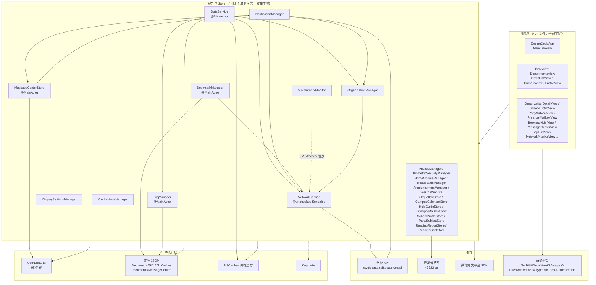
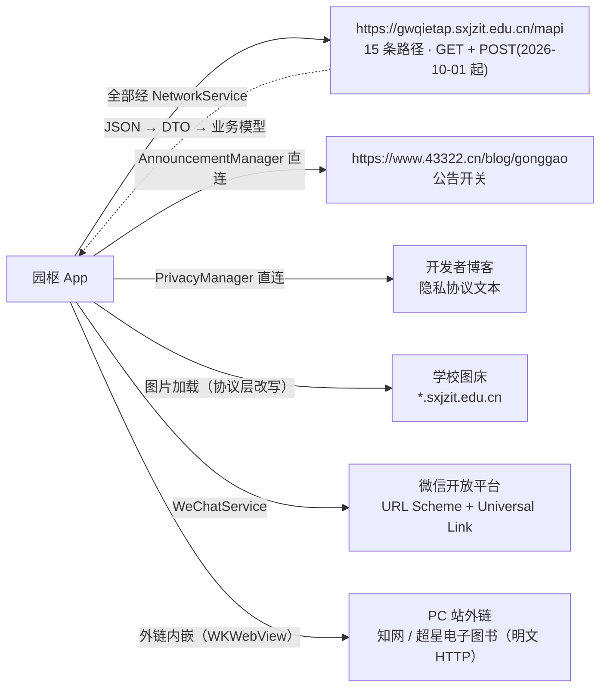

# 04 · 依赖关系

> 本文档为「园枢」App Code Wiki 第 4 册，覆盖**模块依赖、单例耦合、持久化明细与数据一致性规则**。
> 基线提交 `6fc702e`（2026-10-04；首版 `904d75f` → `215ea30`，本轮同步阅读时光模块的 7 个新键与依赖）。全部键名与路径经 `grep` 实测。

---

## 4.1 依赖总览

项目采用**扁平依赖结构**：没有依赖注入容器、没有协议抽象层、没有子目录分层。所有跨模块通信都通过 **`static let shared` 单例** + `@Published` 完成。



**三个结构性事实**：

| 事实 | 证据 |
|---|---|
| **无依赖注入** | 全仓库 `@EnvironmentObject` **0 命中**；`@ObservedObject` 共 **116 处**（其中 `TabBar.swift` **56 处**）；`@StateObject` **仅 2 处**（`LogListView.swift:71` 的 `LogFilterCache`、`TabBar.swift:4917` 的 `WebViewControl`）；跨视图状态全靠 `XxxManager.shared` 直连 |
| **无协议抽象** | 服务层均为 `final class` 具体类型硬引用，无 protocol 注入、无 mock 替换层 |
| **单例即状态源** | **35 个 `static let shared =`**（其中 22 个为 `ObservableObject`；清单见 [07-附录](07-附录-类型与符号索引.md)） |

---

## 4.2 模块依赖矩阵

> 行 = 调用方，列 = 被调用方。`●` = 直接调用/读取，`○` = 间接（经 `@Published` 或通知），空白 = 无依赖。

| ↓ 调用方 \ → 被依赖 | NetworkService | DataService | LogManager | DisplaySettings | CacheMode | NotificationMgr | MessageCenter | BookmarkMgr | OrganizationMgr | SJZNetworkMonitor |
|---|:--:|:--:|:--:|:--:|:--:|:--:|:--:|:--:|:--:|:--:|
| **DataService** | ● | — | ● | | ● | | | | ● | |
| **NetworkService** | — | | ● | | | | | | | ○ |
| **OrganizationManager** | ● | | ● | | ● | | | | — | |
| **NotificationManager** | ● | ● | ● | | | — | ● | | ● | |
| **MessageCenterStore** | | | ● | | | ● | — | | | |
| **BookmarkManager** | ● | | ● | | | | ● | — | | |
| **SJZNetworkMonitor** | | | ● | | ● | | | | | — |
| **LogManager** | | | — | | | | | | | |
| **DisplaySettingsManager** | | | | — | | | | | | |
| **CacheModeManager** | | | | | — | | | | | |
| **ReadingReportStore / ReadingGoalStore / HapticEngine** | | | ● | | | | | | | |
| **视图层（全部）** | ○ | ● | ● | ● | ● | ● | ● | ● | ● | ● |

**要点**：

- **`LogManager` 被所有模块依赖**（它是唯一无业务依赖的叶子节点，除日志页自身的自反馈防护）。
- **`NetworkService` 是唯一出网点**——除 `AnnouncementManager`（博客公告）与 `WeChatService`（微信 SDK）外，所有网络请求都经它。
- **`CacheModeManager` 是横向关注点**：被 `DataService`（同步跳过与限额）、`RefererHeaderURLProtocol`（图片缓存策略）、`SJZDecodedImageCache`（内存档位）、`OrganizationManager`（Timer 暂停）读取。
- **`NotificationManager ↔ MessageCenterStore` 是唯一的双向依赖**（前者 `ingest` 写入，后者 `silentCheckNow` / `launch` 回调 `handleNotificationTap`），但**不构成循环持有**（无强引用闭环）。
- **阅读时光三件（2026-10-03）是「最独立」的数据模块**：数据链仅依赖 `LogManager` + `UserDefaults`，零网络、零跨模块数据依赖；被视图层单向驱动（13 处 `.readingReportTrack`），与「阅读统计」零交互（[06 §6.5.6](06-接口契约与调用链.md)）。2026-10-04 分享改造后，视图层向微信集成组件**单向引用**（`WeChatService` / `WeChatSceneTiles` / `WeChatUnavailableNotice` / 回执横幅；本模块专用菜单 `ReadingReportShareMenu`，共享文件零改动）——属展示/分享出口，不引入数据依赖。

---

## 4.3 依赖解耦方式

| 方式 | 使用场景 | 示例 |
|---|---|---|
| `@ObservedObject` + 单例 | 视图订阅服务状态（主流） | `@ObservedObject private var data = DataService.shared` |
| `@Published` + `onChange` | 跨模块事件传递（**已取代 `NotificationCenter` 广播**） | 通知深链 5 个 `pending*` 通道 |
| `NotificationCenter` | 极少：仅同步完成通知 | `DataService.syncDidCompleteNotification` |
| `@Environment`（自定义键） | 排版与图片加载抑制（**仅 2 类**） | `SJZScrollSuspendedKey`、7 个排版键 |
| 直接函数调用 | 服务间协作 | `DataService.doFullSync` → `OrganizationManager.updateSiteKeys` |
| `URLProtocol` 拦截 | 全局网络改写与埋点（**无侵入**） | `RefererHeaderURLProtocol` |

> 📌 **为何用 `@Published` 取代 `NotificationCenter`**：源码注释（`TabBar.swift:49`）明确「`@Published` 状态驱动，替代 `NotificationCenter` 广播」——因为 `onChange` 语义比广播更可控，且便于配合 `UUID` 保证每次触发。

---

## 4.4 持久化明细

### 4.4.1 UserDefaults 键总表（**95 个**）

> 提取口径（仓库根执行，可复现）：
> ```bash
> cd qin/DesignCode
> grep -ohE '(static )?(let|var) [A-Za-z]*[Kk]ey[A-Za-z]* *(=|:) *"[a-zA-Z][a-zA-Z0-9_]*"' *.swift \
>   | grep -oE '"[a-zA-Z][a-zA-Z0-9_]*"'
> # 并集 forKey: / @AppStorage(...) / UserDefaults.standard.* 中的字面量
> ```

| 模块 | 键数 | 键名 |
|---|---:|---|
| **显示与排版** | 22 | `displayAccentStyle`、`displayArticleTextColorPreset`、`displayArticleTextCustomHex`、`displayAutoBrightness`、`displayAutoLock`、`displayBoldText`、`displayBrightness`、`displayButtonShapes`、`displayChangeHistory`、`displayCustomColorHistory`、`displayFontFamily`、`displayFontSizeTier`、`displayGrayScaleMode`、`displayKeepAwake`、`displayLetterSpacing`、`displayLineSpacing`、`displayReadingCharCountEnabled`、`displayReadingListBadgeEnabled`、`displayReadingSpeedTier`、`displayReadingStatsEnabled`、`displayReadingTimeEnabled`、`displayUseSystemFont` |
| **缓存模式** | 9 | `cacheHitCount`、`cacheImageFreeMode`、`cacheImageFreeSkippedCount`、`cacheImageHitCount`、`cacheImageMissCount`、`cacheMissCount`、`cacheMode`、`cacheSavedTrafficBytes`、`cacheSessionStart` |
| **通知轮询** | 7 | `notificationEnabled`、`notificationLastCheckTime`、`notificationPermissionRequested`、`notificationPollingMinutes`、`notifiedArticleIds`、`notifiedMailboxIds`、`notifiedOrgArticleIds` |
| **机构** | 6 | `organizationCache`、`orgArticleSearchHistory`、`orgFollowBaselineEstablished`、`orgFollowedOrgs`、`orgSearchIndexCache`、`schoolOrgTreeCache` |
| **消息中心** | 5 | `messageCenterAutoCheck`、`messageCenterBadgeEnabled`、`messageCenterImportedSystemOnce`、`messageCenterLastAutoCheckTime`、`messageCenterMaxCount` |
| **应用日志** | 4 | `logCrashCaptureEnabled`、`logDebugEnabled`、`logMaxEntries`、`logRetentionDays` |
| **网络监测** | 4 | `netmonChartWindowSeconds`、`netmonLastProbeJSON`、`netmonLiveSamplingEnabled`、`netmonTimelineJSON` |
| **收藏** | 4 | `bookmarkAutoCacheContent`、`bookmarkedArticles`（旧版迁移源）、`bookmarkMaxCount`、`bookmarkPushOnUpdate` |
| **阅读统计** | 3 | `readingStatsCache`、`readingStatsDiag`、`readingStatsLastResolved` |
| **阅读时光（报表与目标）** | 7 | `readingReportEnabled`、`readingReportEvents`、`readingReportRollups`、`readingGoalDailyMinutes`、`readingGoalWeeklyMinutes`、`readingGoalType`、`readingReportHeroPeriod`（`@AppStorage`） |
| **隐私** | 3 | `privacy_documents_cache`、`privacyConsentAccepted`、`privacyConsentRejected` |
| **校园日历** | 3 | `campusCalendarCache`、`campusCalendarReadArticleIds`、`campusCalendarSearchHistory` |
| **使用帮助** | 3 | `helpGuideReadIds`、`helpGuideRecentIds`、`helpGuideSearchHistory` |
| **生物识别** | 3 | `biometricEnabled`、`biometricLastUnlockAt`、`biometricLockPolicy` |
| **推送基线** | 2 | `partySubjectBaseline`、`schoolProfileBaseline` |
| **首页模块** | 2 | `homeModuleHidden`、`homeModuleOrder` |
| **其他（散落）** | 5 | `colorSchemePreference`、`mailboxLastKnownTotal`、`mailboxSearchHistory`、`partySearchHistory`、`profileSearchHistory` |
| **应用图标** | 1 | `appIconSelection` |
| **已读状态** | 1 | `readArticleIds` |
| **公告** | 1 | `announcementCache` |
| **合计** | **95** | |

#### ⚠️ 键设计隐患

| 隐患 | 说明 |
|---|---|
| **`@AppStorage` 与 `UserDefaults` 双轨** | 仅 7 个键走 `@AppStorage`（`colorSchemePreference`、`notificationEnabled`、`notificationPermissionRequested`、`notificationPollingMinutes`、`privacyConsentAccepted`、`privacyConsentRejected`、`readingReportHeroPeriod`），其余 88 个走 `private static let` 键常量 + `UserDefaults.standard`。两套写法并存 |
| **⚠️ 潜在双源：外观模式** | 根注入读 `@AppStorage("colorSchemePreference")`（`TabBar.swift:22/283`），presentation 注入读 `DisplaySettingsManager.shared.appearanceMode`（`DisplaySettingsManager.swift:2110`）。若两者不同源，会出现「**主界面浅色 / 弹出页深色**」的视觉分裂。[未验证] |
| **无键命名空间约定** | 既有 `display*` 前缀风格，也有 `cacheMode`、`colorSchemePreference` 等无前缀风格 |

### 4.4.2 文件路径总表

| 路径 | 归属模块 | 格式 | 写入强度 |
|---|---|---|---|
| `Documents/SXJZIT_Cache/` | `DataService` | 目录 | — |
| `Documents/SXJZIT_Cache/<key>.json` | `DataService` | **23 个 JSON 缓存文件**（见下） | `write` |
| `Documents/SXJZIT_Cache/Logs/log_<yyyy-MM-dd>.json` | `LogManager` | 日轮转 JSON 数组（单文件上限 1000 条，保留 7 天） | 原子写 |
| `Documents/SXJZIT_Cache/Bookmarks/bookmarks.json` | `BookmarkManager` | `[BookmarkItem]` JSON | `write(.atomic)` |
| `Documents/SXJZIT_Cache/BookmarkImages/{sha256}.img` | `BookmarkManager` | 固化图片（单张上限 8MB） | `Task.detached(.utility)` 原子写 |
| `Documents/MessageCenter/messageCenterEvents.json` | `MessageCenterStore` | `[MessageItem]` JSON（ISO8601） | **tmp + `replaceItemAt`** |
| `Documents/MessageCenter/messageCenterEvents.json.tmp` | `MessageCenterStore` | 原子写临时文件 | — |
| `Documents/MessageCenter/messageCenterEvents.corrupt-{ts}.json` | `MessageCenterStore` | 损坏现场备份（**只保留最近 5 份**） | — |
| `Documents/bookmark_deeplink_selftest_done.json` | `BookmarkDeepLinkSelfTest`（DEBUG） | 自测回执 | — |

**`DataService` 的 23 个缓存 JSON**（`saveCache` 写 21 个 + 2 个独立）：

> ⚠️ **实测缺陷**：`clearCache()` 删除 **22 个**键，**漏删 `specialty.json`**；且**不清 NSCache**、**不重置** `cachedArticleCount` / `estimatedCacheMemoryBytes`（计数器只增不减）、**不删 URLCache**。详见 §4.6。

### 4.4.3 内存缓存与 Keychain

| 存储 | 归属 | 容量 |
|---|---|---|
| `URLCache.shared` | 全局（`DesignCodeApp.init`） | 80MB 内存 / 400MB 磁盘，diskPath `sxjzit_shared_cache` |
| 详情专用 `URLCache` | `NetworkService.cachedSession` | 10MB / 50MB，diskPath `article_detail_cache` |
| `SJZDecodedImageCache` | 图片管线 | **双档**：缓存模式 96MB/600 张；即时模式 40MB/200 张 |
| `SJZAverageColorCache` | 图片管线 | 300 条（NSLock） |
| `BookmarkManager` 图片内存缓存 | 收藏 | 200 项 / 50MB |
| `ArticleDetailCache`（内存） | 机构模块 | `NSCache`，上限可配（`DataService.refreshCacheLimits`） |
| `OrgHomeCache` | 机构模块 | 首页数据缓存（**注意：详情页不读写它**，见 §4.6） |
| `PartyArticleDetailCache` | 党建 | 详情缓存 |
| Keychain | `BiometricSecurityManager` | 生物识别令牌（`BiometricKeychain` `:501`） |

---

## 4.5 数据一致性规则

| 规则 | 说明 | 证据 |
|---|---|---|
| **单一事实源** | `BookmarkItem.hasCachedContent` 以 `cachedContent` **实际内容**判定，不信任 `contentCached` 标志位；加载时由 `reconcileContentFlags()` 自愈并回写 | `Models.swift:1495-1497`、`BookmarkManager.swift:1148-1164` |
| **基线先行** | 所有指纹/集合类通道首次见到数据时**只登记不推送**，切开「历史」与「新增」 | `NotificationManager.swift:452-461/586-593/695-702/780-785` |
| **并集写回** | 跨异步边界修改共享集合时用 `union` 合并，防「读旧快照 → 写回 → 丢并发新增」 | `NotificationManager.swift:854-856` |
| **宁可不报，不可误报** | 子请求失败 → 跳过本轮比对，**不写坏基线** | `NotificationManager.swift:578-581` |
| **基线结构静默升级** | 基线格式变更（如两段→三段）时若旧段未变则直接升级不误报 | `NotificationManager.swift:595-634/705-712` |
| **写后自校验** | 消息中心写完立即回读解码，失败则重写一次 + warning | `MessageCenterStore.swift:288-296` |
| **二级加载自愈** | 整体解码失败 → 备份损坏现场 → 逐条抢救 → 重建 | `MessageCenterStore.swift:218-264` |
| **取消语义红线** | `URLError.cancelled` 不算失败：不重试、不记 ERROR、不告警 | `NetworkService.swift:102-107`、`BookmarkManager.swift:601-613` |
| **测试隔离** | `LogManager` 在测试宿主下仅驻内存 | `LogManager.swift:276-282` |
| **失败不改本地记录** | 应用图标切换失败时不改持久化记录，保证与系统实际一致 | `TabBar.swift:13477-13521` |
| **按天预聚合幂等** | 阅读时光：一条事件只并入一次当日 rollup（upsert 累加）；老数据由 `ensureRollups` **只补缺失天**；日期边界一律 `Calendar`（本地时区，禁 86400 秒加减法） | `ReadingReportStore.swift:150/166` |

---

## 4.6 已知耦合风险与技术债

| 严重度 | 问题 | 位置 | 影响 |
|---|---|---|---|
| 🟠 | **收藏设置联动外包给视图层** | `applyMaxCountLimit` 唯一调用点 `TabBar.swift:11205-11207`；`applyPushOnUpdateSetting` 唯一调用点 `:11208-11210`；模型 `didSet` 只落盘不联动 | 任何非设置页路径修改 `maxCount`/`pushOnUpdate` 都不会生效。与 `NotificationManager` 内聚在 `didSet` 的写法不一致 |
| 🟠 | **`clearCache()` 漏删 `specialty.json`** | `DataService` | 缓存清理不彻底；估算计数器只增不减 |
| 🟠 | **`Set.suffix(n)` 语义错误** | `NotificationManager.swift:160/169/179` | 三个去重集 `get` 返回 `Set`、`set` 做 `Array(newValue.suffix(2000))`；**`Set` 无序，保留的不是「最新 N 条」而是哈希序上的任意子集**。同仓库 `ReadStatusManager` 的 `_order` 数组（`:27-28/99-105`）才是正确范式 |
| 🟠 | **数据层无取消路径** | `DataService.swift` / `NetworkService.swift` | 这 4 个文件内 **0 处 `Task.isCancelled`**；`Task { doFullSync() }` / `Task.detached` **未保存句柄** → 无法取消 |
| 🟡 | **`RefererHeaderURLProtocol` host 子串匹配** | `RefererHeaderURLProtocol.swift` | `host.contains("sxjzit.edu.cn")` → `sxjzit.edu.cn.attacker.com` **也会被拦截并改写** |
| 🟡 | **`loggedURLs` 无界增长** | `RefererHeaderURLProtocol.swift` | 长时间运行内存缓慢增长（量级未测） |
| 🟡 | **`WKWebView` 无法被 URLProtocol 覆盖** | 已知限制 | WebView 内请求不走统一埋点与 Referer 注入 |
| 🟡 | **消息中心入盒 id 与通知 identifier 不一致** | 概况 `:618` vs `:626`；党建 `:729` vs `:737` | 系统通知互相覆盖（只留最新），但消息中心**会累积多条**同类消息 |
| 🟡 | **静默检测可能被丢弃** | `NotificationManager.checkForUpdates` `guard !isChecking`（`:303`） | 与定时轮询撞车的静默检测**无声跳过**，且时间戳已在触发前写入（`MessageCenterStore.swift:589`）→ **撞车一次白等 30 分钟** |
| 🟡 | **`markExistingArticlesAsNotified` 读写放大** | `NotificationManager.swift:941-948` | 每次 `insert` 触发一次 UserDefaults 读+写，N 篇文章 = O(N) 次 |
| 🟡 | **两处写盘强度不一致** | `BookmarkManager.save()` `write(.atomic)` vs `MessageCenterStore.writeAtomically()` tmp+replace | **收藏文件（含更贵的离线正文）反而用较弱方案**；且 `BookmarkItem` 无 `schemaVersion` |
| 🟡 | **三处 `Timer.scheduledTimer` 未加入 `.common` RunLoop mode** | `NotificationManager.swift:278`、`BookmarkManager.swift:960`、`AnnouncementManager.swift:325` | 用户长按/滚动跟踪期间定时器不触发 |
| 🟡 | **`applyRuntimeEffects` 仅 init 调用一次** | `DisplaySettingsManager.swift:900/948` | 回前台不会重新应用亮度/防息屏 |
| 🟢 | **重复实现** | `safeImageURL` 与提图正则在 `NetworkService`/`DataService` **逐字重复两套**；`refreshDetached` 在 4 个 Store 逐字重复 | 维护成本 |
| 🟢 | **死代码/零调用点** | `AnnouncementManager.stopAutoRefresh()`、`OrganizationManager.groupedData`、`OrgHaptics.warning()`、`enrichSectionsWithMoreArticles`、`refreshWithDebounce`、`fetchArticleDetailWithHref`（`NetworkService.swift:258`） | — |
| 🟢 | **搜索历史键 9 处硬编码** | 各模块 `*SearchHistory` | 无统一封装 |
| 🟢 | **`columnId` 硬编码残留** | `DataService.swift:612`、`OrganizationDetailView.swift:166/1979/189-192`、`zswSiteId:163` | 与文件内「严禁硬编码」注释冲突 |

---

## 4.7 外部依赖

### 第三方

| 依赖 | 形式 | 版本 | 用途 |
|---|---|---|---|
| 微信开放平台 SDK | `qin/Frameworks/WechatOpenSDK.xcframework`（**静态库 ar**；slice = `ios-arm64` + `ios-arm64_x86_64-simulator`） | **2.0.8** | 分享（含长图）、登录、小程序 |

> 📌 项目**无任何包管理器**：无 `Podfile` / `Cartfile` / `Package.swift`（`swiftpm/configuration` 为空目录）。唯一第三方以**预编译 xcframework 直接入库**方式引入。

### 系统框架

| 框架 | 用途 | 链接方式 |
|---|---|---|
| SwiftUI / Combine / Foundation | UI 与状态 | 隐式 |
| WebKit | 内嵌浏览器（`WebView` / `OrganizationArticleWebView`） | `-framework WebKit` |
| AVKit / AVFoundation | 视频播放（`VideoPlayerView`） | 隐式 |
| ImageIO | 图片降采样解码与像素尺寸解析 | 隐式 |
| UserNotifications | 本地通知 | 隐式 |
| LocalAuthentication | Face ID / Touch ID | 隐式 |
| CryptoKit | 收藏图片 SHA256 命名 | 隐式 |
| Security | Keychain（生物识别令牌） | `-framework Security` |
| AppIntents | **弱链接** | `AppIntents.framework`（落在 `Recovered References` 组） |
| 其他 | `CoreGraphics`、`CFNetwork`、`SystemConfiguration`、`CoreTelephony`、`-lz`、`-lsqlite3`、`-lc++`、`-ObjC`、`-all_load` | 主 target `OTHER_LDFLAGS` |

---

## 4.8 网络依赖拓扑



| 依赖 | 协议 | 备注 |
|---|---|---|
| 学校 API | HTTPS；GET + Query（`/common/recruit/query` 为 POST + JSON body，2026-10-01 起） | 无版本号、无鉴权、**唯一写面入口为招生查询 POST** |
| 学校图床 | HTTP/HTTPS 混合 | ATS 对 `*.sxjzit.edu.cn` 放行明文；`RefererHeaderURLProtocol` 注入 Referer 绕过防盗链 |
| 外链 PC 站 | 明文 HTTP 为主（`sslibrary.com` 等） | **`Info.plist` 增 `NSAllowsArbitraryLoadsInWebContent=true`（2026-10-01）**——仅豁免 WKWebView 网页内容 ATS，App 主网络层仍严格 ATS |
| 开发者博客 | HTTPS | 公告开关（标题字符串判定）+ 隐私协议文本 |
| 微信 | URL Scheme（`$(WECHAT_APPID)`）+ Universal Link | ⚠️ **Universal Link 因 entitlements 未接线而断链**（见 [05-项目运行方式](05-项目运行方式.md) §5.3） |

---

## 4.9 延伸阅读

| 想了解 | 去哪 |
|---|---|
| 整体架构与关键链路 | [01-项目整体架构](01-项目整体架构.md) |
| 模块职责边界 | [02-主要模块职责](02-主要模块职责.md) |
| 类与函数签名/行号 | [03-关键类与函数参考](03-关键类与函数参考.md) |
| 构建运行与红线 | [05-项目运行方式](05-项目运行方式.md) |
| API 端点与调用链时序 | [06-接口契约与调用链](06-接口契约与调用链.md) |
| 全量类型索引 | [07-附录-类型与符号索引](07-附录-类型与符号索引.md) |
