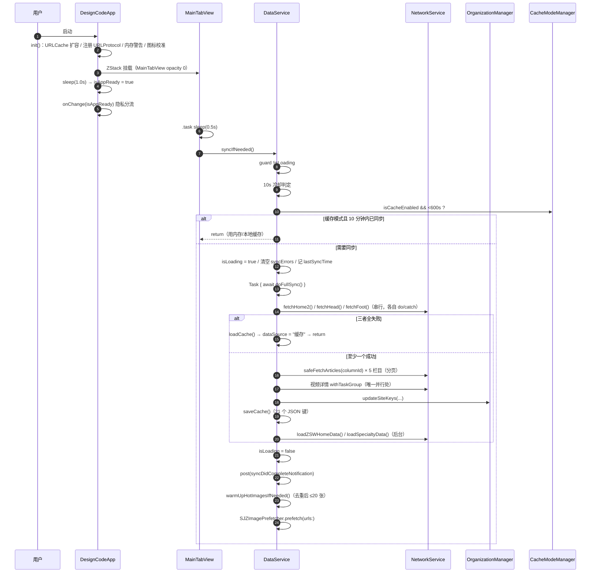
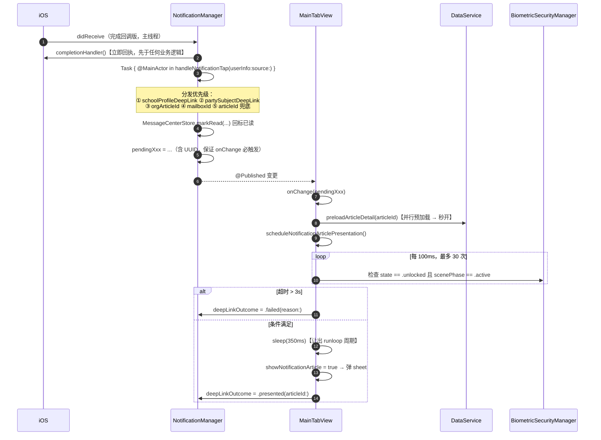
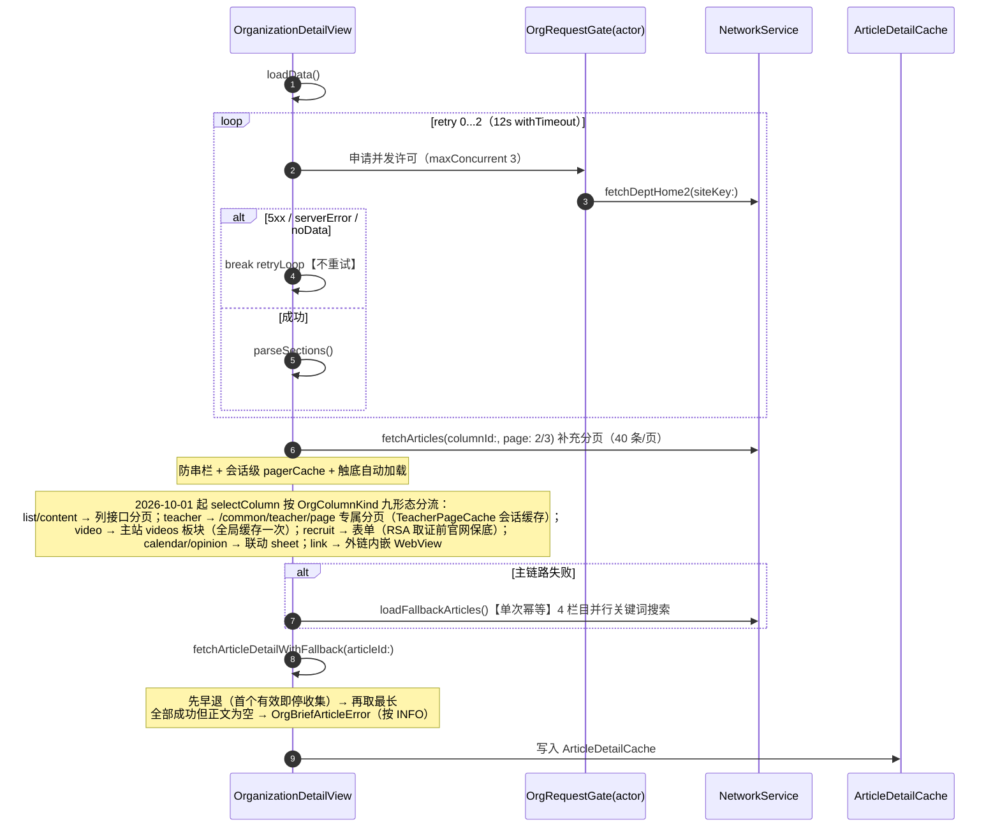
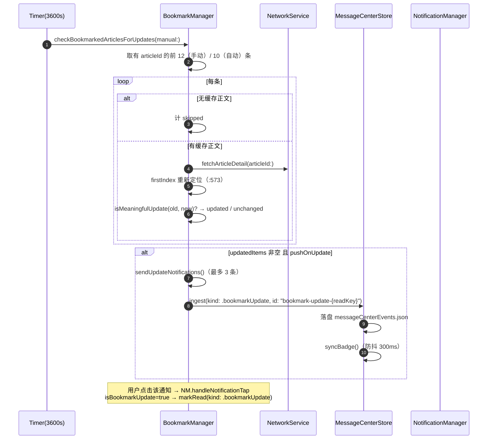
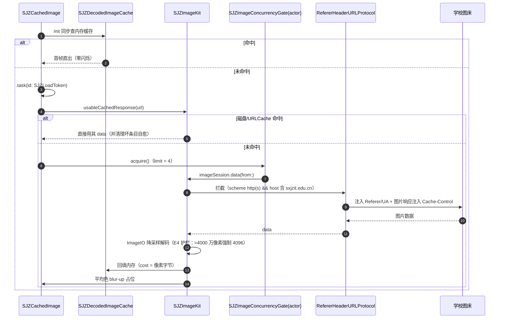
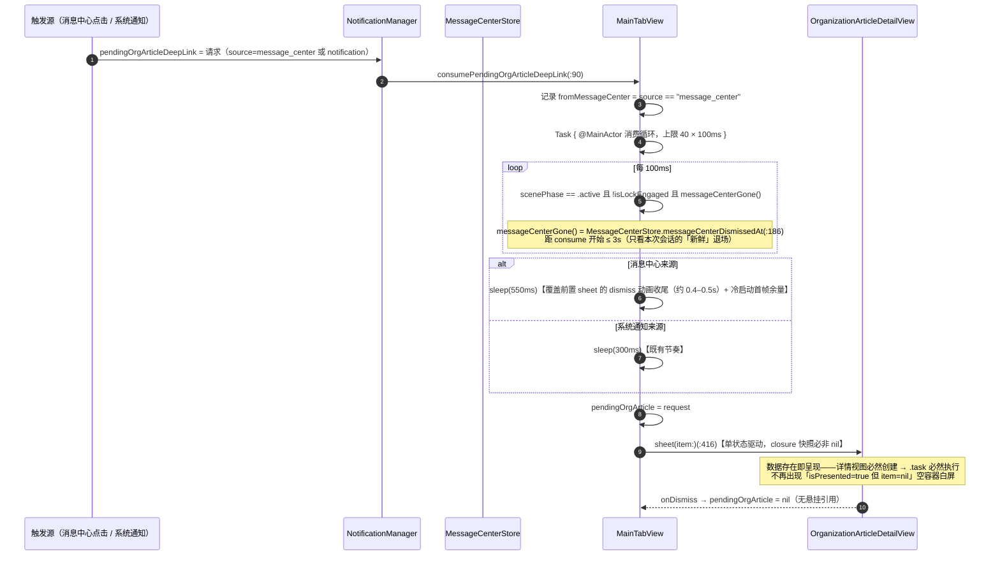
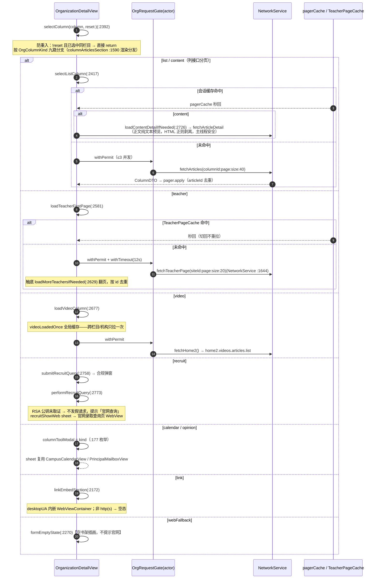
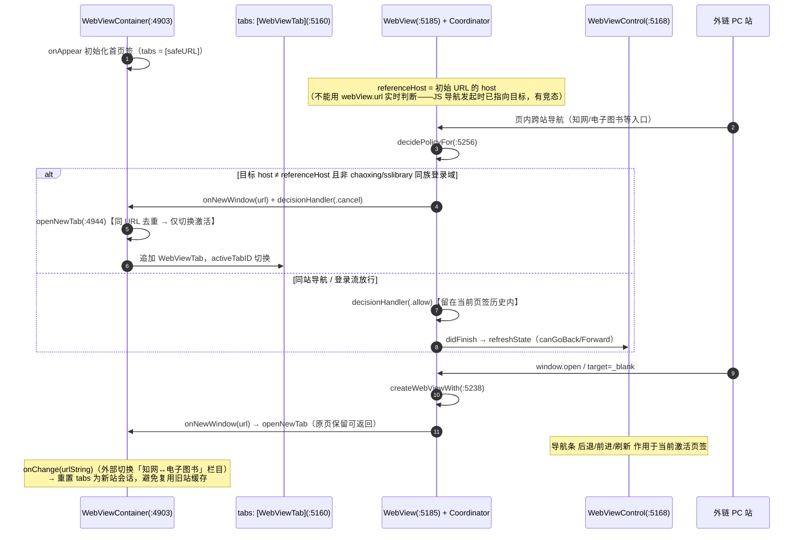
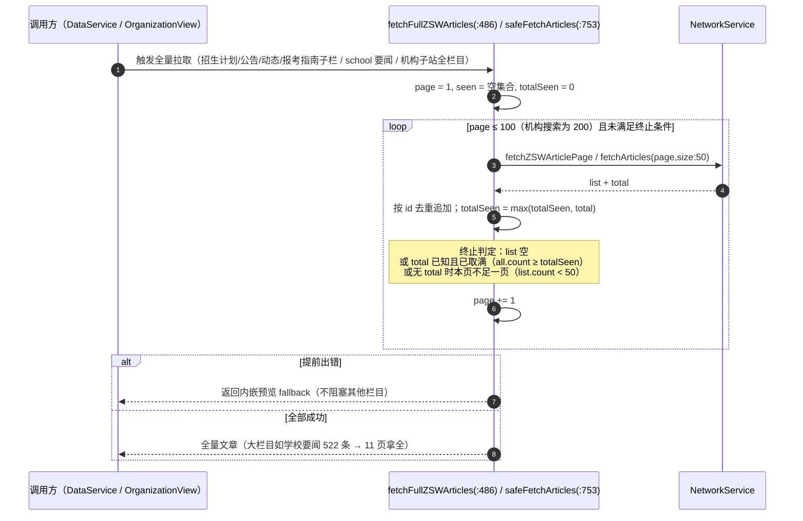

# 06 · 接口契约与调用链

> 本文档为「园枢」App Code Wiki 第 6 册，覆盖**网络接口契约、DTO 约定、函数级调用链时序、模块间契约与错误处理策略**。
> 基线提交 `904d75f`（2026-09-30）。所有端点与方法签名均经 `grep -n` 实测。

---

## 6.1 网络层契约

### 6.1.1 基础约定

| 项 | 值 | 位置 |
|---|---|---|
| Base URL | `https://gwqietap.sxjzit.edu.cn/mapi` | `NetworkService.swift:11` |
| HTTP 方法 | **GET 为主**；`POST` 仅 1 条（`/common/recruit/query`，2026-10-01 起） | 全库实测 |
| 请求超时 | `timeoutIntervalForRequest = 15s` | `:12` |
| 资源超时 | `timeoutIntervalForResource = 30s` | `:13` |
| 最大重试 | `maxRetries = 2`（即**最多 3 次尝试**） | `:14` |
| 退避策略 | **线性**：`500ms × (attempt + 1)`，累计 1.5s | `:114` |
| Accept | `application/json` | `:87` |
| 认证 | **无**（无鉴权、无 token、无账号） | — |
| 版本协商 | **无**（API 无版本号） | — |

**URL 构造**（`buildURL` `:387`）：

```swift
private func buildURL(path: String, params: [String: String]?) throws -> URL
// path 以 "http" 开头 → 直接使用（绝对 URL 透传）
// 否则 → NetworkConfig.baseURL + ("/" 前缀补齐) + path
// params → URLComponents.queryItems
```

### 6.1.2 响应包壳与 `requireData`

所有学校 API 返回统一包壳（`APIResponse<T>`，`:419-434`）：

```swift
struct APIResponse<T: Codable>: Codable {
    let code: Int?
    let message: String?
    let data: T?

    /// 安全获取 data，如果为 nil 则抛出 noData 错误
    func requireData() throws -> T {
        guard let data = data else {
            if let msg = message, !msg.isEmpty { throw NetworkError.serverError(msg) }
            throw NetworkError.noData
        }
        return data
    }
}
```

> ⚠️ **重要事实**：**JSON 字段 `code` 从未被读取**。HTTP 层只校验状态码 200–299；业务层成功与否**只靠 `data == nil` 判定**。
>
> - `data == nil` 且 `message` 非空 → `serverError(message)`
> - `data == nil` 且 `message` 空 → `noData`
> - 特例：`code = 200` + `data: null` + `message: "success"` 的场景由 `dataMissing(String)` 专门处理（**仅用于校长信箱**）

### 6.1.3 错误模型（`NetworkError`，`:17-39`）

| Case | 触发条件 | 用户文案（中文） |
|---|---|---|
| `badURL` | URL 构造失败 | 「无效的请求地址」 |
| `badResponse(Int)` | 非 200–299 状态码 | 「服务器响应异常（状态码：N）」 |
| `decodeFailed(String)` | JSON 解码失败 | 「数据解析失败：…」 |
| `timeout` | 重试耗尽后兜底抛出 | 「网络请求超时，请检查网络连接后重试」 |
| `noData` | `403` / `data == nil` 且无 message | 「服务器未返回数据，请稍后重试」 |
| `dataMissing(String)` | 服务端 200 + `data: null`（文案由调用方提供） | **调用方自定义完整说明** |
| `serverError(String)` | `data == nil` 但 `message` 非空 | 「服务器错误：…」 |

### 6.1.4 取消语义（工程红线）

```swift
if (error as? URLError)?.code == .cancelled {
    await LogManager.shared.debugLog("network", "请求已取消（跳过重试）", ...)
    throw error          // 不重试、不记 ERROR，直接向上传播
}
```

| 场景 | 语义 |
|---|---|
| 请求被取消（下拉刷新取代 / 页面离开 / 任务切换） | **非失败语义**——不重试、不记 ERROR、不上报告警；由调用方按取消路径处理 |
| 其他错误 | 重试至耗尽 → 记 ERROR → 抛出 |

> 📌 该模式在多个模块保持一致：`BookmarkManager` 用 `SJZImageKit.isCancellation(error)` 区分「取消」与「真失败」（取消静默 debug，真失败 warning），源码注释称之为「**取消语义红线**」（`BookmarkManager.swift:602`）；各 Store 的 `RefreshStatus` 状态机中 `URLError.cancelled` 一律归 `idle`。

---

## 6.2 API 端点清单

### 6.2.1 汇总

| 项 | 数量 |
|---|---:|
| 已知 HTTP 路径 | **15 条**（活跃 14；另含 2026-10-01 已停用的 `/common/article/page`，迁移至 `column/articles` 后仅注释留存） |
| 其中 `NetworkService` 内定义（活跃） | **12 条** |
| 经 `fetchJSONDict` 透传 | 2 条（`/school/intro`、`/school/cooperate`） |
| 任意 URL 通道 | 2 条（文章 `href` 直取、短链 HEAD 展开） |
| 公开 `fetch*` / `query` 方法 | **19 个**（含 `fetchSceneryAlbumDetail`）+ 2 个 `fetchJSONDict` 重载 + 通用 `post()` + `resolveShortLinkFinalURL` |
| 请求动词 | GET 为主；**POST 仅 1 条**（`/common/recruit/query`，2026-10-01 起） |

### 6.2.2 路径 → 方法映射

| # | 路径 | 方法 | 行号 | 返回类型 |
|---:|---|---|---:|---|
| 1 | `/school/home2` | `fetchHome2()` | 228 | `Home2DTO` |
| 2 | `/common/column/head` | `fetchHead()` | 233 | `HeadDTO` |
| 3 | `/common/foot` | `fetchFoot()` | 238 | `FootDTO` |
| 4 | `/common/column/articles` | `fetchArticles(columnId:siteId:page:size:)` | 243 | `ColumnDTO` |
| 5 | `/common/article/detail` | `fetchArticleDetail(articleId:siteId:useCache:)` | 250 | `ArticleDetailDTO` |
| 6 | `/common/article/detail` | `fetchZSWArticleDetail(articleId:siteId:)` | 964 | `ArticleDetailDTO` |
| 7 | `/common/column/articles` | `fetchZSWArticlePage(siteId:columnId:page:size:)` | **819** | `ZSWArticlePageDTO`（兼容嵌套 `data.articles` 与旧扁平） |
| 8 | `/dept/home2` | `fetchZSWHome2()` | 807 | `ZSWHome2DTO` |
| 9 | `/dept/home2` | `fetchDeptHome2(siteKey:)` | 1047 | `DeptHome2DTO` |
| 10 | `/dept/home2` | `fetchDeptSiteIndex(siteKey:)` | 1105 | `(siteId: String, columns: [DeptColumnRef])` |
| 11 | `/dept/home2` | `fetchPartySubjectFingerprint(siteKey:)` | 1171 | `PartySubjectFingerprint` |
| 12 | `/common/column/oneTwoArticles` | `fetchSpecialtyData(siteId:columnId:)` | 973 | `SpecialtyData` |
| 13 | `/school/org` | `fetchSchoolOrgTree()` | 1068 | `[SchoolOrgNode]` |
| 14 | `/school/msg` | `fetchPrincipalMailbox(page:size:)` | 1333 | `MailboxPageData` |
| 15 | `/common/msg/detail` | `fetchMessageDetail(msgId:)` | 1420 | `MailboxMessageDetail` |
| 16 | `/common/teacher/page` | `fetchTeacherPage(siteId:page:size:isLeader:)` | **1644** | `TeacherPageDTO`（2026-10-01 新增） |
| 17 | `/common/recruit/query` | `queryRecruit(name:encryptedIdCard:)` | **1662** | `RecruitResultDTO?`（POST，2026-10-01 新增） |
| 18 | `/common/article/detail` | `fetchSceneryAlbumDetail(articleId:siteId:)` | **1247** | `SceneryAlbumDetail`（content 提图 + imageUrl 封面兜底 1251-1254） |
| 19 | `/school/intro` | `fetchJSONDict(path:params:)` 透传 | 341 | `[String: Any]` |
| 20 | `/school/cooperate` | `fetchJSONDict(path:params:)` 透传 | 341 | `[String: Any]` |
| 21 | 文章 `href`（绝对 URL） | `fetchArticleDetailWithHref(_:)` ⚠️ **无调用点** | 258 | `NewsDetailDTO` |
| 22 | 短链（HEAD） | `resolveShortLinkFinalURL(_:)` | 311 | `URL?` |

> ⚠️ **`/dept/home2` 被 4 个方法以 4 种解析策略复用**：类型化解码（`fetchDeptHome2`）、手写递归构建站点索引（`fetchDeptSiteIndex`）、轻量指纹（`fetchPartySubjectFingerprint`）、原始字典（`fetchJSONDict`）。
>
> ⚠️ **`fetchArticleDetailWithHref`（`:258`）无任何调用点**——疑似 dead code [实测]。
>
> ⚠️ **`fetchZSWArticlePage` 已从 `/common/article/page` 迁移至 `/common/column/articles`**（2026-10-01）：旧接口对招生栏目固定返回 12 条（total=12、size/p 无效），与官网总量（column/articles 口径 21）不符——是「招生公告数量远少于官网」的根因之二。`ZSWArticlePageDTO` 自定义 `init(from:)` 同时兼容嵌套（`data.articles.{total,list}`）与旧扁平（`data.{total,list}`）两种结构。

### 6.2.3 方法完整签名

```swift
// —— 基础请求 ——
func get<T: Decodable>(_ path: String, params: [String: String]? = nil,
                       as type: T.Type) async throws -> T                                    // :79
func post<T: Decodable>(_ path: String, body: [String: Any]? = nil,
                        as type: T.Type) async throws -> T                                   // :128 ⚡2026-10-01 新增
private func getWithSession<T: Decodable>(_ path: String, params: [String: String]? = nil,
                                          as type: T.Type, session: URLSession) async throws -> T  // :178
private func buildURL(path: String, params: [String: String]?) throws -> URL                  // :440
private func validate(_ response: URLResponse, _ data: Data) throws                           // :459

// —— 站点与导航 ——
func fetchHome2() async throws -> Home2DTO                                                    // :228
func fetchHead() async throws -> HeadDTO                                                      // :233
func fetchFoot() async throws -> FootDTO                                                      // :238

// —— 栏目与文章 ——
func fetchArticles(columnId: String, siteId: String = "1",
                   page: Int = 1, size: Int = 20) async throws -> ColumnDTO                   // :243
func fetchArticleDetail(articleId: String, siteId: String = "1",
                        useCache: Bool = false) async throws -> ArticleDetailDTO              // :250
func fetchArticleDetailWithHref(_ href: String) async throws -> NewsDetailDTO                 // :258 ⚠️ 无调用点

// —— 通用 / 工具 ——
func resolveShortLinkFinalURL(_ shortURL: URL) async -> URL?                                  // :311
func fetchJSONDict(path: String) async throws -> [String: Any]                                // :336
func fetchJSONDict(path: String, params: [String: String]?) async throws -> [String: Any]     // :341
func strippingHTMLTags() -> String                                                            // :1677

// —— 招生网（ZSW） ——
func fetchZSWHome2() async throws -> ZSWHome2DTO                                              // :807
func fetchZSWArticlePage(siteId: String, columnId: String,
                         page: Int = 1, size: Int = 20) async throws -> ZSWArticlePageDTO     // :819 ⚡改走 /common/column/articles
func fetchZSWArticleDetail(articleId: String,
                           siteId: String = "cb3b1fe4fcdf40999b0c162015c3326d")
                           async throws -> ArticleDetailDTO                                   // :964
func fetchSpecialtyData(siteId: String, columnId: String) async throws -> SpecialtyData       // :973

// —— 机构（院系部门） ——
func fetchDeptHome2(siteKey: String) async throws -> DeptHome2DTO                             // :1047
func fetchSchoolOrgTree() async throws -> [SchoolOrgNode]                                     // :1068
func fetchDeptSiteIndex(siteKey: String) async throws -> (siteId: String, columns: [DeptColumnRef])  // :1105
func fetchPartySubjectFingerprint(siteKey: String) async throws -> PartySubjectFingerprint    // :1171

// —— 九形态（2026-10-01） ——
func fetchTeacherPage(siteId: String, page: Int = 1, size: Int = 40,
                      isLeader: Int = 0) async throws -> TeacherPageDTO                       // :1644 ⚡GET /common/teacher/page
func queryRecruit(name: String, encryptedIdCard: String) async throws -> RecruitResultDTO?    // :1662 ⚡POST /common/recruit/query

// —— 内容型模块 ——
func fetchSceneryAlbumDetail(articleId: String,
                             siteId: String = "1") async throws -> SceneryAlbumDetail         // :1247
func fetchPrincipalMailbox(page: Int, size: Int) async throws -> MailboxPageData              // :1333
func fetchMessageDetail(msgId: Int) async throws -> MailboxMessageDetail                      // :1420
```

### 6.2.4 双 URLSession 分流

| Session | 缓存策略 | URLCache | 使用方 |
|---|---|---|---|
| `session` | `.reloadIgnoringLocalAndRemoteCacheData` | 共享（80MB/400MB） | **除详情外全部**（列表要实时） |
| `cachedSession` | `.useProtocolCachePolicy` | 专属（10MB/50MB，`article_detail_cache`） | **仅 `fetchArticleDetail(useCache: true)`** |

> 📌 **唯一分流点**是 `fetchArticleDetail` 的 `useCache` 参数（`:199`，**默认 `false` = 实时**）。
>
> 两个 session **都显式注册** `protocolClasses = [RefererHeaderURLProtocol.self]`（`:59` / `:71`），源码注释给出历史根因：「不依赖 `URLProtocol.registerClass` 的全局时序（App.init 属性初始化早于 init 体，提前创建的会话会漏注册 → **埋点恒 0 的历史根因**）」。

### 6.2.5 栏目常量

```swift
extension NetworkService {
    /// 校园生活 → 校园日历 栏目 ID（官网 column_id，site_id=1）
    static let campusCalendarColumnId = "8197fe41503c4c32bce1e449d2492b2e"    // :441
}
```

---

## 6.3 DTO 约定

| 约定 | 说明 |
|---|---|
| 数量 | `NetworkService` 侧 **47 个 `*DTO`**（含 private 共 54 个解码类型；2026-10-01 增 `TeacherDTO` / `TeacherPageDTO` / `RecruitResultDTO`，并给 `DeptArticleDTO` 补 `createTime`、`DeptChildDTO` 补 `data` 键、`DeptNavItemDTO` 补 `dataChildren`） |
| 字段可空性 | **全 `Optional`**——服务端字段漂移不导致解码整体失败 |
| 键名映射 | 显式 `CodingKeys`（**30 处**），如 `title_cn` → `titleCn`、`image_url` → `imageUrl`、`create_time` → `createTime` |
| 兼容多来源 | `ArticleDTO.resolvedTitle` = `title ?? titleCn`（兼容 `home2`（`title_cn`）与栏目 API（`title`）两种字段名） |
| 真结构容错 | **5 处**：`AnyCodable`、`DeptNavItemDTO`（含 `dataChildren` 键捕获）、`DeptChildDTO`（`articles`/`data` 双键）、`ZSWArticlePageDTO`（嵌套 `data.articles` / 扁平 `data` 双结构，自定义 `init(from:)`）、`Facility` + `FacilitySection` |
| 与业务模型关系 | DTO →（`DataService.toNewsItem` 等映射）→ `Models.swift` 业务模型 → `@Published` → 视图 |

---

## 6.4 函数级调用链时序

### 链路 A：冷启动 → 数据同步（三层降级）



### 链路 B：通知点击 → 深链展示（防崩溃）



### 链路 C：机构详情加载与降级



### 链路 D：收藏更新检测（第 6 条通道）



### 链路 E：图片加载（零闪烁）



### 链路 F：机构动态深链 → 单状态 sheet 呈现（2026-10-02 冷启动白屏修复）



> 前置 sheet 判据来源：`ProfileView` 的消息中心 `.sheet(isPresented:$showMessageCenter, onDismiss:)` 在收起动画完成后写 `messageCenterDismissedAt`（`TabBar.swift` 末尾 `ProfileView` 区域）。此链条是「**先关消息中心、再弹详情**」两段式呈现的防竞态契约。

### 链路 G：机构栏目九形态壳加载（`selectColumn` 分派，2026-10-01）



### 链路 H：外链 WebView 标签页导航（跨站自动开新页签，2026-10-01）



### 链路 I：total 驱动全量翻页（招生网 / 机构深度检索，2026-10-01）



> **与旧口径的差异**：首版基线为「固定 4/8 页（常规/深度）」；2026-10-01 起改为**服务端 total 驱动翻页到取满**，仅保留极端安全上限 `[实测]`（`OrganizationView.swift` 检索循环上限 200 页；`DataService.safeFetchArticles` / `fetchFullZSWArticles` 上限 100 页）。

---

## 6.5 本地「接口」契约（模块间）

### 6.5.1 通知 → 消息中心配对契约

| 通道 | 系统通知 identifier | 消息中心 id | 一致性 | 配对点 |
|---|---|---|---|---|
| 新闻 | `news-{articleId}` | 同左 | ✅ | `NotificationManager.swift:387` / `:409` |
| 信箱 | `mailbox-{messageId}` | 同左 | ✅ | `:488` / `:504` |
| 概况 | `school-profile-update`（固定） | `schoolProfile-{ms}` | ⚠️ **不一致** | `:618` / `:626`、`:653` / `:661` |
| 党建 | `party-subject-update`（固定） | `partySubject-{ms}` | ⚠️ **不一致** | `:729` / `:737` |
| 机构 | `org-{articleId}` | 同左 | ✅ | `:790` / `:831` |
| 收藏 | `bookmark-update-{readKey}` | 同左 | ✅ | `BookmarkManager.swift:1057` / `:1065` |

**核心契约**：**只有 `delivered`（系统通知发送成功，或静默模式 `pushToSystem: false`）才入盒**。机构通道注释明确：「发送失败：保留未通知态，下轮重推（对齐新闻通道契约）」（`:825-826`）。

**反向配对（点击回写已读）**，`handleNotificationTap` 按 6 种方式回标：

| 目的地 | 回标调用 | 行号 |
|---|---|---:|
| 学校概况 | `markRead(kind: .schoolProfile)` | 1012 |
| 党建专题 | `markRead(kind: .partySubject)` | 1024 |
| 机构文章 | `markRead(id: "org-{id}")` | 1044 |
| 校长信箱 | `markRead(id: "mailbox-{id}")` | 1067 |
| 收藏更新 | `markRead(kind: .bookmarkUpdate, articleId:)` | 1096 |
| 新闻文章 | `markRead(id: "news-{articleId}")` | 1098 |

**收藏归因兜底**（`MessageCenterStore.deliveryUserInfo(for:)`，`:655-661`）：若 `item.kind == .bookmarkUpdate`，**无条件补** `info["isBookmarkUpdate"] = true`。源码注释解释：收藏 payload 只带 `articleId`，若不补，`handleNotificationTap` 会按 `news-{articleId}` 走新闻通道标已读，**收藏条目永远命中不了**；此兜底同时**修复历史已落盘消息**（`:652-654`）。

### 6.5.2 `hasCachedContent` 单一事实源契约

```swift
// Models.swift:1495-1497
var hasCachedContent: Bool   // 以 cachedContent 实际内容判定，不信任 contentCached 标志位
```

**契约**：`contentCached` 标志位失真时，由 `BookmarkManager.reconcileContentFlags()`（`:1148-1164`）在加载时**自愈并回写**。所有派生统计（`contentCachedCount` / `precacheCandidates` / `precacheAvailability`）**必须以 `hasCachedContent` 为准**（`:207-236` 注释「判定源加固」）。

### 6.5.3 `readKey` 三处口径契约

| 模型 | 定义 | 规则 |
|---|---|---|
| `NewsItem.readKey` | `Models.swift:399` | `articleId ?? id` |
| `BookmarkItem.readKey` | `Models.swift:1500` | `articleId ?? title + date` |
| 机构文章 `readKey` | `OrganizationDetailView.swift:67` | `articleId.isEmpty ? title + updateTime : articleId` |

> ⚠️ 三者**口径不同**，已读状态（`ReadStatusManager`）与收藏匹配都依赖各自口径。跨模型比对时须显式转换，**不可直接混用**。

### 6.5.4 显示排版契约（构建期强制）

**契约**：所有文本排版必须走 `display*` 链（`displayFont` / `displaySymbolFont` / `displayLabelFont` / `displayText`），否则**构建失败**。所有 presentation 必须挂 `.sjzPresentationChrome()`（系统 ShareSheet 豁免）。

| 约束 | 强制方式 |
|---|---|
| 排版链四规则 | 构建阶段「显示设置覆盖护栏」`alwaysOutOfDate = 1` |
| presentation chrome 完备性 | 审计不变量：38 处呈现点中 32 处显式挂载，6 处豁免全为系统 `ShareSheet` |

### 6.5.5 禁止项契约（工程红线）

| # | 红线 | 理由 | 证据 |
|---:|---|---|---|
| 1 | 禁用 `NSAttributedString(.html)` 解析 HTML | 会走 `NSHTMLReader` → WebKit 内部加载 → 主线程卡死（HangTracer hang） | `PartySubjectView.swift:1658`、`CampusCalendarView.swift:1417`、`AnnouncementManager.swift:265-268` |
| 2 | 禁止在通知回调同步链中弹 sheet | `Call must be made on main thread` 崩溃 | `TabBar.swift:113-116` / `:290-295` |
| 3 | 通知 delegate 只用完成回调版 | async 版后台队列派发 → 点击通知崩溃 | `NotificationManager.swift:951-956` |
| 4 | 深链须待导航栈挂载稳定后投递 | 否则丢帧 | `PrincipalMailboxView.swift:1706-1709` |
| 5 | 禁止绕过 `SJZCachedImage` 加载图片 | 破坏统一缓存/解码/并发/自愈 | 全库 `AsyncImage` **0 处实际使用**（3 处命中均为注释） |
| 6 | 禁止硬编码线上域名外的地址 | 统一治理 | README 工程约束 |
| 7 | 新增日志必须接入 `LogManager` | 可观测性 | README 工程约束 |

---

## 6.6 错误处理与降级策略

| 层级 | 策略 | 实现 |
|---|---|---|
| **HTTP** | 只校验 200–299；其余 → `badResponse(statusCode)` | `validate(_:_:)` |
| **解码** | 全 Optional + CodingKeys；解码失败 → `decodeFailed` | DTO 约定 |
| **业务** | `data == nil` 判定；有 message → `serverError`，无 → `noData` | `requireData()` |
| **重试** | 最多 3 次，线性退避；**取消不重试** | `get` `:82-122` |
| **数据层** | 三层降级：远程 → 本地 JSON → 静态兜底；`doFullSync` **永不抛出** | `DataService` |
| **模块层** | 各通道独立 `try/catch`，单点失败不影响其余 | `NotificationManager` 五通道 |
| **UI 层** | 缓存徽标 / 弱网提示 / 骨架屏 / 错误态与重试 | `SJZCachedBadge` / `SJZSlowNetworkBanner` / 各视图 |
| **降级不误报** | 子请求失败 → 跳过比对，不写坏基线 | `NotificationManager.swift:578-581` |

---

## 6.7 兼容与演进策略

| 场景 | 策略 | 证据 |
|---|---|---|
| **基线结构升级** | 概况两段→三段：旧段未变则直接升级基线并 return（不误报）；确有变化则按旧语义推送 | `NotificationManager.swift:595-634` |
| **基线结构不符** | 党建通道 `prevParts.count != 4` → **静默重建基线不误报** | `:705-712` |
| **深链 payload 演进** | **payload 自描述 + 消费侧按 kind 兜底**双保险；兜底同时修复历史已落盘消息 | `MessageCenterStore.swift:655-661` |
| **数据模型版本** | `MessageItem.schemaVersion` 用于迁移；缺失 → 1；未知 `kind` → `.news` | `MessageCenterStore.swift:93/98-113` |
| **收藏旧版迁移** | 文件解析失败 → 回退读旧版 `UserDefaults` `bookmarkedArticles`，迁移成功后清源 | `BookmarkManager.swift:1123-1139` |
| **标志位失真** | 以内容为准 + 加载时自愈回写 | `hasCachedContent` / `reconcileContentFlags` |
| **字段名漂移** | `resolvedTitle = title ?? titleCn` | `NetworkService.swift:462` |
| **系统通知历史** | 首次导入：24 小时内记为未读，更早按已读归档（避免升级当天轰炸） | `MessageCenterStore.swift:782-839` |
| ⚠️ **收藏无版本字段** | `BookmarkItem` **无 `schemaVersion`**，版本演进能力弱于消息中心 | [实测] |

---

## 6.8 未验证 / 待确认项

| # | 项 | 说明 |
|---:|---|---|
| 1 | 服务端真实响应与 45 个 DTO 的逐字段一致性 | 未抓包比对 |
| 2 | `code` 字段的实际语义 | 代码从未读取，只信 `data == nil` |
| 3 | 学校 API 的限流与字段漂移行为 | 无法从仓库确认 |
| 4 | `fetchArticleDetailWithHref`（`:258`）是否真为 dead code | 全库无调用点，但可能由反射/未来使用 |
| 5 | ATS 对 HTTP 图片的实际放行行为 | 配置允许，真机未验证 |
| 6 | 共享 `JSONDecoder` 的并发线程安全 | `NetworkService` 非 `@MainActor`，解码在任意线程 |
| 7 | 协议层对 `AVPlayer` Range 请求的实际行为 | 影响视频播放与埋点 |
| 8 | 五槽位深链在同一时刻连点多条通知时是否排队 | 后到会覆盖前一未消费槽 [未验证] |
| 9 | ⚠️ **`POST /common/recruit/query` 的 RSA 公钥** | `queryRecruit` 已就绪但**公钥未从官网录取查询页真机取证**——UI 收口「官网查询」保底，不发起假请求（2026-10-01） |
| 10 | `NSAllowsArbitraryLoadsInWebContent` 对 WKWebView 的实际生效范围 | 配置已加（2026-10-01），真机外链加载待验证 |

---

## 6.9 延伸阅读

| 想了解 | 去哪 |
|---|---|
| 整体架构与关键链路 | [01-项目整体架构](01-项目整体架构.md) |
| 模块职责边界 | [02-主要模块职责](02-主要模块职责.md) |
| 类与函数签名/行号 | [03-关键类与函数参考](03-关键类与函数参考.md) |
| 依赖与持久化明细 | [04-依赖关系](04-依赖关系.md) |
| 构建运行与红线 | [05-项目运行方式](05-项目运行方式.md) |
| 全量类型索引 | [07-附录-类型与符号索引](07-附录-类型与符号索引.md) |
