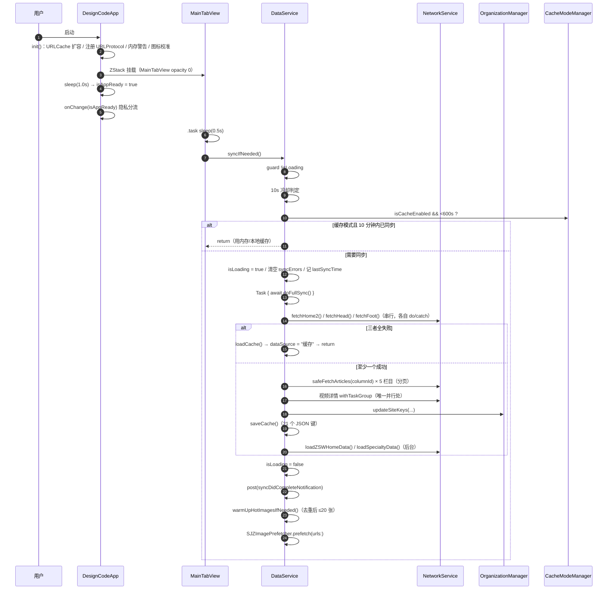
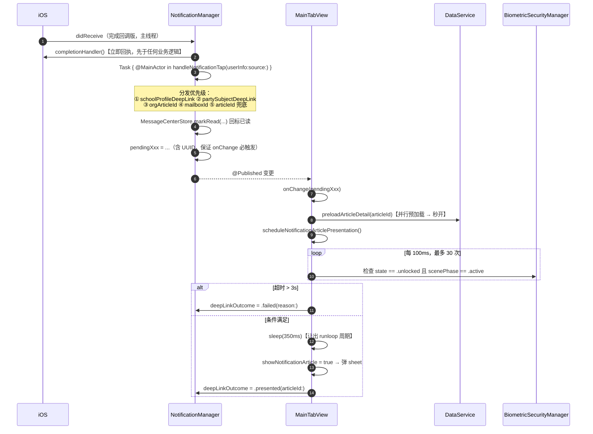
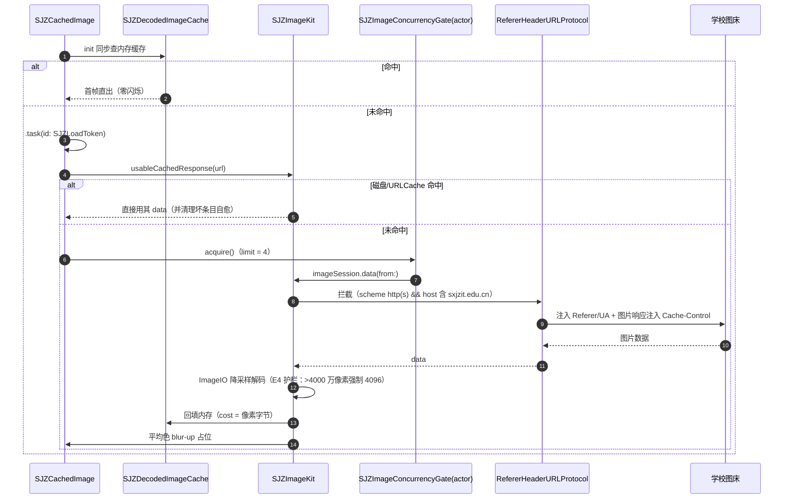
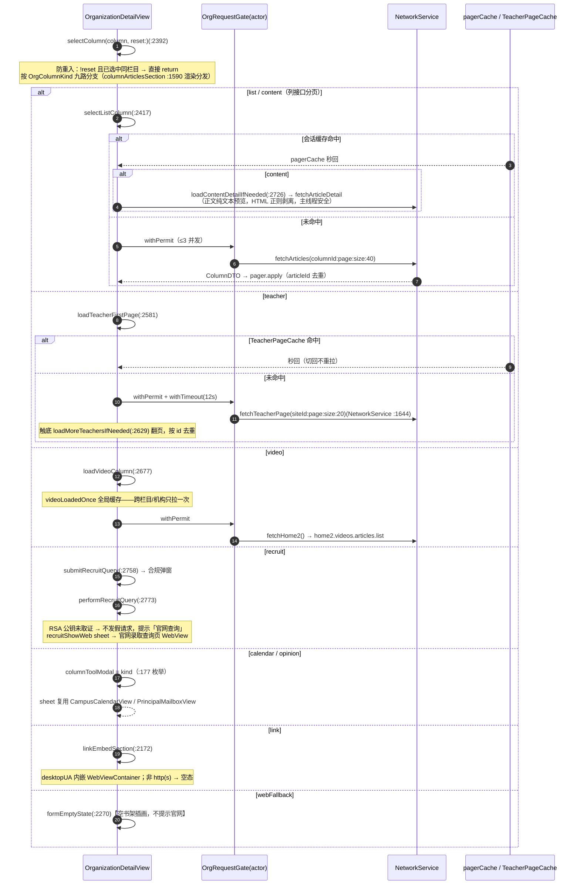

# 园枢 — 山西晋中理工学院 App

「园枢」是山西晋中理工学院第三方 iOS 应用，纯 SwiftUI 实现，为师生与访客提供校园资讯、通知公告、机构导航、校长信箱等一站式服务。本项目仅供测试与交流。

## 项目概览

| 项 | 内容 |
|---|---|
| 工程名 | `DesignCode`（Bundle ID `com.qinchao`） |
| 技术栈 | 纯 SwiftUI + 系统框架；Swift 5 |
| 第三方依赖 | 仅 1 个：微信开放平台 SDK 2.0.8（XCFramework 静态库） |
| 数据来源 | 学校公开 API `https://gwqietap.sxjzit.edu.cn/mapi` + 开发者博客 `www.43322.cn` |
| 后端 | 无。无服务端、无账号体系、无自有推送服务 |
| 调试设备 | 真机「秦超的iPhone」，UDID `00008110-000411A40EC1401E` |

架构要点：**无服务端纯客户端**——用「客户端轮询 + 本地指纹比对」替代服务端推送，用 `URLProtocol` 全局拦截替代服务端遥测，用三层降级（远程 → 本地 JSON → 静态兜底）替代服务端高可用。

## 功能特性

### 五大 Tab

`首页` · `院系` · `资讯` · `校园` · `我的`

### 核心模块

- **首页**：轮播 banner、校园统计、快捷入口、校园亮点、使用帮助锚点
- **资讯**：重要新闻、通知公告、招生信息等分类浏览，文章详情含长图/微信分享/全屏看图
- **校园**：校园日历、活动、风光、设施、师资力量展示
- **院系**：机构目录与子站文章浏览，**栏目九形态渲染**（列表/单篇/视频/师资/招生查询/日历/信箱/外链/空态），文章全站深度搜索
- **我的**：个人中心、收藏管理、消息中心、设置

### 设置与个性化

- **显示设置**：外观模式、主题风格、**全局排版引擎**（字号/行距/字距/粗体/字体家族，含书法字体按需下载）、阅读统计
- **缓存模式**：智能缓存、数据节省模式、图片免流量
- **通知管理**：推送权限、轮询间隔、自定义通知
- **生物识别**：Face ID / Touch ID 应用锁
- **应用图标**：多套 1024×1024 图标切换

### 基础设施

- **无服务端推送**：`NotificationManager` 5 条检测通道（新闻/信箱/概况/党建/机构动态）+ `BookmarkManager` 1 条（收藏更新），靠官网指纹 + 本地集合 diff
- **消息中心**：App 内通知盒子 + 深链直达 + 已读/未读 + 搜索高亮
- **网络监测**：实时状态、流量、延迟（TTFB 口径）、网络体检、下载测速
- **零闪烁图片管线**：`SJZCachedImage` 同步查缓存首帧直出 + 两级缓存 + 并发闸（≤4）+ 解码缓存双档限额

## 实测规模（基线 `215ea30`）

| 指标 | 数值 |
|---|---:|
| 主 target | 50 文件 / 68,699 行 |
| 测试 target | 6 文件 / 4,296 行 |
| 代码总计 | 56 文件 / 72,995 行 |
| 顶层声明 | 406（379 类型 + 27 extension） |
| 单元测试用例 | 241（15 个测试类） |
| 单例 | 33 |
| 日志调用点 | 1,400（40 个日志域） |
| API 路径 | 15（GET 为主 + 1 条 POST 招生查询） |

## 关键调用链时序图

> 以下 4 条为代表核心架构的调用链（GitHub 原生渲染 Mermaid）。完整 9 条（A–I）源码见 [code-wiki/mermaid/](../code-wiki/mermaid/README.md)，与 [06-接口契约与调用链](../code-wiki/06-接口契约与调用链.md) §6.4 逐字同步。

### 冷启动 → 数据同步（三层降级）



### 通知点击 → 深链展示（无服务端推送）



### 零闪烁图片加载管线



### 机构栏目九形态壳加载



## 目录结构

```
qin/
├── DesignCode/              # 主源码（50 文件）
│   ├── DesignCodeApp.swift  # App 入口（@main）
│   ├── TabBar.swift         # 主外壳（13,992 行：5 Tab + 深链中枢 + 图片管线 + WebView 浏览器）
│   ├── OrganizationDetailView.swift  # 机构详情（7,667 行，九形态壳）
│   ├── DataService.swift    # 数据枢纽（三层降级同步）
│   ├── NetworkService.swift # 网络层（15 条 API + 全局遥测）
│   ├── DisplaySettingsManager.swift # 显示设置 / 全局排版引擎
│   ├── SJZNetworkMonitor.swift      # 网络遥测
│   └── [其余模块]
├── DesignCodeTests/         # 单元测试（241 用例）
├── Scripts/                 # 构建护栏与验收脚本
└── docs/                    # 接口摸查与审计取证
```

## 构建与运行

### 环境要求

- macOS + Xcode 27
- 实体 iPhone（本工程约定真机构建调试，不用模拟器）

### 运行方式

```bash
# 打开工程
open qin/DesignCode.xcodeproj

# Xcode 中选择「秦超的iPhone」后运行（⌘R）
# 命令行真机构建（示例）
xcodebuild -project qin/DesignCode.xcodeproj -scheme DesignCode \
  -destination "platform=iOS,id=00008110-000411A40EC1401E" build
```

### 单元测试

```bash
xcodebuild test -project qin/DesignCode.xcodeproj -scheme DesignCode \
  -destination "platform=iOS,id=00008110-000411A40EC1401E" \
  -only-testing:DesignCodeTests
```

注意：静态 241 用例中 `NetworkServiceDTOTests` 含 3 条真实在线用例（直连学校 API，无 mock），断网会挂，建议 `-skip-testing:DesignCodeTests/NetworkServiceDTOTests`。

### 自动化脚本（`qin/Scripts/`）

| 脚本 | 用途 |
|---|---|
| `display_coverage_guard.py` | 构建期护栏：显示排版链 / 弹层 chrome / UIKit 直连字体 / 裸文本零容忍 |
| `device_display_verify.sh` | 真机显示排版验证（构建→安装→启动→日志断言→Markdown 报告） |
| `org_module_acceptance.sh` / `org_forms_acceptance.sh` / `org_visual_acceptance.sh` | 机构模块真机验收（用例断言 + 视觉检查） |
| `push_all.sh` / `remote_sync_report.sh` | 三远端（origin / gitee / cnb）同步推送与核验 |
| `news_fullsync_regression.sh` / `org_article_sheet_acceptance.sh` 等 | 新闻全量同步回归 / 文章 sheet 验收 |

## 工程红线（节选）

1. 构建/测试/调试必须针对实体设备，禁模拟器
2. 文本/图标一律走 `displayFont / displayText / displaySymbolFont / displayLabelFont`，全库 0 处裸 `.font(`
3. 每个 `.sheet / .fullScreenCover` 内容根必须 `.sjzPresentationChrome()`（外观 + 专注灰度）
4. 图片加载必须使用 `SJZCachedImage`；正文 HTML 转纯文本必须用纯正则，禁止 `NSAttributedString` HTML 解析
5. 新增日志必须接入 `LogManager`（带字面量日志域）
6. 微信 `WXApi.registerApp` 只能在用户同意隐私协议后调用；未配置时所有入口只读
7. 隐私同意是轮询与采集恢复的门禁

## 文档

权威文档在仓库根 `code-wiki/`（7 分册 + 总览，基线 `215ea30`，2026-10-02 已同步）：

- [code-wiki/README.md](../code-wiki/README.md) — Code Wiki 总览与导航
- 01 项目整体架构 / 02 主要模块职责 / 03 关键类与函数参考 / 04 依赖关系 / 05 项目运行方式 / 06 接口契约与调用链（含 9 条 Mermaid 时序图）/ 07 类型与符号索引

历史文档（与 `code-wiki/` 冲突时以 `code-wiki/` 为准）：

- `ARCHITECTURE.md`、`PROJECT_UNDERSTANDING.md` — 历史架构与项目理解档案
- `DEBUG_REPORT.md` — 数据同步故障排查
- `docs/` — 接口摸查与审计取证（机构 / 招生网 / 新闻 API）

## 许可证

项目所涉及的任何部分（包括但不限于代码），所有内容仅供学习与内部交流使用。