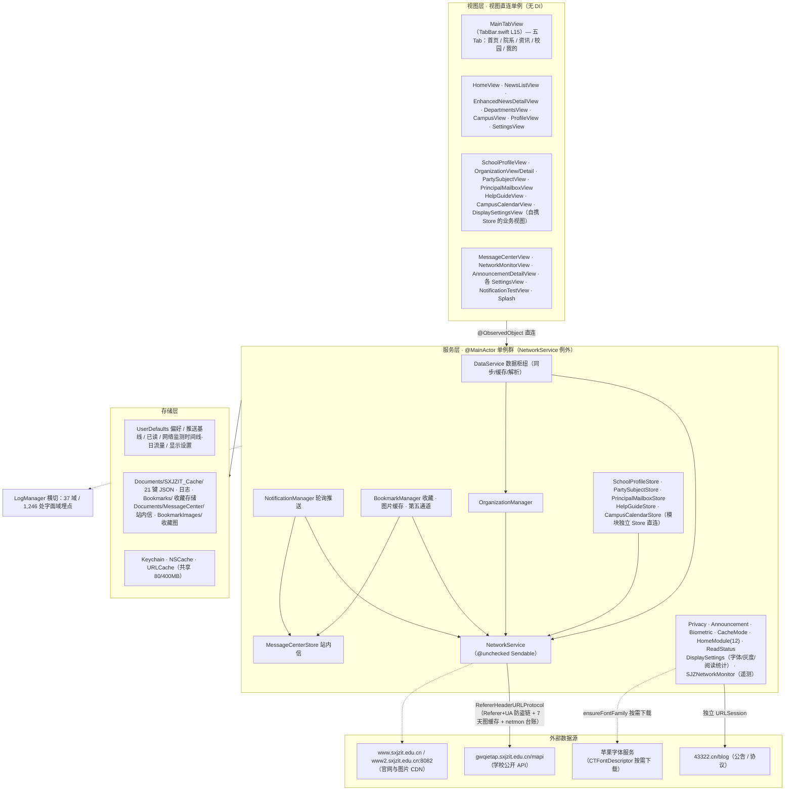
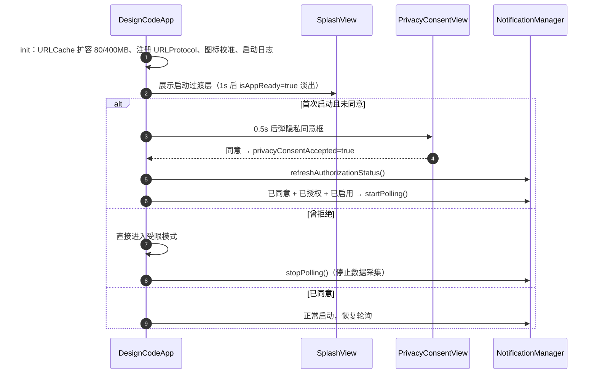
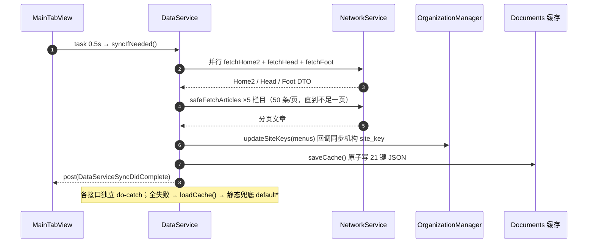
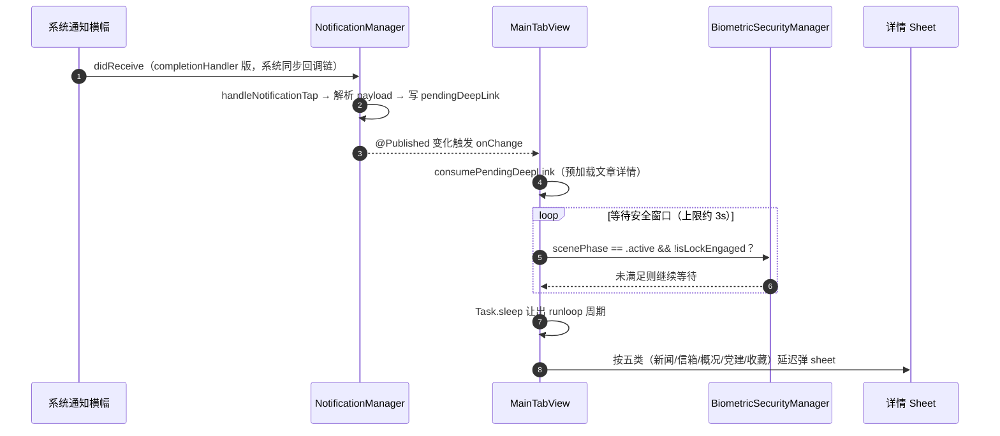
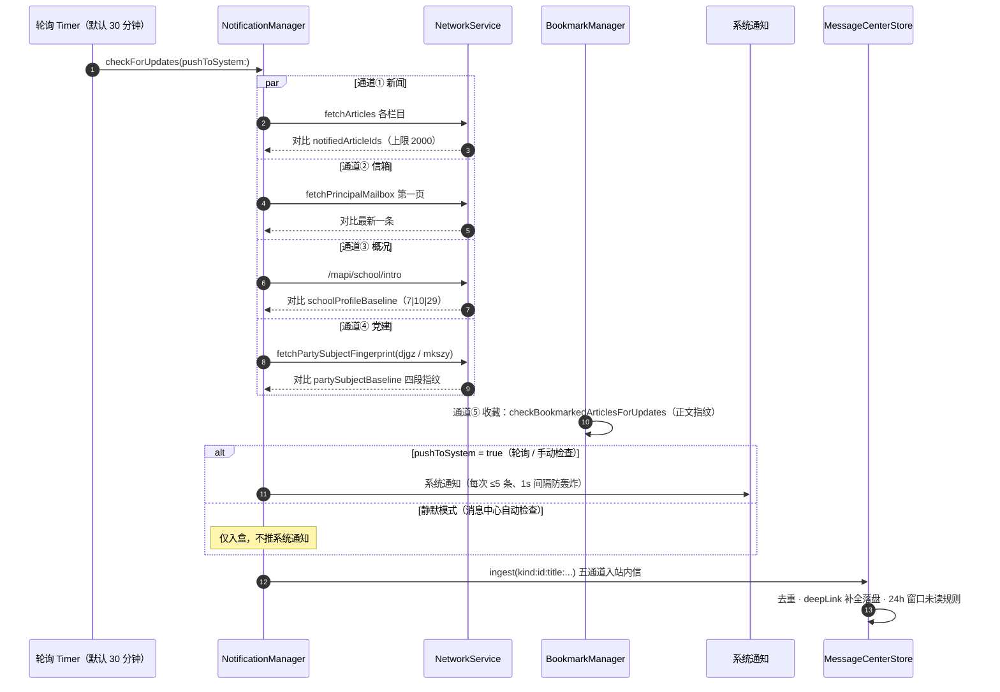

# 01 · 项目整体架构

> 基线：**2026-09-27**（`wc -l` + 逐符号 grep 校准）。行号以符号名为准，若源码再演进请按符号检索。

## 1.1 项目定位

| 项 | 值 |
|---|---|
| App 名称 | **园枢**（DisplayName），工程/目录名沿用模板 `DesignCode` |
| 定位 | 山西晋中理工学院校园信息聚合 App（师生/家长、全年龄段） |
| 平台 | iOS 原生（iPhone + iPad），最低部署目标 26.0（target 层，覆盖 project 层 13.0） |
| 语言 | Swift 5.0（实际使用 async/await、@MainActor、withTaskGroup，Xcode 27 / iOS 26 SDK） |
| UI | 纯 SwiftUI（`@main` App 生命周期），局部混用 UIKit / WebKit / AVKit / Swift Charts |
| 依赖 | **唯一第三方：微信开放平台 SDK**（`Frameworks/WechatOpenSDK.xcframework`，静态库 `-ObjC -all_load`）；无 Podfile / Package.swift / Carthage，其余 100% Apple 系统框架 |
| 后端 | **无**：无账号体系、无自建服务端、无 APNs 服务端 |
| 标识 | Bundle ID `com.qinchao`，Team `F2JL9GNLCC`，版本 1.0 (Build 1)，developmentRegion `zh-Hans` |

**核心命题**：在「无后端、无推送服务器」的约束下，通过**轮询公开官网 API + 本地指纹比对**，从零实现原本属于服务端的推送系统；并以全局 `URLProtocol` 为唯一网络入口，自建**全 App 流量遥测与网络诊断**（netmon），在本地通知、站内信、网络可观测性三个层面做到可审计、可自愈、可验证。

## 1.2 技术栈

| 框架 | 用途 | 选型理由 |
|---|---|---|
| SwiftUI | 全部 UI 构建、`@main`、状态驱动、`@AppStorage` | 声明式视图与 `@Published` 单例状态模型直接对应，引入第三方状态框架无额外收益 `[Expert judgment]` |
| Combine | 响应式订阅；网络监测聚合计时器 | 随 SwiftUI 生态自带，`ObservableObject` 基线能力 `[Expert judgment]` |
| Foundation | `URLSession`、JSON 编解码、`FileManager`、`UserDefaults` | 系统基础库覆盖网络/持久化/编解码全部需求 `[Data-backed]` |
| UserNotifications | 本地推送、badge、通知点击回调、前台静默检查 | 无 APNs 服务端，本地通知是唯一系统级触达通道 `[Data-backed]` |
| WebKit | `WKWebView` 渲染文章详情 HTML（机构详情 / 分数线查询） | 官网正文为富 HTML，WebView 保证版式保真 `[Expert judgment]` |
| AVKit | `AVPlayer` 校园宣传片内联播放（[ProfileInlineVideo](file:///Users/qinchao/Downloads/designcode-swiftui/qin/DesignCode/SchoolProfileView.swift#L2424)） | 系统播放器稳定性优先于自绘播放控件 `[Expert judgment]` |
| Swift Charts | 网络监测双曲线图（吞吐/延迟，[chartCanvas](file:///Users/qinchao/Downloads/designcode-swiftui/qin/DesignCode/NetworkMonitorView.swift#L522)） | iOS 16+ 原生图表，维持零第三方依赖 `[Expert judgment]` |
| Network | `NWPathMonitor` 链路感知（含 iOS 26 linkQuality / isUltraConstrained / IPv4·IPv6·DNS） | 系统唯一公开的链路质量 API；低版本经可用性判断回退 `[Research-backed]` |
| CoreText | 中文字体按需下载（`CTFontDescriptorMatchFontDescriptorsWithProgressHandler`） | 系统字体按需下载的唯一公开途径，`UIFont(name:)` 只能查询不能触发下载 `[Research-backed]` |
| CryptoKit | SHA256 图片缓存键（BookmarkManager） | 系统内置摘要算法，无需第三方哈希库 `[Expert judgment]` |
| ImageIO | 图片降采样解码（`CGImageSourceCreateThumbnailAtIndex`） | Thumbnail 降采样在解码阶段完成，长列表内存可控 `[Research-backed]` |
| UIKit | `UIImage`、`UIViewControllerRepresentable`、触觉反馈、屏幕亮度、idle timer | 桥接 SwiftUI 尚未覆盖的系统能力 `[Data-backed]` |
| LocalAuthentication | Face ID / Touch ID / Optic ID 隐私锁 | 系统生物识别唯一入口 `[Data-backed]` |
| Security | Keychain 生物启用令牌 | 敏感令牌需系统级保护（ThisDeviceOnly 不随备份迁移）`[Data-backed]` |
| Photos | 保存图片到相册（WebP→JPEG 重编码 file-based 写入） | file-based 写入规避 WebP 经 data-based API 写入报 3302 的已知缺陷 `[Research-backed]` |
| os | `Logger`（崩溃日志、阅读统计系统 console 直出） | 系统结构化日志，便于 devicectl 现场取证 `[Expert judgment]` |
| UniformTypeIdentifiers | 日志导出文件类型 | 系统类型标识，替代字符串 MIME 判定 `[Expert judgment]` |

全项目无 SPM / CocoaPods / Carthage 清单文件（实测目录无 Package.swift / Podfile / Cartfile）。这一选择的收益是依赖面收敛、审核风险可控，代价是图片加载、遥测、日志、字体下载四套基建需自研维护 `[Expert judgment]`。

**自研基建**（替代第三方库的角色）：
- 图片加载：`SJZCachedImage`（[TabBar.swift L10486](file:///Users/qinchao/Downloads/designcode-swiftui/qin/DesignCode/TabBar.swift#L10486)），内存 `NSCache`（解码图，双限额）+ `URLCache` 共享（80MB/400MB）+ 磁盘；ImageIO 降采样 720/1440px。
- 网络：纯 `URLSession` + async/await，自带指数退避重试（`NetworkService.get<T>`）。
- 网络遥测：`URLProtocol` 台账（`NetworkMonitorLedger`，NSLock 线程安全）+ 心跳采样 + 双目标诊断 + 测速（netmon）。
- HTML 解析：纯正则（全项目禁用 `NSAttributedString(documentType:.html)`）。
- 日志：自研 LogManager（日轮转、崩溃捕获、导出、36 日志域）。
- 字体：7 款中文全字形家族 + 系统按需下载状态机（display 域）。
- 灰度：全局 `sjzGrayScale()` 修饰器（聚焦灰度模式，跨 sheet/fullScreenCover 传播）。

## 1.3 总体架构分层



关键结构特征：
- **视图直连单例**，无依赖注入、无协议抽象层——服务层即全局状态源。
- `NetworkService` 是唯一 `@unchecked Sendable`（跨线程安全），其余服务均为 `@MainActor`；`NetworkMonitorLedger`（netmon 台账）独立于 MainActor 用 NSLock 守护，供 URLProtocol 任意线程调用。
- 跨模块事件用 `NotificationCenter`（如 `syncDidCompleteNotification`），不建事件总线；深链统一走 `@Published` 状态（新 UUID 强制 onChange 触发）。
- 跨层视觉传播双通道：`.displayTypography(displaySettings)` 单链注入（主题色/字体/灰度）+ 44 处内容级 `sjzGrayScale()` 挂载（覆盖 sheet/fullScreenCover，系统分享面板除外）。
- **网络监测（netmon）已是最大基建模块之一**：链路感知 → 链路事件时间线 → 全 App 流量台账 → 心跳实时采样（5s/10s/30s 三档省电）→ 诊断/健康分/建议 → 一键测速，入口在「我的 → 应用设置 → 网络调试 → 网络监测」（[TabBar.swift L9378](file:///Users/qinchao/Downloads/designcode-swiftui/qin/DesignCode/TabBar.swift#L9378)）。

## 1.4 源码目录拓扑（2026-09-27 实测行数）

```
qin/
├── DesignCode/                        ← 全部源码（46 个 .swift，扁平无子目录，共 62,249 行）
│   ├── DesignCodeApp.swift            213    ← @main 入口：URLCache 扩容、URLProtocol 注册、隐私分流、生物锁遮罩、通知轮询恢复
│   ├── TabBar.swift                   12993  ← 主视图集（60+ View）：MainTabView、五 Tab 全部、ZSW、SJZ 组件族、AppIconManager、校园 Tab 七分区、网络监测入口、日志实机自测钩子
│   ├── Models.swift                   1591   ← 全部业务模型 + 静态兜底数据 default*
│   ├── NetworkService.swift           1599   ← 网络层：统一 GET + 全部 DTO + campusCalendarColumnId
│   ├── DataService.swift              1246   ← 数据枢纽：同步编排、缓存、详情解析
│   ├── SJZNetworkMonitor.swift        1917   ← 网络监测中枢（2026-09-26 扩建）：台账/心跳/诊断/测速/健康分
│   ├── NetworkMonitorView.swift       1615   ← 网络监测 UI（Swift Charts 双曲线 + 诊断/测速卡）
│   ├── NotificationManager.swift      1067   ← 通知系统：四通道轮询、深链、测试支持
│   ├── MessageCenterStore.swift       823    ← 消息中心数据层（自愈存储）
│   ├── MessageCenterView.swift        925    ← 消息中心 UI
│   ├── HelpContent.swift              591    ← 使用帮助内置内容（5 分类 32 篇）
│   ├── HelpGuideStore.swift           239    ← 使用帮助数据中枢（零网络）
│   ├── HelpGuideView.swift            1550   ← 使用帮助主页面 + 详情页
│   ├── CampusCalendarStore.swift      478    ← 校园日历数据中枢
│   ├── CampusCalendarView.swift       1485   ← 校园日历列表 + 详情
│   ├── SchoolProfileView.swift        3511   ← 学校概况（含 SchoolProfileStore/图片保存封装）
│   ├── OrganizationView.swift         2183   ← 机构列表 + 全站文章搜索
│   ├── OrganizationDetailView.swift   5343   ← 机构详情（子站/子标签/降级页）
│   ├── OrganizationManager.swift      730    ← 机构 site_key 管理
│   ├── PartySubjectView.swift         2598   ← 党建专题 + 文章详情体系
│   ├── PrincipalMailboxView.swift     1787   ← 校长信箱（含 PrincipalMailboxStore）
│   ├── BookmarkManager.swift          1071   ← 收藏（文件存储/筛选排序/更新检测）+ 图片固化 + 第五通道推送
│   ├── BookmarkListView.swift         1375   ← 收藏列表 UI（检索/筛选/排序/滑动操作/批量/诊断面板）
│   ├── DisplaySettingsManager.swift   2692   ← 显示设置中枢：外观/排版/字体下载/正文色/亮度/锁定/灰度/阅读统计
│   ├── DisplaySettingsView.swift      2290   ← 显示设置 UI（12 Section，F1–F19）
│   ├── CacheModeManager.swift         455    ← 缓存模式 + 命中率统计
│   ├── CacheModeSettingsView.swift    600    ← 缓存模式 UI
│   ├── HomeModuleManager.swift        356    ← 首页 12 模块显隐与排序
│   ├── HomeModuleSettingsView.swift   146    ← 模块设置 UI
│   ├── BiometricSecurityManager.swift 524    ← Face/Touch/Optic ID 状态机 + Keychain
│   ├── BiometricSettingsView.swift    168    ← 生物识别设置 UI
│   ├── BiometricLockOverlayView.swift 137    ← 锁定遮罩
│   ├── NotificationTestView.swift     501    ← 通知测试中心（五分区）
│   ├── AnnouncementManager.swift      339    ← 公告拉取/解析/判定
│   ├── AnnouncementDetailView.swift   226    ← 公告详情
│   ├── PrivacyManager.swift           449    ← 隐私协议文档三级降级
│   ├── PrivacyPolicyView.swift        795    ← 隐私同意/受限模式/文档 UI（含 exit(0) 红线区）
│   ├── PrivacyLegalTexts.swift        276    ← 协议离线兜底文本
│   ├── LogManager.swift               1073   ← 日志系统（追加合并落盘/抢救/轮转/保留天数/统计/导出/崩溃捕获/风暴与全局限流/**测试宿主仅驻内存隔离**）
│   ├── LogListView.swift              1337   ← 应用日志 UI（统计头/三维筛选/日期分组/滚动几何跟随/详情卡/导出筛选）
│   ├── LogSettingsView.swift          251    ← 日志设置（记录控制/容量保留/实时存储统计/导出清理）
│   ├── ReadStatusManager.swift        109    ← 文章已读状态（回退未读/快照/保序截断）
│   ├── RefererHeaderURLProtocol.swift 234    ← 防盗链 URLProtocol + 图片缓存头 + netmon 台账钩子
│   ├── WeChatService.swift            1396   ← 微信开放平台 SDK 集成（注册/分享/登录/小程序/自检/回执中枢/日志桥）
│   ├── WeChatIntegrationViews.swift   822    ← 微信界面（分享菜单/集成中心/回执横幅）
│   ├── DesignCode.entitlements              ← 关联域名（Universal Link 用；免费个人团队不支持，暂未启用）
│   └── SplashView.swift               125    ← 启动过渡页
├── Frameworks/                        ← WechatOpenSDK.xcframework（OpenSDK 2.0.8，唯一第三方）
├── DesignCodeTests/                   ← 单元测试（5 文件 3,494 行 / 190 用例）
│   ├── MessageCenterStoreTests.swift  1539    ← 消息中心 65 例 + 长图契约与探针 25 例（含 HomeModule/CampusCalendar/NetworkMonitorLogic/DisplaySettingsLogic/ArticleLongImageLogic 五类）
│   ├── NetworkServiceDTOTests.swift   650    ← DTO 解码/真实 API/阅读统计 22 例
│   ├── WeChatSDKTests.swift           358    ← 微信契约 23 例（Info.plist 声明/占位判定/字节裁剪/缩略图/长图编码与预览/编码档位预算/场景/状态机/自检七步/横幅/日志联通）
│   ├── BookmarkManagerTests.swift      434    ← 收藏契约 24 例（存储/迁移/损坏抢救/筛选排序/分组/更新判定/图片固化 + 已读状态回退与保序截断）
│   └── LogManagerTests.swift           513    ← 日志契约 29 例（合并落盘保真/裁剪语义/抢救/搜索/删除/导出/统计/崩溃日键/保留清理/风暴与全局限流/删除不复活/**测试宿主隔离**）
├── DesignCode.xcodeproj/              ← Xcode 工程（签名、部署目标、备选图标名）
├── docs/code-wiki/                    ← 本 Wiki（最新权威文档集）
├── docs/wechat-integration/           ← 微信接入指南 + AASA 模板
├── .trae/documents/                   ← 各模块工程规格书（display/netmon/campus-calendar/message-center/help-guide）
├── ARCHITECTURE.md / CODE_WIKI.md（历史合并版）/ 项目技术全景报告.md ···
├── DesignCode_backup_20260922/ 与 DesignCode_backup_20260926_netmon/  ← 备份快照（勿引用/勿编译）
└── build/ · .build/ · ExportOptions.plist
```

> 结构要点：源码**未分层平铺**（单目录 46 文件），靠命名后缀区分职责：`*Service`=网络/数据、`*Manager`=管理器、`*Store`=模块数据中枢、`*View`=视图、模型集中于 `Models.swift`（DTO 则内嵌在 `NetworkService.swift`）。`TabBar.swift` 是历史遗留的巨型文件（12,274 行，占全库 21%）。

## 1.5 设计模式与状态管理

| 模式 | 落地 |
|---|---|
| 单例（服务定位器） | 所有 Manager/Store 均为 `static let shared`，视图直接引用 |
| 轻量 MVVM | Store/Manager 持 `@Published` 状态 + 业务方法；View 只做渲染与手势 |
| 观察者 | `@Published` 驱动 UI；`NotificationCenter` 承载跨模块一次性事件 |
| 门面（Facade） | `DataService` 对视图屏蔽「API→解析→缓存」细节；新六模块 Store 绕过门面直连 |
| 三层降级（策略） | 远程 API → 本地 JSON 缓存 → 静态兜底，逐层回退 |
| 模板方法 | `NetworkService.get<T>` 统一重试/超时/解码 |
| 防护代理 | `RefererHeaderURLProtocol` 全局注入 Referer/UA 头 + 缓存头 + 台账 |
| 线程安全记账槽 | `NetworkMonitorLedger`（NSLock + `@unchecked Sendable`），URLProtocol 任意线程写入、主线程 drain |
| 纯函数算子 | `DisplayHistoryOperator`（ring buffer 去重置顶/截断）、`DisplayContrastChecker`（WCAG 对比度）、`ReadingStatsCalculator`（单趟字数/时长）——离线可测 |
| 状态机 | 生物锁 `LockState`（inactive→locked→authenticating→unlocked）；字体 `DisplayFontAvailability`（ready/downloading/unavailable）；心跳档位 `SamplingTier`（live 5s→saving 10s→deepSaving 30s）；各模块统一 `RefreshStatus`（idle→refreshing→success/failed）；探测 `ProbeState`/测速 `SpeedTestState` |
| 装饰器（ViewModifier） | `displayTypography` / `displayText` / `sjzGrayScale` / `biometricLockProtected` / `SJZRevealOnce` / `SJZScrollActivityTracker`（定义于 SchoolProfileView.swift，internal 共享）/ `monitorCard`（网络监测卡片风格） |
| 动效门控 | 新增动画统一过 `accessibilityReduceMotion` 门控（`ConditionalBounceModifier`、`NumericTransitionConditionalModifier`、`CardPressStyle(reduceMotion:)`） |
| 异步优先 | 网络全 `async/await`；日志异步防抖写入；机构/党建搜索并发批处理（`withTaskGroup`）流式合入；超 5 万字符阅读统计转 `Task.detached(.utility)` |

状态管理要点：
- 视图层用 `@ObservedObject private var xxx = XxxStore.shared`（而非 `@EnvironmentObject`）。
- 跨模块事件用 `NotificationCenter` 承载一次性广播：`syncDidCompleteNotification`（数据同步完成）、生物识别引导等。
- **深链不走通知中心弹窗**：`NotificationManager.pendingDeepLink` 等四个 `@Published` 深链属性（新闻文章/校长信箱/学校概况/党建专题；收藏更新与消息中心行点击复用文章深链通道），新实例 UUID 保证 onChange 必触发 → `MainTabView.onChange` → 等待 `scenePhase == .active` 且无生物锁 → 延迟弹 sheet（防闪退设计，见 §1.7 链路③）。
- 显示设置经**单链注入**全局生效：`DesignCodeApp.tint(themeStyle) + .displayTypography(...)`；灰度/主题/字体/字号均随 `@Published` 即时重算（字体下载完成经 `typographyRevision` 环境键强制全 App 文本重建）。

## 1.6 三层数据降级（核心设计）

```
① 远程 API   gwqietap.sxjzit.edu.cn/mapi        ← 优先，15s 超时 + 指数退避重试
② 本地缓存   Documents/SXJZIT_Cache/*.json      ← 网络失败时回退（21 个键，见 04-依赖关系）
③ 静态兜底   Models.swift 的 default* 常量      ← 无缓存时保证离线可用
```

- `DataService.dataSource` 以「预置数据 / 缓存 / 服务器」标记当前数据来源。
- 同步结果通过 `syncDidCompleteNotification` 广播，供网络监测等模块联动。
- 新六模块（概况/党建/信箱/消息中心/帮助/日历）各自带缓存策略：概况/党建/信箱直连 `NetworkService`，日历「本地缓存优先 + 静默刷新」，帮助零网络。

## 1.7 启动流程与关键执行链路

### 链路① App 启动（[DesignCodeApp.swift](file:///Users/qinchao/Downloads/designcode-swiftui/qin/DesignCode/DesignCodeApp.swift#L21-L37)）

```
DesignCodeApp.init()
  ├─ URLCache.shared 扩容（内存 80MB / 磁盘 400MB，全 App 图片共享）
  ├─ URLProtocol.registerClass(RefererHeaderURLProtocol)   ← 防盗链 + 缓存头 + netmon 台账前置
  ├─ CacheModeManager.registerMemoryWarningHandler()        ← 内存警告降载
  ├─ AppIconManager.calibrateOnLaunch()                     ← 图标本地记录与系统对齐
  └─ LogManager.info("ui", "App 启动")

WindowGroup → ZStack（zIndex 分层叠加）
  ├─ MainTabView()（opacity 0 → 1）          ← 主界面始终渲染
  ├─ SplashView（isAppReady 前，zIndex 1）    ← 与 LaunchScreen 视觉一致的过渡层
  ├─ PrivacyConsentView（条件，zIndex 2）     ← 首次启动隐私弹窗
  ├─ RestrictedModeView（条件，zIndex 3）     ← 拒绝隐私后的受限模式
  └─ BiometricLockOverlayView（条件，zIndex 4）← 锁定/认证期遮罩（防多任务预览泄露）

.task { sleep 1s → isAppReady = true }
.task(id: isAppReady) { 刷新通知授权状态；已同意+已授权+已启用 → startPolling() }
.onChange(isAppReady) { 按 privacyConsentAccepted/Rejected 三分流：弹窗 / 受限 / 正常 }
.onChange(scenePhase) { background → handleDidEnterBackground；active → handleReturnToForeground }
.tint(themeStyle) + .displayTypography(displaySettings)  ← 显示设置/灰度全局注入点
```

### 链路② 数据同步（[DataService.swift L180](file:///Users/qinchao/Downloads/designcode-swiftui/qin/DesignCode/DataService.swift#L180-L243)）

```
MainTabView.task（0.5s 后）→ data.syncIfNeeded() → doFullSync()（逐接口独立 do-catch，永不整体失败）
  ├─ 并行 fetchHome2 + fetchHead + fetchFoot（全失败 → loadCache 回退 → 仍失败 → 静态兜底）
  ├─ 5 个新闻栏目 safeFetchArticles 分页（每页 50，直到 <50 或空）
  ├─ 视频（并行提取 <video><source>）/ 学生故事 / 教师风采 / 活动 / 风光
  ├─ 院系合并预置数据 + OrganizationManager.updateSiteKeys(menus)（回调更新机构 site_key）
  ├─ saveCache() → Documents/SXJZIT_Cache/*.json（21 键）
  ├─ 后台 Task：loadZSWHomeData() + loadSpecialtyData()
  └─ post(syncDidCompleteNotification)
```

### 链路③ 通知点击 → 深链分发（防闪退核心）

```
点击本地通知 → UNUserNotificationCenterDelegate.didReceive（completionHandler 版，同步链上绝不弹 UI）
  → NotificationManager.handleNotificationTap：解析 payload → 写 @Published pendingDeepLink
  → MainTabView.onChange 捕获 → consumePendingDeepLink（L48）
      ├─ 循环等待 scenePhase == .active && !biometricSecurity.isLockEngaged（上限约 3s）
      ├─ Task.sleep 让出 runloop
      └─ scheduleNotificationArticlePresentation（L82）分五类设置 sheet 状态
  → sheet 挂载区（L304 新闻 / L324 概况 / L342 党建 / 信箱等）展示详情
```

### 链路④ 统一图片加载（零闪烁核心，[SJZCachedImage](file:///Users/qinchao/Downloads/designcode-swiftui/qin/DesignCode/TabBar.swift#L10486)）

```
初始化时同步查解码缓存 → 命中立即渲染（无占位帧）
  → 未命中异步下载：缩略图下采样 720px / 详情主图 1440px（ImageIO Thumbnail）
  → 四态 phase：success / empty / failure / skipped（无图模式）
  → 写入 SJZDecodedImageCache（96MB/40MB 双限额）+ URLCache
```

### 链路⑤ 五通道推送轮询（详情见 02-主要模块职责 §2.13）

```
Timer（默认 30 分钟，可配）→ NotificationManager.checkForUpdates(pushToSystem:true)
  ├─ ① 新闻：fetchArticles 对比 notifiedArticleIds
  ├─ ② 信箱：校长信箱列表对比最新一条
  ├─ ③ 概况：/mapi/school/intro 对比 schoolProfileBaseline（领导数|风光数|合作条数）
  ├─ ④ 党建：fetchPartySubjectFingerprint ×2 站对比 partySubjectBaseline 四段指纹
  └─ ⑤ 收藏：BookmarkManager.checkBookmarkedArticlesForUpdates（正文指纹变化）
  每次变化：本地推送（≤5 条、1s 间隔防轰炸）+ MessageCenterStore.ingest（站内信，静默不推送）
```

### 链路⑥ 网络监测遥测（netmon，2026-09-26 扩建）

```
任意网络请求（URLSession，经 RefererHeaderURLProtocol.startLoading L61）
  ├─ NetworkMonitorLedger.requestStart → 记账（token/inFlight，静默期挂起）
  ├─ addData/addUpData（下行字节 + 上行 httpBody 估算）→ complete(latency/bytes)
  └─ RefererHeaderURLProtocol L88 tapUploadEstimate（上行触点）
SJZNetworkMonitor（@MainActor 单例）
  ├─ NWPathMonitor → 链路状态/linkQuality/IPv4·IPv6·DNS/校园网判定 → 链路事件时间线（持久 30 条）
  ├─ 1s 聚合 tick → EMA 瞬时吞吐 / 峰值 / 并发 / 慢主机 TOP3 / 分钟摘要 / 今日流量（跨启动）
  ├─ 心跳引擎：页面可见 5s 起步，2min 无流量→10s、5min→30s；退后台暂停（scenePhase 门控）
  ├─ 诊断：双目标（网关 API + 官网门户）5 轮冷连接 → 健康分 0-100 + 建议 + 报告
  └─ 一键测速：HEAD 挑源（剔除 <200KB）→ 循环下载真实资源至 8MB 或 10s → 分级
NetworkMonitorView（L21）订阅渲染；日志域 netmon（47 处，节流落盘）
```

### Mermaid 时序图汇总

> 以下为四条关键链路的 Mermaid 时序图（需支持 Mermaid 的预览器渲染；上列 ASCII 文字版为兜底）。

#### ① 冷启动与隐私分流



#### ② 数据同步（三层降级）



#### ③ 通知点击深链（防闪退）



#### ④ 五通道轮询（推送 + 站内信双落）



## 1.8 关键设计决策记录

每一行对应一处结构性取舍。被否方案一并列出，供后续评审判断是否需要在演进中重开议题。

| # | 决策 | 背景 | 理由 | 被否方案 | 标注 |
|---|---|---|---|---|---|
| D1 | 视图层直连单例，不做依赖注入 | 单团队维护、46 个文件 | 调试路径最短，SwiftUI 观察者已足够；引入容器与协议抽象收益不足 | 协议抽象 + EnvironmentObject 注入 | `[Expert judgment]` |
| D2 | DataService 门面与新模块独立 Store 并存 | 旧数据域（首页/招生/专业）字段耦合高；新六模块数据形态特殊 | 旧域集中聚合控制耦合，新域各自隔离互不影响 | 统一门面收编全部模块 | `[Expert judgment]` |
| D3 | 官网指纹轮询替代服务端推送 | 无 APNs 服务端可用 | 在约束内唯一可落地路径；指纹比对避免内容未变时重复打扰 | 无（约束驱动） | `[Data-backed]` |
| D4 | URLProtocol 作为唯一网络增强点 | 防盗链、图片缓存头、遥测三项需求同时存在 | 一处注入覆盖全部 URLSession 流量，业务代码零侵入 | 逐调用点改请求头（存在漏改风险） | `[Expert judgment]` |
| D5 | 三层数据降级 | 无后端兜底服务 | 保证弱网/断网/首启全场景可读 | 仅内存态数据（重启即空白） | `[Data-backed]` |
| D6 | 深链改 `@Published` 状态投递 + 延迟弹层 | 系统通知回调同步链上直接弹 UI 曾致闪退 | 让出 runloop 并等待「前台且未锁屏」安全窗口 | NotificationCenter 广播（时序不可控） | `[Data-backed]` |
| D7 | 消息中心先入盒、后展示横幅 | 站内信需要实时可见 | 横幅失败不影响落库；入盒与展示解耦 | 先横幅后入盒 | `[Expert judgment]` |
| D8 | 灰度双通道传播 | SwiftUI 的 sheet/fullScreenCover 不继承父级修饰器 | 主链 `.saturation` 单点 + 44 处 presentation 级挂载 | 仅根视图注入（弹出层漏灰，已实报缺陷后修复） | `[Data-backed]` |
| D9 | 中文字体采用 7 款全字形家族 + 系统按需下载 | 旧字体库全为西文字体，中文全部回退苹方，切换无感 | 中文界面下家族差异立即可见；下载走系统唯一公开 API | 继续使用西文字体家族 | `[Data-backed]` |
| D10 | netmon 台账独立于 MainActor（NSLock） | URLProtocol 在任意线程回调 | 记账线程安全且不阻塞主线程；主线程只做每秒聚合 | 主线程集中记账（卡顿与竞态风险） | `[Data-backed]` |
| D11 | 不新增在线测试断言 | 在线用例硬编码官网标题/ID，官网内容年度替换必断 | 用本地纯逻辑用例 + 日志闭环 + 真机手测替代 | 依赖在线断言守护数据链路 | `[Expert judgment]` |
| D12 | 手动刷新清详情缓存并推进代际号 | 预热任务存在在途写回 | 旧代际结果写入前被守卫丢弃，防止刷新后回退旧内容 | 只清可见状态 | `[Data-backed]` |
| D13 | 应用图标仅允许用户显式切换 | 后台自动切换会被系统审核视为异常行为 | 显式操作 + 系统确认框 + 启动校准对齐本地记录 | 按时间/主题自动切换 | `[Expert judgment]` |

## 1.9 非功能性设计

性能与流畅度。120Hz 解锁（Info.plist `CADisableMinimumFrameDurationOnPhone`，`[Data-backed]`）；图片加载全链降采样（缩略图 720px / 详情 1440px，ImageIO 解码前压缩 `[Research-backed]`）；解码图内存缓存随缓存模式切换双限额（600 张/96MB ↔ 200 张/40MB `[Data-backed]`）；滚动期间图片任务让路（挂起上限 800ms，`[Data-backed]`）；超 5 万字符的阅读统计转后台线程计算（`Task.detached(.utility)` `[Data-backed]`）；装饰动效走低频节奏（呼吸 2.4s、扫光单次 3.2s），并在 reduceMotion 下降级为直切 `[Data-backed]`。

内存与资源上限。NSCache 的 cost 取像素字节数，双限额之外还有四组缓冲上限：netmon 在飞台账 256 条、平均色缓存 300 条、图片命中日志 600 条、消息中心 FIFO 条数上限 `[Data-backed]`；`CacheModeManager.registerMemoryWarningHandler` 在系统内存警告时执行降载 `[Data-backed]`。

安全与隐私。生物令牌存 Keychain（`kSecAttrAccessibleWhenPasscodeSetThisDeviceOnly`，不随备份迁移），且只写不读、仅作为「设备具备密码」的物理门控 `[Data-backed]`；退后台立即锁定、回前台按策略窗口重新认证；受限模式停止全部数据采集；ATS 例外仅放行 `sxjzit.edu.cn` 子域（HTTP 图片 CDN），其余域名维持默认强制 HTTPS `[Data-backed]`。

可用性。数据层三层降级；消息中心存储采用原子写 + 写后自校验 + 损坏文件抢救（备份保留 5 份）；推送防轰炸（单次 ≤5 条、间隔 1 秒）；历史通知导入采用 24 小时未读窗口（当天未读、更早已读）；netmon 心跳受 scenePhase 门控，退后台即停，避免系统挂起造成「离线」误判 `[Data-backed]`。

可观测性。37 个日志域、1,246 处字面域埋点（`LogManager.shared` 调用点 1,285 处），统一走 LogManager 的节流策略（状态沿 / 30s / 50 条 / 2s / 10s 窗口）`[Data-backed]`；netmon 提供链路、吞吐、延迟、诊断、测速五类遥测；微信集成独占 `wechat` 域 66 处（注册/分享/回执/登录/自检/回跳/SDK 日志桥）、长图生成独占 `longimage` 域 55 处（素材加载/渲染预算/降级重试/黑图校验/分享回执）、收藏独占 `favorite` 域 76 处、日志模块自身独占 `log` 域 61 处（2026-09-28 日志模块升级：页面/筛选/搜索/导出/清空/删除/设置/落盘/崩溃 + 风暴抑制与全局限流防线 + DEBUG 自测钩子与渲染取证）`[Data-backed]`；崩溃日志经 `os.Logger` 与 LogManager 双通道落盘；App 内提供日志查看器、网络监测面板、消息中心诊断面板、微信集成中心四个自查入口 `[Data-backed]`。

无障碍。VoiceOver 覆盖列表组合标签与操作语义；全部新增动画经 reduceMotion 门控；文章文字颜色提供 WCAG 对比度自检（阈值 4.5:1）`[Research-backed]`；灰度专注模式覆盖主层级与 44 处弹出层；正文最小渲染字号 11pt；状态不单独依赖颜色传达（徽章配文字）`[Data-backed]`。

一致性模型。数据为单设备单写者，采用本机强一致（写盘即读回校验）；不存在跨设备同步与并发写入者 `[Data-backed]`。

## 1.10 错误处理与失败降级

失败面与对策（设计层归纳，实现位置见 03）：

| 失败面 | 处理策略 | 标注 |
|---|---|---|
| 请求超时 / 服务端错误 | 15s 请求、30s 资源超时；2 次指数退避重试；`URLError.cancelled` 立即传播不重试（防下拉刷新误报） | `[Data-backed]` |
| DTO 解码失败 | 全字段 Optional + CodingKeys 显式映射 + `AnyCodable` + 容错 `init(from:)`（未知消息类型降级为新闻） | `[Data-backed]` |
| 全量数据获取失败 | 三层降级：API → 本地 21 键 JSON 缓存 → `default*` 静态兜底 | `[Data-backed]` |
| 机构详情局部失败 | 5 个 siteId 并行取最长内容兜底；仍失败则降级为关键词并行搜索 | `[Data-backed]` |
| 子栏目分页失败 | siteIdsToTry 降级链（childSiteId → 招生网 siteId → "1"）+ 每页 12s 超时 + 五路错误分类（取消静默/全空/超时/URL/服务端繁忙） | `[Data-backed]` |
| 消息中心存储损坏 | 整文件改名抢救 → 逐条抢救 → 排序装载；写入为原子替换 + 读回自校验，失败重写 | `[Data-backed]` |
| 通知点击的同步链风险 | `completionHandler` 立即回执，业务处理转入主线程任务并延迟弹层（见 D6） | `[Data-backed]` |
| 图片加载失败 | 透明遮罩轻点重试；网络路径最多 3 次尝试（退避 1s/3s） | `[Data-backed]` |
| 字体下载失败 | 回调 `didFailWithError` 置为不可用并提供重试入口；当前无超时兜底，列为本期头号遗留（05 §5.7） | `[Data-backed]` |
| 遥测台账溢出 | 在飞请求超过 256 条时整体重置并落警告日志，防内存无界增长 | `[Data-backed]` |

幂等与重试边界。业务接口全部为 GET 只读，天然幂等，重试不会产生副作用 `[Data-backed]`；五条推送通道各自独立容错，单通道失败不阻塞其余通道；收藏更新检查逐篇隔离，单篇失败不影响其余；轮询失败不修改基线，待下轮重试 `[Data-backed]`。

超时清单（集中备查）：请求 15s / 资源 30s；机构详情 12s ×3 次；子栏目每页 12s；测速下载上限 8MB 或 10s；心跳采样档 5s/10s/30s；深链等待安全窗口约 3s `[Data-backed]`。

## 1.11 褐地演进与迁移影响

本系统为持续演进的既有工程，任何改动都落在下列敏感面上。各面的现状、影响与迁移手段：

| 变更面 | 现状 | 变更影响 | 迁移与回滚手段 | 标注 |
|---|---|---|---|---|
| 部署目标 | project 层 13.0 与 target 层 26.0 不一致（target 生效） | 统一取值可能改变可用 API 与运行时行为 | 改动前备份 project.pbxproj；两处同步修改 | `[Data-backed]` |
| 首页模块退役 | 已退役值 `campusSceneries` / `bottomBanners` 经 `retiredRawValues` 静默迁移 | 新增退役若漏注册将残留无效开关；helpGuide 文案与枚举成员数强耦合 | 在退役集登记 + info 级清理日志；同步文案计数 | `[Data-backed]` |
| 字体存储值 | 旧西文字体值经 `normalized(rawValue:)` 迁移 | 迁移映射改动会使老用户设置漂移 | 映射逻辑有测试断言（DisplaySettingsLogicTests） | `[Data-backed]` |
| 弹出层灰度 | 44 处 `sjzGrayScale()` 挂载 | 新增 sheet/fullScreenCover 若漏挂载会出现灰度漏点 | 新增弹出层时同步挂载，并以 grep 计数核对 | `[Data-backed]` |
| 网络增强点 | URLProtocol 同时承担防盗链/缓存头/遥测三类职责 | 改动会同时影响三个面，遥测口径可能被污染 | 改动前备份；用 netmon 面板与 netmon 域日志双取证 | `[Expert judgment]` |
| 巨型文件 | TabBar.swift 12,274 行 60+ View、OrganizationDetailView 5,338 行 | 文件内跨行耦合（sheet 挂载区、深链时序）使拆分风险高 | 拆分需逐段迁移并回归深链与灰度用例 | `[Expert judgment]`（设计异味，供评审） |
| 第三方 SDK（微信） | 唯一第三方 `WechatOpenSDK.xcframework`（静态库，`-ObjC -all_load`）；占位配置下全链只读 | 静态库 + `-all_load` 影响链接面；升级需回归全链 | 升级前跑七步自检 + 三场景分享 + 102 例测试；配置单点化（4 个构建设置）降低误配风险 | `[Data-backed]` |
| 版本控制 | 2026-09-27 已重建 Git（main 分支，初始提交 b88e430）；远端双备份：origin = GitHub `kkkh/Garden-iOS`、gitee = Gitee 镜像 `oai/garden-ios` | 变更可用 diff / 回滚定位 | 常规 `git add / commit` 后 `git push origin main` 与 `git push gitee main`；历史备份目录保留在磁盘 | `[Data-backed]` |

迁移序列（推荐流程）。备份受影响文件至专项备份目录 → 单文件编译点验证 → 无签名冒烟编译（`CODE_SIGNING_ALLOWED=NO`）→ 真机构建与 102 例测试 → 拉取设备日志核对埋点 → 审计 → 归档。当前可用回滚源：`DesignCode_backup_20260922/`（全量）与 2026-09-26 三份专项备份（netmon / display / fonts）`[Expert judgment]`。

兼容性回退。iOS 26 专属 API（netmon 的 linkQuality / isUltraConstrained、`glassEffect`、`symbolEffect`、`phaseAnimator`、`contentTransition(.numericText)`）均以可用性判断包裹，低版本回退为材质替代与瞬时更新 `[Data-backed]`；灰度用的 `.saturation` 自 iOS 17 起全版本可用 `[Research-backed]`。
