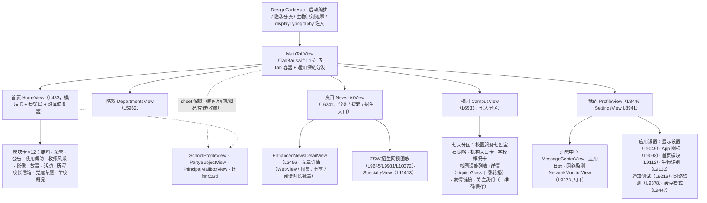

# 02 · 主要模块职责

> 基线：**2026-09-27**。模块全景表（详细小节随表后展开）：

| # | 模块 | 核心文件 | 日志域 |
|---|---|---|---|
| 1 | App 启动编排 | DesignCodeApp.swift / SplashView.swift | ui、privacy |
| 2 | 主框架与深链分发 | TabBar.swift（MainTabView） | ui、messageCenter |
| 3 | 首页 | TabBar.swift（HomeView）+ HomeModuleManager | ui、home_modules |
| 4 | 新闻资讯 | TabBar.swift（NewsListView/EnhancedNewsDetailView） | ui、articleSync |
| 5 | 院系专业 / 招生网 | TabBar.swift（DepartmentsView/ZSW*/Specialty*） | ui、departments、data |
| 6 | 校园生活（七大分区） | TabBar.swift（CampusView + FacilityDetailView） | ui、campusService、organization、schoolInfo、facility、campusLinks、socialFollow、campusCalendar |
| 7 | 机构设置 | OrganizationManager/View/DetailView | organization（219 处，全库最大域） |
| 8 | 学校概况（含合作交流） | SchoolProfileView.swift | profile、collaboration |
| 9 | 党建专题 | PartySubjectView.swift | party |
| 10 | 校长信箱 | PrincipalMailboxView.swift | mailbox |
| 11 | 收藏 | BookmarkManager + BookmarkListView | favorite、bookmark、imageCache |
| 12 | 通知系统（四+一通道轮询） | NotificationManager.swift | notification |
| 13 | 消息中心（站内信） | MessageCenterStore/View | messageCenter |
| 14 | 使用帮助 | HelpContent/HelpGuideStore/HelpGuideView | helpGuide |
| 15 | 校园日历 | CampusCalendarStore/View | campusCalendar |
| 16 | 通知测试中心 | NotificationTestView.swift | notificationTest |
| 17 | 公告 | AnnouncementManager + AnnouncementDetailView | announcement |
| 18 | 隐私合规 | PrivacyManager/PrivacyPolicyView/PrivacyLegalTexts | privacy |
| 19 | 生物识别安全锁 | BiometricSecurityManager 等 | biometric |
| 20 | **显示设置（含字体体系/灰度/阅读统计）** | DisplaySettingsManager/View（2,382 + 2,227 行） | display（40 处） |
| 21 | 缓存模式 | CacheModeManager/SettingsView | cache |
| 22 | 日志系统 | LogManager/LogListView/LogSettingsView | 被全模块调用 |
| 23 | **网络监测（netmon 八能力）** | SJZNetworkMonitor + NetworkMonitorView（1,796 + 1,609 行） | netmon（47 处）、urlProtocol |
| 24 | 已读状态 | ReadStatusManager.swift | — |
| 25 | 防盗链 + 台账 | RefererHeaderURLProtocol.swift | urlProtocol |
| 26 | App 图标切换 | TabBar.swift（AppIconManager） | appicon |
| 27 | 深链协议与排版组件族 | SJZ 组件族 / display* 修饰器 | imageCache、reading |
| 28 | **微信开放平台集成（2026-09-27）** | WeChatService + WeChatIntegrationViews + DesignCode.entitlements | wechat（63 处） |

> 全工程日志域共 **37 个、1,089 处带域埋点**（2026-09-28 复核；`LogManager.shared` 调用点合计 1,118 处，其中 `wechat` 域 63 处），完整清单与计数见 [04-依赖关系 §4.7](04-依赖关系.md)。

### 模块边界一览（负责 / 不负责）

核心模块的单句职责与显式边界如下；依赖方向为单向（视图 → 单例 → 存储/外部），全图无环 `[Data-backed]`。

| 模块 | 负责 | 不负责（显式边界） |
|---|---|---|
| DataService | 旧数据域（首页/院系/资讯/招生/专业）的同步编排、缓存与详情解析 | 新六模块数据（各自 Store 直连网络）；界面状态 |
| NetworkService | 统一 GET 封装、重试/超时、DTO 解码、URL 构造 | 缓存头/Referer/遥测（由 URLProtocol 透明注入）；业务语义判断 |
| NotificationManager | 权限、四通道轮询、指纹比对、通知投递与深链产出 | 站内信存储（交给 MessageCenterStore）；界面展示 |
| MessageCenterStore | 五通道站内信存储、去重、未读与角标联动、深链投递 | 消息来源发现（各通道负责）；系统通知投递 |
| BookmarkManager | 收藏增删查、收藏图片磁盘/内存缓存、收藏更新第五通道 | 文章详情解析（复用 DataService）；推送通道调度 |
| OrganizationManager | 机构目录、site_key 匹配、机构缓存与刷新 | 机构文章搜索（OrganizationView 负责）；子站详情渲染 |
| SchoolProfileStore | 概况七板块数据、合作交流分组、素材 URL 常量 | 相册保存实现（ProfileImageSaveShare 提供）；通用图片缓存 |
| PartySubjectStore | 党建双子站全量收集、搜索索引与历史 | 详情渲染（PartyArticleDetailView 负责）；详情缓存实现 |
| PrincipalMailboxStore | 信箱分页、搜索防抖、刷新三态 | 详情接口解码（NetworkService 负责） |
| HelpGuideStore | 内置指南读取、已读/最近阅读/搜索历史 | 指南内容撰写（HelpContent 静态数据）；网络（本模块零网络） |
| CampusCalendarStore | 日历列表缓存优先加载、分页、本地搜索、已读 | 详情视图渲染；通用缓存基建 |
| DisplaySettingsManager | 外观/排版/字体下载/正文色/亮度/锁定/灰度/阅读统计 | 阅读页纸张底色与系统级 True Tone（无公开 API）；图片渲染管线 |
| SJZNetworkMonitor | 遥测口径（链路/流量/心跳/诊断/测速）、健康分与建议 | 请求发起与重试（NetworkService 负责）；非 URLSession 流量（WKWebView/AVPlayer 为盲区，界面如实标注） |
| LogManager | 日志分级、日轮转、导出、崩溃落盘、节流 | 日志语义与域治理（各模块负责）；远程上传（无此能力） |
| RefererHeaderURLProtocol | sxjzit 域请求头与图片缓存头注入、遥测台账触点 | 非 sxjzit 域请求；业务解码；缓存策略决策（CacheModeManager 负责） |

### 模块关系图（Mermaid）

---

## 2.1 App 启动编排

**文件**：[DesignCodeApp.swift](file:///Users/qinchao/Downloads/designcode-swiftui/qin/DesignCode/DesignCodeApp.swift)（190 行）· [SplashView.swift](file:///Users/qinchao/Downloads/designcode-swiftui/qin/DesignCode/SplashView.swift)

**职责**：
- `init()` 完成四项前置：URLCache 扩容（80MB/400MB）、注册 `RefererHeaderURLProtocol`、内存警告降载、App 图标启动校准。
- ZStack 五层覆盖：主界面 / 启动页 / 隐私同意弹窗 / 受限模式 / 生物识别遮罩。
- 按 `privacyConsentAccepted` + `privacyConsentRejected` 三分流：首次启动弹同意框；拒绝过则直接进受限模式并 `stopPolling()`；已同意则正常启动并恢复通知轮询。
- `scenePhase` 驱动生物识别锁（退后台立即锁定，回前台重新认证）；`.tint(themeStyle) + .displayTypography(displaySettings)` 为全 App 显示设置/灰度唯一注入链。

## 2.2 主框架与深链分发（MainTabView）

**文件**：[TabBar.swift L15](file:///Users/qinchao/Downloads/designcode-swiftui/qin/DesignCode/TabBar.swift#L15)（主容器至 L438）

**职责**：
- 五 Tab 容器：首页(0) / 院系(1) / 资讯(2) / 校园(3) / 我的(4)；「我的」Tab 挂未读角标 `.badge`。
- 通知深链四+一类分发中枢：维护 `pendingDeepLink`（[NotificationManager.swift L115](file:///Users/qinchao/Downloads/designcode-swiftui/qin/DesignCode/NotificationManager.swift#L115)）的消费流程 `consumePendingDeepLink`（[TabBar.swift L48](file:///Users/qinchao/Downloads/designcode-swiftui/qin/DesignCode/TabBar.swift#L48)）与延迟弹 sheet 的 `scheduleNotificationArticlePresentation`（[L82](file:///Users/qinchao/Downloads/designcode-swiftui/qin/DesignCode/TabBar.swift#L82)），等待 `active && !isLockEngaged` 后才展示，让出系统回调同步链（防闪退红线）。
- sheet 挂载区集中在 [L304-L350](file:///Users/qinchao/Downloads/designcode-swiftui/qin/DesignCode/TabBar.swift#L304-L350)：新闻详情（L304）/ 学校概况（L324）/ 党建专题（L342）+ 校长信箱等深链 sheet 分发。
- 党建专题入口不放 Tab，而经 `showPartySubjectSheet` 全屏 sheet 承载完整 `PartySubjectView`。

## 2.3 首页（HomeView + HomeModuleManager）

**文件**：[HomeView](file:///Users/qinchao/Downloads/designcode-swiftui/qin/DesignCode/TabBar.swift#L483)（TabBar.swift L483 起，至 CategoryBadge 前）· [HomeModuleManager.swift](file:///Users/qinchao/Downloads/designcode-swiftui/qin/DesignCode/HomeModuleManager.swift)（356 行）

**职责**：
- 固定区块：英雄 Banner 轮播、统计行、快捷操作、（有公告时）通知公告胶囊。
- 模块区由 `homeModules.visibleOrderedModules` 驱动，用户可在「我的 → 首页模块」开关/排序；**12 个真实模块**：学校要闻、校园荣誉、通知公告、使用帮助（未读呼吸光点+学习进度环+继续阅读直达）、教师风采、映像校园、学生故事、校园活动、发展历程、校长信箱（渐变信封卡+最新一封预览+N 封回复徽章）、党建专题、学校概况（蓝金学术风入口卡）——带 0.07s 递增错峰弹簧入场（`SJZRevealOnce` 会话级去重）。
- 合作交流/校园风光两模块已退役（数据源中断，内容并入「学校概况」；rawValue `bottomBanners`/`campusSceneries` 经 `retiredRawValues` info 级静默清理）。
- 冷启动/缓存缺失时展示 Apple News 风格骨架屏（标题栏+闪烁卡片列，常显入口卡除外）。
- 容器集成 `SJZIdleTimerRepair`：滑动停止 0.12s 后做「拦截→放行」微切换，强制系统重新评估熄屏计时（配合屏幕常亮功能）；hero 装饰层实时渲染（**禁止 `drawingGroup()`**，曾致真机疑似启动黑屏）。

## 2.4 新闻资讯

**文件**：NewsListView（[L6241](file:///Users/qinchao/Downloads/designcode-swiftui/qin/DesignCode/TabBar.swift#L6241)）· EnhancedNewsDetailView（[L2456](file:///Users/qinchao/Downloads/designcode-swiftui/qin/DesignCode/TabBar.swift#L2456)）

**职责**：
- 资讯 Tab：分类筛选（要闻/更新/党建/通知/录取/校园/科研/信息）、搜索过滤、招生网入口。
- 文章详情：`loadDetail()` 经 `DataService.loadArticleFullDetail`（[DataService.swift L742](file:///Users/qinchao/Downloads/designcode-swiftui/qin/DesignCode/DataService.swift#L742)）取正文；HTML 剥纯文本渲染 + 图片提取；支持复制、分享、收藏、已读标记、阅读时间徽章（分层颜色：≤4min 绿 / 5-9 蓝 / 10-19 橙 / ≥20 紫）、图集轮播与全屏查看（缩放拖拽、网格切换、系统长按保存/分享）。
- 进页不确定彩虹扫描进度态 ↔ 图片加载确定进度态（色调旋转）。

## 2.5 院系专业 / 招生网与专业介绍

| 模块 | 位置 | 职责 |
|---|---|---|
| 院系专业 | DepartmentsView（[L5962](file:///Users/qinchao/Downloads/designcode-swiftui/qin/DesignCode/TabBar.swift#L5962)） | 院系列表 → 院系详情 → 专业详情，数据 `DataService.departments`（API+预置合并） |
| 校园生活 | CampusView（[L6533](file:///Users/qinchao/Downloads/designcode-swiftui/qin/DesignCode/TabBar.swift#L6533)，详见 §2.6） | 校园服务七色宝石网格 / 机构设置入口 / 学校概况卡 / 校园设施列表+详情 / 友情链接 / 关注我们 |
| 招生网 | ZSW 视图族 + `loadZSWHomeData`（[DataService L485](file:///Users/qinchao/Downloads/designcode-swiftui/qin/DesignCode/DataService.swift#L485)） | 独立 site_key=zsw 子站，首页/文章分页/详情（ZSWHomeView [L9645](file:///Users/qinchao/Downloads/designcode-swiftui/qin/DesignCode/TabBar.swift#L9645)、ZSWArticleListView [L9931](file:///Users/qinchao/Downloads/designcode-swiftui/qin/DesignCode/TabBar.swift#L9931)、ZSWArticleDetailView [L10072](file:///Users/qinchao/Downloads/designcode-swiftui/qin/DesignCode/TabBar.swift#L10072)） |
| 专业介绍 | Specialty 视图 + `loadSpecialtyData`（[DataService L607](file:///Users/qinchao/Downloads/designcode-swiftui/qin/DesignCode/DataService.swift#L607)） | 按专业聚合文章（oneTwoArticles 接口；SpecialtyListView [L11413](file:///Users/qinchao/Downloads/designcode-swiftui/qin/DesignCode/TabBar.swift#L11413)、College/Major 详情 L11515/L11615） |

## 2.6 校园生活七大分区（CampusView，2026-09-25/26 艺术级升级）

**文件**：CampusView（[L6533-L8446](file:///Users/qinchao/Downloads/designcode-swiftui/qin/DesignCode/TabBar.swift#L6533-L8446)）+ FacilityDetailView（[L7711-L8358](file:///Users/qinchao/Downloads/designcode-swiftui/qin/DesignCode/TabBar.swift#L7711-L8358)）

升级后由七大分区构成，**全部受显示设置管辖（主题色/字号/字重/字体家族/按钮形状/深浅色/灰度实时生效）**，新增 6 个日志域全链路埋点：

| # | 分区 | 类型/位置 | 职责与亮点 |
|---|---|---|---|
| 1 | 校园服务 | `servicesSection`（[ServiceButton L6963](file:///Users/qinchao/Downloads/designcode-swiftui/qin/DesignCode/TabBar.swift#L6963)） | 六色主题渐变「宝石」图标块（Mint/Teal/Indigo/Gold/Green/Accent 循环）+ 彩色投影 + 70ms×序号错峰弹簧入场 + 0.9 倍按压；「7 项服务」计数徽章；外部链接/内部协议/无效链接三路点击处理（校园日历走内部协议 `sxjzit://campus-calendar`） |
| 2 | 机构设置入口 | `OrganizationEntryCard`（[L7033](file:///Users/qinchao/Downloads/designcode-swiftui/qin/DesignCode/TabBar.swift#L7033)） | indigo→电光紫→青绿渐变横幅 + 96pt 倾斜机构水印 + 玻璃悬浮图标双呼吸 + 一次性微光扫过（`blendMode(.screen)`）+ 实时部门总数数字滚动子标题 |
| 3 | 学校概况卡 | `SchoolInfoCard`（[L7129](file:///Users/qinchao/Downloads/designcode-swiftui/qin/DesignCode/TabBar.swift#L7129)） | 校名 Hero 带（类型/创办徽章+水印+微光+学士帽双呼吸）+ 7 行图标档案错峰弹入；**地址一键复制**（符号替换动画）、**招生电话一键拨打**（过滤非数字直通拨号盘）、**校庆日档案**（与学校概况页对齐） |
| 4 | 校园设施 | `facilitiesSection` + `FacilityDetailView`（[L7711](file:///Users/qinchao/Downloads/designcode-swiftui/qin/DesignCode/TabBar.swift#L7711)） | 列表五色渐变图标+双行简介+分区数徽章；详情 6 大功能：① 分区目录 Liquid Glass 居中吸附轮播 ② 顶部阅读进度条（onScrollGeometryChange）③ 620pt 后浮现回顶按钮 ④ 一键复制全文（Markdown 组装+字数 toast）⑤ 重播入场动画 ⑥ 顶部悬浮定位胶囊。交互模型为**「预览与提交分离」**：拖动只移动指针，点按才跳转，正文滚动指针自动回收（v1-v3 误跳/锁死方案已被用户否定） |
| 5 | 友情链接 | `FooterLinkRow`（[L7427](file:///Users/qinchao/Downloads/designcode-swiftui/qin/DesignCode/TabBar.swift#L7427)） | 六色渐变地球徽章 + 站点名 + 真实域名副题（`URL.host` 提取）+ 主题色箭头胶囊 + 左滑错峰入场 |
| 6 | 关注我们 | `SocialQRCard`（[L7505](file:///Users/qinchao/Downloads/designcode-swiftui/qin/DesignCode/TabBar.swift#L7505)） | 金色渐变浮雕相框 + 纯白内芯（扫码对比度）+ 一次性金光扫过 + 金边平台徽章；**点按保存二维码到相册**（复用 `ProfileImageSaveShare.saveToPhotos`，三态反馈+防重复点击守卫） |
| 7 | 主分区容错 | CampusView 既有分区（历史传承） | 学生故事 / 教师风采 / 校园活动等分区随「校园生活」Tab 整体保留，与新增分区共享错峰入场与显示设置管辖 |

**新增日志域**：`campusService`（列表/内链/外链/无效链接）、`organization`（入口显示与点击）、`schoolInfo`（档案卡/复制地址/拨打电话）、`facility`（列表/详情开关/目录跳转含 source/回顶/复制/重播/50%·100% 阅读里程碑）、`campusLinks`（列表/点击含完整 href）、`socialFollow`（保存三态+下载权限写入链路）；兼容保留旧域 `campusCalendar` 原埋点。

## 2.7 机构设置

**文件**：OrganizationManager.swift（730 行）· OrganizationView.swift（2,183 行）· OrganizationDetailView.swift（5,273 行）

**职责**：
- **OrganizationManager**：从 `/common/column/head` 菜单提取部门站点 site_key（`updateSiteKeys` [L257](file:///Users/qinchao/Downloads/designcode-swiftui/qin/DesignCode/OrganizationManager.swift#L257)）；缓存 + 定时刷新 + 缓存模式联动；`syncFromAPI(force:)`（[L404](file:///Users/qinchao/Downloads/designcode-swiftui/qin/DesignCode/OrganizationManager.swift#L404)）；`validateFromPageHTML`（L521）HTML 兜底校验。
- **OrganizationView**（[L105](file:///Users/qinchao/Downloads/designcode-swiftui/qin/DesignCode/OrganizationView.swift#L105)）：机构列表（分类 filterChip）；**全站文章搜索**：500ms 防抖 → `performArticleSearch`（[L1559](file:///Users/qinchao/Downloads/designcode-swiftui/qin/DesignCode/OrganizationView.swift#L1559)）：常规 4 页 200 条 + 深度 8 页 400 条分页，双通道栏目收集（column_id 直收 + 内容页节点），并发批处理每批 8 机构流式合入，实时进度胶囊。
- **OrganizationDetailView**（[L167](file:///Users/qinchao/Downloads/designcode-swiftui/qin/DesignCode/OrganizationDetailView.swift#L167)）：`loadData`（[L1375](file:///Users/qinchao/Downloads/designcode-swiftui/qin/DesignCode/OrganizationDetailView.swift#L1375)）12s 超时/3 次重试；`parseSections`（[L1620](file:///Users/qinchao/Downloads/designcode-swiftui/qin/DesignCode/OrganizationDetailView.swift#L1620)）解析区块；`fetchArticleDetailWithFallback`（[L3481](file:///Users/qinchao/Downloads/designcode-swiftui/qin/DesignCode/OrganizationDetailView.swift#L3481)）5 个 siteId 并行取最长内容兜底；失败降级关键词并行搜索（`loadFallbackArticles` L725 / `extractKeywords` L816 / `departmentDescription` 22 部门硬编码文案 L846）。注意：改本文件前需先确认（回归敏感区）。
- **机构详情 UI 细节**：body 三态（loading / contentView / `enhancedFallbackView` 降级页）+ 刷新 Toast + **四 sheet**：文章详情 / 子标签 ChildSectionDetail（[L4601](file:///Users/qinchao/Downloads/designcode-swiftui/qin/DesignCode/OrganizationDetailView.swift#L4601)）/ 专业列表 / 历年分数线 WebView；`childTabCard`（L1182）四类路由（专业介绍/分数线/录取查询/默认子栏目）。
- **ChildSectionDetailView**：`performLoad`（[L4975](file:///Users/qinchao/Downloads/designcode-swiftui/qin/DesignCode/OrganizationDetailView.swift#L4975)）用**非结构化 Task 承载拉取防 .refreshable 取消**；分页 `siteIdsToTry` 降级链（childSiteId → ZSW siteId → "1"，NSOrderedSet 去重）+ 每页 `withTimeout(12s)`；错误五路分类（取消静默 / 全空→「无更多」/ TimeoutError L3749 / URLError / NetworkError 的 noData=null 语义与 serverError=繁忙）。
- 注意：**与用户偏好冲突（待确认）**：ChildSectionDetailView 关闭按钮用 `xmark.circle.fill`，而用户明确偏好系统返回键样式 `chevron.backward` + 长按菜单——机构子标签页疑似整改遗漏。
- 灰度挂载：OrganizationView 1 处、OrganizationDetailView 5 处 `sjzGrayScale()`。

## 2.8 学校概况（含合作交流）

**文件**：[SchoolProfileView.swift](file:///Users/qinchao/Downloads/designcode-swiftui/qin/DesignCode/SchoolProfileView.swift)（3,511 行）· 日志域 `profile` + `collaboration`

**职责**：
- `SchoolProfileStore`（[L175](file:///Users/qinchao/Downloads/designcode-swiftui/qin/DesignCode/SchoolProfileView.swift#L175)）：**七板块** = `/mapi/school/intro` 六板块（学校简介（统计数字 endNumber 字符串兼容、含**校庆日**档案）、文字区块、现任领导（7 位）、识别系统、宣传片/校歌视频素材、校园风光）+ `/school/cooperate` + 校企合作栏目接口（合作交流三分组）；`SchoolProfileAssets` 常量集中维护哈希素材 URL。
- 蓝金学术风主题（深蓝 0B1F4B + sjzGold），七板块 tab 切换；`RollingNumberView`（[L2448](file:///Users/qinchao/Downloads/designcode-swiftui/qin/DesignCode/SchoolProfileView.swift#L2448)）统计数字滚动动效；`ProfileInlineVideo`（[L2424](file:///Users/qinchao/Downloads/designcode-swiftui/qin/DesignCode/SchoolProfileView.swift#L2424)）内联 AVKit 出现即播/离开即停。
- `ProfileImageSaveShare.saveToPhotos(urlString:logTag:)`（[L2688](file:///Users/qinchao/Downloads/designcode-swiftui/qin/DesignCode/SchoolProfileView.swift#L2688)）：下载→相册权限→JPEG 重编码→临时文件→file-based `PHAssetCreationRequest.addResource` 写入（WebP 铁律封装）；被校园 Tab「保存二维码」与概况相册共用。
- 合作交流固定顺序三分组：国际交流（蓝）/ 继续教育（青绿）/ 校企合作（金蓝），计数徽章 + 预热状态指示；跨栏目 ID 冲突场景强制用内联 content。
- `localSearch`（[L339](file:///Users/qinchao/Downloads/designcode-swiftui/qin/DesignCode/SchoolProfileView.swift#L339)）六板块+合作交流全文搜索（标题/正文/分类加权、分段高亮、来源徽章）。
- `SJZScrollActivityTracker`（[L31](file:///Users/qinchao/Downloads/designcode-swiftui/qin/DesignCode/SchoolProfileView.swift#L31)，internal 共享组件）滚动方向节流追踪，供各模块埋点复用。
- 手动刷新必须清空详情缓存（sceneryAlbums/cooperateDetails）并推进 `cacheGeneration` 代际（预热任务双重校验世代，防旧内容写回）。
- 灰度挂载：7 处 `sjzGrayScale()`（全模块最多）。

## 2.9 党建专题

**文件**：[PartySubjectView.swift](file:///Users/qinchao/Downloads/designcode-swiftui/qin/DesignCode/PartySubjectView.swift)（2,566 行）· 日志域 `party`

**职责**：
- `PartySubjectStore`（[L59](file:///Users/qinchao/Downloads/designcode-swiftui/qin/DesignCode/PartySubjectView.swift#L59)）：双站点（党建工作 site_key=djgz、思政专题 site_key=mkszy），每站 1 次 `/dept/home2` 递归收集；常规 4 页×50 上限即可全量覆盖（djgz 139 篇 + mkszy 161 篇 = 300 篇）。
- 本地多词 AND 搜索 `localSearch`（[L135](file:///Users/qinchao/Downloads/designcode-swiftui/qin/DesignCode/PartySubjectView.swift#L135)）：标题权重 5 + 描述 2 + 标签 1，相关度排序；`searchHitDistribution` 两站命中分布徽章；搜索历史 10 条（去重置顶）。
- **文章详情体系（2026-09-25 新增）**：`PartyContentParser`（[L1657](file:///Users/qinchao/Downloads/designcode-swiftui/qin/DesignCode/PartySubjectView.swift#L1657)）纯正则解析 HTML → `PartyParseOutcome`（L1650）富文本块（`PartyRichBlock` L1637）；`PartyArticleDetailCache`（[L1762](file:///Users/qinchao/Downloads/designcode-swiftui/qin/DesignCode/PartySubjectView.swift#L1762)，@unchecked Sendable）详情缓存；`PartyArticleDetailView`（[L1807](file:///Users/qinchao/Downloads/designcode-swiftui/qin/DesignCode/PartySubjectView.swift#L1807)）详情页 + `PartyFullScreenPayload`（L2563）全屏图片查看。
- 容器型栏目（首页聚合等 500 错误栏目）单栏容错隔离，失败只影响自身；滑动方向（3s 节流）与触底（10s 哨兵节流）行为埋点；灰度挂载 2 处。

## 2.10 校长信箱

**文件**：[PrincipalMailboxView.swift](file:///Users/qinchao/Downloads/designcode-swiftui/qin/DesignCode/PrincipalMailboxView.swift)（1,787 行）

**职责**：
- `PrincipalMailboxStore`（L23 起）：分页拉取（两页×30）；注意：DTO 层级必须与真实抓包对齐——`school/msg` 仅两层 data 嵌套，多建一层会导致「成功返回 0 条」静默失败。
- 搜索：Liquid Glass 搜索框（聚焦描边动画）、500ms 防抖、历史 10 条持久化、命中计数胶囊、空态引导；覆盖来信与回复标题全文匹配。
- 刷新：工具栏三态动画（触觉→旋转进度→绿色对勾脉冲）+ 顶部状态横幅 + 下拉刷新（刷新本体与手势任务解耦防 cancelled 误报）；手动刷新必定真实拉取。
- 拨号 / 复制 / 发信入口；详情走 `/common/msg/detail`（article_id + site_id + msg_id 三参数）。

## 2.11 收藏

**文件**：[BookmarkManager.swift](file:///Users/qinchao/Downloads/designcode-swiftui/qin/DesignCode/BookmarkManager.swift)（424 行）+ [BookmarkListView.swift](file:///Users/qinchao/Downloads/designcode-swiftui/qin/DesignCode/BookmarkListView.swift)（513 行）

**职责**：
- 收藏增删查（`addBookmark` L112、`toggleBookmark` L170）；上限受缓存模式控制（LRU 淘汰）。
- **图片缓存基建**：SHA256 键（`imageCacheKey` L310）、NSCache 数量/大小双限制、磁盘 `BookmarkImages/*.img`、OSAllocatedUnfairLock；缓存命中日志按 URL 首次出现节流（`imageCache` 域 19 处）。
- **第五推送通道**：`checkBookmarkedArticlesForUpdates`（L340）比对收藏文章正文指纹变化 → `sendUpdateNotifications`（L366）本地推送「收藏文章已更新」+ 入消息中心。
- 收藏列表 UI：仿 OrganizationView filterChip、空态引导、阅读进度展示。

## 2.12 通知系统（NotificationManager）

**文件**：[NotificationManager.swift](file:///Users/qinchao/Downloads/designcode-swiftui/qin/DesignCode/NotificationManager.swift)（1,067 行）

**职责**：
- 权限（`requestPermission` [L173](file:///Users/qinchao/Downloads/designcode-swiftui/qin/DesignCode/NotificationManager.swift#L173)、`refreshAuthorizationStatus` L190）与轮询（`startPolling` [L233](file:///Users/qinchao/Downloads/designcode-swiftui/qin/DesignCode/NotificationManager.swift#L233)，默认 30 分钟 `notificationPollingMinutes`，Timer 驱动）。
- `checkForUpdates(pushToSystem:)`（[L262](file:///Users/qinchao/Downloads/designcode-swiftui/qin/DesignCode/NotificationManager.swift#L262)）四通道：
  1. `checkNewsUpdates`（L281）新闻：对比 `notifiedArticleIds`（上限 2000）
  2. `checkMailboxUpdates`（L398）信箱：最新一条对比
  3. `checkSchoolProfileUpdates`（L491）概况：`schoolProfileBaseline` 三段 `领导数|风光数|合作条数`（当前基准 7|10|29，兼容旧 7|10|18 与两段版迁移）
  4. `checkPartySubjectUpdates`（L641）党建：`partySubjectBaseline` 四段 `djgzTotal|djgzTop3|mkszyTotal|mkszyTop3`（指纹含最新 3 篇 id|time 签名，**必须按 id 去重**）
  - 静默检测模式（`pushToSystem: false`，消息中心前台自动检查用）：只 `MessageCenterStore.ingest` 入站内信、不推系统通知。
- 统一处理入口 `handleNotificationTap`（[L809](file:///Users/qinchao/Downloads/designcode-swiftui/qin/DesignCode/NotificationManager.swift#L809)）：日志 → 设置 `pendingDeepLink`（不直接弹 UI）。
- 防轰炸：每次最多 5 条、间隔 1 秒；`getDeliveredNotifications` 首次启动导入历史（经 `withCheckedContinuation` 包装的 completionHandler 版本，注意：async 变体在 iOS 26 SDK 会错落到 completionHandler 版）。
- 测试支持：`ensureRealTestArticle`（本地无文章时现场拉官网要闻兜底）、`sendTestNotification`、`simulateNotificationTap`、`setBadgeCount`。

## 2.13 消息中心（站内信）

**文件**：[MessageCenterStore.swift](file:///Users/qinchao/Downloads/designcode-swiftui/qin/DesignCode/MessageCenterStore.swift)（823 行）+ [MessageCenterView.swift](file:///Users/qinchao/Downloads/designcode-swiftui/qin/DesignCode/MessageCenterView.swift)（925 行）

**职责**：
- 五通道消息盒：新闻 / 信箱 / 概况 / 党建 / 收藏更新（`MessageKind` [L20](file:///Users/qinchao/Downloads/designcode-swiftui/qin/DesignCode/MessageCenterStore.swift#L20)）；`MessageItem`（[L67](file:///Users/qinchao/Downloads/designcode-swiftui/qin/DesignCode/MessageCenterStore.swift#L67)）自定义 `init(from:)` 容错解码：未知 kind 降级 news、缺字段默认值，旧数据/损坏字段不拖垮整库。
- `ingest`（[L324](file:///Users/qinchao/Downloads/designcode-swiftui/qin/DesignCode/MessageCenterStore.swift#L324)）去重：同 id 二次 ingest 且标题不变时**仅当 deepLink 补全才落盘**（防重启丢深链）；概况/党建聚合消息 id 用**毫秒时间戳**防同秒撞车。
- 历史导入 24 小时窗口：当天通知导入为未读（点亮角标），更早归档为已读（防历史轰炸）；`isTest` 排除测试通知。
- 读取/写盘：`load()`（[L201](file:///Users/qinchao/Downloads/designcode-swiftui/qin/DesignCode/MessageCenterStore.swift#L201)）带损坏文件改名抢救 + 逐条抢救；`save()`（L265）临时文件 + `replaceItemAt` 原子替换 + 写后读回自校验，损坏备份时间戳命名保留 5 份（`trimCorruptBackups` L309）；FIFO 截断 `applyMaxCountLimit`（L391）——**61 例测试重点覆盖区**。
- UI（MessageCenterView [L15](file:///Users/qinchao/Downloads/designcode-swiftui/qin/DesignCode/MessageCenterView.swift#L15)）：日分组（今天/昨天/更早，每分钟刷新相对时间）；筛选 chips + 关键词搜索（橙色 sjzOrange 高亮，NSRange⇄Character 双域安全）；行内交互——左滑删除 / 长按动态菜单（已读切换+复制+分享）/ 点击消未读并打开深链或详情卡；**已读/未读切换弹簧动画（spring 0.4/0.75）+ 轻触觉反馈**；全部已读三态脉冲按钮；空态「立即检查」；设置面板（清空 all/readOnly 双 scope——**必须红色确认弹窗**（提示「未读计数与角标将同步清零」）、角标联动开关，关闭时 `setBadgeCount(0)` 清零）；长按铃铛 5 次 → 诊断修复面板（`repairRewrite` L688）。
- 前台自动静默检查（`messageCenterAutoCheck` 30 分钟节流，`handleSceneActive` L558）+ 点击深链复用 `handleNotificationTap`（source=message_center，0.45s 关页面板 → 既有防闪退链路）；详情卡复制有独立 info 埋点；灰度挂载 3 处。

## 2.14 使用帮助（helpGuide）

**文件**：[HelpContent.swift](file:///Users/qinchao/Downloads/designcode-swiftui/qin/DesignCode/HelpContent.swift)（587 行，内置内容）+ [HelpGuideStore.swift](file:///Users/qinchao/Downloads/designcode-swiftui/qin/DesignCode/HelpGuideStore.swift)（239 行）+ [HelpGuideView.swift](file:///Users/qinchao/Downloads/designcode-swiftui/qin/DesignCode/HelpGuideView.swift)（1,550 行）

**职责**：
- **零网络本地内容**：5 分类 32 篇内置指南（HelpCategory/HelpArticle/HelpStep 三级结构），六个新 Store 中唯一不直连 NetworkService 的。
- 主页面（[L14](file:///Users/qinchao/Downloads/designcode-swiftui/qin/DesignCode/HelpGuideView.swift#L14)）：分类卡片 + 搜索 + 最近阅读；详情页：步骤化指南 + 复制全文 + 有帮助/没帮助反馈 + 相关阅读原地切换滚回顶 + 全部已读。
- 搜索：多词 AND 加权 + 橙色关键词高亮 + 历史（10 条去重置顶）+ 防抖「正在搜索…」指示（`isSearchPending` 防旧空结果闪现「未找到」）。
- 学习进度：已读百分比 + 34pt 进度环 + 未读呼吸光点 + 继续阅读直达 + 阅读时间徽章四档配色。
- 首页锚点卡与 `HomeModuleManager.hiddenModules` 联动出入场；图标一律使用脚本校验过的 SF Symbol（`magnifyingglass.fill` 已在 iOS 26 运行时失效，改用 `sparkle.magnifyingglass`）；灰度挂载 1 处。

## 2.15 校园日历

**文件**：[CampusCalendarStore.swift](file:///Users/qinchao/Downloads/designcode-swiftui/qin/DesignCode/CampusCalendarStore.swift)（478 行）+ [CampusCalendarView.swift](file:///Users/qinchao/Downloads/designcode-swiftui/qin/DesignCode/CampusCalendarView.swift)（1,485 行）

**职责**：
- **数据源**：官网校园生活「校园日历」栏目，columnId 常量 `NetworkService.campusCalendarColumnId`（[NetworkService.swift L441](file:///Users/qinchao/Downloads/designcode-swiftui/qin/DesignCode/NetworkService.swift#L441)），**零新接口**——复用 `fetchArticles`/`fetchArticleDetail`（siteId "1"）。
- **列表**：`loadInitial(force:)` 冷启动先读本地缓存（`campusCalendarCache`，含时间戳）再静默刷新；`isFromCache` 驱动「离线缓存」徽章；`loadMore()` 分页触底续拉；`refresh(source:)` 四来源（下拉/工具栏/重试/进入）三态状态机 + `refreshDetached` 防取消误报（刷新会显式接管取消搜索防抖任务，防并发双写列表）。
- **搜索（本地全量）**：多词 AND（标题权重 3 / 摘要权重 1）+ 300ms 防抖（`isSearchPending`）+ 搜索前分页全量拉齐（maxPages 10 保护）；历史去重置顶 ≤10。
- **详情**：内存缓存字典 + 已读落盘；文章 ID 无效直接失败（不用标题兜底）；时间工具 `dateText(_:)` 解析官网三种格式（兜底前 10 字符）。
- **UI**：列表页渐变 Hero 头卡（同步证据/共 N 期/离线缓存徽章）+ Liquid Glass 搜索框 + 五色渐变卡片（官网占位图不渲染缩略图）+ stagger 入场 + 骨架 redacted + 三态横幅 + 空态/失败重试卡（[L21](file:///Users/qinchao/Downloads/designcode-swiftui/qin/DesignCode/CampusCalendarView.swift#L21)）；详情页大图竖排（SJZCachedImage 1440）轻点全屏（缩放拖拽）+ **长按系统菜单保存/分享**（WebP 经 JPEG 重编码 file-based 写入，规避 PHPhotosErrorDomain 3302）+ 复制全文 + 查看原文 + 保存全部图片；灰度挂载 1 处。
- 入口：校园页「校园服务」第七项 `sxjzit://campus-calendar` 内部协议分流。

## 2.16 通知测试中心

**文件**：[NotificationTestView.swift](file:///Users/qinchao/Downloads/designcode-swiftui/qin/DesignCode/NotificationTestView.swift)（501 行）

**职责**：入口「我的 → 应用设置 → 通知测试」（状态徽章 就绪/未授权）。五分区：权限探测（自动）、前台横幅测试（点击横幅跳真实文章详情）、后台/锁屏送达测试（覆盖冷启动）、模拟点击通知（不依赖权限）、角标测试（设置/清除桌面角标）。测试记录面板 20 条上限（成功/失败闭环），通知测试文章兜底 `ensureRealTestArticle()` 保证点击必达。

## 2.17 公告

**文件**：[AnnouncementManager.swift](file:///Users/qinchao/Downloads/designcode-swiftui/qin/DesignCode/AnnouncementManager.swift)（340 行，`refresh` [L78](file:///Users/qinchao/Downloads/designcode-swiftui/qin/DesignCode/AnnouncementManager.swift#L78)）+ AnnouncementDetailView.swift

**职责**：独立 URLSession 拉取 `www.43322.cn/blog`；标题关键字判定开关（零后端远控）；缓存于 `announcementCache`；详情页 HTML 渲染 + 复制/分享；公告变化经首页胶囊露出。

## 2.18 隐私合规

**文件**：[PrivacyManager.swift](file:///Users/qinchao/Downloads/designcode-swiftui/qin/DesignCode/PrivacyManager.swift)（449 行）+ [PrivacyPolicyView.swift](file:///Users/qinchao/Downloads/designcode-swiftui/qin/DesignCode/PrivacyPolicyView.swift)（795 行：`PrivacyPolicyHomeView` L13 / `PrivacyDocumentView` L149 / `PrivacyConsentView` L371 / `RestrictedModeView` L631）+ [PrivacyLegalTexts.swift](file:///Users/qinchao/Downloads/designcode-swiftui/qin/DesignCode/PrivacyLegalTexts.swift)（265 行）

**职责**：协议文档从 43322.cn 拉取（本地离线兜底文本）；首次启动同意弹窗、拒绝进受限模式（停止数据采集）；注意：[PrivacyPolicyView.swift L763](file:///Users/qinchao/Downloads/designcode-swiftui/qin/DesignCode/PrivacyPolicyView.swift#L763) 含 `exit(0)`（Apple 审核红线，改动前必须单独确认）；灰度挂载 3 处。

## 2.19 生物识别安全锁

**文件**：[BiometricSecurityManager.swift](file:///Users/qinchao/Downloads/designcode-swiftui/qin/DesignCode/BiometricSecurityManager.swift)（524 行）+ BiometricSettingsView + BiometricLockOverlayView

**职责**：
- **四态状态机** `LockState`：`inactive`（未启用）/ `locked` / `authenticating` / `unlocked`（[L152-157](file:///Users/qinchao/Downloads/designcode-swiftui/qin/DesignCode/BiometricSecurityManager.swift#L152-L157)）。
- **三触发源**：冷启动（init 时 isEnabled→locked，L219-223）；后台返回（`handleReturnToForeground` L277-299：按 `BiometricLockPolicy` 窗口 immediate/1min/5min 判定，**1.5s 解锁豁免**防 Face ID 对话框关闭触发误锁）；敏感页面请求（`requestLock` L312-315）。
- **能力探测**（`refreshCapability` L239-267）：Face ID/Touch ID/Optic ID 三级，未录入/模拟器/未设密码分级提示（`BiometricCapability` L54-99），`needsSystemSettings` 触发引导通知 `biometricNeedsSystemSettings`（L495）。
- **认证路由**（`performEvaluation` L366-426）：默认 `deviceOwnerAuthenticationWithBiometrics`；**连续 5 次比对失败 → 降级 `deviceOwnerAuthentication`（设备密码）**；`userFallback` / `biometryLockout`（系统锁定）→ 密码路由。失败计数仅 `isBiometricMatchFailure` 时累加，成功清零。
- **首次启用流**（`enableWithGuidedFlow` L431-460）：能力探测 → **Keychain 门控写入**（失败=设备未设密码，引导系统设置）→ 认证（通过→isEnabled=true 并锁定；取消/失败→回滚删除令牌）。关闭需二次认证（`disableWithConfirmation` L463-481）。
- 遮罩 `BiometricLockOverlayView`（zIndex 4）防多任务预览泄露；`isLockEngaged`（L176）供深链等待窗口判断；LAError 全枚举中文文案（13+ case + Xcode 27 SDK 新 case default 兜底）。

**Keychain 细节**（[L161-165 + L498-525](file:///Users/qinchao/Downloads/designcode-swiftui/qin/DesignCode/BiometricSecurityManager.swift#L498-L525)）：
- 存储：`kSecClassGenericPassword`，service=`com.qinchao.DesignCode.biometric`，account=`enrollment-token`；值=**双 UUID 拼接令牌**。
- 可访问性：`kSecAttrAccessibleWhenPasscodeSetThisDeviceOnly` —— ①无密码设备 `SecItemAdd` 自然失败 → 实现「首次启用引导设置密码」门控；②ThisDeviceOnly 不随备份迁移 → 换机必须重新注册。
- **令牌只写不读**：仅有 `saveToken`/`deleteToken`，全工程无 SecItemCopyMatching —— 令牌是「可写性凭证/物理门控」，不参与验证比对。

**脆弱点（实测）**：
1. `saveToken` 无 `errSecDuplicateItem` 容错：异常路径残留令牌时再次启用会 `SecItemAdd` 失败 → 误报「未设置设备密码」。
2. `biometricLastUnlockAt` 写入后**从未读取**——死存储键。
3. 旧文档曾写「低电量等系统异常优雅降级」——代码**无显式低电量分支**，靠 LAError default 兜底，属文档美化。

## 2.20 显示设置（2026-09-26 艺术级重构）

**文件**：[DisplaySettingsManager.swift](file:///Users/qinchao/Downloads/designcode-swiftui/qin/DesignCode/DisplaySettingsManager.swift)（**2,382 行**）+ [DisplaySettingsView.swift](file:///Users/qinchao/Downloads/designcode-swiftui/qin/DesignCode/DisplaySettingsView.swift)（**2,227 行**）· 日志域 `display`（40 处）· 入口 TabBar [L9049](file:///Users/qinchao/Downloads/designcode-swiftui/qin/DesignCode/TabBar.swift#L9049)

**职责（Manager 中枢 + 12 Section UI）**：全部设置实时生效、全局响应、自动持久化（didSet 落盘 + 日志 + 变更史）。

| Section | 功能要点（F 编号为改造规格书条目） |
|---|---|
| Hero 实时预览（F1） | aurora 渐变 + Liquid Glass + 呼吸（2.4s）+ 慢扫光（3.2s 单次）；8 维设置全景实时预览；非默认项计数徽章；主/次按钮直达设置 |
| 外观（F2/F3） | 3 模式横排卡（浅色/深色/跟随系统）+ glassEffect 选中态；5 主题色图鉴（渐变圆徽章+色名+涟漪扩散） |
| 排版方案（F4） | 3 套一键套装：阅读舒适（宋体 1.12×/行距1.25/字距0.2）、紧凑高效（系统字体 0.94×/0.95/0）、护眼大字（圆体 1.26×/1.45/0.5 粗体）；`applyScheme` 一次改 6 项 + toast + 变更史 + 日志前后值 |
| 文字排版（F5/F6/F7/F19） | 6 档字号刻度滑块；粗体开关；**7 款中文全字形家族真字貌画廊**（家族名以自身字体渲染+选中描边+下载状态徽章）；行距/字距 A/B 对照卡（当前 vs 默认实时滑动渲染）+ **排版标尺可视化**（字距刻度尺+行距基线网格随滑块位移）；按钮形状开关 |
| 文章文字颜色（F8/F9/F10/F17） | 8 预设 + 白纸/深纸双面纸面预览 + 自定义 hex 输入 + **最近 6 色历史 ring buffer**（`DisplayHistoryOperator` 去重置顶）+ 随机和谐色骰子（0.3s 防连点）+ **WCAG 对比度自检**（`DisplayContrastChecker` 纯函数，绿 ≥4.5 / 橙 2.5–4.49 / 红 <2.5，双环境判定） |
| 阅读统计 | 正文字数/预计时长开关、列表徽标开关、阅读速度档位（`ReadingSpeedTier`）；五层引擎见下 |
| 屏幕（F11） | 亮度滑杆 + 25/50/75/100% 快捷胶囊 + 光感太阳随亮度缩放 + 自动亮度开关（交还系统时保持记录不再恢复） |
| 自动锁定 | 7 档（30s~永不）；「永不」经 `isIdleTimerDisabled` 真实生效（与屏幕常亮取或） |
| 屏幕常亮 | 独立开关（琥珀渐变图标），与「自动锁定=永不」逻辑或；任一关闭显式复位系统计时器；低电量橙色警示（`lowPowerModeEnabled`） |
| 辅助功能（F12/F18） | 「更深颜色」+ VoiceOver 运行状态行（系统通知监听）；**专注灰度模式**（F18）：App 内全局去饱和开关，说明文案「图片与配色将转为灰度，专注文字阅读」 |
| 最近改动时间轴（F13） | 最近 20 条变更 ring buffer（字段/中文名/新值中文描述/时间）+ 错峰入场 + 清空（`DisplayHistoryOperator.appendChange`） |
| 其他（F15） | ShareLink 分享排版摘要（`shareSummaryText`）+ 恢复默认（红色确认弹窗 + 清历史 + 关灰度）+ 版本号 |
| 页面埋点（F14） | 打开/关闭停留时长 + Section 首曝（Session 去重） |

**中文字体体系（2026-09-26 晚重构，历史教训驱动）**：
- 旧字体库全为西文字体、无中文字形——中文 App 下切换零变化（全回退苹方）。现为 **7 款中文全字形家族**：苹方黑体（system/PingFang SC 恒可用）、宋体（Songti SC）、楷体（Kaiti SC）、圆体（Yuanti SC）、行楷（Xingkai SC）、隶变（Libian SC）、魏碑（Weibei SC）；`fontName` 静态映射；旧存储值迁移 `normalized(rawValue:)`（serif/georgia→宋体、rounded→圆体、palatino→楷体、avenir→系统）。
- **系统按需下载机制**：真机 iOS 27 家族列表仅 PingFang SC；宋/楷/圆/行楷/隶变/魏碑为系统级按需下载字体，须 `CTFontDescriptorMatchFontDescriptorsWithProgressHandler` 显式下载（didMatch=就绪 / didFailWithError=可重试）。状态机 `DisplayFontAvailability`（ready/downloading/unavailable）+ `inFlightFontDownloads` 去重。
- `ensureFontFamily(_:reason:)`（[L1080](file:///Users/qinchao/Downloads/designcode-swiftui/qin/DesignCode/DisplaySettingsManager.swift#L1080)）三个触发点：`startup_preheat`（启动预热 L820）/ `scheme_apply`（方案套用 L1208）/ `gallery_tap`（画廊点选，View L669）；下载完成 `typographyRevision += 1` 驱动全 App `display*` 文本重建即时生效；画廊徽章（转圈/橙箭头重试）。
- **遗留风险**：下载请求可能因网络无法访问苹果字体服务器而长时间挂起（当前无超时兜底 → 状态可能持续「下载中」）；另有 B 计划（随包分发 OFL 免费中文字体）见 05 §5.7。

**专注灰度模式（F18）**：
- 开关 `grayScaleEnabled`（存储键 `displayGrayScaleMode`）；注入点 ① `DisplayTypographyModifier` 内 `.saturation(grayScaleEnabled ? 0 : 1)`（经 App 根链单点生效）；② `SJZGrayScaleModifier`（[DisplaySettingsManager.swift L1529](file:///Users/qinchao/Downloads/designcode-swiftui/qin/DesignCode/DisplaySettingsManager.swift#L1529)）——**sheet/fullScreenCover 不继承根视图修饰器**，须逐 presentation 挂载：全 App **44 处调用点**（TabBar 21 / SchoolProfileView 7 / OrganizationDetailView 5 / MessageCenterView 3 / PrivacyPolicyView 3 / PartySubjectView 2 / HelpGuideView·OrganizationView·CampusCalendarView 各 1）；系统分享面板属系统 UI 不在灰度范围。

**阅读统计引擎**（Manager 文件下半部，纯函数三层 + 缓存 + 渲染分离）：
- `ReadingStatsCalculator`（[L1580](file:///Users/qinchao/Downloads/designcode-swiftui/qin/DesignCode/DisplaySettingsManager.swift#L1580)）：**字数口径 A** = 中文字符（CJK 区段）+ 英文单词（撇号/连字符/下划线延续词）；时长 = 中文/300 + 英文/220（速度档 `max(60,v)`）+ 图片（首张 12s 递减至 3s）+ 代码块 30s/块，ceil 保底 1 分钟；`stripMarkdown`/`stripHTML`（纯正则，全项目禁 NSAttributedString HTML 解析）。
- `ReadingStatsCache`（[L1816](file:///Users/qinchao/Downloads/designcode-swiftui/qin/DesignCode/DisplaySettingsManager.swift#L1816)，@MainActor，500 条）：Entry 只存分量（速度档变化按分量重算不失真）；`insertionOrder` 真 FIFO；`Diagnostics` 跨启动持久化（mounted/resolveAttempts/badgeMounted/badgeComputed）。
- `ReadingStatsService.resolve`（[L1979](file:///Users/qinchao/Downloads/designcode-swiftui/qin/DesignCode/DisplaySettingsManager.swift#L1979)）：门控 → 缓存命中零扫描重算 → 三源预处理（.plain/.markdown/.html）→ 超 50,000 字符转 `Task.detached(.utility)`。
- 渲染组件：`ArticleReadingStatsText`（详情 meta 行 [L2117](file:///Users/qinchao/Downloads/designcode-swiftui/qin/DesignCode/DisplaySettingsManager.swift#L2117)）+ `ReadingTimeBadgeView`（列表角标 [L2283](file:///Users/qinchao/Downloads/designcode-swiftui/qin/DesignCode/DisplaySettingsManager.swift#L2283)，8pt 图标/10pt 文本/Capsule，不遮挡缩略图）；**恒存锚点容器教训**：生命周期修饰符必须挂恒在的 ZStack(Color.clear) 上（挂条件 Group 上永不触发 →「永不显示」死锁）；四档配色 `ReadingDurationTier`（≤4 绿/5-9 蓝/10-19 橙/≥20 紫）。

## 2.21 缓存模式

**文件**：CacheModeManager.swift（455 行）+ CacheModeSettingsView.swift（600 行）· 日志域 `cache`

**职责**：**两种模式**（即时刷新 ↔ 缓存模式，全 App 只有两档）；控制各缓存容量上限（图片 96/40MB 双限额等）、收藏上限、详情缓存策略；内存警告降载 handler；10 分钟同步短路 + 缓存模式挂起定时刷新；命中率统计。

## 2.22 日志系统

**文件**：LogManager.swift（351 行）+ LogListView.swift（393 行）+ LogSettingsView.swift（86 行）

**职责**：`log(domain:level:message:context:)` 统一入口（异步防抖写入）；日轮转文件 `Logs/log_YYYY-MM-DD.json`、崩溃捕获（`crashWrite`）、导出（UTType 文件）；LogListView 按域筛选/日选择/清空；**全工程 37 日志域、1,089 处带域埋点**（`LogManager.shared` 调用点 1,118 处，覆盖 38 个文件）。

## 2.23 网络监测（netmon，2026-09-26 全面扩建）

**文件**：[SJZNetworkMonitor.swift](file:///Users/qinchao/Downloads/designcode-swiftui/qin/DesignCode/SJZNetworkMonitor.swift)（**1,796 行**）+ [NetworkMonitorView.swift](file:///Users/qinchao/Downloads/designcode-swiftui/qin/DesignCode/NetworkMonitorView.swift)（**1,609 行**）· 日志域 `netmon`（47 处）· 入口 TabBar [L9378](file:///Users/qinchao/Downloads/designcode-swiftui/qin/DesignCode/TabBar.swift#L9378)（我的 → 应用设置 → 网络调试 → 网络监测）

**八项能力**（模块头注释即规格）：
1. **链路感知**：`NWPathMonitor` + iOS 26 `linkQuality` / `isUltraConstrained` / IPv4·IPv6·DNS / 接口类型 / 昂贵网络判定 / 网关与 IP / 校园网判定。
2. **链路事件时间线**：断网/恢复/异常三 kind，`@AppStorage` 持久化最近 30 条（`netmonTimelineJSON`）。
3. **全 App 实时流量统计**：`URLProtocol` 埋点台账（`NetworkMonitorLedger`，含上行 httpBody 估算；本项目纯 GET 上行≈0，UI 如实标注「上行按请求体估算」）。
4. **主动心跳实时采样**：页面可见 5s 起步；三档智能省电 5s/10s/30s（2min/5min 无业务流量降档）；**scenePhase 前台门控**（退后台立即暂停防「离线」误判）；热连接复用单会话。
5. **吞吐与历史**：EMA 瞬时吞吐（α=0.35）/ 并发在飞 / 会话峰值 / 慢主机 TOP3（主机归因）/ 分钟级小时历史（60 槽环形）/ 今日流量跨启动（1s 内存累计 + 10s 批写 + 退后台 flush + 日历键翻转清理仅留 3 天）。
6. **双目标网络诊断**：网关 API + 官网门户两目标 ×5 轮冷连接（独立会话）分阶段计时；诊断历史内存 3 + 持久 1；一致性提示。
7. **校园网健康分**：0-100（`cq35+p90m30+loss20+tp15` 权重）+ 优化建议生成器 + 诊断报告文本（复制/分享快照）。
8. **一键带宽测速**：**不挑图**——候选池 = 真实服务器图片 → 已缓存 sxjzit 图；先 HEAD 取 Content-Length 剔除 <200KB 缩略图并排序；对胜出资源循环下载至 8MB 或 10s（干净会话 + 手工 Referer/UA + host 校验；内存丢弃不落盘）；1s 滑动窗口峰值分级（≥4/≥1.5/≥0.5 MB/s）；与心跳/诊断 `setSuspended(true)` 互斥防口径污染。

**UI（NetworkMonitorView）**：Hero 状态卡 + 链路/身份卡 + **Swift Charts 双曲线**（下行 accent / 上行 teal 虚线，窗口 30/60/120s 可切，查值/拖拽挂起自动跟随，reduceMotion 停动画）+ 图例/浮签 + 链路时间线 + 诊断卡（5 轮动画/健康分/建议/报告）+ 测速卡（进度环 + 数字滚动 + 分级 badge）+ 小时历史卡 + 今日流量卡 + 异常预警横幅 + 缓存模式联动卡 + 工具栏手动刷新（`monitorCard()` L1542 统一卡片风格；`FlowBars` L1560 装饰）。

**验收要点**（规格书 DoD）：冷启动进页 5s 内曲线有数据；飞行模式红卡+曲线归零+时间线 outage/recovery 且重启保留；后台切换心跳暂停/恢复无误判；入口行 5s 刷新四要素；netmon 域 29+ 类事件齐全零刷屏。

## 2.24 ~ 2.27 其余支撑模块

| 模块 | 文件 | 职责要点 |
|---|---|---|
| 已读状态 | ReadStatusManager.swift | `readArticleIds`（上限 5000）读/写/清 |
| 防盗链 + 台账 | RefererHeaderURLProtocol.swift（232 行） | 拦截 `*.sxjzit.edu.cn`，注入 Referer 与浏览器 UA（[startLoading L61](file:///Users/qinchao/Downloads/designcode-swiftui/qin/DesignCode/RefererHeaderURLProtocol.swift#L61)）+ 图片 7 天缓存头（no-store 除外）+ **netmon 台账钩子**（L88 `tapUploadEstimate` 上行触点）；注意：全局网络拦截，改动需先确认 |
| 首页模块管理 | HomeModuleManager.swift | **12 模块**可见性/排序持久化、`visibleOrderedModules`、`dataCount` 主线程回调；`retiredRawValues` 静态退役集 + init 区分日志级别静默清理旧值 |
| App 图标 | TabBar.swift AppIconManager（[L11707](file:///Users/qinchao/Downloads/designcode-swiftui/qin/DesignCode/TabBar.swift#L11707-L11991)） | 4 套备用图标（AppIconAlt1~4）+ 默认；`switchTo`（仅用户显式操作+系统确认框，禁止后台自动切换）、`calibrateOnLaunch`（本地存储与系统对齐）；3 列网格选择 UI（AppIconSettingsView [L11831](file:///Users/qinchao/Downloads/designcode-swiftui/qin/DesignCode/TabBar.swift#L11831)） |
| SJZ 组件族 | TabBar.swift L10419-L11413 | 图片/进度/加载态/揭示动效公共组件（详见 03 §3.11） |
| display* 修饰器族 | DisplaySettingsManager.swift | `displayText` / `displayTypography` / `displayFont` / `displaySymbolFont` / `displayLabelFont` / `shapedButtonStyle` / `sjzGrayScale`——全 App 排版与灰度的统一入口 |

## 2.28 微信开放平台集成（2026-09-27 新增）

**文件**：[WeChatService.swift](file:///Users/qinchao/Downloads/designcode-swiftui/qin/DesignCode/WeChatService.swift)（**1,307 行**）+ [WeChatIntegrationViews.swift](file:///Users/qinchao/Downloads/designcode-swiftui/qin/DesignCode/WeChatIntegrationViews.swift)（**822 行**）+ `DesignCode/DesignCode.entitlements` · 日志域 `wechat`（63 处）· SDK：`Frameworks/WechatOpenSDK.xcframework`（OpenSDK 2.0.8，唯一第三方）· 入口：文章详情「分享 → 分享到微信」网页卡片（**7 处**：新闻 / 荣誉 / 教师 / 故事 / 活动 / 机构 / 党建，2026-09-28 补齐党建详情）+「分享 → 长图分享到微信」图片消息（**6 处**：新闻 / 荣誉 / 教师 / 故事 / 活动 / 机构）+「我的 → 应用设置 → 微信集成」

**职责**：
- **配置单点**：`WeChatConfiguration.load()` 从 Info.plist 读 URL Scheme（= AppID）、`WeChatUniversalLink`、`WeChatMiniProgramID`——全部由构建设置 `WECHAT_APPID` / `WECHAT_UNIVERSAL_LINK` / `WECHAT_UL_HOST` / `WECHAT_MINI_PROGRAM` 经 `$(...)` 注入；占位值判定 `isPlaceholder` 是全链总闸。
- **可用性状态机**：`unconfigured → sdkNotRegistered → weChatNotInstalled → weChatVersionTooLow → ready`，`canOperate` 仅在 `ready` 为真；`refreshAvailability()` 在启动、回前台、菜单打开、手动刷新时校准。
- **注册与回跳**：`registerIfNeeded(reason:)` 仅在隐私同意后调用（`DesignCodeApp.task(id: privacyConsentAccepted)`）；回跳双通道 `.onOpenURL`（URL Scheme）与 `.onContinueUserActivity`（Universal Link）→ `WXApi.handleOpen` / `handleOpenUniversalLink`。
- **分享**：`share(_:to:)` 组装 `WXMediaMessage` + `WXWebpageObject`（标题 ≤512B、描述 ≤1KB 字节级裁剪；缩略图 `WeChatThumbnailProvider` 命中详情页内存图 → 解码缓存 720/1440 → 统一图片管线下载，正方形 200×200、JPEG ≤32KB），`SendMessageToWXReq.scene` 归因三场景。
- **长图分享（WXImageObject）**：`shareImage(_:title:to:entry:)` 把正文长图作为图片消息发送（官方示例即覆盖朋友圈）；`WeChatImageEncoder` 保证 `imageData ≤10MB`（质量档 0.92→0.44 + 降采样 1.0→0.34 逐档留痕，不达上限则明确失败并给横幅）；缩略图由长图顶部标题区生成（`thumbData(from:alignment:.top)`）；分享面板「长图分享到微信」经 `LongImageDestination` 路由到 `WeChatLongImageShareMenu`（6 处文章页，复用页面既有长图生成与加载/错误覆盖层；菜单头部预览为载荷构造期生成的 200pt 顶部裁方小图——避免直渲超长图；`entry` 以页面级标识归因）。
- **回执归因**：`WeChatShareKind`（webpage / longImage）随 `pendingScene` 一并记录，onResp 按类型输出区分文案（「已分享到朋友圈」/「长图已分享到朋友圈」）与日志 `kind` 字段。
- **登录 / 小程序**：`startAuth`（`SendAuthReq` + 随机 state 防 CSRF，回执校验后发布 `lastAuthCode`）；`launchMiniProgram`（`WXMiniProgramObject`，未配置原始 ID 时禁用）。
- **自检与日志桥**：`runUniversalLinkSelfCheck()` 汇聚官方七步回调（actor 收集器 + 30s 超时兜底），期间切 SDK 详细日志；`startLog(by:logBlock:)` → LogManager（DEBUG 级）；`WXApiDelegate` 以 nonisolated 提取原语再回主线程归因（取消 = INFO 不计失败）。
- **UI**：`WeChatShareMenu`（网页卡片）与 `WeChatLongImageShareMenu`（长图；含长图预览角标、尺寸信息，头部预览为 200pt 顶部裁方小图）共享 `WeChatSceneTiles`（三场景磁贴）与 `WeChatUnavailableNotice`（不可用指引）；`WeChatIntegrationView`（状态总览 / 分享能力 / 自检 / 登录 / 小程序 / 接入配置指引）、`WeChatBannerOverlay`（根视图 zIndex 3.5，生物识别遮罩下自动隐藏）；两处菜单均挂 `.sjzPresentationChrome()`（构建期护栏校验）。

**边界**：不负责内容生产与文章渲染；不做服务端换取 access_token（仅产出授权码）；不参与系统分享面板（`ShareSheet` 路径独立保留）。配置指南与 AASA 模板见 [docs/wechat-integration](../../docs/wechat-integration/README.md)。