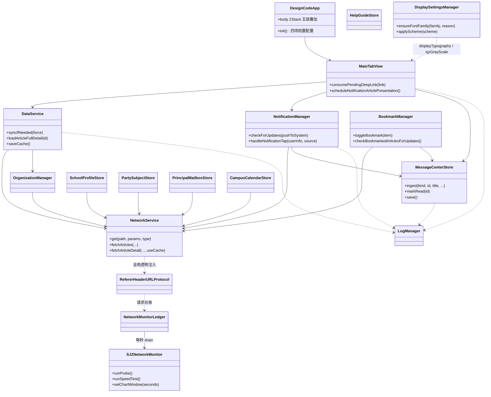

# 03 · 关键类与函数参考

> 行号基于 **2026-09-28** 源码快照实测（`wc -l` + 逐符号 grep；TabBar.swift 12,528 行、Models.swift 1,591 行、NetworkService.swift 1,599 行、DisplaySettingsManager.swift 2,692 行、SJZNetworkMonitor.swift 1,814 行、WeChatService.swift 1,328 行）。链接可点击跳转；函数签名省略参数默认值以控制篇幅，以源码为准。

## 3.0 核心类关系总图

服务层只有两种线程契约：`NetworkService` 为 `@unchecked Sendable`，其余单例均挂在 `@MainActor`；一切跨层调用都从视图指向单例，方向单一。下图给出先读全景，随后各节的成员表回答「具体有哪些方法、在哪一行」。



读图要点：`HelpGuideStore` 不在网络边上（全库唯一零网络 Store）；`DisplaySettingsManager` 与 `SJZNetworkMonitor` 是两条基建支线，分别只经修饰器链与台账汇入主流程，不参与业务数据流；`LogManager` 以虚线连向全部模块，代表横切埋点而非调用依赖。收藏第五通道由 `BookmarkManager` 自己的定时器驱动，与 `NotificationManager` 之间没有调用关系，两者只共同汇入 `MessageCenterStore`。

## 3.1 入口与主框架

### DesignCodeApp（[DesignCodeApp.swift](file:///Users/qinchao/Downloads/designcode-swiftui/qin/DesignCode/DesignCodeApp.swift#L9-L37)）

| 成员 | 行号 | 说明 |
|---|---|---|
| `init()` | L21 | URLCache 80MB/400MB、注册 RefererHeaderURLProtocol、内存警告降载、AppIconManager.calibrateOnLaunch、启动日志 |
| `body` ZStack | L39 | 主界面/启动页/隐私弹窗/受限模式/生物遮罩五层叠加 + `.tint` + `.displayTypography`（显示设置/灰度注入点） |
| `.task` 启动 | L110 | 1s 后 isAppReady = true |
| `.task(id: isAppReady)` | L127 | 刷新通知授权状态；满足条件恢复 startPolling |
| `.onChange(isAppReady)` | L135 | 隐私三分流：弹窗 / 受限 / 正常 |
| `.onChange(scenePhase)` | L117 | 退后台锁定 / 回前台认证 |

### MainTabView（[TabBar.swift L15](file:///Users/qinchao/Downloads/designcode-swiftui/qin/DesignCode/TabBar.swift#L15-L438)）

| 成员 | 行号 | 说明 |
|---|---|---|
| 状态区 | L15-L36 | pendingDeepLink 等 sheet 状态、messageCenterStore |
| `consumePendingDeepLink(_:)` | L48 | 消费 pendingDeepLink：请求权限 → 预加载文章详情 → 延迟调度展示 |
| `scheduleNotificationArticlePresentation()` | L82 | 循环等待 active && !isLockEngaged，Task.sleep 让出 runloop 后弹 sheet |
| 五 Tab | 主容器内 | tag 0-4：Home / Departments / NewsList / Campus / Profile；「我的」挂未读 `.badge` |
| sheet 挂载区 | L304-L350 | 新闻详情（L304）/ 学校概况（L324）/ 党建专题（L342）+ 信箱等四+一类深链 sheet 分发 |

### ProfileView 与设置入口（[TabBar.swift L8446](file:///Users/qinchao/Downloads/designcode-swiftui/qin/DesignCode/TabBar.swift#L8446-L8941)）

| 成员 | 行号 | 说明 |
|---|---|---|
| `showMessageCenter` | L8452 | 消息中心 sheet 开关（sheet 挂载 L8492） |
| 消息中心入口卡 | L8546 附近 | 铃铛图标 + 未读数 + 最新一条预览 + 红色渐变胶囊 badge |
| 各 sheet 挂载 | L8457-L8477 区域 | 设置 / 关于 / 收藏 / 日志 / 公告 / 消息中心六类入口 sheet |
| SettingsView | L8941 | 应用设置总览；功能入口：显示设置 L9049 · App 图标 L9093 · 首页模块 L9112 · 生物识别 L9133 · 通知测试 L9216 · **网络监测 L9378** · 缓存模式 L9447 |

### 其他主视图（TabBar.swift）

| 视图 | 行号 | 说明 |
|---|---|---|
| `HomeView` | L483 | 首页：骨架屏 / hero / 统计 / 快捷操作 / 12 模块区 |
| `EnhancedNewsDetailView` | L2456 | 文章详情：WebView/纯文本、图集、分享、阅读时间徽章 |
| `DepartmentsView` | L5962 | 院系列表（数据 departments） |
| `NewsListView` | L6241 | 资讯 Tab：分类 chips、搜索、招生入口 |
| `CampusView` | L6533 | 校园生活七大分区（详见 02 §2.6）；子组件 ServiceButton L6963 / OrganizationEntryCard L7033 / SchoolInfoCard L7129 / FooterLinkRow L7427 / SocialQRCard L7505 / DepartmentCard L7635 |
| `FacilityDetailView` | L7711 | 校园设施详情：目录轮播/进度条/回顶/复制全文/重播/定位胶囊 |
| `ProfileView` | L8446 | 我的：消息中心入口与全部设置入口 |
| `ZSWHomeView` / `ZSWArticleListView` / `ZSWArticleDetailView` | L9645 / L9931 / L10072 | 招生网首页/列表/详情 |
| `SpecialtyListView` | L11413 | 专业介绍列表（College/Major 详情 L11515/L11615） |
| `AppIconManager` / `AppIconSettingsView` | L11707 / L11831 | 应用图标切换（alternate icons + 启动校准） |

## 3.2 数据模型（[Models.swift](file:///Users/qinchao/Downloads/designcode-swiftui/qin/DesignCode/Models.swift)，1,591 行）

| 类型 | 行号 | 要点 |
|---|---|---|
| `SchoolInfo` | L10 | 校名、官网域名等静态枚举常量（含校庆日档案，供概况页与校园 Tab 概况卡共用） |
| `Banner` | L44 | id 计算属性；defaultBanners 兜底 |
| `NewsItem` | L377 | **id = title + date 计算**（存在碰撞风险，低）；`originalArticleURL` 等 |
| `CampusVideo` | L559 | id = title + videoUrl |
| `CampusService` | L673 | 校园服务条目；`defaultServices` 第七项为「校园日历」（`sxjzit://campus-calendar` 内部协议） |
| `FacilityInfoPair` / `FacilitySection` | L693 / L700 | 设施分区的「标签—数值」键值行与分区结构 |
| `Facility` | L734 | 可选 `sections: [FacilitySection]?`（旧数据缺失容错 nil，自动回退经典样式） |
| `BookmarkItem` | L1470 | id 用 readKey，收藏持久化模型 |

其余模型：`Honor`、`StatItem`、`Department/Major`、`StudentStory`、`TeacherProfile`、`CampusActivity`、`CampusScenery`、`TimelineEvent`、`QuickLink`、`FooterLink`、`SocialPlatform`、`ZSW*`（招生网）、`Specialty*`（专业介绍）。
静态兜底常量族 `default*`（defaultBanners/defaultNews/defaultVideos/defaultServices/…）保证离线可用性。

## 3.3 网络层（[NetworkService.swift](file:///Users/qinchao/Downloads/designcode-swiftui/qin/DesignCode/NetworkService.swift)，1,599 行）

### 结构与请求封装

| 成员 | 行号 | 说明 |
|---|---|---|
| `NetworkConfig` | L10 | baseURL=`https://gwqietap.sxjzit.edu.cn/mapi`、requestTimeout=15s、resourceTimeout=30s、maxRetry=2（共 3 次、指数退避 500ms×N） |
| `final class NetworkService` | L44 | 单例 `@unchecked Sendable`；普通 session + `cachedSession`（详情缓存策略 reloadIgnoringLocalAndRemoteCacheData） |
| `get<T>(_ path:params:as:)` | L79 | 统一 GET：重试/退避/取消跳过重试/超时；`URLError.cancelled` 立即传播不重试（防下拉刷新误报） |
| `NetworkError` | L19 | 中文 errorDescription：badURL/badResponse/decodeFailed/timeout/noData/**dataMissing**/serverError（共 7 case） |
| 缓存头注入 | get 管线内 | URL 路径含 /uploads/、/images/、/img/、/pic/、/media/、/attach/ 且无 Content-Type: image/* 时注入 7 天 Cache-Control（服务器 no-cache/max-age=0 也缓存 7 天，no-store 除外） |
| `resolveShortLinkFinalURL(_:)` | L258 | 短链最终 URL 解析 |
| `parseImages` / `extractImagesFromHTML` / `safeImageURL` | L309 / L326 / L356 | 图片 DTO 提取与 URL 安全化 |

### API 清单（全 GET）

| 方法 | 行号 | 端点 | 用途 |
|---|---|---|---|
| `fetchHome2()` | L177 | /school/home2 | 首页全量 |
| `fetchHead()` | L182 | /common/column/head | 站点+菜单（含机构 site_key） |
| `fetchFoot()` | L187 | /common/foot | 底部链接/社交 |
| `fetchArticles(columnId:siteId:page:size:)` | L192 | /common/column/articles | 文章列表分页 |
| `fetchArticleDetail(articleId:siteId:useCache:)` | L199 | /common/article/detail | 文章详情（useCache 走 cachedSession） |
| `fetchArticleDetailWithHref(_:)` | L207 | 任意 href | 非标准路径详情 |
| `fetchJSONDict(path:)` ×2 | L283/L288 | 任意 | 万能字典接口（学校概况等） |
| `fetchZSWHome2()` | L754 | /dept/home2?site_key=zsw | 招生网首页 |
| `fetchZSWArticlePage(...)` | L759 | /common/article/page | 招生网分页 |
| `fetchZSWArticleDetail(...)` | L878 | /common/article/detail | 招生网详情 |
| `fetchSpecialtyData(siteId:columnId:)` | L887 | /common/column/oneTwoArticles | 专业介绍 |
| `fetchDeptHome2(siteKey:)` | L961 | /dept/home2 | 机构/子站首页 |
| `fetchSchoolOrgTree()` | L982 | 机构树 | 学校组织架构 |
| `fetchDeptSiteIndex(siteKey:)` | L1019 | 子站索引 | siteId+栏目收集（双通道） |
| `fetchPartySubjectFingerprint(siteKey:)` | L1085 | /dept/home2 | 党建站点指纹（total+top3 签名，需按 id 去重） |
| `fetchSceneryAlbumDetail(articleId:siteId:)` | L1161 | /common/article/detail | 风光图集详情 |
| `fetchPrincipalMailbox(page:size:)` | L1247 | 校长信箱列表 | 分页 2 层嵌套解码 |
| `fetchMessageDetail(msgId:)` | L1334 | /common/msg/detail | 信箱详情（必填 article_id+site_id+msg_id） |
| `strippingHTMLTags()` | L1533 | — | String 扩展：纯正则剥 HTML |

关键常量：`campusCalendarColumnId = "8197fe41503c4c32bce1e449d2492b2e"`（[NetworkService.swift L441](file:///Users/qinchao/Downloads/designcode-swiftui/qin/DesignCode/NetworkService.swift#L441)，校园日历栏目，复用 fetchArticles/fetchArticleDetail，siteId "1"）。关键 DTO 全 Optional + CodingKeys 显式映射；`AnyCodable` 处理不规则 JSON。

## 3.4 数据枢纽（[DataService.swift](file:///Users/qinchao/Downloads/designcode-swiftui/qin/DesignCode/DataService.swift)，1,246 行）

| 成员 | 行号 | 说明 |
|---|---|---|
| `final class DataService` | L9 | 单例；@Published 状态：news/honors/departments/banners/videos/…/dataSource |
| `syncDidCompleteNotification` | L13 | 同步完成广播（网络监测等联动） |
| `refreshCacheLimits()` | L127 | CacheModeManager 模式切换调用 |
| `isArticleDetailCached(id:)` / `isZSWArticleCached(id:)` | L135 / L139 | 详情缓存探测（同步） |
| `syncIfNeeded(force:)` | L180 | 节流入口（force 强制刷新） |
| `doFullSync()` | L243 | 全量同步编排（并行 home2+head+foot，逐接口独立 do-catch） |
| `loadZSWHomeData()` | L485 | 招生网数据（缓存模式 30min 内跳过） |
| `loadSpecialtyData()` | L607 | 专业介绍（重试 2 次×1s） |
| `articleSearchColumnEntries()` | L650 | 机构搜索栏目源（动态解析，严禁硬编码） |
| `refreshNewsColumnIdsFromHome2()` | L662 | 兜底重建栏目表 |
| `safeFetchArticles(...)` | L695 | 分页 50/页直到 <50 或空；单栏容错 |
| `loadArticleDetail(articleId:)` | L735 | 简易版详情 |
| `loadArticleFullDetail(articleId:)` | L742 | 缓存（NSCache 按 cost）→ API → parse → 写缓存 |
| `preloadArticleDetail(articleId:)` | L789 | **Task.detached 后台预取**（回主线程写 NSCache） |
| `clearArticleDetailCache()` | L833 | 手动刷新清详情缓存 |
| `loadZSWArticleFullDetail(articleId:siteId:)` | L839 | 招生网详情 |
| `parseArticleDetail(...)` | L884 | **nonisolated 纯函数**：正则剥 HTML/提图/URL 编码（禁 NSAttributedString HTML 解析） |
| `extractImages(from:)` / `safeImageURL(from:)` | L935 / L968 | 图片提取与 URL 安全化 |
| `saveCache()` / `loadCache()` / `clearCache()` | L1012 / L1045 / L1083 | 21 键 JSON 缓存读写清 |
| `allNewsCategories` / `allNews` | L1147 / L1158 | 8 类合并计算属性 |
| `cacheGeneration` | — | 刷新代际：手动刷新清详情缓存并推进，预热写回双重校验 |

## 3.5 通知系统（[NotificationManager.swift](file:///Users/qinchao/Downloads/designcode-swiftui/qin/DesignCode/NotificationManager.swift)，1,067 行）

| 成员 | 行号 | 说明 |
|---|---|---|
| `PendingArticleDeepLink` | L36 | 深链结构体（新 UUID 保证 onChange 必触发） |
| `pollingIntervalMinutes` | L92 | @AppStorage，默认 30 分钟 |
| `pendingDeepLink` | L115 | @Published 深链（MainTabView onChange 消费） |
| `requestPermission()` | L173 | 授权请求 |
| `refreshAuthorizationStatus()` | L190 | 刷新权限状态 |
| `startPolling()` / `stopPolling()` | L233 / L247 | Timer 轮询开关 |
| `checkForUpdates(pushToSystem: = true)` | L262 | 四通道入口，逐通道容错 |
| `checkNewsUpdates` | L281 | 通道① 新闻 |
| `checkMailboxUpdates` | L398 | 通道② 信箱 |
| `checkSchoolProfileUpdates` | L491 | 通道③ 概况（基线 schoolProfileBaseline） |
| `checkPartySubjectUpdates` | L641 | 通道④ 党建（基线 partySubjectBaseline） |
| `sendMailboxSimulationNotification` | L715 | 调试面板模拟新信 |
| `markExistingArticlesAsNotified()` | L752 | 首启把存量文章标记已通知（防轰炸） |
| `userNotificationCenter:willPresent:/didReceive:` | L770 / L787 | **nonisolated** completionHandler 版回调（同步链上只设 pendingDeepLink） |
| `handleNotificationTap(...)` | L809 | 统一深链处理：日志 → 写 pendingDeepLink → 回执 |
| `ensureRealTestArticle()` | L909 | 测试文章兜底（官网要闻第一篇） |
| `sendTestNotification(...)` | L947 | 测试通知 |
| `simulateNotificationTap()` | L1013 | 模拟点击（不依赖权限） |
| `setBadgeCount(_:)` | L1044 | 角标设置（applicationIconBadgeNumber 已废弃） |

## 3.6 消息中心（[MessageCenterStore.swift](file:///Users/qinchao/Downloads/designcode-swiftui/qin/DesignCode/MessageCenterStore.swift) / [MessageCenterView.swift](file:///Users/qinchao/Downloads/designcode-swiftui/qin/DesignCode/MessageCenterView.swift)）

### Store（823 行）

| 成员 | 行号 | 说明 |
|---|---|---|
| `enum MessageKind` | L20 | 新闻/信箱/概况/党建/收藏更新五通道 |
| `struct DeepLinkPayload` | L31 | 五类深链字段 + asUserInfo/isEmpty |
| `struct MessageItem` | L67 | id/kind/title/subtitle/timestamp/isRead/deepLink/isTest/schemaVersion |
| `init(from:)` 容错解码 | extension 中 | 未知 kind 降级 .news、缺字段默认值 |
| `enum MessageLaunchState` | L101 | 启动态（正常/损坏已抢救/空） |
| `final class MessageCenterStore` | L115 | 单例；@Published items L155 / unreadCount L156（didSet 联动角标）/ latestItem L162 / launchState L163 / dismissRequest L165 |
| `load()` | L201 | 标准解码 → 失败改名 .corrupt → 逐条抢救 |
| `save()` / `writeAtomically` / `trimCorruptBackups` | L265 / L290 / L309 | 强原子写 + 写后自校验；损坏备份时间戳命名保留 5 份 |
| `ingest(kind:id:title:subtitle:deepLink:isTest:)` | L324 | 去重；标题不变 + deepLink 补全才落盘；isTest 拒绝；空 id 拒绝 |
| `applyMaxCountLimit()` | L391 | FIFO 淘汰超出上限 |
| `markRead(id:)` / `markRead(kind:articleId:)` / `markRead(kind:)` | L406 / L417 / L436 | 幂等已读（有效方向才有完整动效） |
| `markUnread(id:)` | L447 | 已读→未读 |
| `markAllRead()` | L457 | 全读 |
| `delete(id:)` | L471 | 删除（未读删除联动计数） |
| `clearHistory(scope:)` | L484 | all/readOnly 双 scope 清空（UI 侧强制红色确认弹窗） |
| `filter(keyword:kind:unreadOnly:)` | L510 | 组合过滤（标题+摘要匹配） |
| `unreadCount(of:)` | L523 | 分类未读统计 |
| `static style(for:)` / `kindName(_:)` | L529 / L539 | 五通道图标/配色/中文名 |
| `silentCheckNow()` / `handleSceneActive()` | L552 / L558 | 前台静默检查（30min 节流） |
| `setAutoCheck(_:)` / `setBadgeEnabled(_:)` | L580 / L590 | 自动检查开关 / 角标联动（关闭时清零桌面角标） |
| `syncBadge()` | L608 | 角标同步（300ms 防抖） |
| `launch(item:)` / `deepLinkTargetDescription(_:)` | L634 / L663 | 深链投递（失败置 .failed）/ 目标描述 |
| `repairRewrite()` | L688 | 诊断面板存储修复重写 |
| `importFromDeliveredNotifications()` | L706 | 首启导入历史通知（24h 未读窗口规则） |
| `MessageTimeText.relative(_:now:)` | L798 | 相对时间（永不回显负数） |

### View（925 行）

| 成员 | 行号 | 说明 |
|---|---|---|
| `MessageCenterView` | L15 | 主视图：日分组 + 筛选 + 搜索 + 幂等手势行 |
| `FilterMode` | L22 | 全部/未读/分类筛选 |
| `performSilentCheck()` | L207 | 立即检查（静默模式，不推送系统通知） |
| `filterChip` | L319 | 筛选芯片 |
| `daySection(header:items:)` | L391 | 今天/昨天/更早分组 |
| `refreshBody()` | L406 | 下拉刷新 |
| `messageRow(_:index:highlightKeyword:)` | L426 | 行：光点未读指示、右滑已读（蓝实心）+未读（橙空心）、左滑删除、点击消未读开详情；弹簧动画 + 轻触觉 |
| `MessageDetailCard` | L782 | 详情卡（内容+复制（info 埋点）+分享+深链跳转） |
| `MessageCenterSettingsPanel` | L841 | 清空分 scope（红色确认）、角标联动开关、诊断入口 |

（关键词橙色高亮 `messageCenterHighlighted` 位于 messageRow 调用链内，NSRange⇄Character 双域转换。）

## 3.7 机构 / 学校概况 / 党建 / 校长信箱 / 使用帮助 / 校园日历

### OrganizationManager（[OrganizationManager.swift](file:///Users/qinchao/Downloads/designcode-swiftui/qin/DesignCode/OrganizationManager.swift)）

| 成员 | 行号 | 说明 |
|---|---|---|
| `OrganizationCategory` / `OrganizationUnit` / `OrganizationCache` | L19 / L61 / L93 | 分类枚举 / 机构模型 / 缓存结构 |
| `final class OrganizationManager` | L102 | 单例；init 载缓存 + 定时刷新 + 缓存模式监听 + 首次 sync |
| `refresh()` / `refreshWithDebounce(source:)` | L235 / L250 | 普通刷新 / 防抖刷新 |
| `updateSiteKeys(from:)` | L257 | 从菜单 DTO 提取 site_key 匹配机构 |
| `syncFromAPI(force:)` | L404 | 强制/宽松刷新机构数据 |
| `validateFromPageHTML()` / `extractDepartmentNames(from:)` | L521 / L577 | 页面 HTML 兜底校验与部门名提取 |
| `saveCache()` / `loadCache()` / `clearCache()` | L630 / L648 / L691 | 缓存三件套 |
| `startAutoRefresh()` / `stopAutoRefresh()` | L704 / L726 | 定时刷新启停 |

### OrganizationView（[OrganizationView.swift L105](file:///Users/qinchao/Downloads/designcode-swiftui/qin/DesignCode/OrganizationView.swift#L105)，2,183 行）

| 成员 | 行号 | 说明 |
|---|---|---|
| `performArticleSearch(keyword:deep:)` | L1559 | 全站文章搜索：常规 4 页 200 条 + 深度 8 页 400 条；双通道栏目收集；并发批处理流式合入 |
| `OrganizationSearchMode` / `ArticleSearchScope` / `ArticleSearchSortOrder` / `ArticleSearchResult` | L35 / L76 / L88 / L58 | 搜索模式 / 范围 / 排序 / 结果模型 |
| `OrganizationCardButtonStyle` | L2162 | 卡片按压样式 |

### OrganizationDetailView（[L167](file:///Users/qinchao/Downloads/designcode-swiftui/qin/DesignCode/OrganizationDetailView.swift#L167)，5,273 行）

| 成员 | 行号 | 说明 |
|---|---|---|
| `loadData()` | L1375 | 12s 超时/3 次重试 |
| `parseSections(from:)` | L1620 | 子站首页 → 区块解析 |
| `fetchArticleDetailWithFallback()` | L3481 | 5 个 siteId 并行取最长内容兜底 |
| `loadFallbackArticles()` / `extractKeywords(from:)` / `departmentDescription` | L725 / L816 / L846 | 降级文章 / 三路关键词 / 22 部门硬编码介绍 |
| `childTabCard(_:)` | L1182 | 子标签四类路由（专业/分数线/录取查询/子栏目） |
| `ChildSectionDetailView.performLoad()` | L4975 | 非结构化 Task 防 .refreshable 取消；siteIdsToTry 降级链 |
| `ChildSectionDetailView` / `OrganizationArticleDetailView` / `TimeoutError` | L4601 / L2042 / L3749 | 子栏目详情 / 文章详情 / 超时错误类型 |
| `ArticleDetailCache` / `OrganizationArticleWebView` / `HTMLWebView` | L84 / L3907 / L4249 | 详情缓存 / 文章 WebView / 通用 HTML WebView |

### SchoolProfileStore 与配套（[SchoolProfileView.swift](file:///Users/qinchao/Downloads/designcode-swiftui/qin/DesignCode/SchoolProfileView.swift)，3,511 行）

| 成员 | 行号 | 说明 |
|---|---|---|
| `SJZScrollActivityTracker` | L31 | 滚动方向节流追踪（internal 共享） |
| `SJZIdleTimerRepair` | L72 | 滑动停止后 idle timer 微切换（熄屏修复） |
| `SchoolProfileAssets` | L101 | 哈希素材 URL 常量集 |
| `final class SchoolProfileStore` | L175 | 七板块状态 + load + `refreshDetached` L282 / `refresh` L287 + 刷新世代管理 |
| `localSearch(keyword:)` | L339 | 六板块+合作交流全文搜索（加权/高亮/来源徽章） |
| `SchoolProfileView` | L855 | 主体视图（蓝金学术风） |
| `ProfileInlineVideo` / `RollingNumberView` / `ProfileTextDetailView` | L2424 / L2448 / L2492 | 内联视频 / 数字滚动 / 文字区块详情 |
| `ProfileImageSaveShare.saveToPhotos(urlString:logTag:)` | L2688 | 相册保存封装（WebP→JPEG file-based，规避 3302；校园 Tab 二维码复用） |
| `ProfileAlbumView` / `ProfileCooperateDetailView` | L2787 / L3140 | 风光相册 / 合作交流详情 |

### PartySubjectView（[PartySubjectView.swift](file:///Users/qinchao/Downloads/designcode-swiftui/qin/DesignCode/PartySubjectView.swift)，2,566 行）

| 成员 | 行号 | 说明 |
|---|---|---|
| `final class PartySubjectStore` | L59 | 双站点（djgz/mkszy）全量收集 + 收藏 + 搜索历史 |
| `localSearch(keyword:)` | L135 | 多词 AND 加权（标题 5/描述 2/标签 1） |
| `PartySubjectView` | L498 | 专题主视图（双子站分栏 + 命中分布） |
| `PartyRichBlock` / `PartyParseOutcome` / `PartyContentParser` | L1637 / L1650 / L1657 | 富文本块 / 解析产物 / 纯正则 HTML 解析器 |
| `PartyArticleDetailCache` | L1762 | 详情内存缓存（@unchecked Sendable） |
| `PartyArticleDetailView` | L1807 | 文章详情页（全屏图用下方 Payload） |
| `PartyFullScreenPayload` | L2563 | 全屏图片查看标识 |

### PrincipalMailboxStore（[PrincipalMailboxView.swift L23](file:///Users/qinchao/Downloads/designcode-swiftui/qin/DesignCode/PrincipalMailboxView.swift#L23)）

分页拉取（两页×30）、搜索（500ms 防抖+历史 10 条）、刷新三态、`simulateNewMail()`（调试面板用）。注意：DTO 仅两层 data 嵌套，多建一层会导致「成功 0 条」。

### HelpGuideStore（@MainActor 单例，[HelpGuideStore.swift](file:///Users/qinchao/Downloads/designcode-swiftui/qin/DesignCode/HelpGuideStore.swift)，239 行）

| 成员 | 行号 | 说明 |
|---|---|---|
| `final class` / `shared` | L24 / L26 | 单例 |
| `@Published` 状态 | L37-L43 | readArticleIds（已读）/ searchHistory（≤10）/ recentArticleIDs（最近阅读 ≤6） |
| 本地内容 | — | 直读 `HelpContent`（**零网络**，六 Store 中唯一不连 NetworkService） |
| `markRead(_:)` / `markAllRead()` | L108 / L116 | 已读落盘 `helpGuideReadIds`；未读光点联动 |
| `search(_:)` | L142 | 多词 AND 加权（标题/正文/分类），返回 `HelpSearchHit`；防抖与 `isSearchPending` 在 View 层 |

### CampusCalendarStore（@MainActor 单例，[CampusCalendarStore.swift](file:///Users/qinchao/Downloads/designcode-swiftui/qin/DesignCode/CampusCalendarStore.swift)，478 行）

| 成员 | 行号 | 说明 |
|---|---|---|
| `@Published` 状态区 | L32-L48 | articles/total/isLoading/hasMore/lastError/isFromCache/refreshStatus/searchResults/isSearchPending/searchHistory/readIds 等 |
| `enum RefreshStatus` | L52 | idle → refreshing → success/failed（三态刷新状态机） |
| `loadInitial(force:)` | L116 | 冷启动本地缓存（`campusCalendarCache` 含时间戳）优先 → 静默刷新 |
| `refreshDetached(source:)` / `refresh(source:)` | L171 / L176 | 刷新本体与手势任务解耦防 cancelled 误报；接管取消搜索防抖任务防并发双写 |
| `dismissRefreshBanner()` / `loadMore()` | L230 / L238 | 横幅关闭 / 分页触底续拉 |
| `search(_:)` | L279 | 多词 AND（标题 3/摘要 1）+ 300ms 防抖 + 搜索前分页全量拉齐（maxPages 10） |
| `commitSearchHistory(_:)` / `clearSearchHistory()` | L388 / L399 | 历史去重置顶 ≤10 |
| `loadDetail(articleId:)` | L408 | 详情内存缓存 + 已读落盘；ID 无效直接失败 |
| `isRead(articleId:)` / `markRead(articleId:)` | L438 / L443 | 已读查询/写入 |
| `static dateText(_:)` | L453 | 官网三种时间格式解析（兜底前 10 字符） |

## 3.8 收藏与辅助服务

| 类 | 文件 | 关键成员（行号） |
|---|---|---|
| BookmarkManager | BookmarkManager.swift（424 行） | `addBookmark` L112 · `toggleBookmark` L170 · `cacheArticleContent` L242（注意：await 后 idx 复用隐患）· `cachedImage/cacheImage` L267-L284 · `imageCacheKey` L310（SHA256）· `checkBookmarkedArticlesForUpdates` L340 · `sendUpdateNotifications` L366（第五通道） |
| LogManager | LogManager.swift（351 行） | `log(domain:level:message:context:)` L136 · `writeToDisk` L218 · `crashWrite` L337 |
| ReadStatusManager | ReadStatusManager.swift | `readArticleIds` 上限 5000 读/写/清 |
| RefererHeaderURLProtocol | RefererHeaderURLProtocol.swift（232 行） | 类 L18 · `canInit` L47 · `startLoading` L61 · **netmon 上行触点 `tapUploadEstimate` L88** · `stopLoading` L126；拦截 `*.sxjzit.edu.cn` 注入 Referer/UA + 7 天图缓存头（全局，改动先确认） |
| CacheModeManager | CacheModeManager.swift | 模式切换、容量限制、内存警告降载、`registerMemoryWarningHandler` |
| BiometricSecurityManager | BiometricSecurityManager.swift | 状态机 L152 · `isLockEngaged` L176 · `refreshCapability` L239 · `handleReturnToForeground` L277（1.5s 豁免）· `authenticate` L329 · `performEvaluation` L366（≥5 次失败/锁定降级密码）· `enableWithGuidedFlow` L431（Keychain 门控）· `disableWithConfirmation` L463 · `BiometricKeychain` L501（saveToken L503 / deleteToken L517，只写不读；注意：无 duplicateItem 容错；`biometricLastUnlockAt` 写而不读） |
| AnnouncementManager | AnnouncementManager.swift（340 行） | `AnnouncementCache` L16 · 类 L26 · `refresh()` L78 · `stopAutoRefresh()` L337 |
| PrivacyManager | PrivacyManager.swift | `fetchDocument` L108 |
| HomeModuleManager | HomeModuleManager.swift | `visibleOrderedModules` L274 · 12 模块枚举 L14 · `retiredRawValues` L132（退役值迁移） |
| HelpGuideStore / CampusCalendarStore | 见 §3.7 | — |

## 3.9 网络监测（[SJZNetworkMonitor.swift](file:///Users/qinchao/Downloads/designcode-swiftui/qin/DesignCode/SJZNetworkMonitor.swift)，1,796 行）

### 类型与持久化键

| 类型 | 行号 | 要点 |
|---|---|---|
| `NetmonKey` | L25 | 持久化键：samplingEnabled / chartWindow / timeline / lastProbe / `traffic(day:)`（今日流量按日键） |
| `NetworkMonitorLedger`（private） | L35 | **线程安全台账**（NSLock + @unchecked Sendable）：requestStart/addData/addUpData/complete/abandon/setSuspended（探测期静默）/drainBucket；在飞上限 256 溢出重置 |
| `NetworkTrafficSample` | L133 | 1s 采样点（下行/上行/延迟/失败/心跳标记） |
| `LinkEventKind` / `LinkEvent` | L146 / L150 | 链路事件三 kind（断网/恢复/异常）+ 事件模型 |
| `SamplingTier` / `TrendDirection` / `AnomalyKind` | L170 / L184 / L188 | 节能三档 / 趋势方向 / 异常种类 |
| `ProbeTarget` / `ProbeResult` / `ProbeSummary` / `ProbeState` | L201 / L221 / L250 / L259 | 双目标探针 / 单轮结果 / 汇总（健康分）/ 探测状态机 |
| `SpeedTestState` / `HealthAdvice` / `MinuteSummary` | L266 / L273 / L281 | 测速状态机 / 健康建议 / 分钟摘要（60 槽） |
| `final class SJZNetworkMonitor` | L317 | @MainActor 单例；@Published 链路/流量/心跳/探针/今日流量/会话元信息全量状态 |

### 关键方法

| 方法 | 行号 | 说明 |
|---|---|---|
| `setChartWindow(_:)` | L450 | 图表窗口 30/60/120s（@Published + @AppStorage 双写） |
| `startPathMonitor()` / `apply(path:)` | L488 / L497 | NWPathMonitor 启动 / 路径变化应用 |
| `refreshNetworkIdentity()` | L619 | 网关/IP/校园网判定（`ipSecondOctetInRange` L664） |
| `startAggregator()` / `tick()` | L672 / L681 | 1s 聚合主循环（drain 台账 → 采样/EMA/主机归因/分钟摘要） |
| `updateTrendDirection()` / `accumulateMinuteSummary` / `updateSamplingTier()` | L778 / L803 / L832 | 趋势最小二乘 / 分钟环形槽 / 省电档位切换 |
| `beginLiveSampling()` / `endLiveSampling()` / `setSceneActive(_:)` | L856 / L866 / L879 | 心跳采样启停 / **scenePhase 前台门控** |
| `performHeartbeat()` / `applyHeartbeatResult` | L915 / L944 | 热连接心跳 / 结果吸收（失败计数/异常标记） |
| `registerBusinessLatency` / `absorbCompletion` | L1001 / L1064 | 业务请求延迟/完成吸收（有业务流量即回 live） |
| `logHostStatsSummary()` | L1135 | 慢主机 TOP3 归因日志（节流） |
| `runProbe()` / `probeRound(for:)` | L1185 / L1253 | 双目标 5 轮冷连接诊断 / 单轮执行 |
| `runSpeedTest()` | L1402 | 一键测速（HEAD 挑源 + 循环下载至 8MB/10s + 峰值分级） |
| `setSamplingEnabledForSession` / `refreshNow()` / `performOneOffHeartbeat()` | L1589 / L1608 / L1622 | 会话采样开关 / 手动刷新 / 单次心跳 |
| `appendLinkEvent` / `flushTimeline` / `restoreTimeline` | L1660 / L1668 / L1676 | 时间线追加 / 持久化 / 恢复（30 条） |
| `persistLastProbe` / `restoreLastProbe` | L1682 / L1688 | 诊断历史持久化（内存 3 + 持久 1） |
| `rolloverTodayTrafficIfNeeded` / `cleanupExpiredTrafficKeysIfNeeded` | L1715 / L1740 | 今日流量日键翻转 / 过期键清理（仅留 3 天） |

### NetworkMonitorView（[NetworkMonitorView.swift](file:///Users/qinchao/Downloads/designcode-swiftui/qin/DesignCode/NetworkMonitorView.swift)，1,609 行）

| 成员 | 行号 | 说明 |
|---|---|---|
| `NetworkMonitorView` | L21 | 主视图（`import Charts` L17） |
| `HealthTier` | L165 | 健康分档位 |
| `chartCanvas(kind:)` / `chartControls(kind:)` / `windowChip` | L522 / L631 / L652 | Swift Charts 双曲线（下/上行 + 延迟）/ 控件 / 窗口芯片 |
| `anomalyBanner` / `eventColor` / `eventTitle` | L306 / L759 / L767 | 异常横幅 / 时间线配色与文案 |
| `probeDoneView` / `stageBar` / `copyDiagnosticReport` / `shareSnapshot` | L1088 / L1286 / L1311 / L1319 | 诊断完成卡 / 分阶段条 / 复制报告 / 导出快照 |
| `speedGradeScore` / `formatKBps` | L1409 / L1526 | 测速分级 / 速率格式化 |
| `monitorCard()` | L1542 | 统一卡片风格修饰（各卡复用） |
| `FlowBars` / `Sector` | L1560 / L1578 | 装饰流量条 / 扇区 Shape |
| Preview | L1600/L1607 | `#Preview` |

## 3.10 显示设置 / 字体体系 / 灰度 / 阅读统计（[DisplaySettingsManager.swift](file:///Users/qinchao/Downloads/designcode-swiftui/qin/DesignCode/DisplaySettingsManager.swift)，2,382 行）

### 类型层（L19-L505）

| 类型 | 行号 | 要点 |
|---|---|---|
| `ReadingStatsClock`（private） | L19 | 阅读统计时间戳格式化 |
| `DisplayAppearanceMode` | L33 | 浅色/深色/跟随系统（复用 `colorSchemePreference` 键） |
| `DisplayThemeStyle` | L60 | 5 主题色（tint 全局注入） |
| `ArticleTextColorPreset` | L91 | 8 预设（双环境 hex：浅色/深色纸面） |
| `ReadingSpeedTier` | L156 | 阅读速度档（max(60,v) 下限） |
| `DisplaySchemePreset` | L199 | 3 套排版方案（fontSizeTier/lineSpacing/letterSpacing/boldText/useSystemFont/fontFamily 六目标值） |
| `DisplayChangeRecord` | L291 | 变更记录（field/fieldTitle/value/at） |
| `DisplayHistoryOperator` | L303 | 纯算子：`pushColor`（去重置顶截 6）/ `appendChange`（ring buffer 20） |
| `DisplayContrastChecker` | L322 | WCAG 纯函数：`hexComponents` / `luminance`(L340) / `contrast`(L349) / `level`(L358)；判定 ≥4.5 绿 / 2.5-4.49 橙 / <2.5 红 |
| `DisplayFontSizeTier` | L368 | 6 档字号 |
| `DisplayFontFamily` | L414 | **7 款中文全字形家族**（system/songti/kaiti/yuanti/xingkai/libian/weibei；`fontName` 映射 PingFang SC/Songti SC/…；`normalized(rawValue:)` L460 旧值迁移） |
| `DisplayFontAvailability` | L477 | ready / downloading / unavailable |
| `DisplayAutoLockOption` | L484 | 7 档（30s~永不） |

### 管理器（L506-L1316）

| 成员 | 行号 | 说明 |
|---|---|---|
| `final class DisplaySettingsManager` | L506 | @MainActor 单例；存储键 L512-L536；@Published 全量设置 L538-L680（appearance/theme/fontSize/bold/systemFont/fontFamily/lineSpacing/letterSpacing/buttonShapes/brightness/autoBrightness/autoLock/keepAwake/lowPower/articleColor/readingStats/grayScale/历史） |
| `applyIdleTimer()` | L647 | 常亮与「永不」逻辑或 → `isIdleTimerDisabled` 单点 |
| `logCustomColorSettled()` | L679 | 自定义色沉降日志 |
| `applyRuntimeEffects()` / `refreshSystemAccessibilityState()` / `registerAccessibilityObservers()` | L855 / L869 / L877 | 运行期效果 / 无障碍状态 / 系统通知监听（VoiceOver/更深颜色） |
| `openSystemSettings()` | L911 | 跳系统设置（常亮诊断引导） |
| `resetAll()` | L1033 | 恢复默认（含清历史 + 关灰度 + 撤销亮度/防息屏接管） |
| `refreshFontAvailability()` | L1065 | 以 `UIFont(name:)` 实查刷新家族可用态（在途保持 downloading） |
| `ensureFontFamily(_:reason:)` | L1080 | **字体按需下载状态机**：CTFontDescriptorMatchFontDescriptorsWithProgressHandler；didMatch→ready+`typographyRevision+=1`；didFail→unavailable 可重试；reason=startup_preheat(L820)/scheme_apply(L1208)/gallery_tap(View L669) |
| `logSliderSettled(_:_:)` | L1129 | 滑块调整完成（尾随日志 + 变更史） |
| `recordChange(field:fieldTitle:value:)` | L1146 | 变更史记录（0.5s 防抖持久化 scheduleHistorySave L1153 / persistHistories L1162） |
| `applyScheme(_:)` | L1175 | 一键套用 6 项 + 前后值日志 + 触发字体下载 + Toast 文案 |
| `pushCustomColor` / `clearCustomColorHistory` / `clearChangeHistory` | L1214 / L1225 / L1233 | 颜色历史入史 / 清空（双历史） |
| `shareSummaryText()` | L1242 | 排版摘要文本（ShareLink） |
| `changeDescription(field:rawValue:)` / `log(_:_:)` | L1273 / L1316 | 值→中文描述 / didSet 统一埋点（display 域） |

### 修饰器与工厂（L1326-L1578）

| 成员 | 行号 | 说明 |
|---|---|---|
| 环境键族 | L1326-L1346 | DisplayFontScaleKey / DisplayBoldKey / DisplayFontFamilyEnvKey / DisplayLetterSpacingKey / DisplayLineSpacingKey / **DisplayTypographyRevisionKey**（字体下载后强制重建） |
| `DisplayFontFactory` | L1385 | `font(family:size:weight:)` 统一取字体（就绪即用，未就绪回退系统） |
| `DisplayTextModifier` / `DisplayScaledFontModifier` / `DisplayTypographyModifier` | L1405 / L1455 / L1491 | `displayText` / `displayFont` 系列 / `displayTypography`（含 `.saturation` 灰度单点） |
| `SJZGrayScaleModifier` / `.sjzGrayScale()` | L1529 / L1541 | **跨 presentation 灰度修饰器**（sheet/fullScreenCover 44 处挂载） |
| `DisplayShapedButtonStyle` / `.shapedButtonStyle(enabled:)` | L1548 / L1515 | 按钮形状（边框化/胶囊化） |

### 阅读统计引擎（L1580-L2382）

| 成员 | 行号 | 说明 |
|---|---|---|
| `ReadingStatsCalculator` | L1580 | 纯函数：`countPlainText` L1610 / `isCJK` L1634 / `calculate` L1662 / `minutes` L1686 / `formattedCount` L1712 / `formattedMinutes` L1720 / `compactMinutes` L1733 / `stripMarkdown` L1744 / `stripHTML` L1790 |
| `ReadingStatsCache` | L1816 | @MainActor 内存缓存（500 条）：Entry/LastResolved/Diagnostics；`loadIfNeeded` L1867 / `entry` L1933 / `save` L1939 / `guessMinutes` L1966 |
| `ReadingStatsService` | L1979 | `resolve(...)` L1989：门控 → 缓存 → 预处理 → 超 5 万字符 Task.detached |
| `ArticleReadingTextSource` / `ArticleReadingStatsText` | L2105 / L2117 | 三源枚举 / 详情 meta 行渲染（恒存锚点容器） |
| `ReadingDurationTier` / `ReadingTimeBadgeView` | L2238 / L2283 | 四档配色 / 列表角标（8pt/10pt/Capsule；`refreshMinutes` L2337 / `logBadgeIfChanged` L2367） |

### DisplaySettingsView（[DisplaySettingsView.swift](file:///Users/qinchao/Downloads/designcode-swiftui/qin/DesignCode/DisplaySettingsView.swift)，2,227 行）

| 区块 | 行号（MARK） | 说明 |
|---|---|---|
| `DisplaySettingsView` | L16 | 12 Section 表单主体（底部 `.navigationTitle("显示设置")`；dark/light 自适应） |
| 通用工具（曝光/Toast） | L113 | `exposeSection`（Session 去重首曝埋点） |
| Hero 实时预览（F1） | L149 | aurora 渐变 + 呼吸 + 慢扫光 + 8 维预览 + 非默认计数 |
| 外观（F2/F3） | L319 | 3 模式卡 + 5 主题图鉴 + 涟漪 |
| 排版方案（F4） | L464 | 3 套方案卡 + 套用动画 |
| 文字排版（F5/F6/F7/F19） | L529 | 字号刻度 / 字体画廊（含下载徽章 `BadgePreviewSample` L1594）/ A-B 对照 + 标尺 / 按钮形状 |
| 文章文字颜色（F8/F9/F10/F17） | L883 | 纸面预览 / 历史 / 骰子 / 对比度自检 / hex 输入 |
| 阅读统计 | L1393 | 开关组 + 速度档位 |
| 屏幕（F11） | L1636 | 亮度 + 预设 + 光感太阳 |
| 自动锁定 | L1751 | 7 档 |
| 屏幕常亮 | L1781 | 开关 + 诊断卡 |
| 辅助功能（F12/F18） | L1947 | 五项 + 灰度专注开关 |
| 最近改动时间轴（F13） | L2039 | 20 条 + 清空 |
| 其他（F15） | L2129 | 分享摘要 + 恢复默认 + 版本 |
| 动效门控/按压样式/亮度扩展 | L2172 / L2212 / L2221 | reduceMotion 辅助 / CardPressStyle / 系统亮度读取 |

## 3.11 SJZ 组件族（[TabBar.swift L10419-L11413 区域](file:///Users/qinchao/Downloads/designcode-swiftui/qin/DesignCode/TabBar.swift#L10419-L11413)）

| 组件 | 行号 | 说明 |
|---|---|---|
| `SJZScrollSuspendedKey` / `SJZScrollSuspendModifier` | L10419 / L10432 | 滚动挂起修饰器（EnvironmentKey + ViewModifier） |
| `SJZImagePhase` / `SJZImageFreePlaceholder` | L10454 / L10464 | 图片四态 / 无图模式占位 |
| `SJZCachedImage<Content>` | L10486 | 统一图片加载：init 同步查解码缓存零占位帧；`load()` 管线：无图模式短路→解码缓存直出→滚动让路（挂起最多 800ms）→缓存优先读→网络 3 次尝试（退避 1s/3s）；失败态轻点重试；`SJZLoadToken(url,attempt,freeMode)` 三要素变化重启 |
| `SJZImageKit` | L10744 | `decode`（ImageIO 官方降采样：ThumbnailMaxPixelSize + 4000 万像素护栏限 4096）/ `imageSession` 共享会话 / `makeRequest` 缓存模式感知 / `shouldLogHit` 节流（600 条上限） |
| `SJZLoadToken` / `SJZImageError` / `SJZImageDownloadDelegate` | L10838 / L10845 / L10851 | 任务标识 / decodeFailed / 下载进度委托 |
| `SJZAverageColorCache` | L10878 | 本地化 blur-up：8×8 降采样均值 hex；300 条 FIFO |
| `SJZDecodedImageBox` / `SJZDecodedImageCache` | L10936 / L10946 | **解码图内存缓存（滚动零闪烁关键）**：键=`variant::url`；NSCache 双限额（缓存模式 600 张/96MB，即时 200 张/40MB）；cost=像素字节；OSAllocatedUnfairLock |
| `SJZImagePrefetcher` | L11010 | 智能预取（过滤已缓存→并发 ≤4→失败静默） |
| `SJZDesignTokens` | L11064 | 设计令牌常量 |
| `SJZPageLoadProgressBar` / `SJZGalleryProgressBar` | L11094 / L11187 | 页面/图集加载进度条 |
| `SJZSlowNetworkBanner` / `SJZCachedBadge` | L11232 / L11255 | 慢网横幅 / 缓存来源徽章 |
| `SJZArticleLoadingView` | L11279 | 文章加载态 |
| `SJZRevealRegistry` / `SJZRevealOnce` | L11354 / L11369 | 会话级去重揭示动效（0.07s 递增延迟+弹簧） |
| `AppIconItem` / `AppIconSwitchError` / `AppIconManager` | L11684 / L11694 / L11707 | 图标模型 / 错误 / 切换管理器（calibrateOnLaunch + switchTo） |
| 校园 Tab 子视图 | L6533-L7711 | ServiceButton L6963 / OrganizationEntryCard L7033 / SchoolInfoCard L7129 / FooterLinkRow L7427 / SocialQRCard L7505 —— 详见 02 §2.6 |

## 3.12 单元测试（DesignCodeTests/，1,996 行 / **119 例**）

### [NetworkServiceDTOTests.swift](file:///Users/qinchao/Downloads/designcode-swiftui/qin/DesignCodeTests/NetworkServiceDTOTests.swift)（650 行 / 22 例；类：`NetworkServiceDTOTests` L11 + `ReadingStatsCalculatorTests` L484）

- DTO 解码 8 例：Home2 真实样本 L17、Banner 缺字段、文章新旧格式、Column children、Campus activites、video dynamicDigit、AnyCodable、requireData。
- 真实 API 3 例（在线，与学校数据实时交互）：Home2 / Articles / ArticleDetail。
- 阅读统计与文本处理 11 例：中文/英文/混排/标点/Markdown 与图片/空白/长文性能/格式化/图片时间衰减/`ReadingStatsService.resolve` 集成/禁用态。

### [MessageCenterStoreTests.swift](file:///Users/qinchao/Downloads/designcode-swiftui/qin/DesignCodeTests/MessageCenterStoreTests.swift)（989 行 / 74 例，**6 个测试类**）

| 类 | 行号 | 覆盖 |
|---|---|---|
| `MessageCenterStoreTests` | L18 | 消息中心 ~46 例：ingest 去重（L51/L60）、**深链补全持久化** L69、isTest 排除、空 id 拒绝、FIFO 淘汰、损坏文件抢救、幂等已读/未读、多态已读、全读、删除、清空双 scope、组合过滤、启动降级、**30 分钟自动检查节流** L262、修复重写、相对时间不为负、日分组、latestItem、批量未读计数等 |
| `HomeModuleManagerTests` | L332 | 5 例：显隐幂等、排序保全集、恢复默认、helpGuide 联动等 |
| `CampusCalendarStoreTests` | L401 | 3 例：时间格式解析、空值兜底、搜索历史去重置顶 |
| `NetworkMonitorLogicTests` | L442 | 网络监测离线逻辑（今日流量日键格式 L530、百分位/分级等） |
| `DisplaySettingsLogicTests` | L539 | 显示设置离线逻辑：方案目标值（L543/L552/L561）、徽章文案 L570、对比度黑白极限 L634、对称交换 L641、8 预设双纸面达标 L647、判定边界 L660、自定义色纸面 L669、字体画廊字貌非空 L690、**旧值迁移** L698、字体名映射 L716 |
| `ArticleLongImageLogicTests` | L827 | **长图渲染加固契约（2026-09-28）9 例**：画布预算四态（常规保持 3x / 多图收敛 / 低内存收缩 / 极端 floor）、EXIF 方向归一、素材头解析（非图像数据必须失败）、纯色黑图校验（黑/白判失效、白底文字不误判）、端到端素材渲染（非黑图 + 逻辑 750pt + 像素 ≥1x）、降级页脚可见说明 |

> 工程惯例：**不新增在线用例**（在线测试硬编码官网标题/ID/阈值，官网内容年度替换必断）；新模块覆盖依赖日志闭环 + 本地纯逻辑用例 + 手动验收；新 Store 用例追加在既有测试文件内（避免 pbxproj 注册；新文件需四段注册，仓库已重建可用 git 回滚）。

### [WeChatSDKTests.swift](file:///Users/qinchao/Downloads/designcode-swiftui/qin/DesignCodeTests/WeChatSDKTests.swift)（357 行 / 23 例，2026-09-27 新增，2026-09-28 长图专项扩容）

离线契约用例（不触网、不拉起微信）：Info.plist 官方声明（URL Scheme = AppID、LSApplicationQueriesSchemes 三件套与前 50 条约束、Universal Link / 小程序键存在）；配置装载与占位判定（占位/空/http/真实值四态 + AppID 格式 + 小程序 gh_ 判定）；字节级裁剪（512B/1KB，中文不切断 + 兜底值）；缩略图契约（横图/竖图 → 200×200 正方形 JPEG ≤32KB 且 < 64KB 硬上限）；**长图分享契约**（`WeChatImageEncoder` 官方 10MB 上限、超限逐档降档 `adjusted`、长图缩略图 ≤32KB 顶部裁方、长图载荷预览 200pt 方形、`WeChatShareKind` 回执文案/日志归因区分）；场景数值对齐官方 WXScene（0/1/2）与三场景文案互异；可用性状态机不变量（仅 ready 可操作）与服务占位自洽；自检七步标题互异 + `selfCheckFinalStep == 6` + 未知步骤回退；横幅模型 id 唯一性与**生命周期**（错误 id 不误清）；**日志联通**（注册路径必须写入 `wechat` 域 LogEntry，占位配置须留 WARNING 级说明且不得报告注册成功）。

## 3.13 通用工具扩展（随源文件散布）

- `String.strippingHTMLTags()`：纯正则剥 HTML（全项目禁用 `NSAttributedString(documentType:.html)`）。
- `safeImageURL`：相对路径转绝对、非 ASCII 编码、过滤 `file://`。
- 阅读时间估算：字数/码块/图片加权衰减（NetworkServiceDTOTests 有专测）。
- 相对时间文案：秒<60 显示「刚刚」，未来时间戳不回显负数（MessageCenterStore）。
- `SJZScrollActivityTracker`（SchoolProfileView.swift L31）：滚动方向节流追踪（3s 窗口），各模块埋点复用。
- `monitorCard()`（NetworkMonitorView.swift L1542）：网络监测统一卡片风格（背景/描边/圆角/内边距）。

## 3.14 非平凡算法归纳（伪代码）

以下逻辑超出简单取值转发，实现细节散落各处，这里按判定顺序归纳成可评审的伪代码；公式常量均可在源码对应符号处复核。

阅读时长估算（ReadingStatsCalculator，DisplaySettingsManager.swift L1662-L1740）：

```
resolveMinutes(text, speedV):
  if text 为空: return nil
  if text 长度 > 50_000: 转后台线程计算（Task.detached .utility）
  (cn, en, imgs, codes) = scan(text)        # 单趟扫描：CJK 字符数 / 英文词数 / 图片数 / 代码块数
  base   = cn / 300 + en / 220              # 速度档位以下限 max(60, speedV) 生效
  imgSec = Σ max(3, 12 - i) for i in 0..<imgs   # 首张 12s 逐张递减，最低 3s
  total  = base + imgSec + 30 * codes
  return max(1, ceil(total))                # 分钟，保底 1
```

校园网健康分（SJZNetworkMonitor.runProbe，L1185-L1253）：

```
healthScore(probeSummary):
  score = 连通性(权重35) + P90延迟(权重30) + 丢包率(权重20) + 吞吐(权重15)
  return clamp(score, 0, 100)               # 各项分段阈值在 ProbeSummary 汇总处定义；未诊断时返回 nil
```

测速分级（SJZNetworkMonitor.runSpeedTest，L1402）：

```
grade(peakMBps):                            # 1s 滑动窗口峰值
  ≥ 4.0  → 极速
  ≥ 1.5  → 流畅
  ≥ 0.5  → 一般
  else   → 偏慢
```

心跳采样档位切换（SJZNetworkMonitor.tick，L681 / updateSamplingTier，L832）：

```
onTick():
  if 非前台: tier = 暂停; return
  if 本秒业务流量 > 0: tier = live(5s)
  elif 静默 >= 5min:  tier = deepSaving(30s)
  elif 静默 >= 2min:  tier = saving(10s)
```

深链安全窗口等待（MainTabView.scheduleNotificationArticlePresentation，TabBar.swift L82）：

```
waitAndPresent(link):
  for i in 0..<30:                          # 约 3s 上限
    if scenePhase == .active && !isLockEngaged: break
    sleep(100ms)
  sleep(350ms)                              # 让出系统回调 runloop 后弹层
  present(sheet)
```

字体下载状态机（DisplaySettingsManager.ensureFontFamily，L1080）：

```
ensureFontFamily(f, reason):
  refreshAvailability()
  if f == system or availability[f] == ready: return
  if f in inFlight: return                  # 去重，忽略重复触发
  inFlight.insert(f); availability[f] = downloading
  CTFontDescriptorMatch(f.fontName):
    didMatch → availability[f] = ready; typographyRevision += 1   # 驱动全 App 文本重建
    didFail  → availability[f] = unavailable                      # UI 展示可重试
  # 现状：无超时兜底，网络不可达时可能停留在 downloading（05 §5.7 头号遗留）
```

历史通知导入的 24 小时窗口（MessageCenterStore.importFromDeliveredNotifications，L706）：

```
importDelivered(delivered):
  for n in delivered:
    if n.isTest: continue
    if n.deliveredAt 距今 < 24h: ingest(n, isRead = false)   # 当天：未读，点亮角标
    else:                        ingest(n, isRead = true)    # 更早：归档已读，防历史轰炸
```