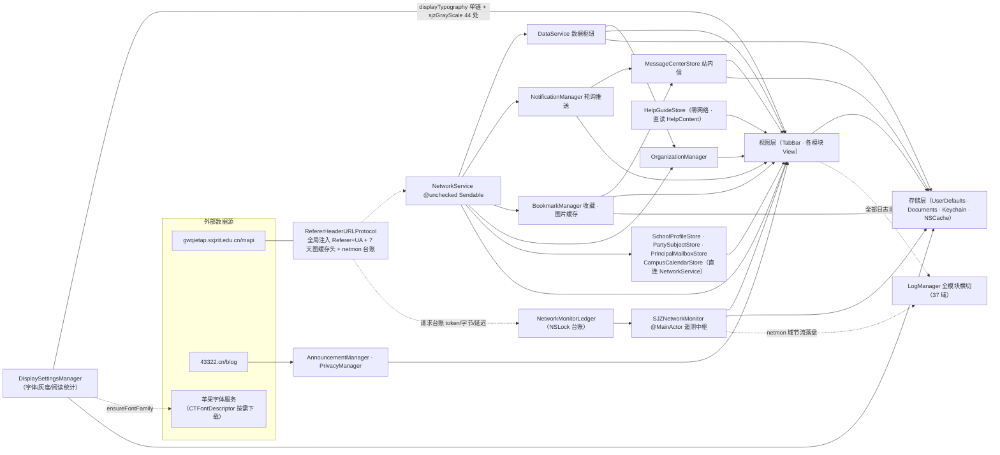
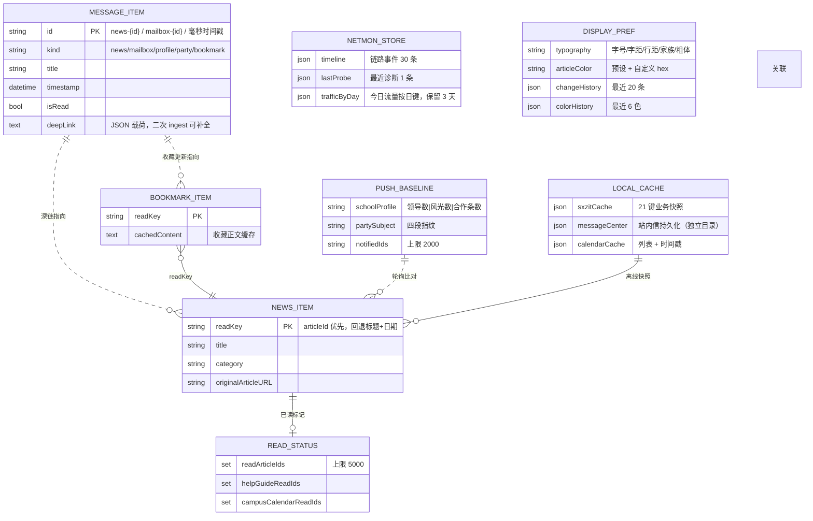
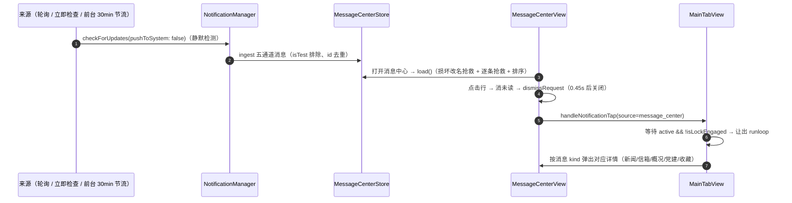
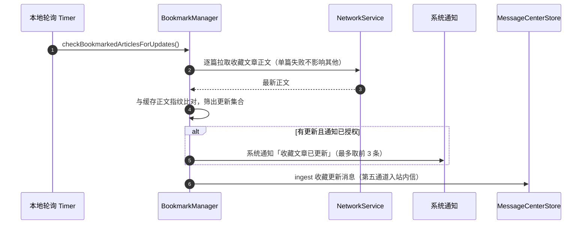
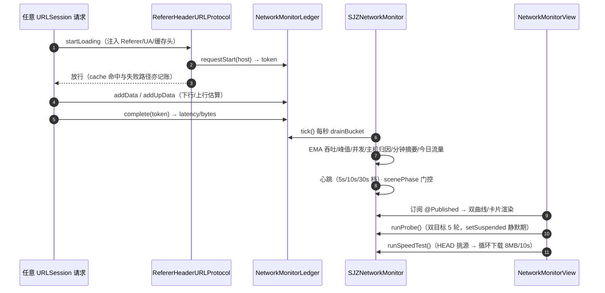

# 04 · 依赖关系

> 基线：**2026-09-27**。本册覆盖模块依赖、数据流、持久化与日志域全景。

## 4.1 依赖总图

> 若阅读器不支持 Mermaid，可对照 §4.2 依赖矩阵表理解同图结构。

**三条主线**：
1. **数据线**：视图 ──直接引用── 单例服务（无 DI）→ NetworkService/URLSession → 学校 API；落盘 UserDefaults + `Documents/SXJZIT_Cache/`。
2. **推送线**：NotificationManager（Timer 轮询）→ 发现变化 → 系统通知 + MessageCenterStore.ingest → 深链回 MainTabView → sheet 详情。
3. **遥测线**：URLProtocol（唯一网络入口）→ NetworkMonitorLedger 记账 → SJZNetworkMonitor 聚合/心跳/诊断 → NetworkMonitorView 展示 + netmon 域日志。

## 4.2 依赖矩阵（主要生产模块）

| 模块 ↓ \ 依赖 → | Network | Data | Notification | MsgCenter | Bookmark | OrgMgr | Log | 其他要点 |
|---|---|---|---|---|---|---|---|---|
| DataService | ✔ | — | | | | ✔ | ✔ | ReadStatus（间接） |
| NetworkService | — | | | | | | | 无内部依赖；被 URLProtocol 透明增强 |
| NotificationManager | ✔ | ✔ | — | ✔ | | | ✔ | Biometric（深链等待 isLockEngaged，经 TabBar） |
| MessageCenterStore | | | | — | | | ✔ | 被 BookmarkManager L366 五通道调用；角标联动 |
| BookmarkManager | ✔ | | | ✔ | — | | ✔ | → ReadStatusManager |
| OrganizationManager | ✔ | | | | | — | ✔ | |
| SchoolProfileStore | ✔ | | | | | | ✔ | /mapi/school/intro + /school/cooperate + 校企合作栏目 |
| PartySubjectStore | ✔ | | | | | | ✔ | /dept/home2 双子站全量 |
| PrincipalMailboxStore | ✔ | | | | | | ✔ | /school/msg、/common/msg/detail |
| HelpGuideStore | | | | | | | ✔ | **零网络**：直读本地 HelpContent |
| CampusCalendarStore | ✔ | | | | | | ✔ | 复用 fetchArticles/fetchArticleDetail（campusCalendarColumnId） |
| TabBar（全部视图） | ✔ | ✔ | ✔ | ✔ | ✔ | ✔ | ✔ | 深链消费方（唯一） |
| SJZNetworkMonitor | ✔ | ✔ | | | | | ✔ | 监听 syncDidComplete；依赖 Ledger + URLProtocol 触点；@AppStorage 5 键 |
| NetworkMonitorLedger | — | | | | | | | 独立于 MainActor（NSLock），URLProtocol 任意线程调用 |
| DisplaySettingsManager | | | | | | | ✔ | CoreText 字体下载（PDE）；与 App @AppStorage(colorSchemePreference) 共享键；灰度经修饰器传播 |
| BiometricSecurityManager | | | | | | | ✔ | Keychain |
| CacheModeManager | | ✔ | | | ✔ | | ✔ | 容量决策向下渗透（含 SJZDecodedImageCache 双限额） |

**耦合小结**：围绕 `DataService`（数据）+ `NetworkService`（网络）+ `LogManager`（日志横切）三个单例展开；NotificationManager / BookmarkManager 各自独立轮询互不干扰；视图层是唯一深链消费点。**架构演进**：校长信箱/党建/概况/消息中心/使用帮助/校园日历六个新业务模块不经过 DataService 门面，由模块内私有 `*Store` 直连 NetworkService（HelpGuideStore 例外：零网络）；网络监测与显示设置是「基建型」单例（不持业务数据，只持遥测/偏好状态）。

## 4.3 跨模块事件（NotificationCenter）

| 事件名 | 定义处 | 用途 |
|---|---|---|
| `DataServiceSyncDidComplete` | [DataService.swift L13](file:///Users/qinchao/Downloads/designcode-swiftui/qin/DesignCode/DataService.swift#L13-L15) | 全量同步完成广播（网络监测等联动） |
| `biometricNeedsSystemSettings` | BiometricSecurityManager.swift L495 | 生物识别不可用引导去系统设置 |
| `organizationArticleWebViewLoaded` / `...Blank` / `...Progress` | OrganizationDetailView.swift | 机构详情 WebView 加载三态事件 |

深度链接通道为 `@Published` 属性而非通知：`NotificationManager.pendingDeepLink` → `MainTabView.onChange`；消息中心用 `MessageCenterStore.dismissRequest`（`@Published`）请求关闭自身后投递深链。显示设置有 2 个系统通知监听（VoiceOver 运行状态 / 更深颜色）经 `registerAccessibilityObservers`（DisplaySettingsManager L877）。

## 4.4 持久化明细

### UserDefaults 键

| 键 | 属主 | 说明 |
|---|---|---|
| `readArticleIds` | ReadStatusManager | 已读文章 id，上限 5000 |
| `notifiedArticleIds` | NotificationManager | 已推送新闻 id，上限 2000 |
| `schoolProfileBaseline` | NotificationManager | 概况基线 `领导数｜风光数｜合作条数`（当前基准 7\|10\|29；兼容 7\|10\|18 与两段旧版迁移） |
| `partySubjectBaseline` | NotificationManager | 党建基线 `djgzTotal\|djgzTop3\|mkszyTotal\|mkszyTop3` |
| `notificationEnabled` / `notificationPollingMinutes` | NotificationManager | 推送总开关 / 轮询间隔（默认 30） |
| `privacyConsentAccepted` / `privacyConsentRejected` | @AppStorage | 隐私状态（启动分流依据） |
| `messageCenterAutoCheck` | MessageCenterStore | 前台自动检查节流时间戳（30 分钟） |
| `messageCenterSearchHistory` / `messageCenterReadIds` | MessageCenterStore | 搜索历史 / 已读 id |
| `helpGuideSearchHistory` / `helpGuideReadIds` / `helpGuideRecentIds` | HelpGuideStore | 帮助搜索历史（10 条）/ 已读 / 最近阅读（≤6） |
| `campusCalendarCache` / `campusCalendarSearchHistory` / `campusCalendarReadArticleIds` | CampusCalendarStore | 列表 JSON+时间戳 / 搜索历史（10 条）/ 已读 |
| `bookmarkedArticles` | BookmarkManager | 收藏列表 JSON |
| `announcementCache` / `organizationCache` / `privacy_documents_cache_{type}` | 各 Manager | 模块内容缓存 |
| 搜索历史键 ×6 | PartySubject / PrincipalMailbox / OrganizationView / SchoolProfile / HelpGuide / CampusCalendar | 上限 10 条、去重置顶 |
| `colorSchemePreference` | DisplaySettingsManager + App | 注意：共享同一键，改键名需双处同步 |
| **`netmonLiveSamplingEnabled` / `netmonChartWindowSeconds` / `netmonTimelineJSON` / `netmonLastProbeJSON` / `netmonTraffic_<yyyy-MM-dd>`** | SJZNetworkMonitor | 心跳开关 / 图表窗口偏好 / 链路时间线（30 条）/ 最近诊断（持久 1）/ **今日流量按日键**（跨启动保留 3 天） |
| **显示设置键族**：`displayAccentStyle`·`displayFontSizeTier`·`displayBoldText`·`displayUseSystemFont`·`displayFontFamily`·`displayLineSpacing`·`displayLetterSpacing`·`displayButtonShapes`·`displayBrightness`·`displayAutoBrightness`·`displayAutoLock`·`displayKeepAwake`·`displayArticleTextColorPreset`·`displayArticleTextCustomHex`·`displayReadingStatsEnabled`·`displayReadingCharCountEnabled`·`displayReadingTimeEnabled`·`displayReadingListBadgeEnabled`·`displayReadingSpeedTier`·`displayGrayScaleMode`·`displayCustomColorHistory`·`displayChangeHistory` | DisplaySettingsManager | 23 个键；后 3 键为 2026-09-26 重构新增；`displayArticleTextCustomHex` 与 `displayArticleTextColorPreset` 为 nonisolated 直读快照 |
| 缓存模式 / 首页模块排序 / App 图标选择 | 各 Manager | 设置类持久化 |

### 文件存储（`Documents/`）

| 路径 | 属主 | 说明 |
|---|---|---|
| `SXJZIT_Cache/*.json`（21 键） | DataService | news、honors、departments、banners、bottom_banners、videos、student_stories、teacher_profiles、campus_sceneries、campus_activities、footer_links、social_platforms、recruit_phones、important_news、update_news、party_news、notices、admission_news、campus_news、research_reports、information_news |
| `SXJZIT_Cache/Logs/log_YYYY-MM-DD.json` | LogManager | 日志日轮转 |
| `MessageCenter/messageCenterEvents.json`（+ `corrupt-<时间戳>` 损坏备份 ×5，**独立于 SXJZIT_Cache**） | MessageCenterStore | 站内信持久化（强原子写 replaceItemAt + 写后自校验） |
| `BookmarkImages/*.img` | BookmarkManager | 收藏图片磁盘缓存（SHA256 键） |
| Keychain | BiometricSecurityManager | 启用令牌：kSecClassGenericPassword · service=`com.qinchao.DesignCode.biometric` · account=`enrollment-token` · `kSecAttrAccessibleWhenPasscodeSetThisDeviceOnly`；双 UUID 令牌**只写不读**（saveToken/deleteToken，无 SecItemCopyMatching） |

### 内存缓存

| 缓存 | 属主 | 参数 |
|---|---|---|
| URLCache.shared | DesignCodeApp.init | 内存 80MB / 磁盘 400MB（全 App 共享） |
| SJZDecodedImageCache | TabBar.swift | 解码图 NSCache：缓存模式 600 张/96MB、即时 200 张/40MB；OSAllocatedUnfairLock |
| SJZAverageColorCache | TabBar.swift | 300 条 FIFO（平均色占位） |
| 文章详情 NSCache | DataService | 按 cost（正文长度） |
| 阅读统计缓存 | DisplaySettingsManager | 500 条 Entry + insertionOrder FIFO + Diagnostics（跨启动持久化） |
| 诊断历史 | SJZNetworkMonitor | 内存 3 条 + 持久 1 条 |

### 4.4.1 核心数据实体与关系（概念模型）

系统无数据库，实体以「内存模型 + UserDefaults 键 + 文件 JSON + Keychain」四种介质存在。下图给出评审所需的概念关系；菱形连线表示弱引用（键值指向，无强制完整性），实线表示同一键空间下的强关联。

关系解读：`MESSAGE_ITEM` 是站内信唯一的实体，其五类来源通过 `deepLink` 弱指向业务实体；`NEWS_ITEM` 以 `readKey` 为全局键，被收藏、已读、推送基线与离线缓存四个面引用；`PUSH_BASELINE` 只存计数与指纹，不存正文，因此基线体积恒定；`NETMON_STORE` 与 `DISPLAY_PREF` 为纯本机状态，不参与任何业务关联。

### 4.4.2 一致性与完整性规则

| 规则 | 内容 | 标注 |
|---|---|---|
| 主键契约 | 文章全局键 `readKey = articleId ?? id`；站内信 id 分三类（`news-{id}`、`mailbox-{id}`、聚合消息用毫秒时间戳防同秒撞车） | `[Data-backed]` |
| 已知碰撞面 | `NewsItem.id` 为「标题 + 日期」计算属性，同题同日会碰撞；读取链路以 `readKey` 兜底，风险低 | `[Data-backed]` |
| 写入原子性 | 站内信采用临时文件 + 原子替换 + 写后读回自校验；其余 JSON 为直接写入 | `[Data-backed]` |
| 容量上限 | 已读 5000 / 已通知 2000 / 站内信 FIFO / 变更史 20 / 颜色史 6 / 搜索历史 10 / 链路时间线 30 | `[Data-backed]` |
| 时间窗规则 | 历史通知 24 小时未读窗口；今日流量键保留 3 天；日志按日轮转 | `[Data-backed]` |
| 键共享约束 | `colorSchemePreference` 由 App 与 DisplaySettingsManager 双主共享，改键名必须两处同步 | `[Data-backed]` |
| 事务边界 | 单设备单写者，无跨文件事务；崩溃最多丢失单文件最近一次写入（站内信由自校验兜底） | `[Expert judgment]` |

## 4.5 隐式依赖与时序约束（改动必读）

1. **CacheModeManager 必须先于 DataService.refreshCacheLimits()** 可用——容量参数向下渗透（含图片缓存双限额）。
2. **隐私同意是通知轮询前提**：`privacyConsentAccepted && isAuthorized && isEnabled` 三者同时满足才 startPolling；拒绝隐私必须 stopPolling。
3. `HomeModule.dataCount` 必须在主线程回调（列表卡顿根源）。
4. `colorSchemePreference` 双主：DisplaySettingsManager 与 App 级 @AppStorage 共享存储键。
5. 消息中心 ingest 时序：**先 ingest 入盒，后展示前台横幅**，保证消息中心实时出现新行。
6. 深链投递闭环：消息中心深链先 `dismissRequest`（0.45s 关闭页面）→ 再走 `handleNotificationTap` 既有防闪退链路。
7. 通知 delegate 只允许 completionHandler 版本（async 版本在 iOS 26 SDK 会错落到回调版）；同步回调链上禁止弹 sheet。
8. 手动刷新语义红线：必须清详情缓存（sceneryAlbums/cooperateDetails）并推进 cacheGeneration，预热任务写回前后双重校验世代。
9. **校园日历防双写**：refresh 必须显式接管取消搜索防抖任务；校历详情 ID 无效直接失败，不用标题兜底。
10. **网络监测台账口径**：URLProtocol 任意线程写入 Ledger（NSLock）；探测/测速期间必须 `setSuspended(true)`（静默期账目不污染曲线）；心跳必须受 scenePhase 门控（退后台暂停防「离线」误判）。
11. **灰度传播双通道**：根视图 `.displayTypography` 链上的 `.saturation` 不作用于 sheet/fullScreenCover（SwiftUI presentation 不继承父级修饰器）——所有内容级 presentation 必须单独挂载 `sjzGrayScale()`（当前 44 处；系统分享面板除外）。新增 sheet/fullScreenCover 时必须同步挂载。
12. **字体下载与生效链**：`ensureFontFamily` → CTFont 下载 → didMatch 后 `typographyRevision += 1` → 全部 `display*` 文本重建（字体就绪即时全局生效）；覆盖安装会清系统下载状态（启动预热量增）。下载无超时兜底为已遗留风险（见 05 §5.7）。
13. **显示设置 didSet 结构约束**：全部 @Published 走 `persist + log`；新增设置项必须同时接入变更史（`recordChange`）与日志，`isDefault/resetAll` 语义保持同步。

## 4.6 端到端时序（Mermaid）

### 消息中心深链闭环（站内信 → 详情）

### 收藏第五通道（BookmarkManager 独立轮询）

### 网络监测采样与诊断（netmon）

## 4.7 日志域总表（2026-09-27 聚合实测）

> `LogManager.shared.{info|warning|error|debugLog|log}("域", ...)` 全量去重统计（含下划线域）：**37 个日志域、1,078 处带域埋点**；`LogManager.shared` 调用点合计 **1,107 处**（含域名为变量/多行的调用），其中 `wechat` 域 52 处（2026-09-27 微信集成新增 + 2026-09-28 补齐党建分享入口）。表内标「本轮增长」者为 2026-09-26 夜三波改造（netmon 扩建 / 显示设置重构 / 字体灰度）中显著增长的域。

| 日志域 | 埋点计数 | 属主模块 | 说明 |
|---|---|---|---|
| `organization` | 219 | OrganizationDetailView(150) + Manager(34) + View(32) + TabBar(3) | 机构全链路（全库最大域） |
| `ui` | 70 | TabBar(69) + DesignCodeApp(1) | 界面通用事件 |
| `party` | 69 | PartySubjectView(67) + TabBar(2) | 党建专题 |
| `profile` | 68 | SchoolProfileView(66) + TabBar(2) | 学校概况 |
| `campusCalendar` | 61 | Store(33) + View(27) + TabBar(1) | 校园日历 |
| `messageCenter` | 59 | Store(34) + View(22) + TabBar(2) + NotificationManager(1) | 站内信消息中心 |
| `netmon`（本轮增长） | 47 | SJZNetworkMonitor(39) + NetworkMonitorView(7) + TabBar(1) | 网络遥测（2026-09-26 扩建后由 14 → 47） |
| `mailbox` | 43 | PrincipalMailboxView(41) + TabBar(2) | 校长信箱 |
| `display`（本轮增长） | 40 | DisplaySettingsManager(24) + DisplaySettingsView(16) | 显示设置（重构后由 22 → 40，含字体下载/灰度/对比度/曝光） |
| `biometric` | 30 | BiometricSecurityManager(28) + Settings(2) | 生物识别锁 |
| `notification` | 29 | NotificationManager | 通知轮询/推送 |
| `helpGuide` | 28 | View(18) + Store(6) + TabBar(4) | 使用帮助 |
| `collaboration` | 28 | SchoolProfileView | 合作交流三分组 |
| `notificationTest` | 27 | NotificationManager(16) + NotificationTestView(11) | 通知测试中心 |
| `privacy` | 26 | PrivacyPolicyView(18) + DesignCodeApp(8) | 隐私合规 |
| `cache` | 21 | CacheModeManager(12) + Settings(3) + DataService(3) + TabBar(3) | 缓存模式 |
| `home_modules` | 20 | HomeModuleManager(14) + Settings(6) | 首页模块设置 |
| `imageCache` | 19 | TabBar | 图片缓存命中/写入（节流） |
| `data` | 17 | DataService | 数据同步/缓存 |
| `reading` | 12 | DisplaySettingsManager | 阅读统计（字数/时长/徽章） |
| `announcement` | 12 | AnnouncementManager | 公告 |
| `network` | 10 | NetworkService | 网络请求层 |
| `facility` | 10 | CampusView/FacilityDetailView | 校园设施 |
| `schoolInfo` | 8 | CampusView SchoolInfoCard | 学校概况卡（档案/复制/拨打） |
| `appicon` | 8 | AppIconManager | 图标切换 |
| `favorite` | 6 | BookmarkManager | 收藏 |
| `articleSync` | 4 | DataService | 文章同步 |
| `campusService` | 4 | CampusView servicesSection | 校园服务 7 项 |
| `socialFollow` | 4 | CampusView SocialQRCard | 关注我们（二维码保存三态） |
| `about` | 4 | AboutView | 关于页 |
| `departments` | 3 | DepartmentsView | 院系导航 |
| `campusLinks` | 2 | CampusView FooterLinkRow | 友情链接 |
| `bookmark` | 1 | BookmarkManager | 收藏低频 |
| `startup` | 1 | DataService | 启动 |
| `urlProtocol` | 1 | RefererHeaderURLProtocol | 防盗链协议层 |
| `settings` | 1 | TabBar | 设置页低频 |
| `wechat` | 52 | WeChatService(49) + WeChatIntegrationViews(2) + PartySubjectView(1) | 微信开放平台集成（2026-09-27 新增，2026-09-28 补齐党建分享入口）：注册/可用性/分享发起与回执归因/登录 state 校验/自检逐步/回跳/SDK 日志桥/菜单点击 |

**注**：`home`、`log` 等域在旧文档出现过，2026-09-27 实测以本表为准；部分域历史更名（`partySubject`→`party`、`schoolProfile`→`profile`、`icon`→`appicon`）。各域写入均走 LogManager 的节流策略（状态沿/30s/50 条/2s/10s 窗口），防刷屏。

## 4.8 外部二进制依赖（唯一第三方）

| 依赖 | 位置 | 形态与链接 | 说明 |
|---|---|---|---|
| 微信开放平台 SDK（WechatOpenSDK 2.0.8，含支付版） | `Frameworks/WechatOpenSDK.xcframework`（`ios-arm64` + `ios-arm64_x86_64-simulator`，含 `PrivacyInfo.xcprivacy`） | **静态库**（`ar` 归档）→ `OTHER_LDFLAGS = -ObjC -all_load` + `-framework Security/CoreGraphics/WebKit/CFNetwork/SystemConfiguration/CoreTelephony` + `-lz/-lsqlite3/-lc++`；Swift module 名 `WechatOpenSDK` | 仅被 `WeChatService` / `WeChatIntegrationViews` 引用；未启用 `CODE_SIGN_ENTITLEMENTS`（关联域名需真实域名后再开，见 [微信接入指南](../../docs/wechat-integration/README.md)） |

> 依赖原则：除上表外**无任何第三方库**（无 SPM / CocoaPods / Carthage）；系统框架清单见 [ARCHITECTURE §3](../../ARCHITECTURE.md)。