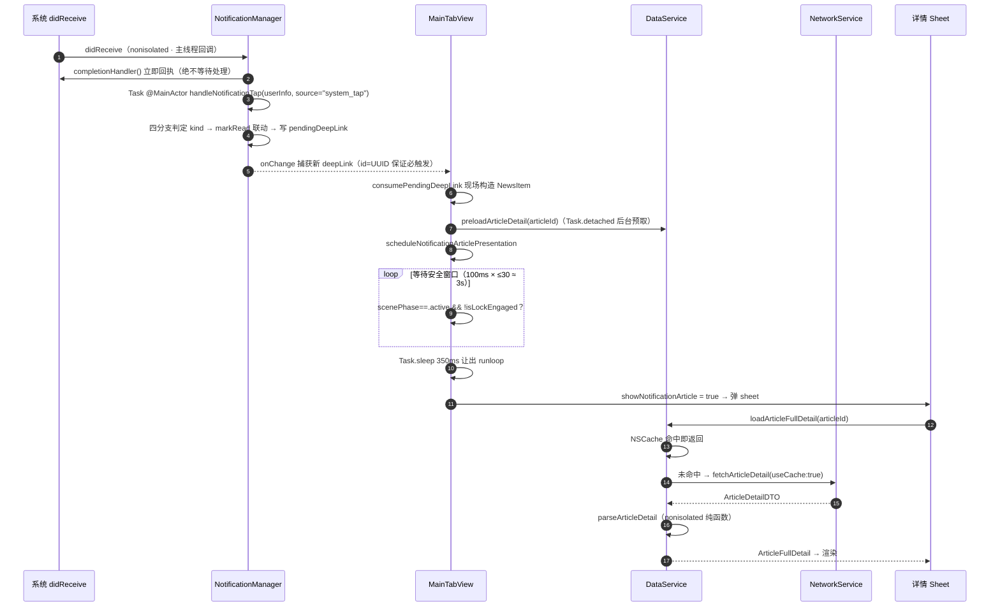
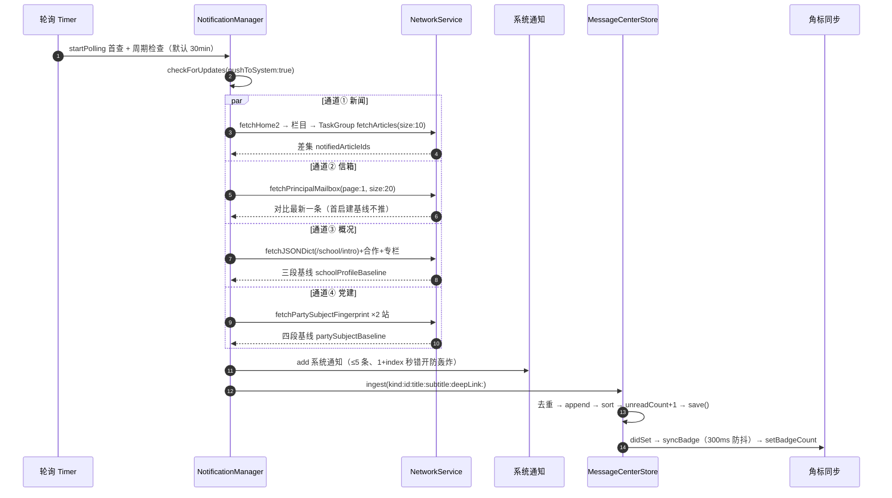
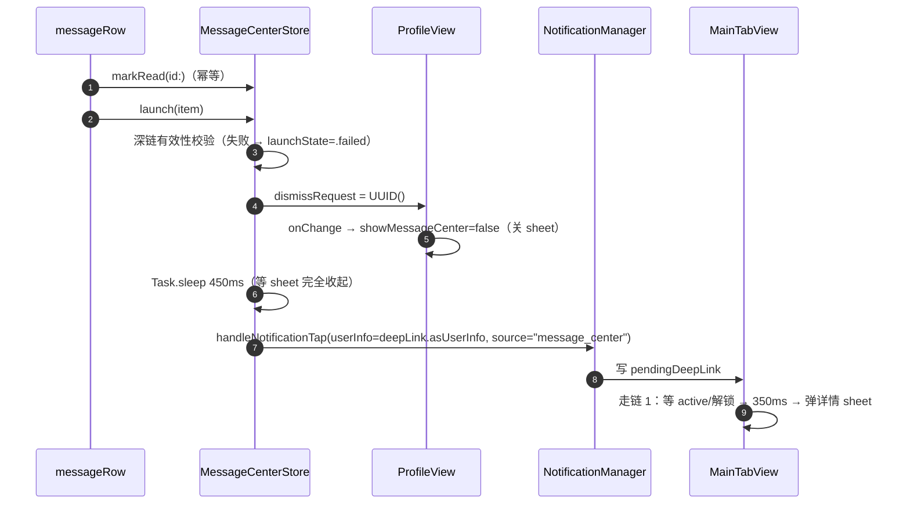
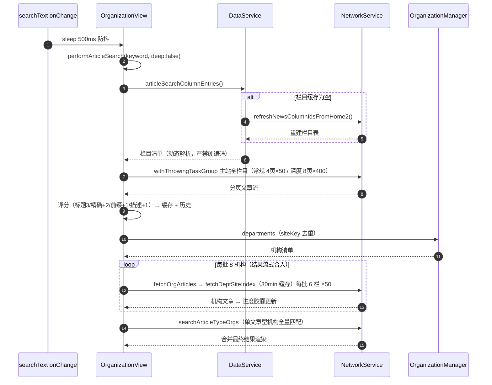
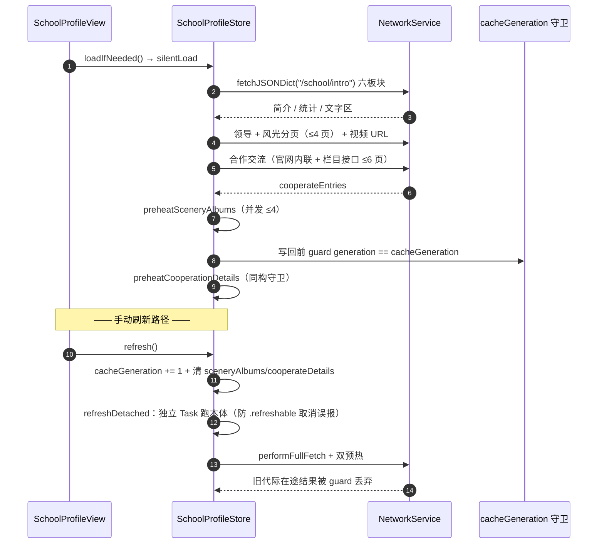
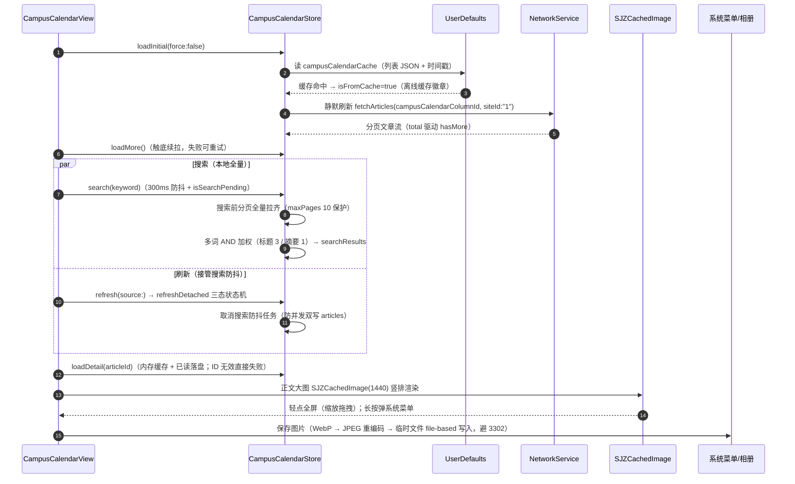

# 06 · 核心模块接口契约与调用链

> 签名级接口契约 + 函数级调用链 Mermaid 时序图。行号为 **2026-09-28** 快照（HEAD `e3d282e`，与 03 一致；显示设置 / 网络监测 / 机构 / 日志等因 09-27/28 改动发生行号偏移，已全部重校准）。

## 1. 接口契约（精确签名）

### 1.1 NetworkService（`@unchecked Sendable` 单例，NetworkService.swift）

以下接口均为客户端对学校公开 API 的封装：鉴权为无（全 GET、公开只读）；响应结构为对应 DTO（内嵌于 NetworkService.swift，全字段 Optional + CodingKeys 显式映射，详见 03 §3.3）；统一错误码与重试边界见 §1.10。

| 签名 | 行号 |
|---|---|
| `get<T: Decodable>(_ path: String, params: [String: String]? = nil, as type: T.Type) async throws -> T` | L79 |
| `fetchHome2() async throws -> Home2DTO` | L177 |
| `fetchHead() async throws -> HeadDTO` | L182 |
| `fetchFoot() async throws -> FootDTO` | L187 |
| `fetchArticles(columnId: String, siteId: String = "1", page: Int = 1, size: Int = 20) async throws -> ColumnDTO` | L192 |
| `fetchArticleDetail(articleId: String, siteId: String = "1", useCache: Bool = false) async throws -> ArticleDetailDTO` | L199 |
| `fetchArticleDetailWithHref(_ href: String) async throws -> NewsDetailDTO` | L207 |
| `resolveShortLinkFinalURL(_ shortURL: URL) async -> URL?` | L258 |
| `fetchJSONDict(path: String[, params: [String: String]?]) async throws -> [String: Any]` ×2 | L283/L288 |
| `fetchZSWHome2() async throws -> ZSWHome2DTO` | L754 |
| `fetchZSWArticlePage(siteId: String, columnId: String, pageNo: Int = 1, pageSize: Int = 20) async throws -> ZSWArticlePageDTO` | L759 |
| `fetchZSWArticleDetail(articleId: String, siteId: String = "cb3b1fe4fcdf40999b0c162015c3326d") async throws -> ArticleDetailDTO` | L878 |
| `fetchSpecialtyData(siteId: String, columnId: String) async throws -> SpecialtyData` | L887 |
| `fetchDeptHome2(siteKey: String) async throws -> DeptHome2DTO` | L961 |
| `fetchSchoolOrgTree() async throws -> [SchoolOrgNode]` | L982 |
| `fetchDeptSiteIndex(siteKey: String) async throws -> (siteId: String, columns: [DeptColumnRef])` | L1019 |
| `fetchPartySubjectFingerprint(siteKey: String) async throws -> PartySubjectFingerprint` | L1085 |
| `fetchSceneryAlbumDetail(articleId: String, siteId: String = "1") async throws -> SceneryAlbumDetail` | L1161 |
| `fetchPrincipalMailbox(page: Int, size: Int) async throws -> MailboxPageData` | L1247 |
| `fetchMessageDetail(msgId: Int) async throws -> MailboxMessageDetail` | L1334 |
| `static let campusCalendarColumnId: String` | L441 | 校园日历栏目 `8197fe41503c4c32bce1e449d2492b2e`（**零新接口**，校园日历复用 fetchArticles/fetchArticleDetail，siteId "1"） |

### 1.2 DataService（`@MainActor` 单例，DataService.swift）

| 签名 | 行号 | 线程注意 |
|---|---|---|
| `refreshCacheLimits()` | L127 | CacheModeManager.mode didSet 调用 |
| `isArticleDetailCached(id: String) -> Bool` | L135 | 同步 |
| `isZSWArticleCached(id: String) -> Bool` | L139 | 同步 |
| `syncIfNeeded(force: Bool = false)` | L180 | 非 async（内部开 Task） |
| `loadZSWHomeData() async` | L485 | SWR：缓存模式 30min 内跳过 |
| `loadSpecialtyData() async` | L607 | 重试 2 次×1s |
| `articleSearchColumnEntries() -> [(String, String)]` | L650 | 机构搜索栏目源（动态解析） |
| `refreshNewsColumnIdsFromHome2() async -> Bool` | L662 | 兜底重建栏目表 |
| `loadArticleDetail(articleId: String) async throws -> String` | L735 | 简易版 |
| `loadArticleFullDetail(articleId: String) async throws -> ArticleFullDetail` | L742 | 缓存→API→parse→写缓存 |
| `preloadArticleDetail(articleId: String)` | L789 | **Task.detached 后台预取** |
| `clearArticleDetailCache()` | L833 | |
| `loadZSWArticleFullDetail(articleId: String, siteId: String = "cb3b1fe4fcdf40999b0c162015c3326d") async throws -> ArticleFullDetail` | L839 | |
| `clearCache()` | L1083 | 数据管理入口 |
| `allNews` / `allNewsCategories` | L1158/L1147 | 计算属性（8 类合并） |
| `parseArticleDetail(...) -> ArticleFullDetail` | L884 | **nonisolated 纯函数** |

### 1.3 NotificationManager（`@MainActor` 单例，NotificationManager.swift）

| 签名 | 行号 |
|---|---|
| `requestPermission() async -> Bool` | L173 |
| `refreshAuthorizationStatus() async` | L190 |
| `startPolling()` / `stopPolling()` | L233/L247 |
| `checkForUpdates(pushToSystem: Bool = true) async` | L262 |
| `sendMailboxSimulationNotification(message: NetworkService.MailboxMessage) async` | L715 |
| `markExistingArticlesAsNotified()` | L752 |
| `userNotificationCenter(_:willPresent:withCompletionHandler:)` **nonisolated** | L770 |
| `userNotificationCenter(_:didReceive:withCompletionHandler:)` **nonisolated** | L787 |
| `handleNotificationTap(userInfo: [AnyHashable: Any], actionIdentifier: String = UNNotificationDefaultActionIdentifier, source: String)` | L809 |
| `sendTestNotification(delaySeconds: TimeInterval, useRealArticle: Bool, source: String) async -> NotificationTestResult` | L947 |
| `simulateNotificationTap() async -> NotificationTestResult` | L1013 |
| `setBadgeCount(_ count: Int) async -> NotificationTestResult` | L1044 |

私有通道：`checkNewsUpdates` L281 · `checkMailboxUpdates` L398 · `checkSchoolProfileUpdates` L491 · `checkPartySubjectUpdates` L641 · `ensureRealTestArticle` L909。

### 1.4 MessageCenterStore（`@MainActor` 单例，MessageCenterStore.swift）

| 签名 | 行号 |
|---|---|
| `ingest(kind: MessageKind, id: String, title: String, subtitle: String, deepLink: DeepLinkPayload?, isTest: Bool = false)` | L327 |
| `applyMaxCountLimit()` | L394 |
| `markRead(id: String)` / `markRead(kind: MessageKind, articleId: String?)` / `markRead(kind: MessageKind)` | L409/L420/L439 |
| `markUnread(id: String)` / `markAllRead()` / `delete(id: String)` | L450/L460/L474 |
| `clearHistory(scope: ClearScope)` | L487 |
| `filter(keyword: String? = nil, kind: MessageKind? = nil, unreadOnly: Bool = false) -> [MessageItem]` | L513 |
| `unreadCount(of kind: MessageKind) -> Int` | L526 |
| `silentCheckNow() async` | L555 |
| `handleSceneActive()` | L561 |
| `setAutoCheck(_ enabled: Bool)` / `setBadgeEnabled(_ enabled: Bool)` | L583/L593 |
| `static deliveryUserInfo(for item: MessageItem) -> [AnyHashable: Any]` | L639 | 投递归因纯函数（收藏更新 kind 补全，2026-09-29；launch 使用、测试共用） |
| `launch(item: MessageItem)` | L648 |
| `repairRewrite() -> Bool` | L702 |

### 1.6 CampusCalendarStore（`@MainActor` 单例，[CampusCalendarStore.swift](file:///Users/qinchao/Downloads/designcode-swiftui/qin/DesignCode/CampusCalendarStore.swift)，2026-09-24 新增）

| 签名 | 行号 |
|---|---|
| `loadInitial(force: Bool = false)` | L116 |
| `refreshDetached(source: String) async` / `refresh(source: String) async` | L171 / L176 |
| `dismissRefreshBanner()` | L230 |
| `loadMore() async` | L238 |
| `search(_ keyword: String)` | L279 |
| `commitSearchHistory(_:)` / `clearSearchHistory()` | L388 / L399 |
| `loadDetail(articleId: String) async -> NetworkService.ArticleDetailDTO?` | L408 |
| `isRead(articleId: String?) -> Bool` / `markRead(articleId: String)` | L438 / L443 |
| `static dateText(_ raw: String?) -> String` | L453 |

### 1.7 HelpGuideStore（`@MainActor` 单例，[HelpGuideStore.swift](file:///Users/qinchao/Downloads/designcode-swiftui/qin/DesignCode/HelpGuideStore.swift)，2026-09-24 新增，**零网络**）

| 签名 | 行号 |
|---|---|
| `markRead(_ id: String)` / `markAllRead()` | L108 / L116 |
| `search(_ rawKeyword: String) -> [HelpSearchHit]` | L142 |

### 1.8 关键值类型

- **DeepLinkPayload**（MessageCenterStore.swift L31-66）：`articleId/articleCategory/articleTitle/mailboxId/mailboxTitle/schoolProfile/partySubject/isBookmarkUpdate` 全可选；`asUserInfo` 只编已设值的键（4 类目的地键 + 2026-09-29 新增 `isBookmarkUpdate`）；`isEmpty` 四类皆空判定。
- **MessageItem**（L70-80）：`id/kind/title/subtitle/timestamp/isRead/deepLink/isTest/schemaVersion`；容错 `init(from:)` 仅 id 严格（L87-98）。
- **PendingArticleDeepLink**（NotificationManager.swift L35-49）：`id: UUID`（每次 init 新 UUID 保证 onChange 必触发）。
- **DeepLinkOutcome**（L52-74）：`.presented(articleId)` / `.failed(articleId, reason)`。
- **NewsItem**（Models.swift L377-423）：10 字段；`init` 中 `content.isEmpty ? summary : content`（L392）；`readKey = articleId ?? id`（L398）；`originalArticleURL` 四级判优（L405-422）。

### 1.9 近期新增契约（2026-09-25 校园升级 / 09-26 夜三波改造）

| 签名 | 位置 | 说明 |
|---|---|---|
| `ProfileImageSaveShare.saveToPhotos(urlString: String, logTag: String) async -> String?` | SchoolProfileView.swift L2688 | 下载→权限→JPEG 重编码→临时文件→`PHAssetCreationRequest.addResource(.photo, fileURL:)`；返回错误文案或 nil（成功）。校园 Tab SocialQRCard 以 `logTag: "socialFollow"` 复用 |
| `PartyContentParser.parse(html: String) -> PartyParseOutcome` | PartySubjectView.swift L1657 | 党建详情纯正则 HTML 解析（禁 NSAttributedString） |
| `PartyArticleDetailCache.shared`（`@unchecked Sendable`） | PartySubjectView.swift L1762 | 党建详情内存缓存（`cached(key:)` / 写回） |
| `FacilitySection` / `FacilityInfoPair`（Codable, Hashable） | Models.swift L700 / L693 | 设施分区结构与「标签—数值」行；`Facility.sections` 可选字段容错 nil 回退经典样式 |
| `SchoolInfo` 校庆日档案 | Models.swift L10 | 校园 Tab 概况卡与学校概况页共用的校庆日数据 |
| `MainTabView` 深链 sheet 挂载区 | TabBar.swift L304-L350 | 新闻（L304）/概况（L324）/党建（L342）+ 信箱等四+一类 sheet |
| `NetworkMonitorLedger.requestStart/addData/addUpData/complete/abandon/setSuspended/drainBucket` | SJZNetworkMonitor.swift L35 | 线程安全遥测台账（NSLock；URLProtocol 任意线程调用；静默期不记账） |
| `SJZNetworkMonitor.runProbe() / runSpeedTest() / setChartWindow(_:)` | SJZNetworkMonitor.swift L1306 / L1523 / L518 | 双目标诊断 / 一键测速 / 图表窗口（诊断·测速与业务采集 `setSuspended` 互斥） |
| `DisplaySettingsManager.ensureFontFamily(_:reason:)` | DisplaySettingsManager.swift L1195 | 字体按需下载状态机（主字面+粗体字面合并请求；CTFontDescriptorMatchFontDescriptorsWithProgressHandler；didMatch→`typographyRevision+=1` 全局生效；停滞看门狗 60s 无进展复位可重试） |
| `DisplaySettingsManager.applyScheme(_:) / shareSummaryText()` | DisplaySettingsManager.swift L1475 / L1542 | 排版方案一键套用（6 项 + 日志 + 字体下载）/ 分享摘要文本 |
| `DisplayContrastChecker.contrast(foregroundHex:backgroundHex:)`（纯函数） | DisplaySettingsManager.swift L349 | WCAG 对比度（≥4.5 绿 / 2.5-4.49 橙 / <2.5 红），8 预设双纸面达标有测试断言 |
| `View.sjzPresentationChrome()`（`SJZPresentationChromeModifier`） | DisplaySettingsManager.swift L1851/L1838 | 跨 presentation「外观模式+专注灰度」双注入（sheet/fullScreenCover 62 处挂载；构建期护栏 `Scripts/display_coverage_guard.py` 强制；系统分享面板除外） |

### 1.10 错误码与兼容策略

网络层统一定义 `NetworkError`（NetworkService.swift L19），共 7 个 case：

| 错误码 | 含义 | 处理位置与策略 |
|---|---|---|
| `badURL` | URL 构造失败 | 抛出至调用方，进入页面错误态，不重试 |
| `badResponse` | 非 HTTP 响应 | 进入统一校验路径 `validate`（L406）判定 |
| `decodeFailed` | JSON 解码失败 | 抛出；数据契约问题不因重试恢复，交由上层降级路径 |
| `timeout` | 请求/资源超时 | 计入重试判定（最多 2 次、指数退避 500ms×N） |
| `noData` | 响应体为空 | 抛出；部分接口以空语义处理（如子栏目「无更多」） |
| `dataMissing` | 期望字段缺失 | 抛出（2026-09-25 新增 case） |
| `serverError` | 服务端错误状态 | 计入重试判定；界面提示「服务繁忙」 |

重试边界：重试只针对可恢复的网络类失败（`timeout` / `serverError` 等，判定在 `get` 管线 L79-L127），`URLError.cancelled` 立即传播不进入重试，避免下拉刷新被取消后误报 `[Expert judgment]`。

版本与兼容策略（服务端无版本协商，全部 GET、无鉴权）：

1. 容错解码是第一防线：DTO 全字段 Optional + CodingKeys 显式映射 + `AnyCodable` 兜不规则 JSON；未知消息类型降级为新闻、缺失字段取默认值 `[Data-backed]`。
2. 站点与栏目标识尽量动态解析（`articleSearchColumnEntries`），不硬编码；现存唯一硬编码例外是机构详情失败降级路径的 4 个主站栏目 ID（OrganizationDetailView L737-742，服务端变更时需人工核对）`[Data-backed]`。
3. 深链载荷带 `schemaVersion` 字段，老数据可向前兼容装载 `[Data-backed]`。
4. 数据迁移面有三处：字体旧值（`normalized(rawValue:)`）、首页模块退役值（`retiredRawValues`）、推送基线旧格式（概况三段兼容两段、党建四段指纹）`[Data-backed]`。
5. 破坏性变更应对原则：客户端为服务端唯一消费者，字段变更以「容错 + 降级 + 日志取证」闭环处理，不做接口版本锁定 `[Expert judgment]`。

同一接口在本文档、03 关键类表与 04 依赖矩阵中的名称与参数保持一致，行号以 03 为准 `[Data-backed]`。

## 2. 函数级调用链时序图（Mermaid）

### 链 1：点击系统通知 → 文章详情（跨 3 文件、2 次线程切换）

### 链 2：四通道轮询（推送 + 站内信双落 + 角标联动）

### 链 3：消息中心行点击 → 深链重投（0.45s 时序闭环）

### 链 4：机构全站搜索（防抖 → 主站并行 → 机构分批流式）

### 链 5：学校概况加载与手动刷新（cacheGeneration 代际守卫）

### 链 6：校园日历（缓存优先 → 分页 → 详情保存，2026-09-24 新增）

## 3. 跨链公共约定（隐式契约，改动红线）

1. **深链统一入口**：系统点击（source=system_tap）、消息中心（source=message_center）、测试模拟（source=test_simulate）三源共用 `handleNotificationTap` 一份分发逻辑。
2. **ingest 的 id 契约**：新闻/信箱 `news-{id}` / `mailbox-{id}` 可被 `markRead(id:)` 精确命中；概况/党建为毫秒时间戳（防同秒撞车），只能靠 `markRead(kind:)` 兜底。
3. **异步写缓存必须回主线程**：`preloadArticleDetail` 的 `Task.detached → MainActor.run → NSCache.setObject`。
4. **delegate 两铁律**：completionHandler 立即回执 + nonisolated 签名 + 内部 `Task @MainActor` 双保险（点击通知闪退根因修复）。
5. **遥测双铁律**（netmon）：台账只经 `NetworkMonitorLedger`（NSLock，禁直读写主线程状态）；诊断/测速期间 `setSuspended(true)`，结束恢复——保证曲线口径不被自测流量污染。
6. **外观+灰度传播契约**：内容级 sheet/fullScreenCover 一律显式 `.sjzPresentationChrome()`（外观模式 + 专注灰度；构建期护栏强制）；根视图 `.displayTypography` 链上的 saturation 仅覆盖主层级视图。
7. **WebView 排版注入契约**（2026-09-29）：`articleCSSTypographyRuleBlock` = `body, body * { …!important }`（家族名优先的字体栈 + 字号/行高/字距/字重）；两个模板（机构文章 / 原文浏览）初始即写入 `style#sjz-typography`；`OrganizationArticleWebView.injectTypography(_:into:logTag:probeFamily:phase:)` 同步对全部元素写 inline `!important` 并回传探针串（`ok|标签|实际font-family|字号|字重|check=`）；`updateUIView` 以 revision 变化触发（phase=update），`didFinish` 兜底（phase=load）。字体栈首候选必须为 CSS 家族名。